# 侧栏导航需求文档（个人规范版）

> 版本：V2.9；日期：2026-10-19；状态：设置分类侧栏及权限同源已实现并完成本次范围验证；原完整权限脚本与历史验收缺口保留。
> 共同基线／变更编号：SETTINGS-CATEGORY-20261019-01；继承 FINANCE-NAV-20261019-01；产品 V2.10 / 研发 V2.9 / 个人 V2.9。

[产品 V2.10](侧栏导航布局-门店版与连锁版.md) · [研发 V2.9](侧栏导航业务规格说明书（研发交付版）.md) · [个人规范 V2.9](侧栏导航需求文档（个人规范版）.md)

## 设置分类侧栏统一（SETTINGS-CATEGORY-20261019-01）

用户于 2026-10-19 明确要求：设置中的功能分类使用页内侧栏，其他菜单同类设置页保持相同方式，编辑权限按相同分类展示并控制。本次基线 main@8201b9d7；业务字段、默认值、计算与保存下发契约不变。

### 休息与加班 → 设置

图注：2026-10-19，功能 worktree 原生预览，工作周设置选中；本地演示账号与门店，非生产鉴权证据。

| 字段／操作 | 逻辑说明 |
|---|---|
| 设置入口 | 保留三个二级菜单中的设置，不把分类升级为团队全局菜单或新的授权层级。 |
| 休息设置分类 | 第一个侧栏分类，定位休息设置区域；其成员为带薪休息时长、超时转无薪、禁止提前结束三项。 |
| 工作周设置分类 | 第二个侧栏分类，定位工作周开始于；与休息设置分开展示分类归属。 |
| 分类选中与点击 | 文字与留白均可点击；当前分类高亮，地址记录到原设置地址下的分类后缀。Ctrl/Command 等组合键保留链接默认行为。 |
| 内容与草稿 | 分类切换定位对应内容，控件保持挂载；修改带薪时长和周日后切换分类不丢值，不自动保存或下发。原页面内的业务字段与约束不重复决策。 |
| 旧地址 | 旧 break-rules/work-week 书签兼容到设置内对应分类。根设置入口默认第一分类，深链接可定位第二分类。 |

### 员工打卡 → 规则设置

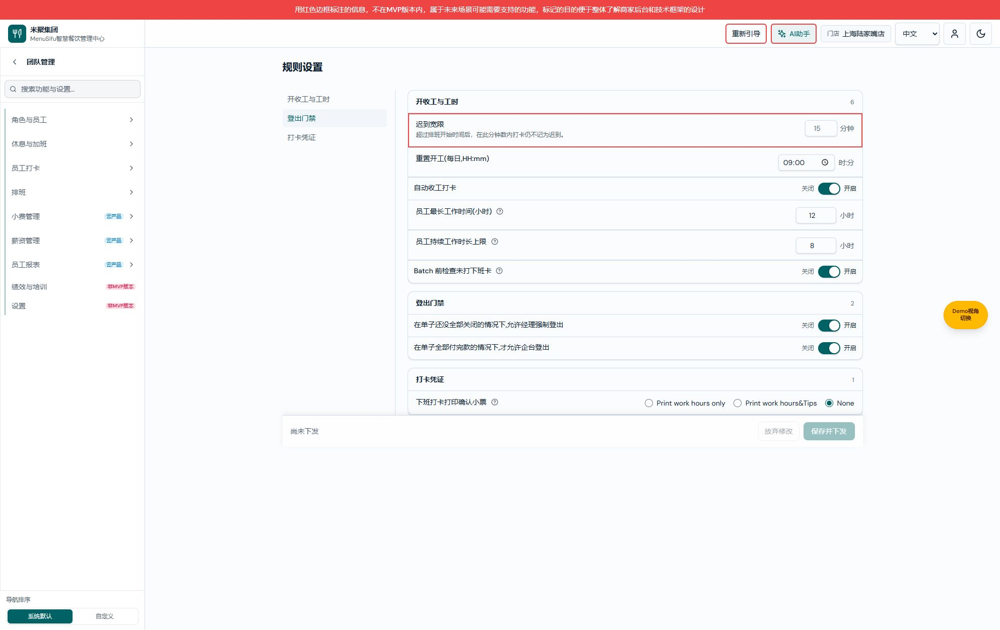

图注：同一功能版本，登出门禁分类选中；沿用原演示规则，不新增业务规则。

| 字段／操作 | 逻辑说明 |
|---|---|
| 开收工与工时 | 第一个分类；沿用现有迟到宽限及 seq72/73/71/67/241。未来版本标记和原可见条件不变。 |
| 登出门禁 | 第二个分类；沿用 seq68/69 两项。 |
| 打卡凭证 | 第三个分类；沿用 seq70。 |
| 侧栏及正文 | 复用休息与加班设置的同一分类布局与绑定；深链接保留 rules 主视角，不误切到打卡管理。 |
| 保存与权限 | 原 /team/clock-in 保存桶及各字段授权键不变；分类切换不产生业务变更。 |

### 其他已分类设置页

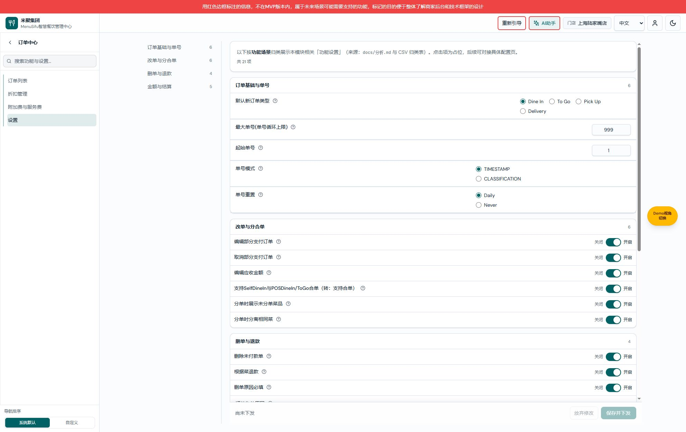

图注：同一功能版本，订单设置保留四组共21项；图片不确认其中示例业务值。

用途／入口：各模块现有设置入口。26 个 catalog 的分类定义、名称、顺序与成员统一由 settings-category-model 派生，运行时仍执行产品版本、权限、预设与订阅过滤；过滤后无成员的分类不应复活。

| 字段／操作 | 逻辑说明 |
|---|---|
| 订单基础与单号 | 沿用六项，不将已移至折扣管理及附加费与服务费的对象管理功能塞回设置。 |
| 改单与分合单 | 沿用六项。 |
| 删单与退款 | 沿用四项。 |
| 金额与结算 | 沿用五项；权限编辑器不再使用旧分组拆开这五项。 |
| 打印、前厅、财务等分类 | 统一消费对应现有归类规范，保留大分组标题和页面过滤；不为本次统一展示新造业务分类。 |
| 无分类／单功能页面 | 未定义功能分类的单一业务页不强制制造分类侧栏；自定义休息、加班规则等管理页保持直接列表。 |

### 门店信息 → 设置

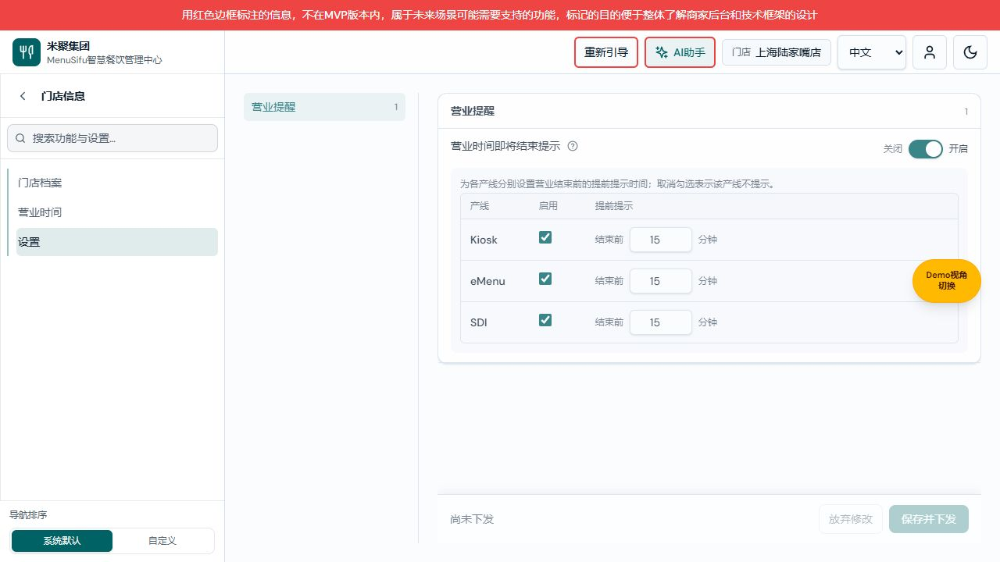

图注：同一功能版本的营业提醒分类。门店档案与营业时间为独立业务页，仍保留原布局。

| 字段／操作 | 逻辑说明 |
|---|---|
| 营业提醒分类 | 设置页侧栏与权限编辑器均展示同名分类，包含原 seq582，沿用渠道与提前提示的原值。 |
| 分类书签 | /stores/settings/store-operation-alerts 能正确读取本页设置项，不出现空页或混入门店档案字段。 |

### 权限与验证

权限编辑与预览的详细行为同步见 [权限产品 V3.9](../superpowers/specs/2026-09-23-permission-management-center-authoritative.md)、[研发 V2.9](../superpowers/specs/权限管理中心业务规格说明书（研发交付版）.md)、[个人规范 V2.9](../superpowers/specs/权限管理中心需求文档（个人规范版）.md)。分类是既有设置项的组织和批量编辑入口，不新增分类门控或迁移历史grant。两个订单对象管理入口按真实导航归位到各自权限页；原446/447键保留，新页面未授权时仍遵循默认拒绝，不自动扩权。

验收：26目录/104分类同源与字段覆盖专项通过；休息与加班、员工打卡、订单及门店设置实页验证；休息时长15分钟与周日切换分类保持，权限分类只读批量和预览过滤通过。类型检查、导航回归、打卡及休息权限回归、订单/门店导航回归通过。完整权限回归仍在餐位平面图 data-floor-plan-save-area 处失败，已于同提交干净 main 复现；不属于本次回归，不宣称全套通过。Playwright CLI 无法保持浏览器会话，实页证据由内置浏览器完成；原生放弃确认框的浏览器自动化未闭合，本次未改变其实现。既有其他模块验收缺口及生产鉴权接入状态不变。

## 财务收银记录与审计子导航（FINANCE-NAV-20261019-01）

### 付款记录页面

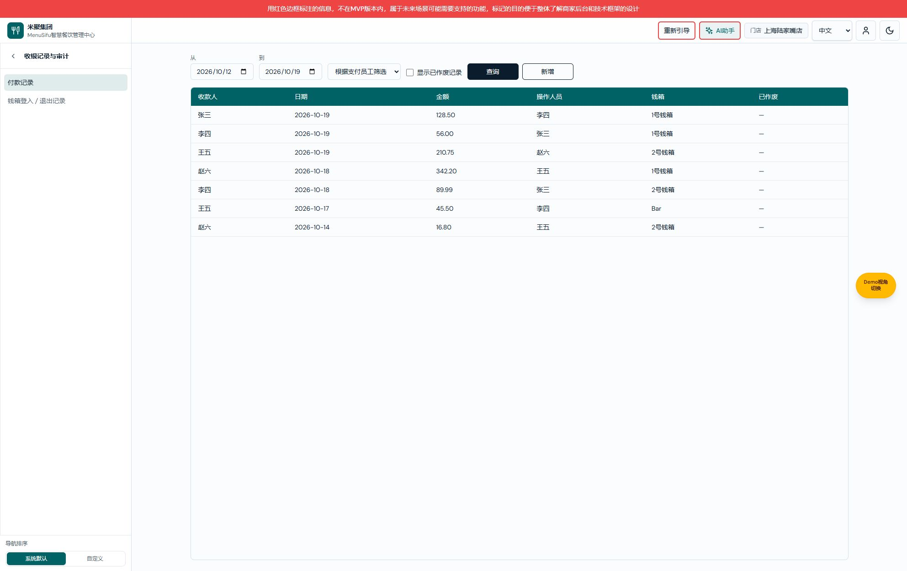

图注：2026-10-19，功能分支 codex/finance-audit-subnav-20261019，起始 main@180e3322；本地演示数据，仅证明导航和页面状态。

用途／入口：财务中心 → 收银记录与审计 → 付款记录。

| 字段／操作 | 逻辑说明 |
|---|---|
| 收银记录与审计父菜单 | 导航容器；文字和留白整行点击均进入公共覆盖子滑层，路由不变化，不自动打开付款记录。继承 NAV-20261014-01。 |
| 子层标题 | 显示“收银记录与审计”，顶部、宽度与财务父层一致，覆盖父标题、搜索及菜单。 |
| 返回上一级菜单 | 仅返回财务中心菜单；当前业务页及路由保留，不保存或删除记录。 |
| 付款记录 | 第一项；点击进入 /finance/register-audit/payments；子导航保持显示，当前项高亮。 |
| 页面顶部 | 移除付款记录／钱箱记录的重复页签；原日期、员工、作废筛选、查询、新增、表格及弹框业务继续沿用。 |

### 钱箱登入／退出记录页面

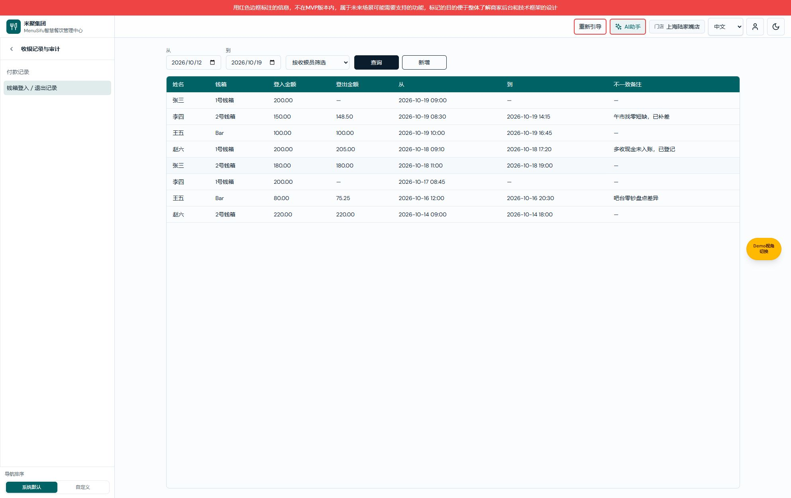

图注：同上功能分支及基线，钱箱记录选中态；无用户数据迁移。

用途／入口：财务中心 → 收银记录与审计 → 钱箱登入／退出记录。

| 字段／操作 | 逻辑说明 |
|---|---|
| 钱箱登入／退出记录 | 第二项，保留完整名称，避免与账号退出混淆；原地址 /finance/register-audit/cash-drawer 不变，点击后当前项高亮，子层保持显示。 |
| 查询与表格 | 原筛选、查询、新增、金额、不一致备注等字段、校验及写入行为保持；本次仅调整导航，不新增计算和状态。 |
| 旧地址／刷新 | 两个原叶子地址均可直接打开；直接访问时是否自动展开侧栏继续遵循公共导航规则，不强制打开子层。 |
| 权限／预设／订阅 | 保留 fin-register-audit 父键及 page:/finance/register-audit/payments、page:/finance/register-audit/cash-drawer 页面资源键；沿用原过滤与草稿保护，不新增授权。 |
| 搜索 | 公共搜索索引从 sidebarChildren 获取两个叶子，点击沿用对应旧路由。 |

验收：父项文字／留白下钻不改路由；子层覆盖；两叶子正确切页并高亮；返回仅一层；原链接可访问；页面无重复页签。校验结果：TypeScript、Vite 独立目录构建、递归导航、财务演示适配校验通过；浏览器通过父项文字／留白、两页切换与 aria-current、返回一层、钱箱旧地址刷新及搜索直达。权限综合脚本在原 main@180e3322 同样因餐位控件 data-floor-plan-save-area 缺失而失败，未在本次修复。历史业务定义与验收缺口保持原状态，“付款记录”不改名；本次未新增金额算法或业务规则。

## 订单中心二级入口与设置分离（ORDER-NAV-20261016-01）

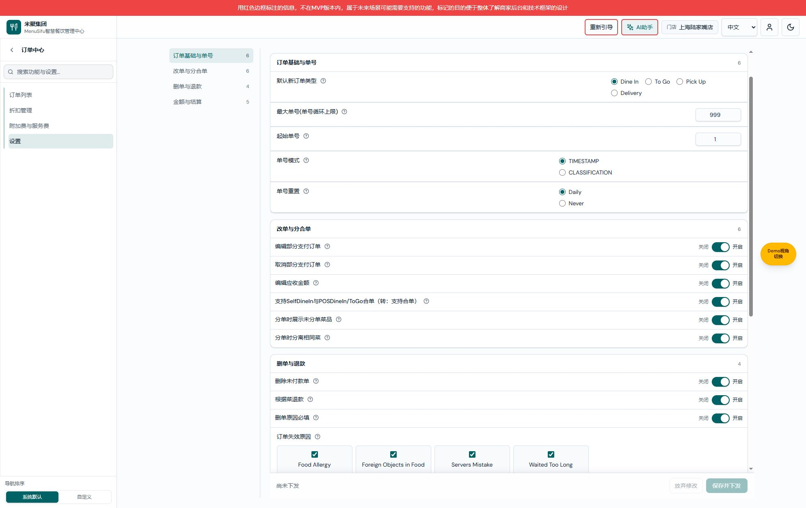

图：2026-10-16 功能分支，基线 main@8e415a0c，设置／订单基础与单号状态；截图为本地演示数据，不作为新增业务决策。

订单中心二级顺序为订单列表、折扣管理、附加费与服务费、设置。默认仍进入订单列表。继续复用公共覆盖滑层、整行点击、返回一层及当前项高亮。

| 入口／区域 | 逻辑说明 |
|---|---|
| 订单列表 | `/orders/all`；保留现有页面及业务行为。 |
| 折扣管理 | `/orders/discounts`；只呈现 seq 446 的既有预设列表和编辑弹框。 |
| 附加费与服务费 | `/orders/surcharges`；只呈现 seq 447 的既有预设列表和编辑弹框。 |
| 设置 | `/orders/settings`；21 项规则，四组，不再重复展示两个预设列表。 |
| 订单基础与单号 | 126、127、128、129、130、131，共 6 项；分类单号仍按原单号模式条件展示。 |
| 改单与分合单 | 117、116、115、124、119、140，共 6 项。 |
| 删单与退款 | 158、159、157、156，共 4 项；没有新增退款申请、记录或审批功能。 |
| 金额与结算 | 162、163、149、161、147，共 5 项；依次为折扣原因规则、收费处理规则、取整。 |

### 折扣管理页

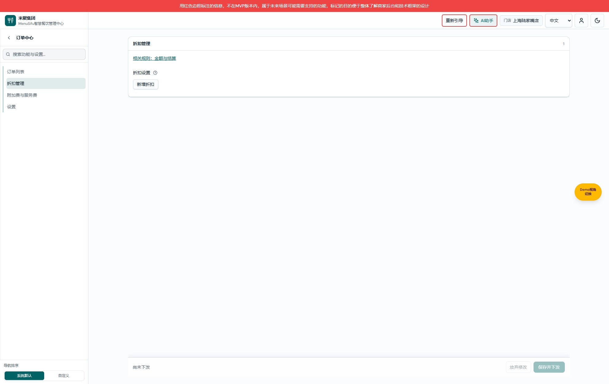

图：同一功能版本，未配置折扣预设状态。

| 字段／操作 | 逻辑说明 |
|---|---|
| 折扣预设列表 | 使用原 seq 446 数据；有数据时沿用折扣名称、比例类型、比例和操作列；空时保留新增入口。 |
| 新增折扣 | 打开原新增弹框；不自动保存或下发整个订单设置。 |
| 编辑／删除 | 操作当前预设，沿用原校验及确认流程；本次不改变折扣金额算法。 |
| 相关规则：金额与结算 | 跳转 `/orders/settings/order-pricing`，定位原因及金额规则；保留同一保存桶中的草稿。 |

### 折扣新增／编辑弹框

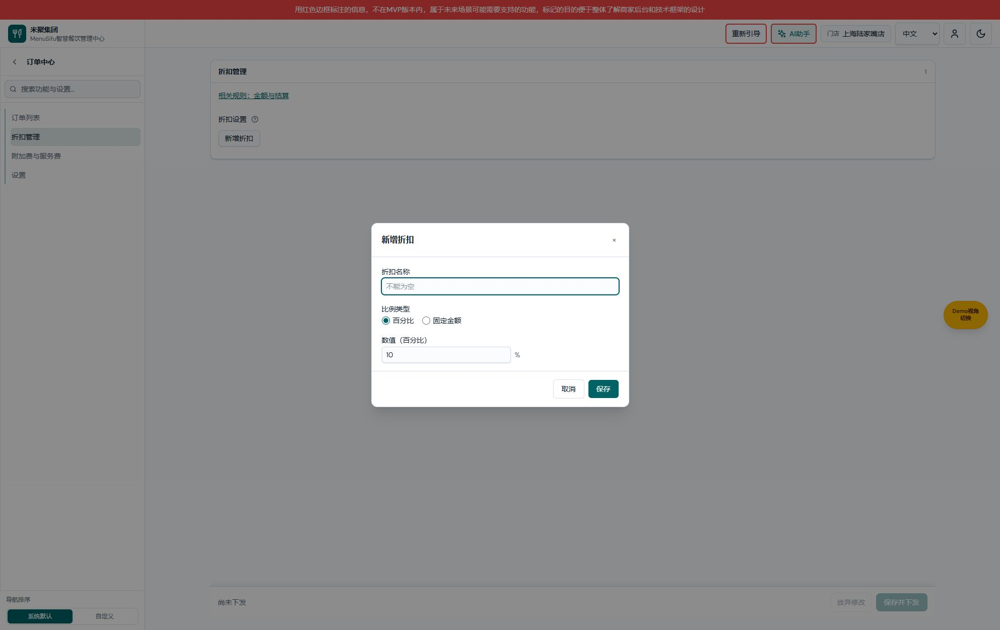

图：同一功能版本，新增折扣弹框；编辑复用同一结构，带入原值，保存按钮为“保存修改”。

| 字段／操作 | 逻辑说明 |
|---|---|
| 折扣名称 | 沿用原必填校验；编辑回填原名称。 |
| 比例类型 | 沿用百分比／固定金额两种选项及原联动。 |
| 数值 | 沿用所选比例类型的单位、范围及精度，不重定义计算口径。 |
| 保存／保存修改 | 原校验成功后更新当前页面共享草稿；由底部统一保存并下发生效。 |
| 取消／关闭 | 关闭当前弹框，不提交本次弹框编辑。 |

### 附加费与服务费页

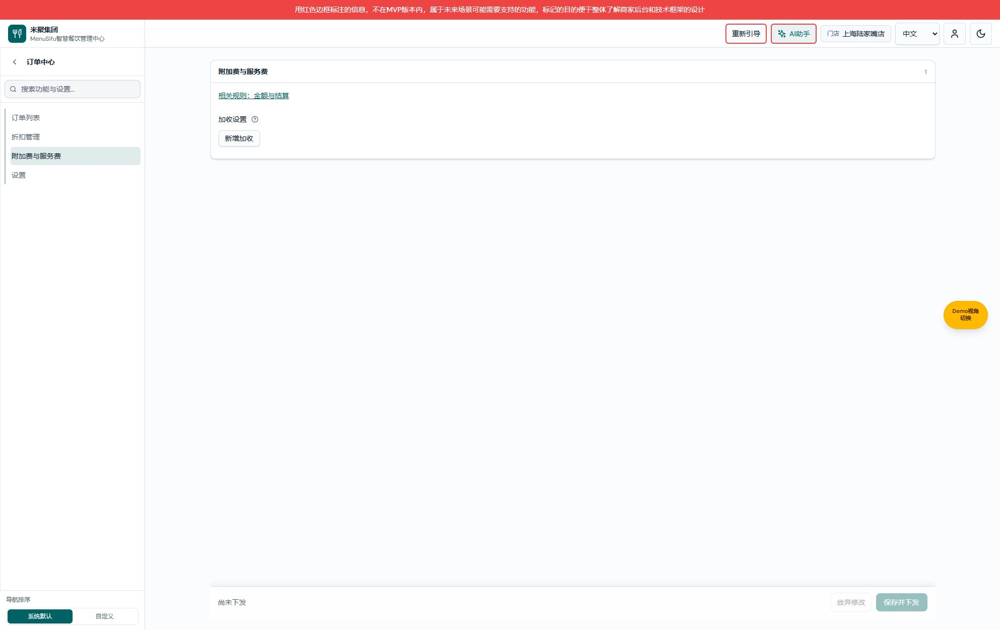

图：同一功能版本，未配置加收预设状态。

| 字段／操作 | 逻辑说明 |
|---|---|
| 预设列表 | 使用原 seq 447 数据，不创建新存储副本；空时保留新增加收入口。 |
| 新增加收 | 打开原加收编辑弹框。 |
| 编辑／删除 | 沿用原预设操作、校验及确认，作用对象为当前加收项目。 |
| 相关规则：金额与结算 | 跳转收费处理与取整所在的设置分组；不重复维护规则。 |

### 加收新增／编辑弹框

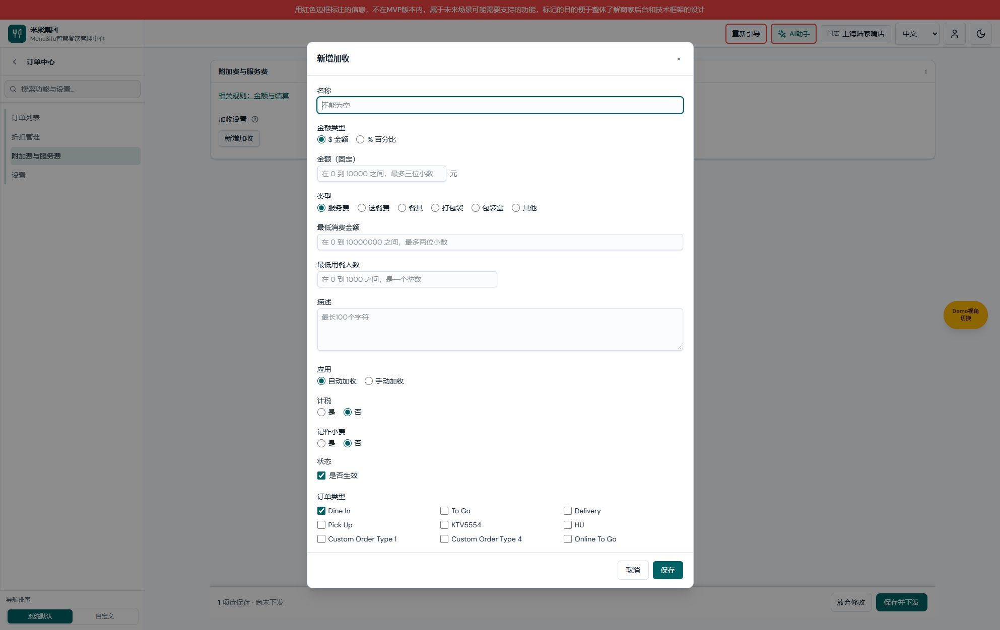

图：同一功能版本，新增服务费预设状态；其他类型的条件字段沿用原组件。本次只改变入口。

| 字段／操作 | 逻辑说明 |
|---|---|
| 名称 | 沿用原必填校验，编辑回填原值。 |
| 金额类型 | 固定金额／百分比；原单位及输入约束继续生效。 |
| 金额／百分比 | 随金额类型切换原输入方式。 |
| 类型 | 服务费、送餐费、餐具、打包袋、包装盒、其他；沿用原条件展示。 |
| 最低消费金额 | 原适用条件及精度不变。 |
| 最低用餐人数 | 原类型条件及整数校验不变。 |
| 最低配送距离 | 原类型条件及单位不变；截图所选服务费状态不显示该项。 |
| 描述 | 原长度限制及回填行为不变。 |
| 应用 | 自动加收／手动加收，原语义不变。 |
| 计税 | 是／否，原语义不变。 |
| 记作小费 | 是／否，原语义不变。 |
| 是否生效 | 沿用原预设启用状态。 |
| 订单类型 | 原多选范围不变，不新增业务类型或授权。 |
| 保存／保存修改 | 校验成功后更新共享草稿；统一保存并下发。 |
| 取消／关闭 | 不提交本次弹框编辑。 |

### 设置／金额与结算

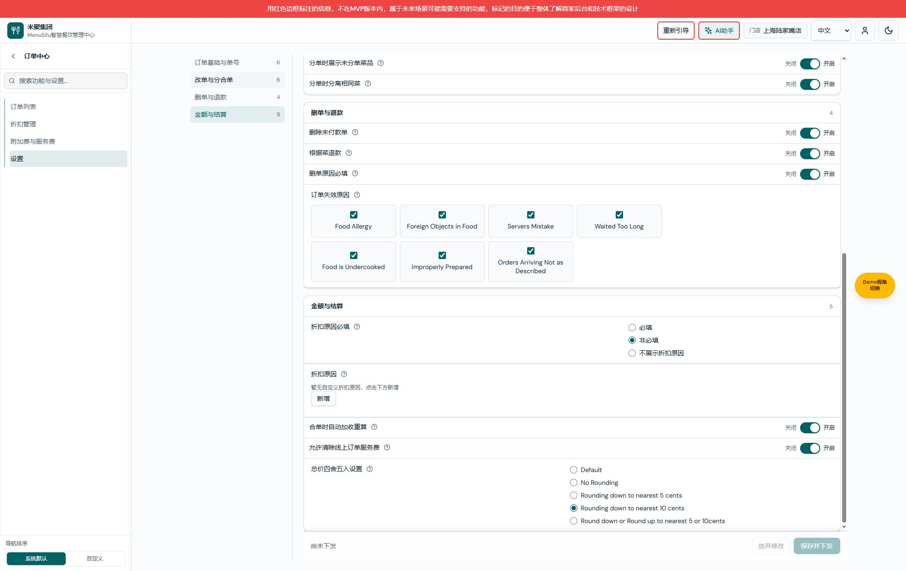

图：同一功能版本，金额与结算分组定位状态。

| 字段／操作 | 逻辑说明 |
|---|---|
| 折扣原因必填 | seq 162，保留必填／非必填／不展示原因原选项。 |
| 折扣原因 | seq 163，保留原原因列表及新增编辑操作。 |
| 合单时自动加收重算 | seq 149，保留原开关逻辑。 |
| 允许清除线上订单服务费 | seq 161，保留原开关逻辑。 |
| 总价四舍五入设置 | seq 147，保留原取整选项及计算规则。 |
| 保存并下发／放弃修改 | 两个管理页与设置共用原 `/orders/settings` 保存桶；保存、放弃作用于该桶全部待保存改动。跨这三页不丢草稿，离开该桶仍走原未保存保护。 |

### 兼容与验收边界

旧分组中的 `/s446`、`/s447` 或对应设置锚点转入新管理页；旧折扣、加收、结算分组转入金额与结算。搜索结果直接指向新归属；仍使用原设置项及原授权，不自动扩充权限、订阅或平台预设。

TypeScript 与 `scripts/verify-order-center-navigation.ts` 通过；浏览器已验证入口、两个新增弹框、折扣编辑回填、跨页草稿保留、放弃草稿、相关规则及旧折扣书签跳转。用户已授权提交、合并并推送；交付 SHA 以 Git 记录及聊天交付核验为准；历史导航文档中的其他验收缺口保持原状态。

生成器校验缺口：`build-module-settings-catalog.mjs` 报 source 670 / catalog 462 并退出 1；使用 main@8e415a0c 原脚本复核同样失败。本次已同步生成模板的新路由逻辑，保留原 catalog 的其他内容，未纳入重生成时额外出现的 seq 443；不宣称全量 catalog 重建通过。

## 版本记录

| 版本 | 日期 | 变化 |
|---|---|---|
| V2.9 | 2026-10-19 | SETTINGS-CATEGORY-20261019-01：设置分类侧栏、权限同源与分类批量；产品V2.10 / 研发V2.9 / 个人V2.9 |
| V2.8 | 2026-10-19 | FINANCE-NAV-20261019-01：付款与钱箱记录迁入公共子滑层，移除重复页签，沿用路由与权限；产品 V2.9 / 研发 V2.8 / 个人 V2.8 |
| V2.7 | 2026-10-16 | ORDER-NAV-20261016-01：折扣与收费预设独立入口、四组设置、原授权与共享草稿、旧链接与搜索兼容；产品 V2.8 / 研发 V2.7 / 个人 V2.7 |
| V2.6 | 2026-10-16 | STORE-INFO-20261016-01：门店档案／营业时间／设置三页、原权限与草稿共享、旧地址与搜索兼容、空白文本首次编辑修复；产品 V2.7 / 研发 V2.6 / 个人 V2.6 |
| V2.5 | 2026-10-16 | BREAKS-NAV-20261016-01：休息与加班三页、设置合并、跨页草稿及旧地址兼容；产品 V2.6 / 研发 V2.5 / 个人 V2.5 |
| V2.4 | 2026-10-16 | MESSAGE-NAV-20261016-01：品牌四项、门店两项，旧地址兼容及待配置页；产品 V2.5 / 研发 V2.4 / 个人 V2.4 |
| V2.3 | 2026-10-16 | INVENTORY-NAV-20261016-01：物料分类／效期管理各两个叶子，保留 WMS 分类，其余待配置；产品 V2.4 / 研发 V2.3 / 个人 V2.3 |
| V2.2 | 2026-10-16 | HARDWARE-NAV-20261016-01：14 类设备迁入硬件覆盖子层，移除内容重复列表；产品 V2.3 / 研发 V2.2 / 个人 V2.2 |
| V2.1 | 2026-10-16 | NAV-20261016-02：规则限制改名为菜单下单规则，自助餐规则移至首项；产品 V2.2 / 研发 V2.1 / 个人 V2.1 |
| V2.0 | 2026-10-16 | NAV-20261016-01：移除外层菜单下单限制导航入口，三个子菜单及旧业务不变；产品 V2.1 / 研发 V2.0 / 个人 V2.0 |
| V1.9 | 2026-10-15 | NAV-20261015-07：规则限制三子项、取消外层重复自助餐与页内切换栏；产品 V2.0 / 研发 V1.9 / 个人 V1.9 |
| V1.8 | 2026-10-15 | SHOP-20261015-01：店中店子导航、渠道设置与品牌菜单编辑入口；产品 V1.9 / 研发 V1.8 / 个人 V1.8 |
| V1.7 | 2026-10-15 | FOH-20261015-01：前厅新增餐位管理并列入口；产品 V1.8 / 研发 V1.7 / 个人 V1.7 |
| V1.6 | 2026-10-15 | NAV-20261015-05：取消全部云产品路由配置提示弹窗；产品 V1.7 / 研发 V1.6 / 个人 V1.6 |
| V1.5 | 2026-10-15 | MEMBERS-20261015-01：会员中心截图菜单与独立路由；业务页待配置；产品 V1.6 / 研发 V1.5 / 个人 V1.5 |
| V1.4 | 2026-10-15 | NAV-20261015-04：调味下发记录独立地址与默认空状态；产品 V1.5 / 研发 V1.4 / 个人 V1.4 |
| V1.3 | 2026-10-15 | NAV-20261015-03：三项云产品标签；产品 V1.4 / 研发 V1.3 / 个人 V1.3 |
| V1.2 | 2026-10-15 | NAV-20261015-02：薪资后新增考勤记录、加班规则、评价统计；产品 V1.3 / 研发 V1.2 / 个人 V1.2 |
| V1.1 | 2026-10-15 | NAV-20261015-01：员工报表五项迁入公共子导航；产品 V1.2 / 研发 V1.1 / 个人 V1.1 |
| V1.0 | 2026-10-14 | NAV-20261014-01：统一覆盖滑层；产品 V1.1 |

## 门店信息二级菜单（STORE-INFO-20261016-01）

共同业务基线：main@76150c32；2026-10-16 用户确认。三个二级入口为门店档案、营业时间、设置。仅重组现有页面，复用原字段、数据与保存下发机制；本节为门店信息导航的当前有效定义，旧分组方案仅作历史参考。

### 门店档案

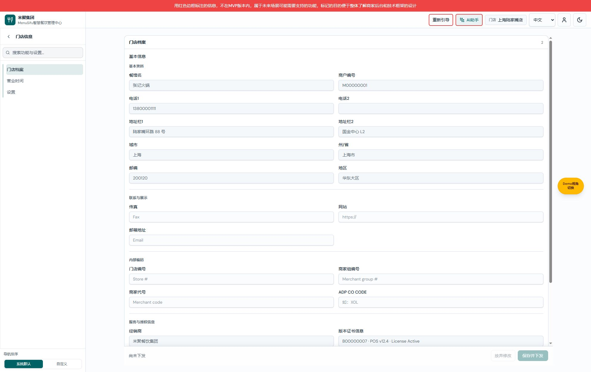

图注：2026-10-16，功能分支原生页面、演示门店；基本资料与联系信息默认态。界面示例不是新增产品规则。

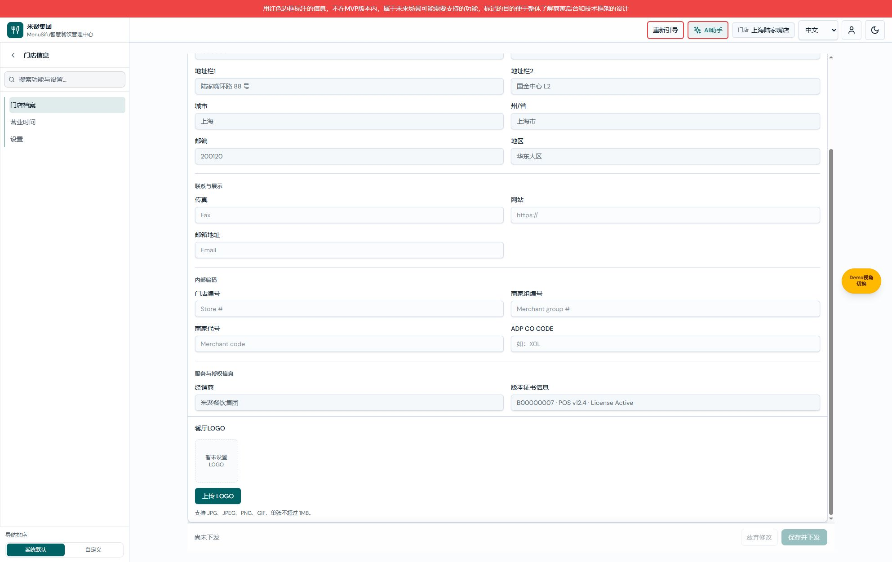

图注：同版本页面滚动至下部，展示内部编码、服务与授权信息及 LOGO 区域。

入口：门店信息 → 门店档案，`/stores/profile`。进入门店信息默认打开此页；不再显示原设置页的三组分类侧栏。

| 字段／操作 | 逻辑说明 |
|---|---|
| 门店档案二级菜单 | 第一项，整行可点击，打开档案页面并保持公共子导航显示、当前项高亮。属于已有门店信息功能范围。 |
| 基本资料区域 | 原 417 基本信息；平台主数据保持只读，空值保持空白，不因移动区域开放编辑。 |
| 餐馆名 | 当前门店主数据的名称；只读，保留原来源与显示值。 |
| 商户编号 | 当前门店所属商户标识；只读，不与门店编号合并。 |
| 电话1 | 原主联系电话；只读，原值或空白。 |
| 电话2 | 原第二联系电话；只读，原值或空白。 |
| 地址栏1 | 原门店地址第一行；只读。 |
| 地址栏2 | 原地址补充；只读，可空。 |
| 城市 | 原门店城市；只读。 |
| 州／省 | 原门店州省；只读。 |
| 邮编 | 原门店邮编；只读，不新增格式转换。 |
| 地区 | 原地区值；只读，不新增区域授权关系。 |
| 联系与展示区域 | 保留原三项可编辑字段，修改进入原门店设置草稿。 |
| 传真 | 原联系传真，文本，可空；本次不新增校验。 |
| 网站 | 原网站字段，URL 输入，可空；首次从空白输入也必须进入草稿，不得被当作默认值忽略。 |
| 邮箱地址 | 原联系邮箱，邮箱输入，可空；本次不新增必填要求。 |
| 内部编码区域 | 保留原四项可编辑编码，不新增自动生成或与主数据编号联动。 |
| 门店编号 | 原门店内部编号，文本，可空；与商户编号独立。 |
| 商家组编号 | 原商家组编码，文本，可空。 |
| 商家代号 | 原商家代号，文本，可空。 |
| ADP CO CODE | 暂留原位及原存储字段，不迁移薪资映射；后续目标薪资入口待核对，不在本次自行决定。 |
| 服务与授权信息区域 | 将原基本信息中的经销商和版本证书信息集中只读展示，不提供授权修改操作。 |
| 经销商 | 沿用原主数据，只读。 |
| 版本证书信息 | 沿用原版本及证书显示，只读；不解释为本次新增授权状态。 |
| 餐厅 LOGO 区域 | 原 433，与基本信息同一档案页面；不单独设置“品牌标识素材”菜单。未设置时显示原空态；已有图片显示原预览。 |
| 上传 LOGO | 沿用本地上传／素材库选择、原格式与体积限制及取消处理，不重定义原弹框与图片处理。权限仍按原 433 控制。 |

### 营业时间

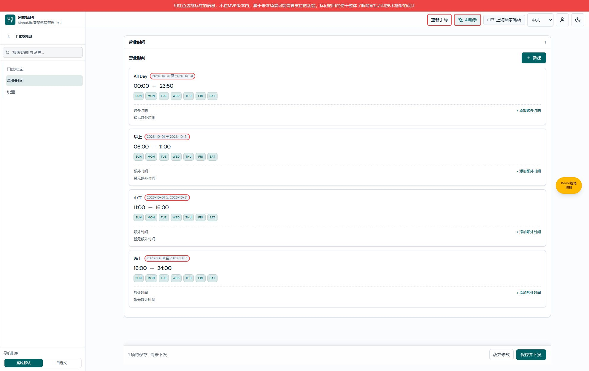

图注：同功能版本、演示门店营业时间列表；底部“1 项待保存”为跨页保留档案网站草稿的验证状态，不代表新增营业规则。

入口：门店信息 → 营业时间，`/stores/hours`。本页承载原 418，不包含结束提示。

| 字段／操作 | 逻辑说明 |
|---|---|
| 营业时间二级菜单 | 第二项，整行可点击，打开原营业规则列表，当前项高亮。 |
| 常规营业时间 | 保留原名称、生效日期、星期、起止时间和列表管理；本次不改变跨日、日期或时间校验。 |
| 新建 | 打开原营业时间编辑框，沿用原新增、确认与取消处理；不创建未经用户填写的规则。 |
| 编辑 | 打开所选规则的原编辑框，保留对象标识和原数据。 |
| 删除 | 沿用原确认、引用约束及关联处理；不因导航迁移批量删除规则。 |
| 额外时间 | 保留在营业时间卡片内；沿用已有“添加额外时间”及编辑／删除，不新增独立二级菜单或开放被版本限制的能力。 |
| 外部引用提示 | 分类、品类及店中店品牌页面统一提示“门店信息 → 营业时间”，数据引用仍使用原规则标识。 |

### 设置

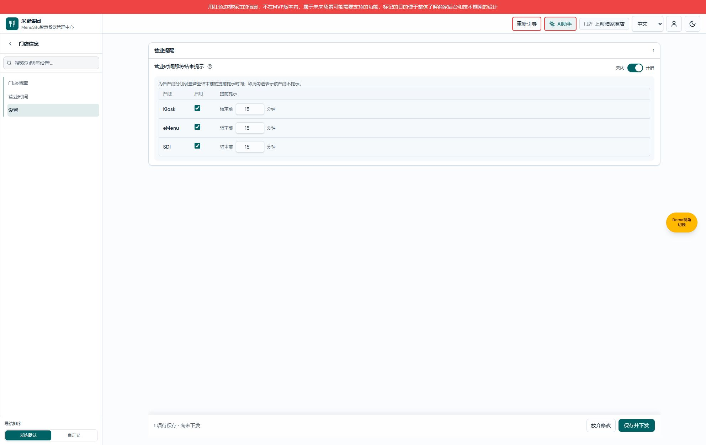

图注：同功能版本、演示默认提醒值；底部展示跨页档案草稿。原“营业与运营”不再作为当前菜单名称。

入口：门店信息 → 设置，`/stores/settings`。当前仅展示营业提醒区域。

| 字段／操作 | 逻辑说明 |
|---|---|
| 设置二级菜单 | 第三项，保留原设置地址；作用范围为本店运行参数。 |
| 营业时间即将结束提示 | 原 582；主开关和分产线字段保持原读写及默认值。与营业规则分页面，不分离保存桶。 |
| Kiosk 启用提示 | 沿用原 Kiosk 启用选择，未启用时该产线不提示。 |
| Kiosk 提前提示分钟数 | 沿用原分钟字段，默认 15，范围 1～180；不因页面迁移重置已有值。 |
| eMenu 启用提示 | 沿用原 eMenu 启用选择。 |
| eMenu 提前提示分钟数 | 沿用原分钟字段，默认及范围同原实现。 |
| SDI 启用提示 | 沿用原 SDI 启用选择。 |
| SDI 提前提示分钟数 | 沿用原分钟字段，默认及范围同原实现。 |

### 保存、兼容与验收

| 字段／操作 | 逻辑说明 |
|---|---|
| 权限与订阅 | 三页仍沿用原 st-settings、原 L3 分组和各 seq 的 L4 权限；不新增独立授予资格。原入口未授权时，新页面不能据此绕过原限制。权限中心保留唯一“门店档案、营业时间与设置”授权入口。 |
| 页内切换 | 三页共用 `/stores/settings` 草稿桶；从档案切到营业时间再切设置，不清除草稿、不自动保存，待保存数量继续显示。 |
| 保存并下发 | 沿用原保存确认与下发范围，包含该共用桶中三页的待保存修改；只调整页面位置，不新增发布接口或下发规则。 |
| 放弃修改 | 放弃整个原门店设置草稿桶，三页同步恢复已保存值；无草稿时沿用禁用态。 |
| 离开本模块 | 有草稿时沿用原离开确认；取消保留页面及草稿，确认离开按原机制丢弃草稿。 |
| 旧档案地址 | `/store/basic`、`/stores/settings/store-profile` 转到档案；原 LOGO 地址转到档案并定位原 433；原字段锚点保留。 |
| 旧营业地址 | `/store/business-hours`、`/stores/settings/store-hours-operation` 转到营业时间；带 582 锚点则转到设置。 |
| 搜索 | 基本信息和 LOGO 指向档案、营业时段指向营业时间、结束提示指向设置；仍用原 settingsPath 和 seq 编辑，不新增副本。 |
| 失败边界 | 沿用既有保存失败、取消和权限拒绝处理。本次不声明线上下发成功；仅验证本地原型。 |

验收：三菜单顺序与页面内容正确；主数据仍只读；网站首次空值编辑进入草稿；三页切换后值与数量保留；离开取消后草稿保留；放弃后恢复空值；旧 582 地址打开营业提醒。真实浏览器已覆盖上述主路径，代码检查覆盖旧字段和授权标识。

未闭合项：ADP 目标入口未核对，保持原位；本次未重验所有原营业编辑弹框和图片上传异常，不将旧业务全量验收计入本次结论。

## 休息与加班二级页面（BREAKS-NAV-20261016-01）

本次范围：按用户确认，将团队管理下的休息与加班拆为自定义休息、加班规则、设置。仅调整导航、页面承载及跨页草稿保护；原计薪算法、字段校验、发布范围与授权方式不重新定义。基线 main@3adc2347。

### 自定义休息

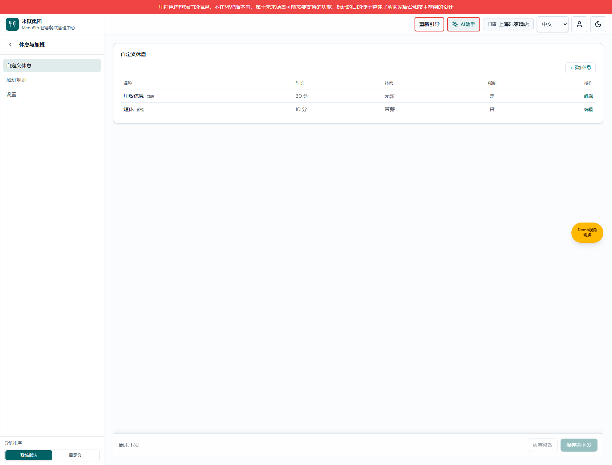

图注：2026-10-16，BREAKS-NAV-20261016-01 功能 worktree 原生 Vite 页面，演示门店默认列表；图中示例不作为新增业务决策。

入口：团队管理 → 休息与加班 → 自定义休息（`/team/breaks-overtime/custom-breaks`）。

| 字段／操作 | 逻辑说明 |
|---|---|
| 休息与加班父菜单 | 文字、留白整行点击进入公共覆盖式子导航，标题为休息与加班，覆盖父标题、搜索与列表；不在父菜单内展开。返回只退一层，不写业务数据。 |
| 自定义休息 | 第一个二级入口；只展示既有休息列表，不混入设置及加班列表。叶子选中高亮并保持当前子层。 |
| 名称 | 当前休息项目的名称，沿用系统项目标识和名称编辑限制。 |
| 时长 | 当前项目的分钟数，保留既有值；不因页面拆分与全局带薪休息时长合并。 |
| 补偿 | 当前休息项目的带薪／无薪属性，原枚举不变。 |
| 强制 | 当前项目是否强制，原含义与默认值不变。 |
| 添加休息 | 打开原新增休息弹窗；保存至共享草稿，取消沿用原行为；不自动下发。 |
| 编辑 | 操作当前行，打开原编辑弹窗；系统项目限制、校验及结果不变。 |
| 删除 | 仅对原本允许删除的项目保留原确认流程，不因导航变更新增删除权限。 |

### 加班规则

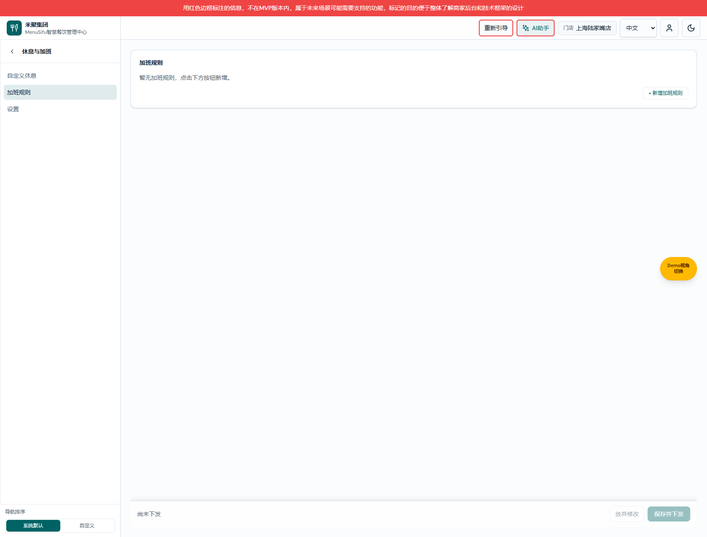

图注：同一功能版本的加班规则空列表；不虚构已配置规则。

入口：团队管理 → 休息与加班 → 加班规则（`/team/breaks-overtime/overtime-rules`）。

| 字段／操作 | 逻辑说明 |
|---|---|
| 加班规则 | 第二个二级入口；承载原规则列表及新增、编辑、删除流程。 |
| 名称 | 当前加班规则名称，空列表不展示虚构记录。 |
| 计算口径 | 沿用每日、每日双倍、每周、第 N 天四种原口径；本次不调整含义或组合关系。 |
| 工时超过（小时） | 沿用当前规则的工时阈值及原校验。 |
| 工资倍率 | 沿用当前规则的倍率及原精度、分档展示。 |
| 新增加班规则 | 打开原弹窗，原口径数量限制不变；无规则时保留原空状态与新增入口。 |
| 编辑／删除 | 对当前记录沿用原编辑弹窗及删除确认；取消不写入该操作的变更。 |

### 设置

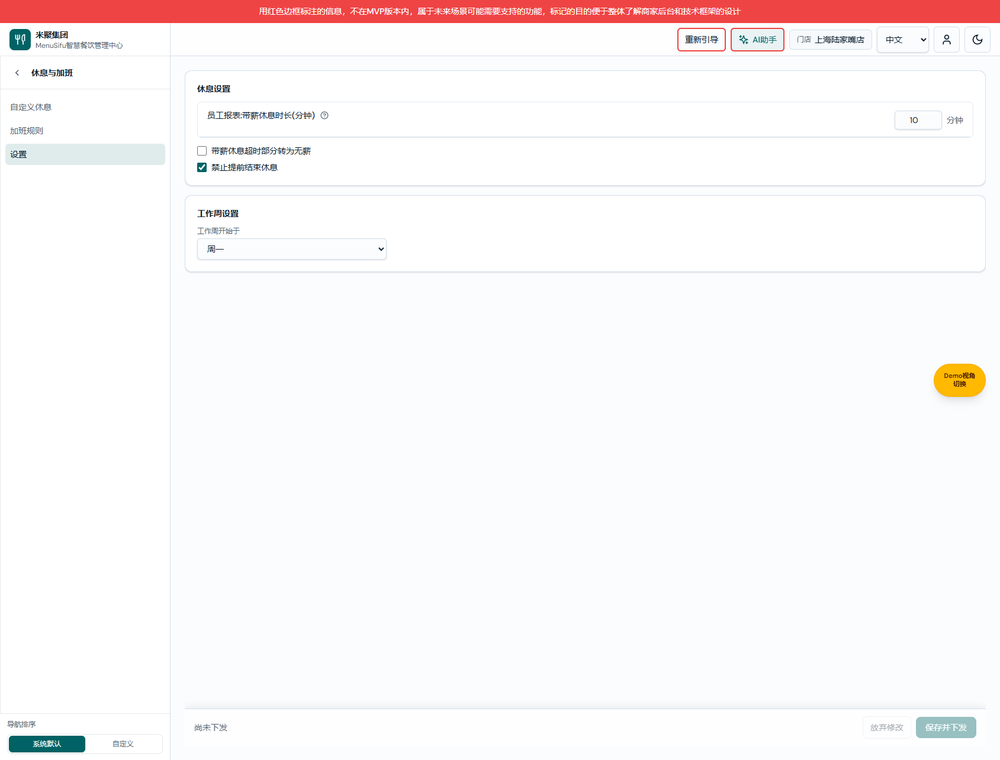

图注：同一功能版本的设置页面，包含休息设置和工作周设置两个区域；属于本模块，不迁往团队管理全局设置。

入口：团队管理 → 休息与加班 → 设置（`/team/breaks-overtime/settings`）。页面内两个区域按 SETTINGS-CATEGORY-20261019-01 使用分类侧栏，不新增全局菜单层。

| 字段／操作 | 逻辑说明 |
|---|---|
| 休息设置 | 承接原休息规则区域；仅更新区域名称和承载页面。 |
| 员工报表：带薪休息时长（分钟） | 沿用字段 `329-paid-break-minutes`，默认 10，整数、最小 0、最大 240。首次无存储值时也以默认 10 比较变更，不能将首次编辑值当作基线。与单个休息时长之间的核算关系不在本次确认范围内，不合并两个字段。 |
| 带薪休息超时部分转为无薪 | 沿用原开关；带薪时长大于 0 才可开启，为 0 时关闭并隐藏入口。跨页不得复活已关闭值。 |
| 禁止提前结束休息 | 沿用原布尔值与默认配置，切换三个子页面不清空。 |
| 工作周设置 | 承接原同名区域。 |
| 工作周开始于 | 星期单选，数值 0—6，其中周日为 0；缺少当前控件时保留共享草稿的原值，不能回落为周一。 |
| 放弃修改 | 作用于原 `/team/breaks-overtime` 共享保存桶，沿用确认流程，确认放弃后恢复原保存值；取消保留草稿。 |
| 保存并下发 | 沿用原整页保存、原字段及集合变更下发流程；三个页面共享会话，不新增逐页授权、自动保存或单独下发规则。失败沿用原反馈，不声称完成下发。 |

### 地址、权限与草稿契约

- 根地址及尾斜杠兼容到自定义休息；旧 `break-rules`、`work-week` 地址及尾斜杠兼容到设置。旧 `/team/scheduling/overtime-rules` 路径进入加班规则。
- 新导航叶子只组织页面，不创建新的权限资源；保留 `page:/team/breaks-overtime` 及原设置、内容和动作资源键。权限编辑器按自定义休息、加班规则、设置三组呈现，四个设置资源归入设置组，原授权值不迁移、不丢弃。权限、订阅、发布与预设过滤继续使用公共实现。
- 三个地址由 `resolvePageSaveKey` 解析为 `/team/breaks-overtime`。设置输入同步进入内存草稿，离开本模块仍由原保存拦截处理；取消离开保留草稿，确认离开沿用原丢弃流程。
- 本次不修改 `bplant-team-breaks-overtime-v1` 结构；`customBreaks`、`overtimeRules`、`blockEarlyEnd`、`convertExcessPaidToUnpaid`、`workWeekStartDay` 保持原类型。无服务端对象／公式／接口新增。

### 验收与待确认

1. 父菜单整行下钻、返回一层；三个叶子按指定顺序展示，业务页不再重复模块子导航；设置内按 SETTINGS-CATEGORY-20261019-01 提供功能分类侧栏。
2. 自定义休息／加班规则分别沿用原新增弹窗；文字中心和菜单留白均能切换目标页面。
3. 工作周选周日，修改休息开关及带薪时长后依次进入另两页并返回，三项草稿保留；无历史存储的带薪时长首次由 10 改为 15，返回仍为 15。
4. 带薪时长改为 0，超时转无薪取消勾选并隐藏，跨页后仍为关闭。
5. 旧地址正确兼容；类型检查、权限分类验证及公共递归导航验证通过。浏览器使用测试账号与本地演示门店；未声称用户已验收或生产下发成功。
6. 待确认：单项休息时长与报表带薪时长的核算关系，保持既有状态；本次不重新决定。历史库存、硬件等模块的验收缺口仍保留，不因本次变更宣称闭合。

## 消息中心层级（MESSAGE-NAV-20261016-01）

本次范围：按用户 2026-10-16 三张截图调整入口。模板、配置与品牌额度复用原页及存储；没有新增账务计算、账户分配、保存或下发规则。

### 消息中心

实施图注：2026-10-16，功能分支 codex/message-center-hierarchy-20261016，基线 main@18b4112f，Vite 5186 浏览器验收截图。

图注：用户提供，2026-10-16，菜单参考；非实施后截图。

入口：侧栏 → 消息中心。

| 字段／操作 | 逻辑说明 |
|---|---|
| 品牌消息 | 第一项；整行文字和留白均打开覆盖式子层，父行不改业务地址、不写数据；过滤后无叶子时隐藏父组。 |
| 门店消息 | 第二项；整行进入门店子层，与品牌复用公共递归滑层。 |
| 返回 | 返回一级菜单，不保存或丢弃业务草稿。 |
| 原设置入口 | 从菜单移除；`/notifications/settings` 及既有短信渠道链接继续有效，沿用权限、预设和草稿保护。 |

### 品牌消息

实施图注：2026-10-16，功能分支 codex/message-center-hierarchy-20261016，基线 main@18b4112f，Vite 5186 浏览器验收截图。

图注：用户提供，2026-10-16，品牌子层参考；非实施后截图。

入口：消息中心 → 品牌消息。

| 字段／操作 | 逻辑说明 |
|---|---|
| 消息模板 | 第一项；保留 `notif-templates` 与 `/notifications/templates`，复用现有模板业务、默认值和本地存储。 |
| 消息配置 | 第二项；保留 `notif-scene-config` 与 `/notifications/scene-config`，复用现有场景关联逻辑。 |
| 消息额度 | 第三项；保留 `notif-quota` 与 `/notifications/quota`，复用现有品牌账户页，不重新定义额度或管理模式。 |
| 额度消费记录 | 第四项；`notif-brand-consumption`，`/notifications/brand/consumption-records`；显示“品牌消息 · 额度消费记录”和“待配置”。记录来源、字段、筛选与分页待确认，无模拟记录、余额或写入。 |
| 返回 | 只返回消息中心层，当前业务路由保留。 |

### 门店消息

实施图注：2026-10-16，功能分支 codex/message-center-hierarchy-20261016，基线 main@18b4112f，Vite 5186 浏览器验收截图。

图注：用户提供，2026-10-16，门店子层参考；非实施后截图。

入口：消息中心 → 门店消息。

| 字段／操作 | 逻辑说明 |
|---|---|
| 消息额度 | 第一项；`notif-store-quota`，`/notifications/store/quota`；显示“门店消息 · 消息额度”和“待配置”。门店账户、额度来源及分配待确认，不将品牌共享额度作为门店数据。 |
| 额度消费记录 | 第二项；`notif-store-consumption`，`/notifications/store/consumption-records`；显示“门店消息 · 额度消费记录”和“待配置”；接口、字段与查询规则待确认。 |
| 返回 | 只返回消息中心层，不切换账户或写业务数据。 |

### 数据约束、边界与验收

展示父组使用 `id/title/titleEn/path/activePrefixes/sidebarChildren`，原叶子 ID 不变。先执行现有预设、订阅等过滤，再按品牌四项、门店两项组织；父组 `path` 取过滤后首个叶子供定位，点击父行不跳转。无叶子时不生成父组，旧设置不进入任何父组，不新增父组授权。

六个叶子独立寻址，点击后当前子层保持并高亮；旧模板、配置、品牌额度及设置地址保持有效。新待配置页不请求账务接口、不写存储，无输入字段、金额精度或公式。保存失败、取消离开和草稿保护沿用原业务机制。

正常算例：打开品牌不改 hash，四项按图排序；点击模板进入原地址；返回一次到消息中心，再返回一级。门店两项分别打开对应待配置页。

边界算例：过滤掉模板后品牌组保留其余三项原序；全部门店项不可访问时隐藏门店组；设置即使可访问仍不出现在截图菜单。异常算例：待配置页无记录也不生成余额或消费数据。

待确认项：门店账户、额度来源与品牌关系，两类消费记录接口和字段；本次只完成导航，未据截图补造业务。验证：TypeScript、公共递归导航和分组过滤边界检查通过；浏览器已验证品牌四项、门店两项、父行不改地址、单层返回、门店留白点击、叶子高亮与子层保持，以及三个既有页面正常挂载、三个新页面显示待配置。既有硬件浏览器配图缺口仍保留。

## 库存管理中心导航（INVENTORY-NAV-20261016-01）

### 库存管理中心外层

待补页面图片：本次“物料分类／效期管理”两个父项的原生运行图。用户提供的图片确认层级，不作为本项目实现验收图。

用途／入口：库存管理中心。按用户 2026-10-16 最新确认，本次只建立导航及待配置状态，不推测外部地址或新增库存业务。

| 字段／操作 | 逻辑说明 |
|---|---|
| 物料分类父项 | 外层第一项，由原 inv-materials 物料管理更名；整行点击进入同位置覆盖子层，不自动进入业务页。 |
| 效期管理父项 | 外层第二项，保留 inv-expiry；整行点击进入覆盖子层。 |
| 原设置入口 | 不在图片要求的外层导航展示；原 inv-settings、旧地址及权限口径保留，不删除业务。 |
| 返回 | 子层只退一层，业务地址及草稿沿用公共机制，不产生保存或下发。 |

### 物料分类子导航

待补页面图片：物料分类子层及待配置页。

| 字段／操作 | 逻辑说明 |
|---|---|
| 物料分类 | 第一项，/operations/inventory-ordering/materials/categories；显示独立待配置页，不猜测 WMS 地址。 |
| 物料列表 | 第二项，/operations/inventory-ordering/materials/list；显示独立待配置页。 |
| 子层标题与高亮 | 标题“物料分类”；选中叶子后保持子层并按地址高亮，复用公共导航实现，不内嵌展开。 |
| 待配置提示 | “待配置：此功能入口与路由已建立，尚未接入对应库存业务页面。”显示当前地址，无业务编辑、保存或伪造数据。 |

### 效期管理子导航

待补页面图片：效期管理子层、效期分类 WMS 和效期规则待配置页。

| 字段／操作 | 逻辑说明 |
|---|---|
| 效期分类 | 第一项，/operations/inventory-ordering/expiry/categories；复用原 https://wms.menusifuchina.com/platform-expiration-category iframe，不新建外部页面或变更其业务。 |
| 效期规则 | 第二项，/operations/inventory-ordering/expiry/rules；显示上述待配置提示及地址，不加载效期分类 iframe 伪装规则页面。 |
| 旧效期根地址 | /operations/inventory-ordering/expiry 继续显示原 WMS 效期分类；模块默认进入地址仍保持此值。 |
| 旧物料根地址 | /operations/inventory-ordering/materials 保留并显示待配置，不删除或冒充已接入的物料业务。 |
| 外部页面异常 | 原 WMS 加载、认证或网络限制沿用现状；本次未新增登录代理、跨域绕过或外部失败兜底，不将不可访问声称为本地验收通过。 |

研发：NAV_MODULES 保留原 inv-materials、inv-expiry 与 inv-settings 标识，在前两项 children 登记四个独立叶子。库存专用外壳继续保留原打开／关闭机制，内部列表改用 renderPcSheetDarkSubnav，复用公共覆盖栈；既有预设过滤后移除设置显示行，未增加权限。isInventoryExpiryIframePath 只匹配旧效期根与新 categories，不能用 expiry/ 全前缀吞掉 rules。待配置页面无输入、无保存、无新增数据，无计算、金额或精度规则。

验证：四叶子名称、顺序和地址唯一性、旧设置能力保留、WMS 分类专用匹配、公共渲染调用以及待配置分支的针对性检查通过；类型及公共递归导航检查通过。浏览器实际下钻、返回、高亮、搜索和外部 WMS 可用性未重新验收；本次未切换当前 main 预览，未提交、合并或推送。历史未闭合项不因本次导航调整关闭。

## 硬件覆盖式子导航（HARDWARE-NAV-20261016-01）

### 硬件管理中心外层

待补页面图片：本次“硬件”父项可下钻的新运行状态；当前 5190 仍是 main，不能作为功能分支验收图。

用途／入口：硬件管理中心；外层只保留既有“硬件”“设置”。

| 字段／操作 | 逻辑说明 |
|---|---|
| 硬件 | 父行复用公共覆盖式子导航，文字与留白点击均进入设备子层，不自动跳转支付设备或写入数据。 |
| 设置 | 保留外层入口及原设置页内容、地址归一化、权限和保存行为，不迁入硬件设备子层。 |

### 硬件子导航与设备业务页

待补页面图片：14 项硬件子导航及设备选中状态；本次仅完成代码与脚本检查，尚无新运行图。

用途／入口：硬件管理中心 → 硬件；子层覆盖父标题、搜索和列表，顶边与宽度对齐，沿用 NAV-20261014-01，不内嵌展开。

| 字段／操作 | 逻辑说明 |
|---|---|
| 子层标题 | 显示“硬件”，来源为既有 dm-hardware 名称。 |
| 返回上一级菜单 | 只返回硬件管理中心一层；不改变当前业务页、不保存或丢弃草稿。 |
| 支付设备 | 原地址 `/device-management/hardware/payments`；点击进入原业务页，保留硬件子导航与高亮，不新增设备业务或授权。 |
| 税控机 | 原地址 `/device-management/hardware/fiscal`；点击进入原业务页，保留硬件子导航与高亮，不新增设备业务或授权。 |
| 钱箱 | 原地址 `/device-management/hardware/cash-drawer`；点击进入原业务页，保留硬件子导航与高亮，不新增设备业务或授权。 |
| 来电显示 | 原地址 `/device-management/hardware/caller-id`；点击进入原业务页，保留硬件子导航与高亮，不新增设备业务或授权。 |
| 路由器 | 原地址 `/device-management/hardware/router`；点击进入原业务页，保留硬件子导航与高亮，不新增设备业务或授权。 |
| POS | 原地址 `/device-management/hardware/pos`；点击进入原业务页，保留硬件子导航与高亮，不新增设备业务或授权。 |
| POS GO | 原地址 `/device-management/hardware/pos-go`；点击进入原业务页，保留硬件子导航与高亮，不新增设备业务或授权。 |
| KDS | 原地址 `/device-management/hardware/kds`；点击进入原业务页，保留硬件子导航与高亮，不新增设备业务或授权。 |
| 叫号屏 | 原地址 `/device-management/hardware/queue-display`；点击进入原业务页，保留硬件子导航与高亮，不新增设备业务或授权。 |
| 打印机 | 原地址 `/device-management/hardware/printers`；点击进入原业务页，保留硬件子导航与高亮，不新增设备业务或授权。 |
| 电子秤 | 原地址 `/device-management/hardware/scale`；点击进入原业务页，保留硬件子导航与高亮，不新增设备业务或授权。 |
| Kiosk | 原地址 `/device-management/hardware/kiosk`；点击进入原业务页，保留硬件子导航与高亮，不新增设备业务或授权。 |
| CDS | 原地址 `/device-management/hardware/cds`；点击进入原业务页，保留硬件子导航与高亮，不新增设备业务或授权。 |
| eMenu | 原地址 `/device-management/hardware/emenu`；点击进入原业务页，保留硬件子导航与高亮，不新增设备业务或授权。 |
| 当前项高亮 | 按原设备地址匹配；叶子跳转后保持子导航，不恢复内容区重复列表。 |
| 业务内容区 | 删除原主内容区左侧 14 项设备导航，释放宽度给原业务页面；原表单、列表、绑定、帮助、异常及保存／下发控件不变。 |
| 过滤与空子项 | 沿用原权限、订阅、发布、预设过滤，不新授权；保留 dm-hardware、dm-settings 逻辑 ID。无可访问叶子时不显示空下钻层，未授权业务仍由原校验阻止。 |

研发映射：`navModuleChildrenAsSheetSubnav` 将 dm-hardware 的 `sidebarChildren` 映射为既有 `DEVICE_MANAGEMENT_HARDWARE_SUBNAV`，14 个 ID、名称、顺序与路径不另复制；`activePrefixes` 引用同一数组的路径。NAV_MODULES 的默认路径及旧叶子地址不变，系统设置快捷入口沿用同源数组。main 删除 `renderDeviceManagementHardwareSidebar` 及其调用，保留全部硬件页面分支和绑定。无持久化字段、计算、精度、状态枚举或接口变更；失败／取消沿用原业务处理。

验收与状态：针对性测试检查 14 项名称顺序与地址、设置不含硬件叶子、默认地址不变、所有叶子父项高亮、重复内容导航移除且税控／打印机渲染保留；公共递归导航、菜单下单规则回归及 TypeScript 检查通过。浏览器的文字／留白真实点击、设备跳转及草稿离页保护尚未在本次重新验收；不能将脚本通过等同于这些交互已通过。未执行真实设备绑定、保存或下发。

## 菜单下单规则二级导航（NAV-20261016-02）

依据：用户于 2026-10-16 确认移除外层“菜单下单限制”入口；父菜单文案从“规则限制”改为“菜单下单规则”；子菜单顺序调整为自助餐规则、每轮菜品互斥/组合、其他设置。不删除旧数量功能、数据、权限和地址。本节替代 NAV-20261015-07 中保留旧外层入口的定义。

### 前厅外层导航

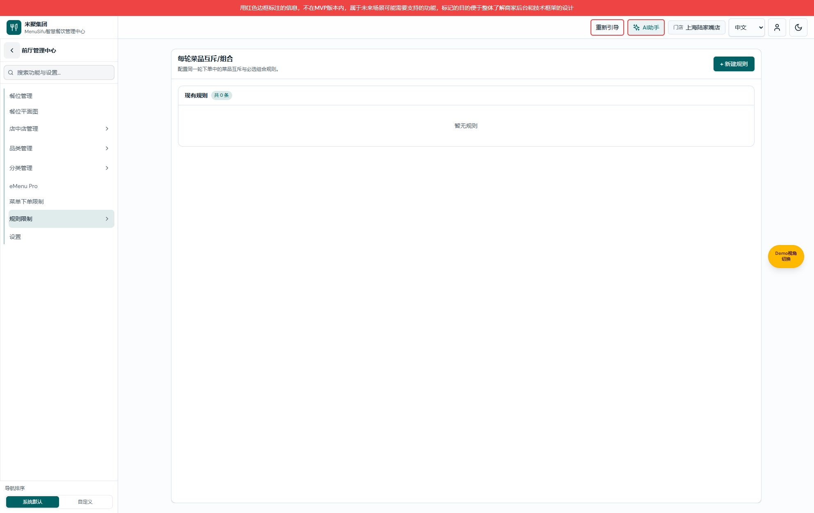

图注：历史位置参考，2026-10-15 的 B 方案运行截图。图中“菜单下单限制”行已不属于当前需求；当前要求移除此行。待补页面图片：NAV-20261016-01 移除该行后的前厅外层运行图；本次未执行新版本浏览器截图。

用途／入口：前厅管理中心；仅调整入口组织。

| 字段／操作 | 逻辑说明 |
|---|---|
| 菜单下单限制（移除入口） | 不再显示外层导航行，也不追加到菜单下单规则子层。原 /operations/queue-call/menu-order-limits 业务页、数据及能力注册保留；经原权限校验的旧地址仍可访问，不自动重定向。 |
| 菜单下单规则 | 替代原外层自助餐入口，位于 eMenu Pro 后、设置前；文字和留白点击均打开公共覆盖子导航，不切换业务地址、不写数据。 |
| 原外层自助餐规则 | 不再独立展示；只在菜单下单规则子层出现一次，原逻辑能力标识仍保留。 |
| 前厅搜索 | 沿用公共搜索；叶子按现有机制检索，不另设重复业务入口。 |

### 菜单下单规则子导航与每轮菜品互斥/组合

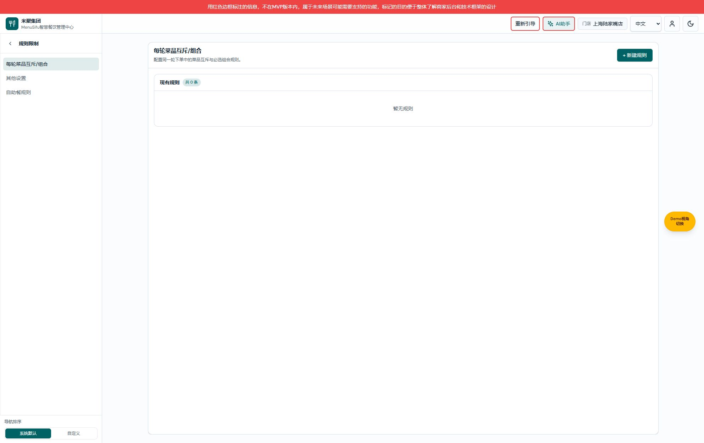

图注：历史位置参考；图中旧父菜单名称和排序已被 NAV-20261016-02 替代。待补页面图片：菜单下单规则新名称及自助餐规则首项状态。

用途／入口：前厅管理中心 → 菜单下单规则。沿用公共 NAV-20261014-01，子层顶边及宽度与父层一致，覆盖父标题、搜索及列表。

| 字段／操作 | 逻辑说明 |
|---|---|
| 当前层标题 | 显示“菜单下单规则”（英文 Menu ordering rules），来源为显示父节点名称，不读取业务数据。 |
| 返回上一级菜单 | 只返回前厅菜单，当前业务地址与未保存内容不因返回而改变；不保存、不下发。 |
| 每轮菜品互斥/组合 | 第二项；进入 /operations/queue-call/menu-order-limits/dish-round；保留原规则列表、新建和互斥／组合编辑逻辑。 |
| 其他设置 | 第三项；进入 /operations/queue-call/menu-order-limits/other，展示原设置。 |
| 自助餐规则 | 第一项；进入 /operations/queue-call/buffet-rules，展示既有现代自助餐规则列表，不替换成旧数量列表。 |
| 当前项高亮 | 点击叶子后保持子导航，按原地址标记当前项；刷新沿用公共导航内存栈规则，不承诺恢复下钻层级。 |
| 页内切换栏 | 原数量与频次／互斥组合／其他设置三项顶部切换栏取消；改由侧栏分别进入。不取消业务内部的页签、筛选或折叠区。 |
| 草稿保护 | 叶子跳转沿用既有保存桶及离页保护；取消离开不写入或丢弃草稿。本次不新增保存、发布和授权流程。 |

### 其他设置页面

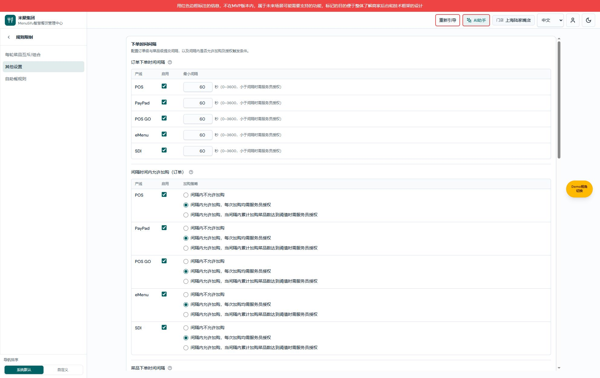

图注：历史位置参考，旧父菜单名称与顺序不再生效；其他设置选中；截图为原订单时间间隔与加购配置区域。本次未改变字段默认值、计算或配置含义。

入口：菜单下单规则 → 其他设置。下单时间间隔、命中后授权、积分菜限制及帮助说明保留原实现；顶部无重复三项切换栏。该页业务参数不属于本次重新定义范围。

### 自助餐规则页面

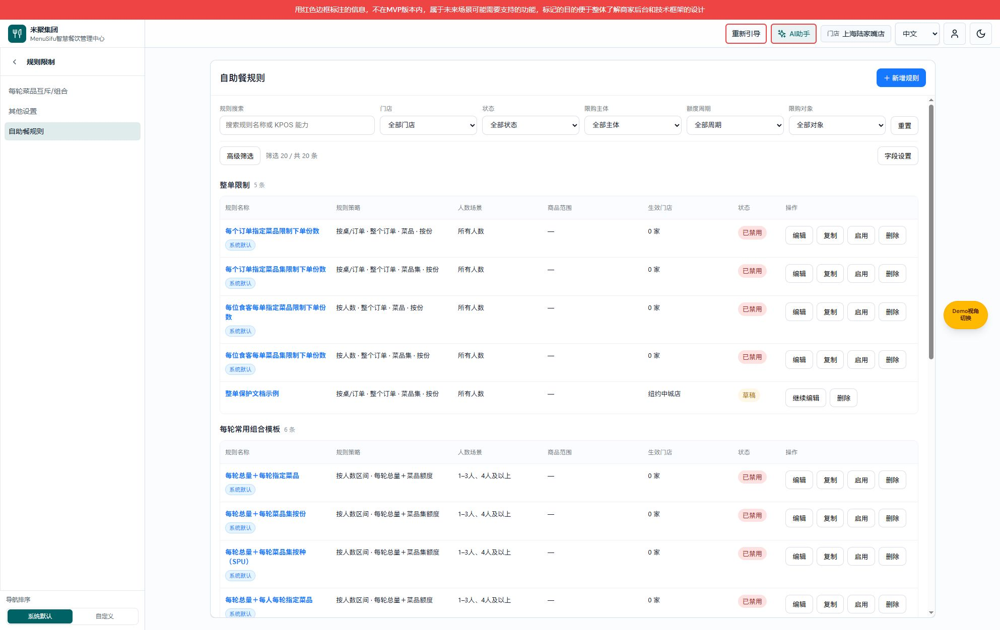

图注：历史位置参考，旧父菜单名称与顺序不再生效；自助餐规则选中；包含既有搜索、门店／状态／主体／周期／对象筛选及分组列表；演示草稿不是本次创建。

入口：菜单下单规则 → 自助餐规则。列表、新建五步流程、配置额度及原 iframe 全屏行为沿用既有规则，本次不修改其业务定义或数据。

### 可见范围、异常和验收

| 原可见能力 | 外层菜单下单限制 | 菜单下单规则内容 |
|---|---|---|
| 两项均可见 | 不展示 | 自助餐规则、互斥／组合、其他设置 |
| 仅菜单下单限制 | 不展示 | 互斥／组合、其他设置 |
| 仅自助餐规则 | 不展示 | 自助餐规则 |
| 两项均不可见 | 不展示 | 不展示父项 |

逻辑能力 qc-menu-order-limits、foh-buffet-rules 及原 URL 保留；先经过既有权限、订阅、发布、预设处理，再组织显示层，不将新父项作为额外授权。若既有过滤结果没有可见子项，不生成空父项。失败与取消继续使用原业务处理，无新增请求、数值字段、金额、精度或统计公式。

本次新增断言：父标题为“菜单下单规则”，自助餐规则为首项；不改变 qc-rule-restrictions 标识和 rule-restrictions 原显示容器路径，不迁移权限。其余验收：四种能力组合均不得出现外层旧行；菜单下单规则子项数量仍为 3／2／1／0，无可见叶子不生成空父项；输入树不变，旧数量根地址仍注册但无对应外层高亮。针对性导航、公共递归、自助餐导航／全屏脚本及类型检查通过。新版本尚未执行浏览器验收，旧图不作为本次完成证据；生产角色授权、真实下发及业务编辑不在本次已验证范围。

## 店中店管理子导航与页面拆分（SHOP-20261015-01）

本次依据：用户于 2026-10-15 确认“采用建议”。复用本模块既有三份导航权威入口，范围包含店中店导航、页面布局及相关渠道设置，不重新定义品牌营业、商品主数据或终端运行规则。

### 品牌管理页面

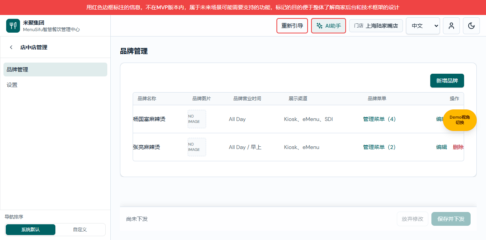

图注：2026-10-15，本地原生项目；SHOP-20261015-01；上海陆家嘴店演示数据、无待保存修改。左侧店中店子导航覆盖父层。

用途／入口：前厅管理中心 → 店中店管理 → 品牌管理；管理当前门店品牌，地址 `/operations/queue-call/brand-menu/brands`。

| 字段／操作 | 逻辑说明 |
|---|---|
| 店中店管理父菜单 | 整行文字与留白点击均进入公共子导航覆盖滑层；点击父节点不修改业务页，不内嵌展开。子层顶边和宽度对齐父层。 |
| 返回上一级菜单 | 只返回前厅菜单这一层；不提交、丢弃或重置业务草稿。 |
| 品牌管理子菜单 | 进入独立品牌列表地址，保持子导航显示并高亮当前项；页面内不再重复“品牌与菜单／设置”页签。 |
| 设置子菜单 | 进入 `/operations/queue-call/brand-menu/settings`，同样保持子导航显示与当前项高亮。 |
| 新增品牌 | 保留列表顶部按钮及原创建弹框；不拆成导航菜单。 |
| 品牌名称 | 显示当前行品牌名称，来源为当前门店品牌集合，不改名称编辑规则。 |
| 品牌图片 | 展示该品牌已配置图片；缺少图片保留现有占位。 |
| 品牌营业时间 | 显示该品牌引用的营业时间摘要；沿用原营业时间规则来源及编辑方式。 |
| 展示渠道 | 显示当前品牌可见渠道，属于品牌自身属性；不代替设置页的全局品牌模式和首页选项。 |
| 品牌菜单 | 显示当前品牌的“管理菜单（数量）”入口；数量沿用既有跨产线菜单选择计数，不新增菜单总数口径。 |
| 编辑 | 打开当前品牌编辑弹框，携带当前品牌 ID 和回填资料；不改变原保存校验。 |
| 删除 | 保留当前品牌删除确认及取消结果；本次不调整删除影响、可恢复性或权限。 |

### 指定品牌的菜单编辑弹框

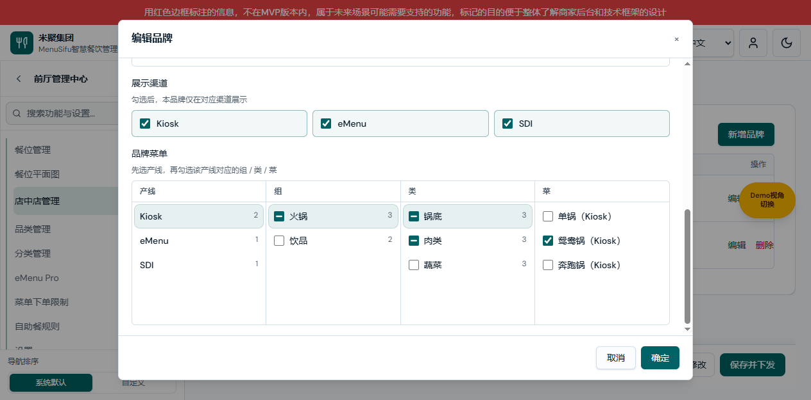

图注：2026-10-15，本地原生项目；SHOP-20261015-01；“杨国富麻辣烫”菜单编辑定位状态。弹框已滚动至菜单区域，上方品牌资料仍在同一表单内。

用途／入口：品牌管理列表 → 对应行“管理菜单（数量）”。复用当前品牌编辑弹框，不新增独立菜单库，也不将商品主数据维护迁入此处。

| 字段／操作 | 逻辑说明 |
|---|---|
| 管理菜单入口 | 从该行品牌 ID 读取并回填同一品牌，打开编辑弹框并滚动定位品牌菜单区域；不得打开其他品牌或无上下文空表单。 |
| 品牌菜单区域 | 沿用已有“产线 → 组 → 类 → 菜”选择器和原选中数据；品牌名称、图片、营业时间、展示渠道仍属于同一品牌记录。 |
| 确定 | 沿用既有品牌校验：名称去除首尾空格后不能为空，空名称时聚焦名称输入且不关闭弹框；通过后更新当前品牌草稿并关闭、刷新列表。仍须由页面保存流程提交。 |
| 取消／关闭／遮罩／Escape | 关闭弹框，不把本次尚未确定的表单修改写入品牌集合；此前已确定的页面草稿继续保留。 |

### 店中店设置页面

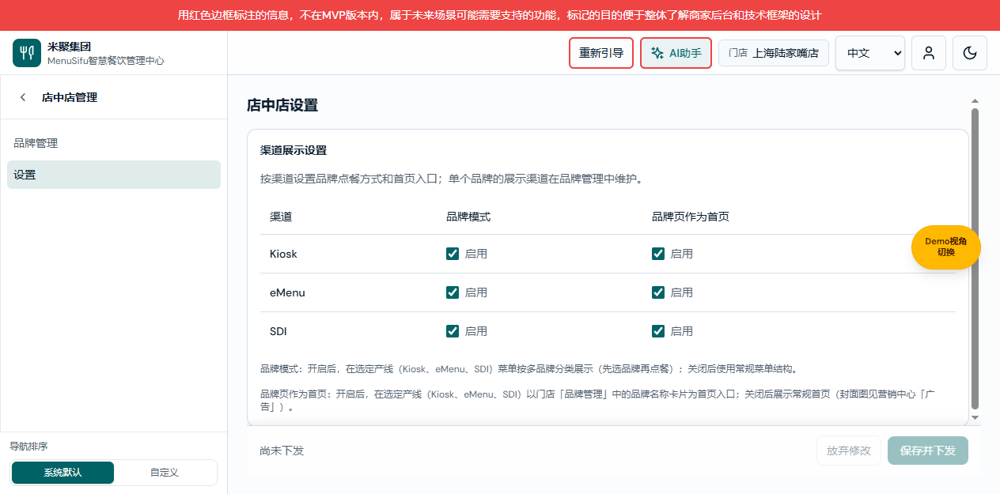

图注：2026-10-15，本地原生项目；SHOP-20261015-01；Kiosk、eMenu、SDI 三渠道默认开启状态，无待保存修改。

用途／入口：店中店管理 → 设置；按渠道对比整体品牌点餐方式和首页入口。品牌列表不再展示这两个全局设置。

| 字段／操作 | 逻辑说明 |
|---|---|
| 渠道 | 固定显示 Kiosk、eMenu、SDI，每行是一条渠道；本次不扩展其他渠道的全局展示开关。 |
| 品牌模式 | 每渠道独立布尔选项；开启按多品牌分类先选品牌再点餐，关闭使用常规菜单结构。读取原 seq 531 配置，未配置默认开启。 |
| 品牌页作为首页 | 每渠道独立布尔选项；开启以品牌卡片作为首页入口，关闭使用原常规首页。读取原 seq 530 配置，未配置默认开启。 |
| 启用控件 | 点击对应控件或标签区域改变该渠道的一个选项；首次修改默认开启的未落库配置也必须生成草稿。不得自动改变另一列或其他渠道。 |
| 说明文案 | 就近解释两个设置的作用范围，并提示具体品牌的展示渠道在品牌管理维护。 |
| 放弃修改 | 沿用公共放弃确认；确认后丢弃店中店共享草稿并恢复已保存值，取消则保留修改。 |
| 保存并下发 | 沿用现有门店选择、保存确认、权限及下发过程；本次不新增提交或下发规则。没有修改时禁用；本次浏览器验证未执行实际下发。 |

### 未保存离开确认

图注：2026-10-15，本地原生项目；SHOP-20261015-01；店中店存在一项渠道草稿，点击餐位平面图触发公共离开确认。

| 字段／操作 | 逻辑说明 |
|---|---|
| 模块内切换 | 品牌管理与设置共用原店中店保存桶；切换保留草稿和待保存数量，不弹出离开确认。 |
| 离开未保存页面 | 离开店中店到其他保存桶时沿用公共保护提示。 |
| 取消 | 恢复原业务地址并保留草稿；子导航展开状态沿用公共实现。 |
| 确认离开 | 丢弃该模块未保存草稿，进入所选目标；不保存、不下发。 |

### 验收与待确认项

已验证：父菜单文字区域及留白真实鼠标点击、覆盖子层及单层返回、两子页面切换和高亮、旧根地址归一到品牌管理、设置地址直接加载、菜单入口回填并定位、取消编辑、首次默认选项修改生成草稿、模块内草稿保留、离开提示与取消恢复、放弃后恢复默认开启。类型检查、公共递归导航检查、店中店路由／字段／保存桶回归通过。

待确认 SHOP-Q01：品牌模式与品牌首页是否有业务依赖，以及无可见品牌、无菜单、非营业时间的终端展示策略。本次保留既有独立配置，不新增互锁或终端兜底。未重新验收所有既有品牌 CRUD、生产权限组合和真实下发链路。隔离 main 首次加载仍观察到既有初始化带出 5 项待保存的基线现象；本次未纳入其他任务的通用初始化修复，未声称该历史问题已解决。

## 前厅餐位管理并列入口（FOH-20261015-01）

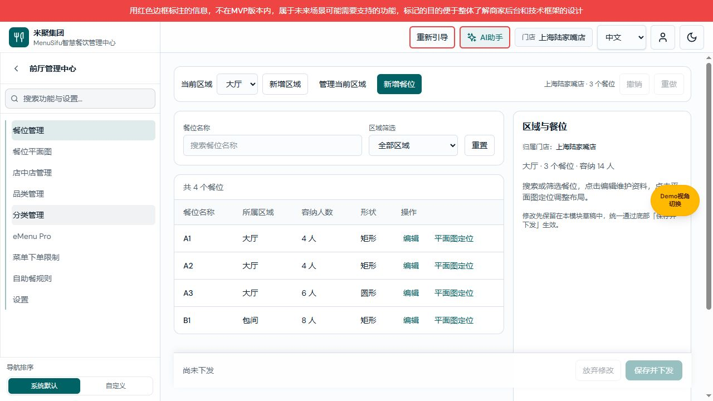

图注：2026-10-15，本地原生项目，隔离测试数据；前厅公共二级滑层保持显示。

| 字段／操作 | 逻辑说明 |
|---|---|
| 餐位管理 | 新增并列入口 `/operations/queue-call/tables`，位于餐位平面图之前；整行文字与留白点击行为一致。 |
| 餐位平面图 | 保留原入口与默认地址；负责空间布局，管理页负责资料维护。 |
| 导航及保存上下文 | 管理页与平面图共享同一门店、业务草稿、保存键；互跳不触发丢弃，离开模块按原保护执行。 |
| 能力过滤 | 新视图复用 `qc-floor-plan` 已有能力；权限、订阅、发布与平台预设仍按原条件校验，不新增授权。 |
| 层级 | 不新增餐位配置父层，不新增独立区域菜单；公共覆盖滑层规则保持。 |

具体字段与行为见[餐位产品权威 V1.0](餐位管理产品权威需求文档.md)、[研发 V1.0](餐位管理业务规格说明书（研发交付版）.md)、[个人 V1.0](餐位管理需求文档（个人规范版）.md)。本节只登记导航变化，不复制业务规则。

## 云产品入口取消提示弹窗（NAV-20261015-05）

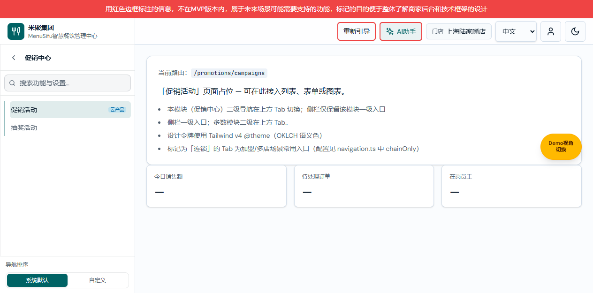

图注：2026-10-15，本地 Vite 原生项目，点击促销活动后保留云产品标签、进入原路由且无公共提示弹窗。其他入口逐页运行图片待补。

用途／入口：所有由公共云产品路由提示组件管理的一级与子级入口。用户明确要求不再展示截图中的“云产品…通过路由配置”对话框。

| 字段／操作 | 逻辑说明 |
|---|---|
| 一级云产品入口 | 点击商品中心、会员中心、评价中心、预约等位中心、报表中心、礼品卡中心时，沿用原菜单展开或导航，不显示路由配置对话框。 |
| 子级云产品入口 | 促销活动、打印装修、营销活动、手动营销、屏保、消息模板、消息配置和消息额度沿用原目标地址，不显示路由配置对话框。 |
| 云产品标签 | 沿用原显隐条件及翻译，只显示产品归属；点击标签区域与整行操作一致。 |
| 对话框标题、提示正文、知道了、遮罩 | 全部取消，没有关闭、确认或取消步骤，不产生额外数据写入。 |
| 权限与草稿保护 | 继续执行原权限、订阅、发布、预设过滤和草稿离页校验。 |

研发：删除公共提示的状态、点击捕获监听、延迟重挂载与对话框渲染；保留标签函数。此提示无存储迁移、金额计算或业务状态变更。业务自身错误、保存确认及员工报表独立来源说明不属于此公共路由配置弹窗。

验收口径：点击一级与子级云产品入口及重复进入、刷新后均不出现 data-cloud-product-notice-dialog；菜单导航和原标签仍可用。

本次验证：TypeScript 与公共递归导航检查通过；源码已无公共弹窗渲染及点击监听引用。真实浏览器点击商品中心后正常打开子导航，点击促销活动后进入 /promotions/campaigns，公共弹窗数量均为 0；标签仍显示。

## 会员中心菜单与路由（MEMBERS-20261015-01）

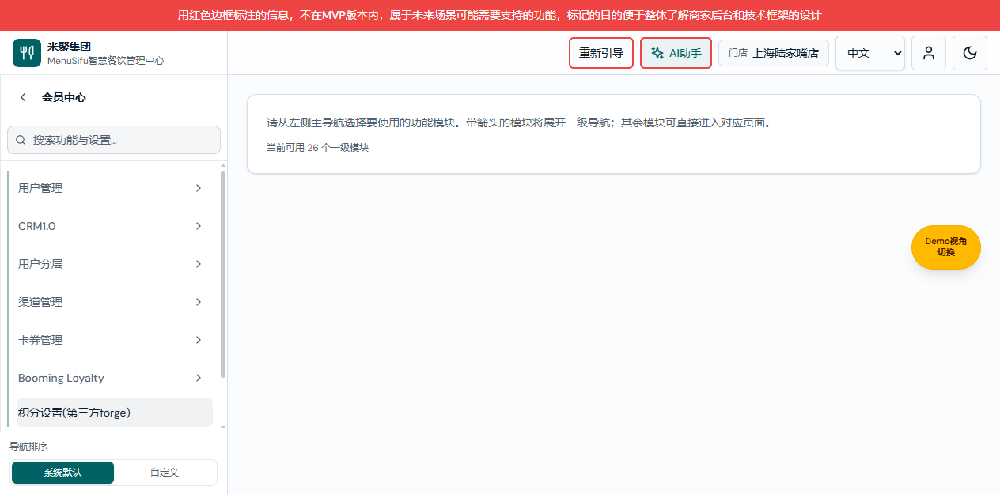

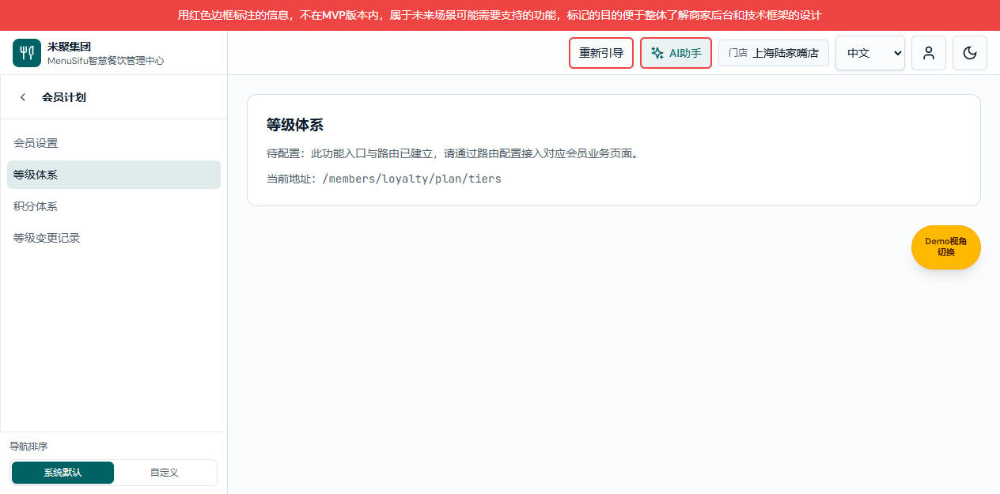

图注：2026-10-15，本地 Vite 原生项目运行截图，MEMBERS-20261015-01；分别为会员中心顶层、四级叶子选中与待配置状态。

用户于 2026-10-15 明确选择先实现完整菜单与路由。共同业务基线为本次七张菜单截图；只确认入口名称、层级和顺序，不确认会员业务字段、计算、保存、营销执行或第三方接口。

图注：用户提供的菜单层级参考，第 1 张，2026-10-15；不是本项目运行截图。

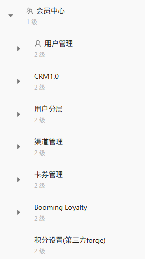

图注：用户提供的菜单层级参考，第 2 张，2026-10-15；不是本项目运行截图。

图注：用户提供的菜单层级参考，第 3 张，2026-10-15；不是本项目运行截图。

图注：用户提供的菜单层级参考，第 4 张，2026-10-15；不是本项目运行截图。

图注：用户提供的菜单层级参考，第 5 张，2026-10-15；不是本项目运行截图。

图注：用户提供的菜单层级参考，第 6 张，2026-10-15；不是本项目运行截图。

图注：用户提供的菜单层级参考，第 7 张，2026-10-15；不是本项目运行截图。

用途／入口：侧栏会员中心。菜单保留当前作用域，沿用权限、订阅、发布与预设过滤；点击不创建会员或营销数据。

| 字段／操作 | 逻辑说明 |
|---|---|
| 父菜单整行 | 有可访问子项时进入公共覆盖滑层；覆盖父标题、搜索与菜单，保持宽度和顶部位置。 |
| 返回 | 每次只退一层；会员中心顶层返回一级侧栏。 |
| 叶子菜单 | 进入唯一地址，当前子导航保持显示，当前项高亮；有草稿时沿用公共离页保护。 |
| 搜索 | 支持三级与四级名称；过滤后保留通往匹配叶子的祖先路径。 |
| 待配置提示 | 业务页面未接入时显示“待配置：此功能入口与路由已建立，请通过路由配置接入对应会员业务页面。”不提供业务提交或模拟指标。 |
| 当前地址 | 只读字符串，显示当前独立路由，无输入或保存。 |
| 兼容设置入口 | 原 /members/settings 保留并接入现有设置；截图中的 CRM 设置与 Booming 会员设置保持独立。 |
| 旧地址 | /members/card/coupon-mgmt、/members/card/paid-detail、/members/card/paid-config、/members/points 保留；积分入口展示截图名称。 |

### 各菜单元素与地址

| 字段／操作 | 逻辑说明 |
|---|---|
| 用户管理 | `/members/users`；目录整行点击下钻，不写入业务数据。 |
| 用户管理 → 会员列表 | `/members/users/list`；叶子进入此地址，标题为“会员列表”；未接入业务时显示待配置。 |
| 用户管理 → 修改会员信息 | `/members/users/edit`；叶子进入此地址，标题为“修改会员信息”；未接入业务时显示待配置。 |
| CRM1.0 | `/members/crm`；目录整行点击下钻，不写入业务数据。 |
| CRM1.0 → 会员概览 | `/members/crm/overview`；叶子进入此地址，标题为“会员概览”；未接入业务时显示待配置。 |
| CRM1.0 → 会员管理 | `/members/crm/members`；叶子进入此地址，标题为“会员管理”；未接入业务时显示待配置。 |
| CRM1.0 → 访问报表 | `/members/crm/visits`；叶子进入此地址，标题为“访问报表”；未接入业务时显示待配置。 |
| CRM1.0 → 销售报表 | `/members/crm/sales`；叶子进入此地址，标题为“销售报表”；未接入业务时显示待配置。 |
| CRM1.0 → 短信营销任务 | `/members/crm/sms-tasks`；叶子进入此地址，标题为“短信营销任务”；未接入业务时显示待配置。 |
| CRM1.0 → 生日营销任务 | `/members/crm/birthday-tasks`；叶子进入此地址，标题为“生日营销任务”；未接入业务时显示待配置。 |
| CRM1.0 → 设置 | `/members/crm/settings`；叶子进入此地址，标题为“设置”；未接入业务时显示待配置。 |
| CRM1.0 → 用户列表 | `/members/crm/users`；叶子进入此地址，标题为“用户列表”；未接入业务时显示待配置。 |
| 用户分层 | `/members/segments`；目录整行点击下钻，不写入业务数据。 |
| 用户分层 → 动态标签 | `/members/segments/dynamic-tags`；叶子进入此地址，标题为“动态标签”；未接入业务时显示待配置。 |
| 渠道管理 | `/members/channels`；目录整行点击下钻，不写入业务数据。 |
| 渠道管理 → KOL/KOC管理 | `/members/channels/kol-koc`；叶子进入此地址，标题为“KOL/KOC管理”；未接入业务时显示待配置。 |
| 卡券管理 | `/members/card`；目录整行点击下钻，不写入业务数据。 |
| 卡券管理 → 优惠券管理 | `/members/card/coupon-mgmt`；叶子进入此地址，标题为“优惠券管理”；未接入业务时显示待配置。 |
| 卡券管理 → 付费会员明细 | `/members/card/paid-detail`；叶子进入此地址，标题为“付费会员明细”；未接入业务时显示待配置。 |
| 卡券管理 → 付费会员配置 | `/members/card/paid-config`；叶子进入此地址，标题为“付费会员配置”；未接入业务时显示待配置。 |
| Booming Loyalty | `/members/loyalty`；目录整行点击下钻，不写入业务数据。 |
| Booming Loyalty → 经营预览 | `/members/loyalty/overview`；叶子进入此地址，标题为“经营预览”；未接入业务时显示待配置。 |
| Booming Loyalty → 支付顾客识别 | `/members/loyalty/recognition`；目录整行点击下钻，不写入业务数据。 |
| Booming Loyalty → 支付顾客识别 → 顾客分析 | `/members/loyalty/recognition/analysis`；叶子进入此地址，标题为“顾客分析”；未接入业务时显示待配置。 |
| Booming Loyalty → 支付顾客识别 → 识别设置 | `/members/loyalty/recognition/settings`；叶子进入此地址，标题为“识别设置”；未接入业务时显示待配置。 |
| Booming Loyalty → 会员管理 | `/members/loyalty/members`；目录整行点击下钻，不写入业务数据。 |
| Booming Loyalty → 会员管理 → 会员列表 | `/members/loyalty/members/list`；叶子进入此地址，标题为“会员列表”；未接入业务时显示待配置。 |
| Booming Loyalty → 会员管理 → 会员标签与分群 | `/members/loyalty/members/segments`；叶子进入此地址，标题为“会员标签与分群”；未接入业务时显示待配置。 |
| Booming Loyalty → 会员计划 | `/members/loyalty/plan`；目录整行点击下钻，不写入业务数据。 |
| Booming Loyalty → 会员计划 → 会员设置 | `/members/loyalty/plan/settings`；叶子进入此地址，标题为“会员设置”；未接入业务时显示待配置。 |
| Booming Loyalty → 会员计划 → 等级体系 | `/members/loyalty/plan/tiers`；叶子进入此地址，标题为“等级体系”；未接入业务时显示待配置。 |
| Booming Loyalty → 会员计划 → 积分体系 | `/members/loyalty/plan/points`；叶子进入此地址，标题为“积分体系”；未接入业务时显示待配置。 |
| Booming Loyalty → 会员计划 → 等级变更记录 | `/members/loyalty/plan/tier-history`；叶子进入此地址，标题为“等级变更记录”；未接入业务时显示待配置。 |
| Booming Loyalty → 权益会员 | `/members/loyalty/benefits`；目录整行点击下钻，不写入业务数据。 |
| Booming Loyalty → 权益会员 → 权益会员配置 | `/members/loyalty/benefits/config`；叶子进入此地址，标题为“权益会员配置”；未接入业务时显示待配置。 |
| Booming Loyalty → 权益会员 → 权益会员明细 | `/members/loyalty/benefits/details`；叶子进入此地址，标题为“权益会员明细”；未接入业务时显示待配置。 |
| Booming Loyalty → 权益会员 → 会员价 | `/members/loyalty/benefits/pricing`；叶子进入此地址，标题为“会员价”；未接入业务时显示待配置。 |
| Booming Loyalty → 卡券管理 | `/members/loyalty/coupons`；目录整行点击下钻，不写入业务数据。 |
| Booming Loyalty → 卡券管理 → 券模板管理 | `/members/loyalty/coupons/templates`；叶子进入此地址，标题为“券模板管理”；未接入业务时显示待配置。 |
| Booming Loyalty → 卡券管理 → 会员优惠券 | `/members/loyalty/coupons/member-coupons`；叶子进入此地址，标题为“会员优惠券”；未接入业务时显示待配置。 |
| Booming Loyalty → 卡券管理 → 渠道优惠券 | `/members/loyalty/coupons/channel-coupons`；叶子进入此地址，标题为“渠道优惠券”；未接入业务时显示待配置。 |
| Booming Loyalty → 卡券管理 → 券包设置 | `/members/loyalty/coupons/package-settings`；叶子进入此地址，标题为“券包设置”；未接入业务时显示待配置。 |
| Booming Loyalty → 卡券管理 → 券包明细 | `/members/loyalty/coupons/package-details`；叶子进入此地址，标题为“券包明细”；未接入业务时显示待配置。 |
| Booming Loyalty → 卡券管理 → 礼品卡 | `/members/loyalty/coupons/gift-cards`；叶子进入此地址，标题为“礼品卡”；未接入业务时显示待配置。 |
| Booming Loyalty → 营销管理 | `/members/loyalty/marketing`；目录整行点击下钻，不写入业务数据。 |
| Booming Loyalty → 营销管理 → 精准营销 | `/members/loyalty/marketing/targeted`；叶子进入此地址，标题为“精准营销”；未接入业务时显示待配置。 |
| Booming Loyalty → 营销管理 → 自动化营销 | `/members/loyalty/marketing/automation`；叶子进入此地址，标题为“自动化营销”；未接入业务时显示待配置。 |
| Booming Loyalty → 营销管理 → 营销活动 | `/members/loyalty/marketing/campaigns`；叶子进入此地址，标题为“营销活动”；未接入业务时显示待配置。 |
| Booming Loyalty → 营销管理 → 广告位管理 | `/members/loyalty/marketing/ad-slots`；叶子进入此地址，标题为“广告位管理”；未接入业务时显示待配置。 |
| 积分设置(第三方forge) | `/members/points`；叶子进入此地址，标题为“积分设置(第三方forge)”；未接入业务时显示待配置。 |

研发约束：唯一数据源 src/config/member-center-navigation.ts；id 是二级预设键，path 是地址，sidebarChildren 递归描述子菜单；父节点无业务写入。叶子权限资源沿用 page:<path>，不自动增加授权。金额、计算精度、业务状态、保存失败、营销执行均不适用本次导航交付。

验收：七个二级入口按截图排序；Booming Loyalty → 会员计划 → 等级体系进入 /members/loyalty/plan/tiers；返回依次回到会员计划、Booming Loyalty 和会员中心；用户管理与 Booming 会员列表使用不同地址。原设置仍可访问。

验证：TypeScript 与公共递归导航检查通过；38 个叶子路由、标题、登记与路径集合核对通过；浏览器验证四级下钻、叶子高亮保持与逐层返回通过；用户管理文字中心 (53,238) 与右侧空白 (237,238) 真实指针点击均成功；搜索等级体系显示完整四级面包屑。移除会员中心旧点击提示弹窗，保留云产品标签。

未闭合：具体业务页接入及业务规则不在本次范围；除已附运行状态外，其余叶子的逐页运行图待补；用户菜单参考不替代运行验收。既有其他模块历史差异沿用原状态。

## 商品中心 → 调味管理 → 下发记录（NAV-20261015-04）

图注：2026-10-15，本地原生项目，NAV-20261015-04，调味记录独立空状态。

| 字段／操作 | 逻辑说明 |
|---|---|
| 下发记录入口 | 商品中心 → 商品管理 → 调味管理 → 下发记录，打开 `/brand-products/seasoning-mgmt/distribution-log`，不跳至系统设置。沿用原导航权限和高亮。 |
| 页面标题 | 显示“下发记录”，页面对象为调味下发记录。 |
| 默认数据 | 默认记录数为 0；不读取系统下发记录、不注入系统演示数据，也不删除系统已有记录。 |
| 空状态 | 显示“暂无调味下发记录”，不展示伪造记录、详情或重试操作。英文使用对应空状态文案。 |
| 地址与刷新 | 保留独立地址，允许末尾斜杠，刷新仍为空状态。 |

实现范围：仅本页地址隔离与默认空展示；未来调味下发写入、字段、筛选、失败与重试尚未定义，本次不新增。系统设置下发记录与其他旧下发入口沿用原逻辑。此页面不加载业务数据，没有加载失败转为空的分支，不产生保存／下发副作用。

验收证据：针对性测试修复前重定向断言失败，修复后通过；浏览器已确认独立地址及空提示。完整真实下发链路不在本次范围内。

## 团队管理云产品标签（NAV-20261015-03）

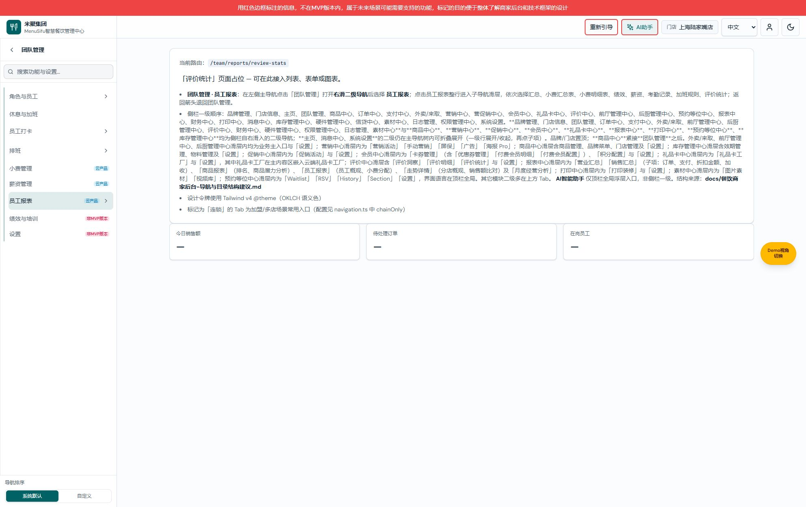

图注：团队管理菜单，小费管理、薪资管理、员工报表均显示云产品标签；本地原生预览，NAV-20261015-03，2026-10-15。浏览器已确认三项标签可见。

| 字段／元素 | 逻辑说明 |
|---|---|
| 小费管理标签 | 菜单行名称后显示“云产品”，沿用公共蓝色标签样式。 |
| 薪资管理标签 | 菜单行名称后显示“云产品”；作为父菜单时同样显示。 |
| 员工报表标签 | 父菜单行名称后、进入箭头前显示“云产品”。 |

三项沿用 `CLOUD_PRODUCT_NAV_CHILD_IDS` 配置；叶子与父菜单共用标签渲染。标签仅说明产品归属，点击标签所在位置沿用整行点击行为，不新增路由、权限、提示弹框、保存或下发规则。中文显示“云产品”，其他语言沿用公共翻译。验收：三项标签可见，父菜单仍可进入子导航，叶子沿用原地址。

## 员工报表子导航（NAV-20261015-02）

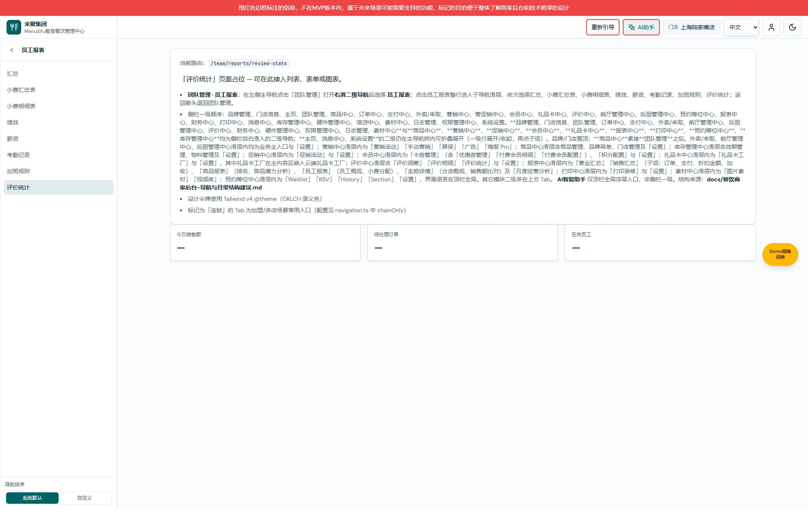

图注：员工报表八项子导航，评价统计选中态；2026-10-15 本地原生项目，NAV-20261015-02。右侧为占位页。

入口：团队管理 → 员工报表。复用 NAV-20261014-01 公共覆盖滑层；只调整导航位置，报表内容与统计口径沿用既有定义。

| 字段／操作 | 逻辑说明 |
|---|---|
| 员工报表父菜单 | 整行文字与空白点击进入员工报表子导航，不自动跳转业务地址；覆盖团队管理标题、搜索及菜单区域。 |
| 当前层标题 | 显示“员工报表”，顶部与宽度同父层。 |
| 返回箭头 | 仅退回团队管理菜单；当前业务地址不变，不写入业务数据。 |
| 汇总 | 第一项，目标 `/team/reports/summary`。 |
| 小费汇总表 | 第二项，目标 `/team/reports/tip-summary`。 |
| 小费明细表 | 第三项，目标 `/team/reports/tip-detail`。 |
| 绩效 | 第四项，目标 `/team/reports/performance`。 |
| 薪资 | 第五项，目标 `/team/reports/payroll`；沿用员工报表内容，不切换至薪资管理。 |
| 考勤记录 | 第六项，位于薪资后，目标 `/team/reports/attendance`，报表独立占位页；不改变员工打卡的考勤记录入口。 |
| 加班规则 | 第七项，目标 `/team/reports/overtime-rules`，独立占位页；本次不定义或实现加班计算、编辑及保存。 |
| 评价统计 | 第八项，目标 `/team/reports/review-stats`，报表独立占位页；不改变评价中心入口。 |
| 叶子点击与高亮 | 点击打开对应原地址，保留当前子导航，按地址标记当前项；内容区不再显示重复的员工报表细项导航。 |
| 可见与异常 | 沿用权限、订阅、发布、预设过滤及草稿保护。过滤后无子项不显示空下钻层；导航本身无金额、精度、输入字段或保存操作。 |

研发映射：`team-reports.children` 是唯一菜单数据源；`TEAM_REPORTS_SUBNAV` 引用同一数组，保留原五个 `team-rpt-*` 标识及路径，追加三个报表标识及路径。旧父地址及旧别名继续使用现有路由归一化逻辑。刷新不恢复下钻栈，沿用公共规则。

验收：父行文字中心和空白点击均应打开八项子导航且地址不变；依次点击八项应进入对应地址并高亮、保留滑层；返回恢复团队管理；直接打开叶子地址可渲染对应内容且没有重复细项列。无权限／无订阅场景沿用现有过滤结果。

验证状态：TypeScript 与公共递归导航检查通过；浏览器已确认八项顺序、父项进入不改变地址、考勤记录页面加载、加班规则与评价统计点击跳转及子导航保留。未覆盖全部权限组合及空白坐标点击。

## 员工打卡子导航

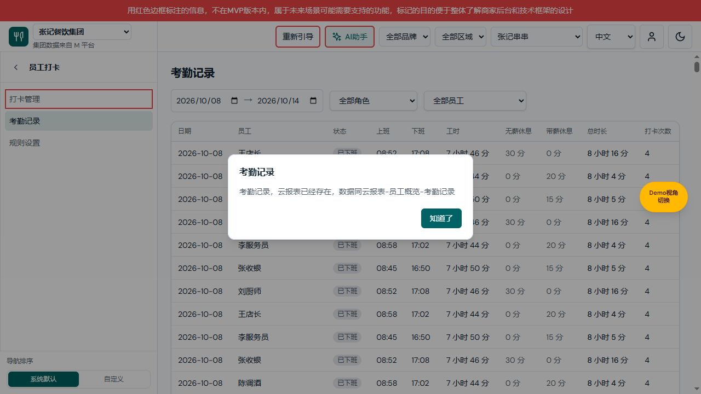
图注：本地原生项目，NAV-20261014-01，2026-10-14 演示状态；右侧为截图时实际业务页，不代表点击父菜单会自动进入默认业务页。

入口：团队管理 → 员工打卡；查看打卡管理、考勤记录、规则设置。

### 标题与菜单区域

| 字段 | 逻辑说明 |
|---|---|
| 当前菜单标题 | 来源为被点击父项名称；与父层顶部及宽度对齐，覆盖父标题、搜索和列表。 |
| 返回箭头 | 点击退一层，更深层返回前一父菜单，首层返回所属模块根菜单；当前业务地址和数据不变，无保存／下发。 |
| 有子菜单的菜单行 | 来源为当前允许访问的导航树，整行文字和空白均可点击，进入下一层覆盖滑层；不内嵌展开。 |
| 叶子菜单行 | 进入原业务地址并保留子导航；当前地址对应项高亮。业务页权限与草稿保护沿用原机制。 |
| 菜单滚动区域 | 内容超出可见高度时内部纵向滚动，标题栏固定在原顶部位置。 |

## 排班子导航

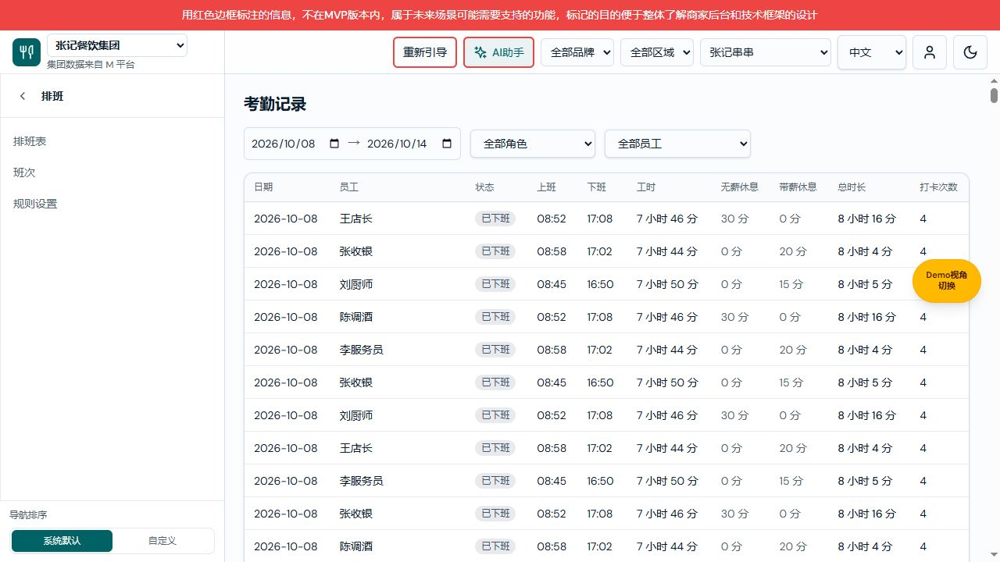
图注：本地原生项目，NAV-20261014-01，2026-10-14 演示状态；右侧为截图时实际业务页，不代表点击父菜单会自动进入默认业务页。

入口：团队管理 → 排班；查看排班表、班次、规则设置。

### 标题与菜单区域

| 字段 | 逻辑说明 |
|---|---|
| 当前菜单标题 | 来源为被点击父项名称；与父层顶部及宽度对齐，覆盖父标题、搜索和列表。 |
| 返回箭头 | 点击退一层，更深层返回前一父菜单，首层返回所属模块根菜单；当前业务地址和数据不变，无保存／下发。 |
| 有子菜单的菜单行 | 来源为当前允许访问的导航树，整行文字和空白均可点击，进入下一层覆盖滑层；不内嵌展开。 |
| 叶子菜单行 | 进入原业务地址并保留子导航；当前地址对应项高亮。业务页权限与草稿保护沿用原机制。 |
| 菜单滚动区域 | 内容超出可见高度时内部纵向滚动，标题栏固定在原顶部位置。 |

## 商品管理子导航

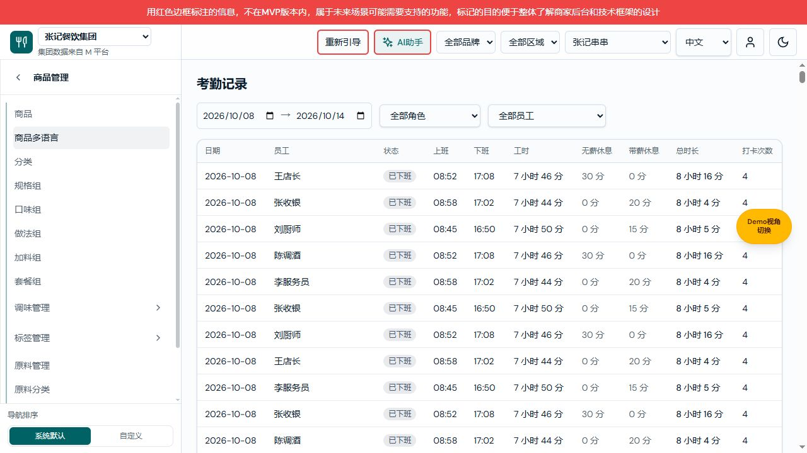
图注：本地原生项目，NAV-20261014-01，2026-10-14 演示状态；右侧为截图时实际业务页，不代表点击父菜单会自动进入默认业务页。

入口：商品中心 → 商品管理；查看商品、分类、规格等已有导航项。

### 标题与菜单区域

| 字段 | 逻辑说明 |
|---|---|
| 当前菜单标题 | 来源为被点击父项名称；与父层顶部及宽度对齐，覆盖父标题、搜索和列表。 |
| 返回箭头 | 点击退一层，更深层返回前一父菜单，首层返回所属模块根菜单；当前业务地址和数据不变，无保存／下发。 |
| 有子菜单的菜单行 | 来源为当前允许访问的导航树，整行文字和空白均可点击，进入下一层覆盖滑层；不内嵌展开。 |
| 叶子菜单行 | 进入原业务地址并保留子导航；当前地址对应项高亮。业务页权限与草稿保护沿用原机制。 |
| 菜单滚动区域 | 内容超出可见高度时内部纵向滚动，标题栏固定在原顶部位置。 |

## 配方管理子导航

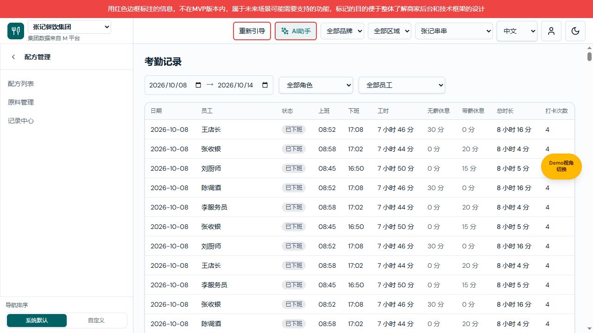
图注：本地原生项目，NAV-20261014-01，2026-10-14 演示状态；右侧为截图时实际业务页，不代表点击父菜单会自动进入默认业务页。

入口：商品中心 → 商品管理 → 配方管理；查看配方列表、原料管理、记录中心。

### 标题与菜单区域

| 字段 | 逻辑说明 |
|---|---|
| 当前菜单标题 | 来源为被点击父项名称；与父层顶部及宽度对齐，覆盖父标题、搜索和列表。 |
| 返回箭头 | 点击退一层，更深层返回前一父菜单，首层返回所属模块根菜单；当前业务地址和数据不变，无保存／下发。 |
| 有子菜单的菜单行 | 来源为当前允许访问的导航树，整行文字和空白均可点击，进入下一层覆盖滑层；不内嵌展开。 |
| 叶子菜单行 | 进入原业务地址并保留子导航；当前地址对应项高亮。业务页权限与草稿保护沿用原机制。 |
| 菜单滚动区域 | 内容超出可见高度时内部纵向滚动，标题栏固定在原顶部位置。 |

## 卡券管理子导航

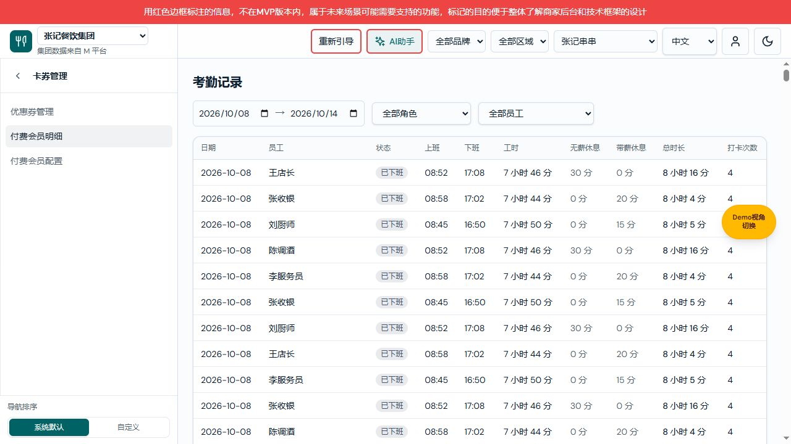
图注：本地原生项目，NAV-20261014-01，2026-10-14 演示状态；右侧为截图时实际业务页，不代表点击父菜单会自动进入默认业务页。

入口：会员中心 → 卡券管理；查看优惠券管理、付费会员明细、付费会员配置。

### 标题与菜单区域

| 字段 | 逻辑说明 |
|---|---|
| 当前菜单标题 | 来源为被点击父项名称；与父层顶部及宽度对齐，覆盖父标题、搜索和列表。 |
| 返回箭头 | 点击退一层，更深层返回前一父菜单，首层返回所属模块根菜单；当前业务地址和数据不变，无保存／下发。 |
| 有子菜单的菜单行 | 来源为当前允许访问的导航树，整行文字和空白均可点击，进入下一层覆盖滑层；不内嵌展开。 |
| 叶子菜单行 | 进入原业务地址并保留子导航；当前地址对应项高亮。业务页权限与草稿保护沿用原机制。 |
| 菜单滚动区域 | 内容超出可见高度时内部纵向滚动，标题栏固定在原顶部位置。 |

## 公共菜单交互规则（NAV-20261014-01）

用户确认：导航菜单存在二级菜单时，统一采用排班式覆盖滑层，任意更深父子层级递归复用。

| 元素 | 逻辑说明 |
|---|---|
| 有子菜单的菜单行 | 整行含文字与空白可点击，显示进入箭头；点击进入下一层，不在父项下内嵌展开，不自动切换业务页。 |
| 子导航滑层 | 占用与父层相同区域，顶部和宽度对齐；覆盖父标题、搜索与列表，不在新标题上方保留父标题。商家标识及导航排序沿用原侧栏边界。 |
| 当前层标题 | 使用被点击的菜单名称；每层只展示该菜单当前允许访问的子项。 |
| 返回按钮 | 左上箭头只退一层，首层子导航返回主导航；不回退业务地址，不保存、下发或修改业务数据。 |
| 叶子菜单 | 沿用原目标地址打开页面，保留当前子导航层，当前项高亮；业务页权限和草稿保护沿用原机制。 |
| 深层父项 | 继续按同位置覆盖滑层下钻，不并排展开多层列表；返回逐层恢复。 |
| 可见菜单范围 | 沿用权限、订阅、发布和预设过滤；不新增授权。过滤后无子项不显示空下钻层。 |
| 搜索 | 已有模块搜索仍在父层使用；进入子层清除原搜索，不复制父搜索框、不新增子层搜索能力。 |
| 刷新／切换模块 | 下钻路径仅保存于内存，刷新不恢复；业务页按地址定位。切换模块或关闭滑层清除旧层级。 |

范围：导航菜单父子层级；页面内部页签、业务列表折叠和更多组织分组不属于本规则。无子菜单的链接沿用原打开方式。新菜单必须复用公共逻辑，不新增模块内嵌展开例外。

## 验证及边界

上述五个界面截图实际存在。已验证团队三类父项、商品两级下钻与返回、会员下钻返回及顶部对齐；可见链接键盘可达。未逐页测试全部模块业务逻辑，不宣称已补齐历史全量业务字段。

# 既定交互修复记录（CATEGORY-20261015-01）

2026-10-15：品类管理父行进入覆盖滑层，四个子项的逐元素说明和当前图片见[品类管理个人规范版](品类管理需求文档（个人规范版）.md)。菜单编辑确认或放弃草稿后，当前子导航保持显示；本次修复公共状态冲突，沿用既有返回、权限和草稿规则，不增加专用交互例外。公共父行名称中心与留白点击已在浏览器验证。

## 分类管理接入记录（CLASSIFICATION-20261015-01）

2026-10-15：分类管理接入“分类与菜单／分类设置”两个子项，沿用 NAV-20261014-01 公共覆盖滑层与既有授权、预设、草稿规则，不新增公共导航语义；本次页面与字段业务定义见[分类管理产品权威需求文档](分类管理产品权威需求文档.md)、[研发版](分类管理业务规格说明书（研发交付版）.md)、[个人规范版](分类管理需求文档（个人规范版）.md)，均为 V1.0。
