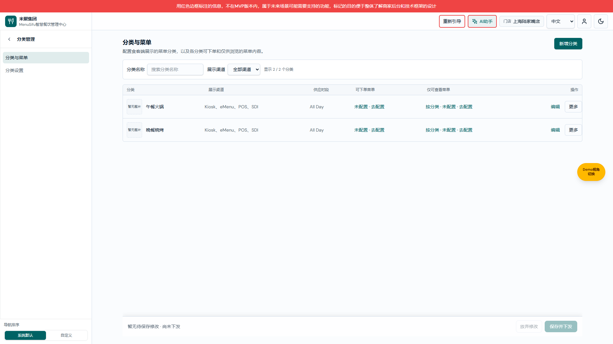
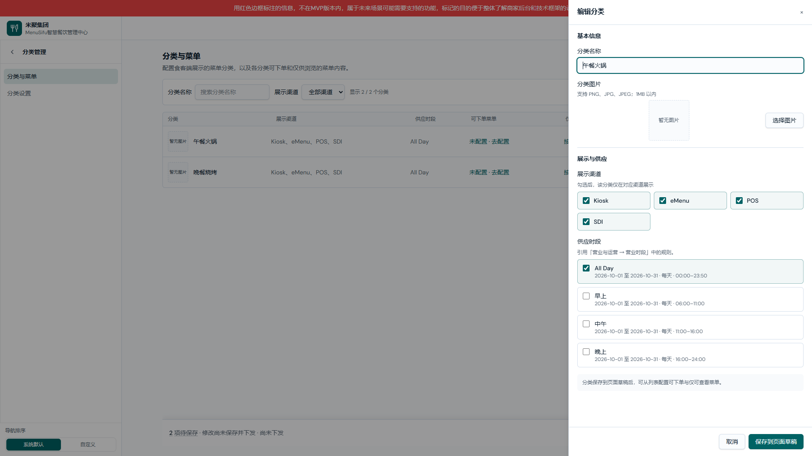
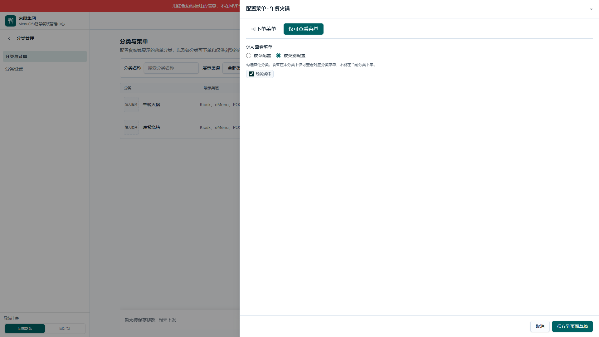
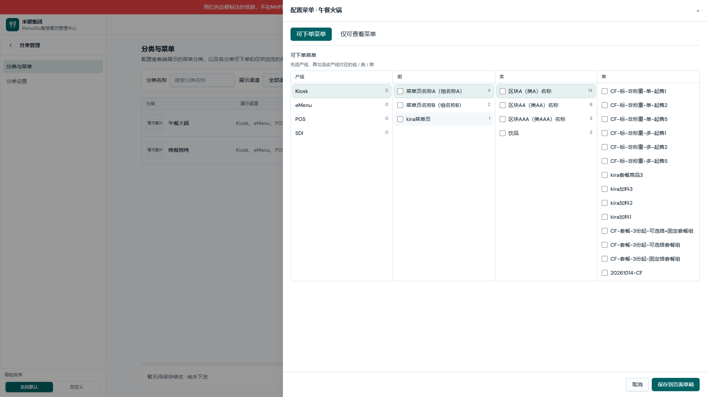
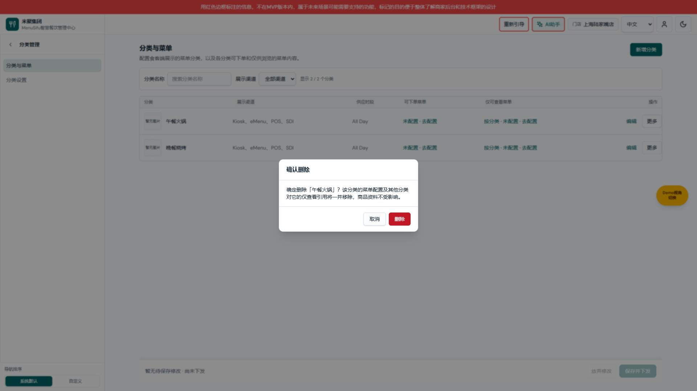
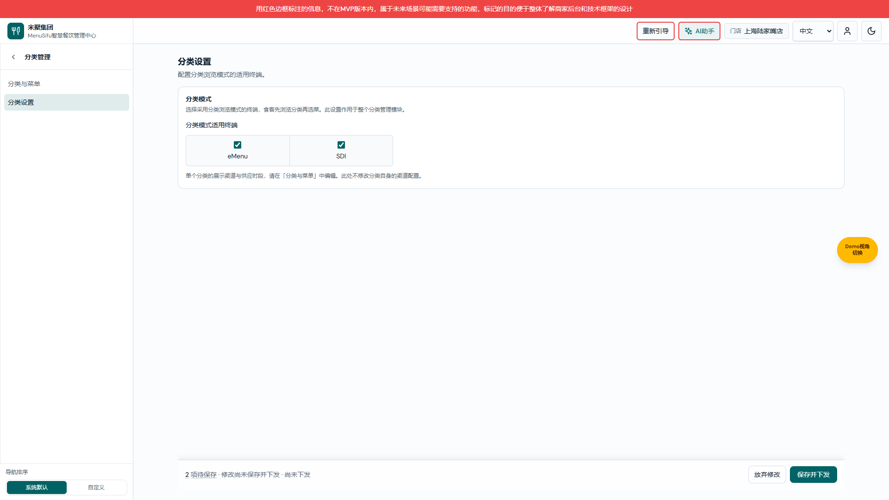

# 分类管理产品权威需求文档

> 版本：V1.0；日期：2026-10-15；变更编号／共同业务基线：CLASSIFICATION-20261015-01。
> 状态：依据用户“采用建议进行修改”落实本次导航与页面调整。终端消费规则未在本次重新定义。
> 职责：产品范围、已确认交互与验收依据；逐元素操作见个人规范版，数据结构见研发版。

[产品 V1.0](分类管理产品权威需求文档.md) · [研发 V1.0](分类管理业务规格说明书（研发交付版）.md) · [个人规范 V1.0](分类管理需求文档（个人规范版）.md)

## 版本记录

| 版本 | 日期 | 变化 | 配对 |
|---|---|---|---|
| V1.0 | 2026-10-15 | 分类二级导航、列表摘要、基本资料与菜单抽屉分离、筛选、仅可查看文案、草稿状态提示 | 产品 V1.0 / 研发 V1.0 / 个人规范 V1.0 |

## 范围与决策

分类管理指面向食客展示的菜单入口分类，与商品主数据中的菜品分类不同。采用“分类与菜单／分类设置”两项公共子导航；沿用 NAV-20261014-01 的覆盖滑层、权限、订阅、预设、发布和草稿保护。

单个分类维护名称、图片、展示渠道、供应时段、可下单菜单与仅可查看菜单。分类模式的适用终端留在本模块设置页。营业时段规则继续在“营业与运营 → 营业时段”维护，本模块只引用已有规则。

本次不新增批量操作、不改变商品主数据、跨产线分别累计口径、终端授权和下发流程，不把“仅可查看”解释成售罄或禁售。

## 分类与菜单页面

图注：2026-10-15，本地原生页面实拍，CLASSIFICATION-20261015-01；分类列表与公共子导航，演示分类。

用途／入口：前厅管理中心 → 分类管理 → 分类与菜单；地址 `/operations/queue-call/classification-settings/categories`，作用于当前门店。

### 导航与工具栏

| 字段／操作 | 逻辑说明 |
|---|---|
| 分类管理父菜单 | 整行进入公共子导航覆盖层，覆盖前厅标题、搜索和菜单；文字与留白均可点击，不改变业务页。 |
| 返回上一级菜单 | 仅退回前厅菜单；不清空草稿、不下发。 |
| 分类与菜单子菜单 | 进入分类列表；子导航保持显示并高亮，页面不重复同名导航页签。 |
| 分类设置子菜单 | 进入独立设置地址；共用分类管理保存桶，不因同模块切换丢失已加入页面的草稿。 |
| 页面标题 | 固定“分类与菜单”；说明本页配置食客端菜单分类及其可下单与仅浏览内容。 |
| 新增分类 | 打开空基本信息抽屉；不直接创建持久记录。 |
| 分类名称搜索 | 默认空，按名称包含关系过滤、忽略大小写并去除搜索首尾空白；清空后恢复全部。 |
| 展示渠道筛选 | 默认全部；可选 Kiosk、eMenu、POS、SDI。与名称搜索取交集，不更改分类数据。 |
| 显示数量 | 显示当前可见分类数／全部分类数；筛选后重算，不计菜单数量。 |
| 无分类 | 提示“暂无分类，请点击新增分类”；不伪造默认配置。 |
| 无匹配结果 | 有分类但筛选后为零时提示调整名称或渠道；区别于数据为空。 |

### 列表区域

| 字段／操作 | 逻辑说明 |
|---|---|
| 分类图片 | 与名称同列；来自分类图片。无图显示“暂无图片”，不显示英文占位。 |
| 分类名称 | 显示当前门店该分类名称；编辑后列表回显。 |
| 展示渠道 | 显示该分类配置渠道的标签，空数组显示破折号；不代替全局分类模式设置。 |
| 供应时段 | 展示引用时段名称，沿用原“营业时间”数据；保留 All Day 等规则原名，不伪造全天供应。 |
| 可下单菜单 | 零选择显示“未配置 · 去配置”；有选择显示“N 道菜 · 配置”；点击进入该分类菜单宽抽屉并选中可下单页签。 |
| 仅可查看菜单 | 显示按菜／按分类模式；零选择显示未配置，有选择分别显示“N 道菜”／“N 个分类”；点击定位仅可查看页签。 |
| 编辑 | 打开本行分类基本信息抽屉并回填；不把菜单选择器塞进基本信息。 |
| 更多 | 展开本行低频操作；本次仅删除分类。 |
| 删除分类 | 打开确认框，确认前不删除；删除影响见对应弹框。 |

## 新增／编辑分类抽屉

图注：2026-10-15，本地原生页面实拍，CLASSIFICATION-20261015-01；午餐火锅编辑抽屉，原有资料回填。

用途／入口：列表新增或本行编辑；右侧普通宽度抽屉；仅编辑当前分类属性。

### 基本信息与展示供应

| 字段／操作 | 逻辑说明 |
|---|---|
| 分类名称 | 文本，必填，最多 50 字符；提交去首尾空白。新增默认空、编辑回填；为空显示“请输入分类名称”并聚焦，保持抽屉与其他输入。沿用现有重名行为，不新增唯一性限制。 |
| 分类图片 | 可选；沿用图片库／上传来源选择器。页面提示 PNG、JPG、JPEG、1MB 内；失败由来源选择器回传错误，显示在选择按钮附近；取消来源选择不替换当前预览。 |
| 选择图片 | 打开公共图片来源选择器；选择成功更新本次抽屉预览，尚未写入分类草稿。 |
| 展示渠道 | 多选 Kiosk／eMenu／POS／SDI，新增默认全部；编辑回填；允许保留空数组，按现有规则表示未选展示渠道。标签区域可点击。 |
| 供应时段 | 多选已有时段，显示名称和完整规则摘要；新增默认 All Day，缺少该项时取首个可用时段；来源为空提示先维护营业时段。历史空值回退见 Q02。 |
| 菜单配置说明 | 提示先保存分类到页面草稿，再从列表配置两种菜单；不是自动跳转或自动下发。 |
| 保存到页面草稿 | 校验名称后新增或更新当前分类；编辑时完整保留两种菜单结构和仅查看模式；关闭抽屉、刷新列表并保留筛选，底部出现待保存变更。 |
| 取消 | 放弃本次抽屉尚未加入页面的输入；原分类与此前页面草稿保持原值。 |
| 关闭／遮罩／Escape | 与取消相同；图片来源弹窗打开时先由该弹窗处理，不穿透关闭分类抽屉。 |

## 配置菜单宽抽屉

图注：2026-10-15，本地原生页面实拍，CLASSIFICATION-20261015-01；午餐火锅仅可查看菜单，选中晚餐烧烤但尚未加入草稿。

图注：2026-10-15，本地原生页面实拍；可下单视角的产线、组、类、菜四列选择器。

用途／入口：本行菜单摘要；携带分类 ID 与菜单类型。右侧宽抽屉适配产线 → 组 → 类 → 菜选择器。

| 字段／操作 | 逻辑说明 |
|---|---|
| 抽屉标题 | “配置菜单 · 分类名称”，持续显示当前编辑对象。 |
| 可下单菜单页签 | 选择允许在当前分类下下单的菜单内容；切换仅隐藏另一面板，不重建选择器、不丢未保存选择。 |
| 产线 | 使用原有 Kiosk／eMenu／POS／SDI 独立选择，不改变产线数据来源与选择规则。 |
| 组 | 原有菜单树第一层，按产线来源展示；沿用选择器勾选与联动。 |
| 类 | 原有菜品分类层，与食客菜单入口分类区分；沿用选择器联动。 |
| 菜 | 原有具体菜品层；按产线分别记录选择结构；不在此维护商品资料。 |
| 仅可查看菜单页签 | 定义在当前分类下可浏览但不能下单的内容；不是停售／售罄名单。 |
| 按菜配置 | 单选切换，显示原菜单选择器；仅查看与可下单分别记录。 |
| 按类别配置 | 单选切换，显示其他菜单入口分类多选；默认沿用原按分类模式。 |
| 其他分类选项 | 排除当前分类；选中后在本分类下仅可浏览被引用菜单。空选择表示没有对应仅查看配置。 |
| 保存到页面草稿 | 同时采集两个面板，保留各自产线结构；写入当前分类菜单草稿，关闭后更新两列摘要。 |
| 取消 | 放弃本次宽抽屉未保存选择，保留之前页面草稿。 |
| 关闭／遮罩／Escape | 与取消相同；切换页签不等于保存。 |

## 删除分类确认框

图注：2026-10-15，本地原生页面实拍，CLASSIFICATION-20261015-01；午餐火锅删除确认，未确认删除。

用途／入口：本行更多 → 删除分类；作用于选定分类 ID。

| 字段／操作 | 逻辑说明 |
|---|---|
| 标题 | “确认删除”。 |
| 影响说明 | 显示具体分类名称，说明分类菜单配置与其他分类对它的仅查看引用一并移除，商品资料不受影响。 |
| 删除 | 在同一页面草稿中移除分类、该分类菜单映射及其他分类对其引用；列表刷新；仍需页面保存并下发。 |
| 取消／遮罩／Escape | 关闭确认框，不移除分类，不更改菜单与引用。 |

## 分类设置页面

图注：2026-10-15，本地原生页面实拍，CLASSIFICATION-20261015-01；分类设置与共享待保存状态。

用途／入口：分类管理 → 分类设置；地址 `/operations/queue-call/classification-settings/settings`。

| 字段／操作 | 逻辑说明 |
|---|---|
| 页面标题 | “分类设置”；无列表、无重复导航页签。 |
| 分类模式说明 | 说明先浏览分类再选菜，作用于模块整体；不代替单个分类展示渠道。 |
| eMenu | 分类模式适用终端多选项；读取原有终端集合，默认与回填沿用原值；点击标签区域切换，仅记录页面草稿。 |
| SDI | 同上，对应 SDI 终端；不新增 Kiosk／POS 模式选项。 |
| 配置范围提示 | 提示单分类渠道和供应时段在分类与菜单中维护；终端具体合成规则见 Q01。 |

## 页面保存栏

页面图片见各页面底部；沿用公共保存栏。

| 字段／操作 | 逻辑说明 |
|---|---|
| 保存状态 | 无变更显示“暂无待保存修改”；有变更显示“修改尚未保存并下发”。不把抽屉加入草稿当成下发完成。 |
| 待保存项数 | 来自公共变更登记；代表配置项数量，不是分类数量。点击沿用公共变更预览，不新增汇总口径。 |
| 下发状态 | 显示既有下发提示，例如尚未下发／上次下发时间；与草稿状态分开展示。 |
| 放弃修改 | 无变更禁用；有变更走既有确认流程，取消保留草稿，确认后恢复持久配置并刷新页面。 |
| 保存并下发 | 无变更禁用并提示原因；有变更沿用公共变更预览、确认和下发流程。成功／失败反馈与持久化策略沿用现有流程；本次不承诺真实设备已接收。 |

## 验收场景

1. 分类父项文字与行内留白点击均进入覆盖子导航；返回仅退一层；进入叶子保留子层和高亮。
2. 两分类默认列表中搜索“午餐”只显示午餐火锅；搜索不存在名称显示无匹配；清空恢复两项；与渠道筛选取交集。
3. 仅查看按分类选中晚餐烧烤，切换到可下单再返回，勾选仍保留；保存后列表显示“按分类 · 1 个分类 · 配置”。
4. 在场景 3 后编辑午餐火锅资料并保存，菜单仍保留 1 个分类引用；取消编辑不影响之前草稿。
5. 分类设置与分类列表共用保存桶，已加入草稿不因切换丢失；放弃修改确认后恢复原值。
6. 删除确认取消不移除分类；确认写入草稿并清理引用；未执行页面保存下发前不宣称生效。

## 本次验证

TypeScript、专项回归及独立目录生产构建通过。浏览器在 1920×1080 验证父项文字与留白、筛选与无匹配、菜单页签选择保留、资料编辑保留菜单、同模块共享草稿、删除取消。截图位于本文对应页面；不代表真实终端下发验收。

## 待确认与已知边界

- CLASSIFICATION-Q01：分类模式适用终端与单分类展示渠道的消费关系、未启用分类模式时的终端展示方式，仍待业务与终端确认；本次仅解释两处配置范围，不新增交集或覆盖算法。
- CLASSIFICATION-Q02：沿用原实现的时段默认规则：无有效时段时回退 All Day 或首个可用时段；不把空选择解释成全天禁售。本次未重新确认该历史业务口径。
- CLASSIFICATION-Q03：菜单模式适用终端目前仅 eMenu／SDI；单分类展示渠道为 Kiosk／eMenu／POS／SDI。不得由此推断四种终端消费行为一致。
- 设置页沿用原有主标记启用与迁移逻辑，本次未新增主开关。跨产线重复菜品的计数沿用既有选择器累计口径，不承诺跨终端去重。列表补计内置树以外已配置的主机菜品叶子，避免选择已保存却显示未配置。
- 本地浏览器验证不代表真实主机、终端接收或线上下发已验收；Git 提交与 main 合并按用户后续明确授权执行；未进行线上业务配置下发。
