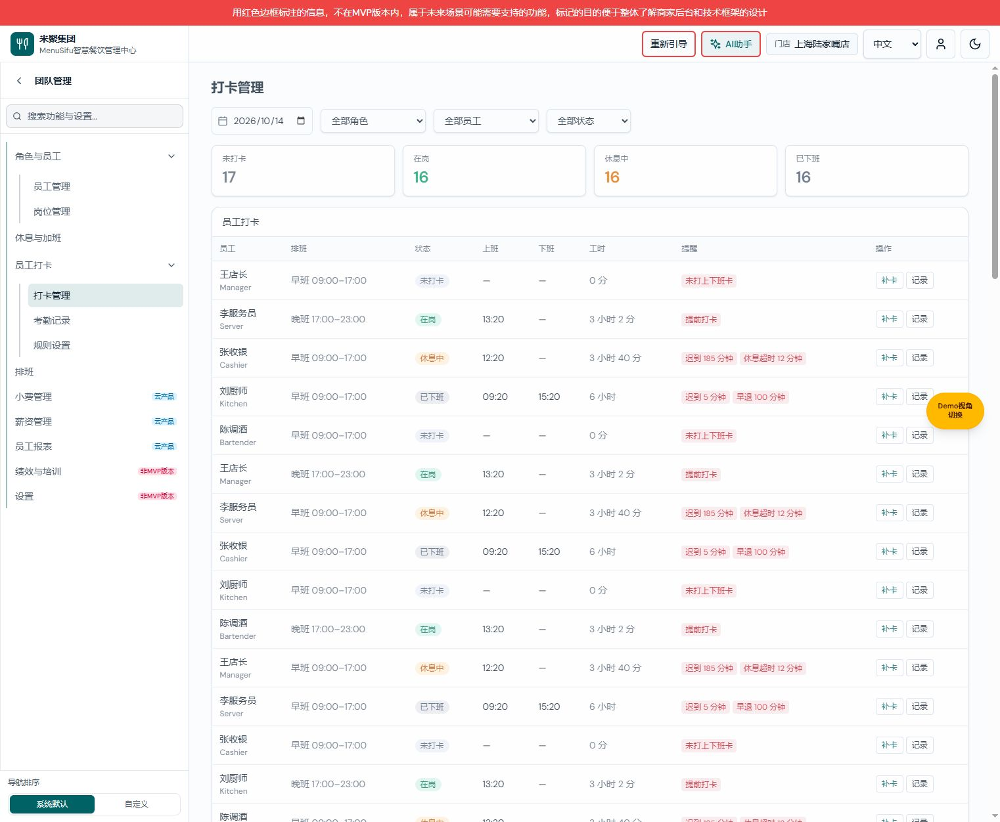
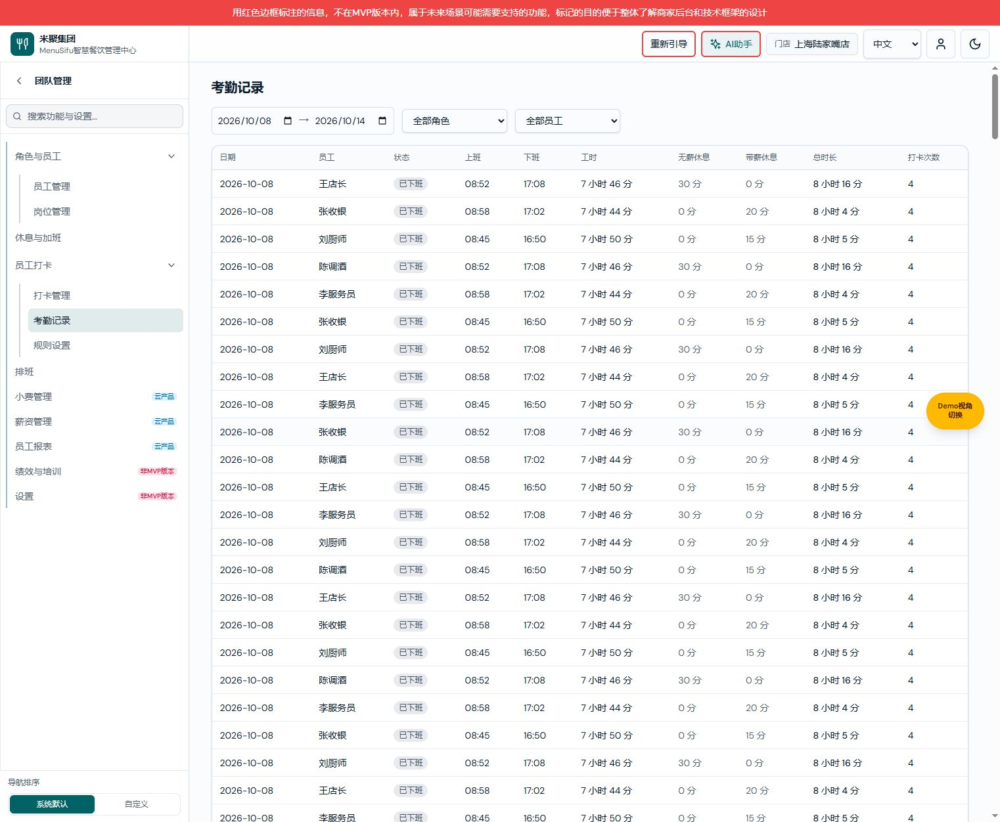
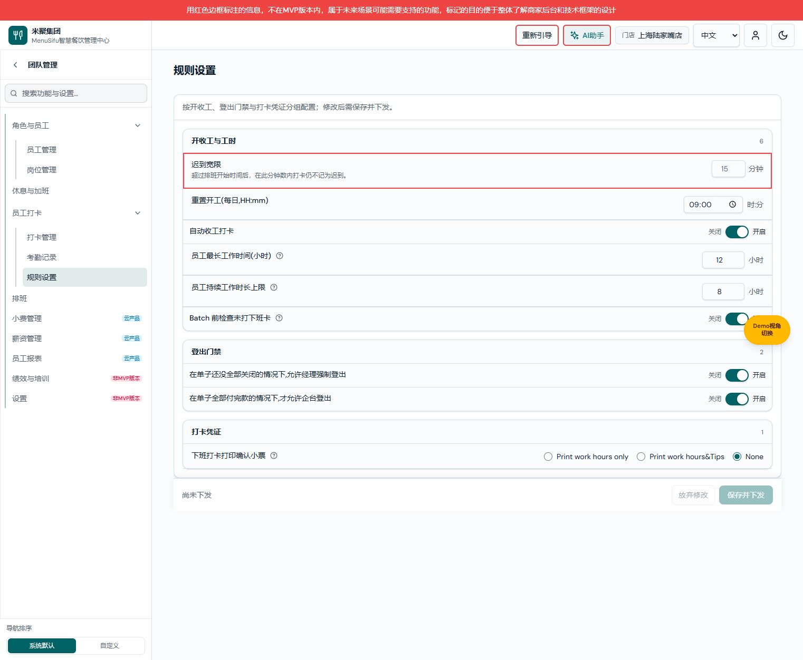

# 员工打卡需求文档（个人规范版）

> 版本 V1.0；日期 2026-10-14；变更编号 CLOCK-20261014-01。
> 产品权威：[新商家后台 PRD](./新商家后台-PRD.md) v1.1；研发：[员工打卡业务规格说明书（研发交付版）](./员工打卡业务规格说明书（研发交付版）.md) V1.0；个人：[员工打卡需求文档（个人规范版）](./员工打卡需求文档（个人规范版）.md) V1.0。
> 共同基线：用户确认改为二级；仅覆盖本次导航变更。

## 版本记录

| 版本 | 日期 | 实际变化 |
| --- | --- | --- |
| V1.0 | 2026-10-14 | CLOCK-20261014-01：建立导航变更规格，配对 PRD v1.1、另一视角 V1.0 |

## 打卡管理

图注：打卡管理，员工打卡二级菜单展开、当前项选中；2026-10-14 本地 Vite 工作区 CLOCK-20261014-01，演示数据。

用途与入口：团队管理 → 员工打卡 → 打卡管理；作用范围沿用当前门店与员工范围。

### 导航区域

| 字段 | 逻辑说明 |
| --- | --- |
| 员工打卡 | 父行文字、箭头、空白均可展开/收起，不跳转、不修改业务数据。 |
| 打卡管理 | 子行整行点击进入 /team/clock-in/live；高亮该项；地址刷新恢复页面类型。 |
| 页面标题 | 显示打卡管理；页面顶部原 Tab 移除。 |
| 筛选与页面内容 | 沿用原页面定义；各页筛选分别保留会话内状态；不新增同步要求。 |
| 保存栏 | 不展示保存并下发栏。 |

验收：地址、标题、菜单选中一致，顶部没有 Tab。

## 考勤记录

图注：考勤记录，员工打卡二级菜单展开、当前项选中；2026-10-14 本地 Vite 工作区 CLOCK-20261014-01，演示数据。

用途与入口：团队管理 → 员工打卡 → 考勤记录；作用范围沿用当前门店与员工范围。

### 导航区域

| 字段 | 逻辑说明 |
| --- | --- |
| 员工打卡 | 父行文字、箭头、空白均可展开/收起，不跳转、不修改业务数据。 |
| 考勤记录 | 子行整行点击进入 /team/clock-in/records；高亮该项；地址刷新恢复页面类型。 |
| 页面标题 | 显示考勤记录；页面顶部原 Tab 移除。 |
| 筛选与页面内容 | 沿用原页面定义；各页筛选分别保留会话内状态；不新增同步要求。 |
| 保存栏 | 不展示保存并下发栏。 |

验收：地址、标题、菜单选中一致，顶部没有 Tab。

## 规则设置

图注：规则设置，员工打卡二级菜单展开、当前项选中；2026-10-14 本地 Vite 工作区 CLOCK-20261014-01，演示数据。

用途与入口：团队管理 → 员工打卡 → 规则设置；作用范围沿用当前门店与员工范围。

### 导航区域

| 字段 | 逻辑说明 |
| --- | --- |
| 员工打卡 | 父行文字、箭头、空白均可展开/收起，不跳转、不修改业务数据。 |
| 规则设置 | 子行整行点击进入 /team/clock-in/rules；高亮该项；地址刷新恢复页面类型。 |
| 页面标题 | 显示规则设置；页面顶部原 Tab 移除。 |
| 筛选与页面内容 | 沿用原页面定义；各页筛选分别保留会话内状态；不新增同步要求。 |
| 保存栏 | 保留既有保存并下发流程，成功、失败和取消定义不变。 |

验收：地址、标题、菜单选中一致，顶部没有 Tab。

## 验证与交付范围

TypeScript 与本地浏览器导航切换、高亮、规则页刷新及保存栏差异通过。本文件仅覆盖本次导航元素；完整考勤历史规格未补齐，未保存配置离开确认分支未在本次浏览器验证中覆盖。

主分支集成校验：保留员工打卡既有入口权限键及 live/records/rules 视图权限键，二级导航不重置已有授权；权限目录仍由专用打卡注册器生成。TypeScript 检查通过；权限回归脚本被既有 /team/roles-employees 操作权限对应菜单缺失阻断，已在未修改的 origin/main 基线上复现，不报告权限回归通过。
