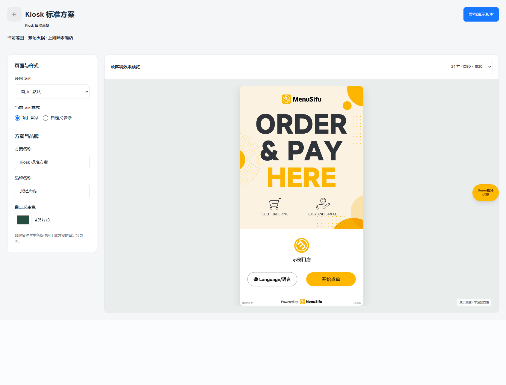

# 品牌装修业务规格说明书（研发交付版）

版本：1.20；共同业务基线：BRAND-DECORATION-20261123-01。状态：功能分支本机演示，未接入真实终端发布。

[品牌装修产品权威需求文档.md](品牌装修产品权威需求文档.md) | [品牌装修业务规格说明书（研发交付版）.md](品牌装修业务规格说明书（研发交付版）.md) | [品牌装修需求文档（个人规范版）.md](品牌装修需求文档（个人规范版）.md)

## 结构与来源

导航：`src/config/navigation.ts` 注册 brand-decoration，三个 L2 叶子由公共路由、权限树、订阅和预设过滤处理。不增加可见性特例，不替旧员工／预设自动授予新模块。宿主 `src/main.ts` 仅增加渲染、绑定及满宽容器分支。

`src/brand-decoration/domain.ts` 定义渠道、页面、模板、方案、发布与变更；store.ts 负责存储和乐观版本检查；scope.ts 读取当前授权范围；ui.ts 复用 standalone-page-header 和 deployment-change-preview。预览 iframe 与宿主同源，校验消息 origin、source 和类型，不发送交易请求。

Kiosk 静态预览来源：kiosklite/docs/2026-11-06-Kiosk品牌装修Demo 的 V6 模板、默认原生包 f84dd529。保留 248 个可达原生依赖及模板资源、字体许可证，不引入旧商家编辑器或旧 localStorage 草稿。eMenu 为此模块独立样式演示，未修改 vendor/emenu-new。

## 数据与隔离

| 字段 | 类型、约束与来源 |
|---|---|
| scope | 当前品牌 ID/当前有效门店 ID；品牌级为 brand 后缀；无明确品牌或门店越权时不加载装修 |
| storage key | menusifu:brand-decoration:v1:encodeURIComponent(scope)，不同品牌、门店互不读写 |
| schema / revision | 固定 1 / 非负整数；每次成功写入递增 1；写前对比当前值，冲突阻止写入 |
| schemes | 当前范围方案数组；UI 创建／复制总量最多 20；无数据时惰性初始化每渠道标准方案，稳定 ID initial-kiosk/initial-emenu |
| Scheme.id | 新方案 crypto.randomUUID；复制不沿用原编号 |
| name | 去除首尾空白，1–40 字；副本名称截断后附加“ 副本” |
| channel | kiosk / emenu，不可在已建方案中修改 |
| brandName | 1–20 字；初始化取当前品牌显示名称前 20 字，不修改品牌主档 |
| primary | #RRGGBB；主题选择更新推荐色，应用于方案的自定义页面 |
| styles | 当前渠道完整页面映射；mode=default/custom；theme=jade/noir/terra；默认保留未生效的模板值 |
| updatedAt | ISO 时间；成功的配置写入使用当前浏览器时间 |
| releases | 当前范围版本数组，最新在前；同渠道版本从 1 递增，渠道之间独立 |
| Release.snapshot | 发布时深拷贝 Scheme；后续草稿修改不改变快照 |
| actor / scopeName | 当前登录账号／当前范围显示名；均为发布时快照 |
| createdAt / result | 浏览器时间 ISO；结果恒为“演示版本已生成”，没有真实设备状态 |

读到坏 JSON 或不完整配置时显示读取错误，保留原数据，不自动重置。setItem 失败回滚内存候选并提示失败。新旧窗口 revision 不同则拒绝覆盖。浏览器本机操作不是跨端事务，不声称具备服务端并发一致性。

## 操作与状态

新建：校验名称和权限→初始化当前渠道默认页→写入→进入新方案；失败留在弹框并显示错误；取消不写入。

编辑：复制当前数据→更新目标方案→校验→写入→替换内存数据。默认／自定义只控制展示，不启用终端业务功能。主色为方案级；预览使用当前品牌名称，历史配置中的品牌名称字段保留用于读取旧数据。每页 mode/theme 为页级。

发布：比较同渠道最近一次快照，方案名称／品牌名称／主色及每页有效样式逐项生成对照；默认页隐藏模板值不计展示差异。确认时再次检查权限、范围、revision。无变化拒绝重复发布；有变化将新版本与草稿同次 setItem；失败不新增记录。取消保持已自动保存的草稿。历史快照是全量配置对照。发布记录先按授权门店确定可见范围，再按快照方案名称与产线组合筛选。筛选条件按当前范围和页面保存在会话中。

权限：入口继续由宿主过滤；写操作每次重取 scope 与授权，scope 变化或当前不可编辑即失败。品牌访问使用现有 manage-page 资源；传统会话使用新模块功能快照，未分配不允许修改。素材入口最终由目标模块处理，不扩展素材访问权。

## 验证记录

基线：origin/main@db904f9e476b4c59319bb3645c8a1f39e180653c；分支 codex/brand-decoration-20261123；未提交。

- `node scripts/verify-brand-decoration.mjs`：稳定初始 ID、24 页、读写持久化、品牌／门店／渠道隔离、冲突拒绝、快照独立、各渠道版本号、重复发布、非法颜色、存储失败及坏数据通过。
- TypeScript 编译通过；项目 build 成功。已有动态／静态 import 与大包警告，Kiosk 旧嵌入包缺 `.embed-build` 警告；本模块使用独立 public 预览包，不修改终端业务代码。
- 公共递归导航回归脚本通过；浏览器实际看到品牌装修子导航，进入三个子页和独立编辑页。
- 浏览器：新建、自动保存、应用确认／取消、发布取消不生成记录、发布成功、快照、空结果、渠道切换验证；Kiosk 144 组合仅为渲染标记检查，eMenu 21 组合为 DOM 内容检查，不等于逐图视觉验收。
- 780px 窄屏 document.scrollWidth=780；表格容器宽 510、滚动内容 734。Kiosk 原生参考菜单横竖屏可加载。
- 实际截图在个人规范版就近展示。真实接口、硬件、深色模式与非演示角色组合仍未验收。

## 排期字段与校验

`DecorationData.schedule` 为向后兼容的可选字段，和原草稿、快照共享范围键及修订号。defaults 按渠道存 releaseId，空值由原生样式兜底。活动含 id、channel、name、releaseId、starts、ends、endedAt 和 pageIds。时间存 UTC 毫秒，输入按门店关联商户或当前品牌时区转换，缺失时使用并标明浏览器时区。夏令时无效和重复时间均提示重新选择。

冲突判定采用半开区间 [starts, min(ends, endedAt))，相邻时间允许。版本和页面 ID 按渠道校验。提前结束写入 endedAt。当前与指定时间预览根据单页是否在 pageIds 内选择活动快照或默认快照。指定时间使用当前配置，不重演替换版本前的历史。继续使用本机演示存储和既有权限校验。

## 全屏装修工作台

从方案列表点击「装修」或「查看」进入全屏独立工作台，工作区独立滚动。左侧返回按钮回到当前渠道方案列表，右侧保留发布操作。权限、草稿保存和发布规则沿用原定义。

## 装修方案统一流程

界面版本 1.7 使用四步流程，门店和活动有效期独立配置。方案名称在使用规则中编辑；主色在方案主题中设置。顾客端预览沿用当前品牌名称。日常和限时装修统一使用方案名称，限时装修的冲突提示引用已上架方案名称。

当前页面装修以一个「新建装修方案」入口组织日常装修和限时装修。列表展示方案、类型、渠道、门店、生效时间和状态。旧版数据保留在原范围，可经「查看已有装修数据」进入。

新版在品牌级 plan-flow 存储域更新草稿及版本。Scheme.rules 为草稿规则，Release.rules 为发布快照。PlanRules 包含 kind、storeIds、timezone、UTC 起止毫秒和 pageIds。以最新发布快照按门店和渠道解析日常装修；在半开区间内且页面被选中时使用活动快照。默认替换不改变其他门店。发布前检查授权门店、同一时区、有效时间、页 ID 和新版／旧版门店活动冲突。旧数据读取继续使用原范围键。

新版时间预览按当前可用配置计算。新版尚未接入正式下发，以及进行中活动提前结束和替换版本操作。典型多门店、跨时区、相邻活动、活动到期与局部页面继承算例由 verify-brand-decoration.mjs 覆盖。

## 方案效果预览

从方案列表打开「效果预览」，左侧按装修阶段筛选页面卡片，Kiosk 支持搜索页面名。选择卡片后，右侧预览同步更新，选中的卡片高亮。预览页头固定，宽屏只滚动超高的页面列表，窄屏只滚动页头下方的预览工作区。默认预览已发布版本，尚未发布时显示当前草稿。限时方案里沿用日常装修的页面，优先按当前范围内首家适用门店显示日常方案并标明来源。返回保留当前渠道。

草稿允许暂缺 storeIds 和 UTC 起止时间，以便在选门店前进入编辑器。第三步继续时校验完整性与冲突，发布时复验。修改类型保留页面样式及已保存门店和时间，由使用方式决定这些字段是否参与发布。

使用方式的两个选项各提供说明图标，鼠标悬停或键盘聚焦时显示说明气泡。日常装修说明为「门店平时使用的装修。」限时装修说明为「在指定时间内展示，到期后恢复门店的日常装修。」

四步共用顶部区域。宽屏左侧显示返回和标题，副标题按步骤展示，居中显示四步进度，右侧显示当前操作。宽度不足时，第一行保留标题和操作，第二行居中显示当前步数及名称。步骤一和三的下一步按钮从页头提交各自表单。

## 广告管理式的方案创建

四步的顶部共用标题、操作、步骤名称和细进度条。第一步以整卡单选呈现日常装修与限时装修，点击卡片选中，说明气泡独立可聚焦。第三步采用左侧门店列表与右侧已选门店区。限时装修在选择门店后进入独立的「活动有效期」步骤。

## 限时装修有效期

日常装修保留四步。限时装修有五步，选择门店之后单独设置活动有效期，再核对发布。门店页只负责选择门店。有效期页显示已选门店和适用时区，按该时区输入开始和结束时间，进入核对前检查时段冲突。返回修改门店时，同一时区保留已保存的有效期，时区变化需要重新填写。发布前再次校验。

## 保存并继续草稿

新版创建流程的每一步均提供「保存草稿」。首次保存须填写方案名称，门店和起止时间可以未填完。保存成功后返回当前渠道列表，可通过「继续草稿」回到保存时的步骤。保存不生成新版本，已发布方案继续采用原发布快照。继续或发布仍须按当前步骤校验。

草稿位置随方案和所属渠道保存。已发布方案保存新草稿后仍显示原版本的生效状态，并提供「继续草稿」操作。再次成功发布会清除草稿位置。

Scheme.draftStep 为可选字段，值为 rules、editor、stores、period 或 review。旧记录缺少该字段时从装修工作台继续。草稿保存复用现有修订号和写入权限，不调用 publishPlan。

## 装修方案列表筛选

装修方案列表默认在同一张表展示全部产线。筛选选项与方案行的产线名称统一显示为 Kiosk、eMenu。可组合按方案名称、产线、使用方式和发布状态查询。「重置」清空全部筛选。返回列表时在当前浏览器会话保留筛选。列表中的产线、装修、预览和草稿恢复均使用该行方案所属产线。旧版方案列表同样按产线筛选，仅显示其已有字段。

页面装修列表页头左侧显示标题，右侧显示「新建装修方案」或只读状态，下接筛选栏。方案列表按品牌及授权范围展示，发布门店在创建步骤中选择。草稿保存和异常状态出现时在页头下方提示。

独立装修工作台使用贯穿整个视口的统一底色。新建流程的所有步骤共用通栏页头，浅色模式使用白底，底部显示通栏进度线。标题、步骤与操作都位于页头内，表单区域沿用工作区底色和卡片表面。

## 方案主题色

装修工作台在页面设置上方展示「方案主题色」。提供系统默认、松石绿、琥珀金、陶土红、靛蓝、石墨灰及自定义主色。新方案选择系统默认，配色为Kiosk 原生黄色主色（`#FFB702`）和浅灰底。既有系统默认方案也使用该配色，自定义主色继续使用已保存的颜色。选择主题色时更新方案中的所有自定义页面，共用主色、背景、文字与强调色。单页模板只决定页面样式结构。Kiosk 原生页保留原生布局，组件支持的颜色随方案主题更新，继承页使用门店日常方案的配色。

主题选择随草稿保存，核对页显示名称，发布快照记录所选主题及主色。已有方案缺少主题标识时继续使用原配色，显式选择主题后按新规则预览。

Scheme.paletteId 为可选枚举，缺少时按历史渲染。theme 仍是单页模板标识。自定义主题用 primary 生成背景，并按相对亮度选择黑色或白色的按钮文字。预览仅对当前页面为自定义的有效方案应用主题。

## 页面模板与方案主题

选择装修页面后，布局标题显示当前页面名称，例如「连接异常页面布局」。布局提供「系统布局」和「自定义布局」，限时装修另提供「沿用日常装修」。「装修页面」以双列卡片展示页面名称和布局示意。可按点餐流程筛选，Kiosk 支持按名称搜索。筛选只缩小列表范围，点击卡片才切换编辑页面。选择「自定义布局」后，可为当前页选择「留白图文」「紧凑列表」或「大图卡片」。模板随当前页保存，决定内容排布、间距和组件形态。方案主题独立选择，提供按钮、按钮文字、背景、正文、标签、选中态、成功、提醒和错误等颜色。选择主题后，所有使用本方案自定义装修的页面按同一套颜色角色渲染。Kiosk 原生页通过原生颜色变量应用方案主题，继承页使用所选门店日常方案的主题。

模板和主题可组合使用。例如，选择靛蓝作为方案主题，首页使用留白图文，菜单使用紧凑列表，换布局时按钮、标签和状态色保持一致。主题按角色提供前景与背景，按钮及状态文字通过对比度校验。已有页面模板标识继续使用原值。

### 主题色即时预览

装修工作台选择方案主题色后，当前自定义页和 Kiosk 原生页立即更新支持的配色。Kiosk 原生页切回系统默认时恢复原生黄色及原始颜色；固定图标等未接入颜色变量的部分继续使用原生颜色。eMenu 原生预览显示尚未接入的提示。继承页继续展示门店日常装修。

### 方案上下架

核对页选择「保存」后，方案处于未上架状态。列表中选择「上架」并确认后，系统检查门店权限及限时活动冲突，按适用门店和有效期使用当前配置。已上架方案提供效果预览、复制和下架。下架后可编辑、删除或重新上架；门店改用其他符合条件的装修。复制生成独立的未上架方案，保留页面和规则配置。删除仅适用于未上架方案，需二次确认；已生成的历史记录保留。

### 共用顶栏与页面内容

方案主题位于工作台上方。「页面装修」与「共用组件」在左栏卡片顶部切换。页面装修调整单页布局和内容；共用组件的左侧从下拉框选择「顶部导航」，顶栏布局选项在同一行展示，预览区可切换实际页面。右侧组件属性按组展示，自定义布局可修改背景色与底部分隔线，背景色默认跟随方案主题，文字颜色自动适配。系统布局的属性仅供查看。返回页面装修时恢复原选页面，两个入口共用屏幕方向。系统布局沿用当前页面原有顶栏；自定义布局将方案主题应用于现有顶栏，保留返回、语言、主页等原生控件。没有顶栏的系统页面继续使用原有结构。沿用日常装修的页面使用日常方案的配置。

装修工作台宽屏采用三栏：左侧选择页面和布局，中间显示顾客端预览，右侧显示页面内容。窄屏将页面内容放在预览上方的折叠面板。切换页面后，内容区跟随当前页。

「页面内容」覆盖 Kiosk 的 24 个页面和 eMenu 的 7 个页面。自定义布局为每个页面提供文案编辑；支持素材或可选区块的页面另提供替换和显隐。Kiosk 系统布局可在右侧按编辑区域修改已登记的原生文案，例如支付方式、用餐方式、收据和异常页按钮。点击系统布局预览中已登记的字段，右侧切换至对应编辑区域并定位字段；从右侧切换区域时，预览同步高亮。修改保留原生结构及操作。没有可登记文本的页面仍显示原生内容。eMenu 原生系统布局尚未接入。页面内容按标题与说明、按钮、字段标签、图片和显示设置分组，选择类页面增设「选项卡片」或「支付方式卡片」，只显示含可编辑项的分组。布局内的静态区块标题、说明、按钮及输入提示均通过字段登记。商品和规格名称、价格、数量、桌号、订单号及支付状态等由原业务数据提供。自定义布局默认选中首个可编辑分组。点击顾客端预览里的可编辑元素会切换到对应分组并定位字段；使用「编辑区域」下拉也可切换分组，预览同步高亮。点击共用顶部导航进入组件属性。独立效果预览保持原行为。姓名输入页支持编辑确定和跳过按钮文案。 Kiosk 支付方式页在自定义布局中可编辑扫码支付和银行卡支付卡片的标题及说明，点击卡片定位标题，点击说明定位对应字段。文案设置与支付方式及交易流程独立。未修改的文本在输入框内显示系统默认值，并标记「默认」。修改后在输入框下方对照原文，字段标题同行提供「恢复默认」。文本最多 60 字，图片为 120 KB 以内的 PNG、JPEG 或 WebP。覆盖值按页面及元素保存，切换模板后继续使用；可恢复单项或确认恢复整页。订单号、商品数据和按钮动作由原页面继续提供。

装修方案列表的有效期显示开始与结束时间，按门店时区格式化，时间后不附加时区名称。

所有状态的方案均可单独修改 storeIds。未上架和草稿更新当前规则，保留方案状态和历史发布快照。已配置时间的限时方案要求新增门店与有效期时区一致。保存校验当前方案、预期上架快照、全量门店权限及至少一家；限时装修沿用原时区和起止时间，仅校验新增门店剩余时段冲突。一次写入更新方案门店和新的 storeScopeOnly 快照，历史快照保留。已有门店沿用此前日常优先级，新增门店以此次更新参与优先级。

「适用门店」按当前列表规则的 storeIds 计数。已上架方案取生效快照，其余取当前方案。打开详情前再次校验方案和快照的门店权限。弹框只读展示名称、MID、区域和门店档案的 postalCode。搜索匹配该方案门店的名称、MID、区域或邮编，空邮编显示「—」，零门店行对有权限用户也提供弹框入口。

装修工作台的「顾客端效果预览」与独立效果预览共用「竖版」「横版」切换。切换方向保留当前页面和页面筛选。画布随可用高度缩放。新建方案的页头固定，装修工作台宽屏时各配置区域在内容超高后独立滚动，窄屏时只滚动页头和方案主题下方的工作区。其他步骤只滚动步骤内容区。Kiosk 独立预览页头只显示方案标题。Kiosk 按 1080×1920 或 1920×1080 展示，eMenu 自定义布局按 390×844 或 844×390 展示。

### 从参考图生成页面模板

Kiosk「付款后小费与签名」预览默认同时展示小费与签名，可切换「仅小费」或「仅签名」。切换只影响预览场景。「独立签名」仅展示签名流程。

Kiosk 和 eMenu 的每个装修页面在左侧默认显示「我的模板」，支持在系统布局、自定义布局和沿用日常装修时直接上传参考图。列表只显示当前渠道和页面的模板，原有 Kiosk 首页模板仍在该页。

| 字段或操作 | 逻辑说明 |
| --- | --- |
| AI 生成模板 | 演示账号的入口和弹框标题均为「AI 生成模板」；其他账号的入口和弹框标题均为「用参考图生成模板」。通过「上传参考图」选择或拖入一张 10 MB 以内的 PNG、JPEG 或 WebP。选中后显示缩略图和文件名，支持更换与移除。 |
| 生成模板 | 浏览器分析参考图的图文分布、对齐和圆角，使用当前页面的布局组件生成预览。 |
| 布局对比 | 左侧显示当前布局，右侧显示生成结果。使用与效果预览相同的「竖版／横版」分段按钮，同步切换两块画布。画布内使用预览灰底，并在顾客端画面两侧保留边距。 |
| 应用到当前页 | 将当前页切换为自定义布局，同时保存到方案草稿和当前页的模板库。限时装修将当前页纳入生效范围。沿用方案配色、共用顶栏和页面内容。取消或保存失败保留原布局。 |
| 已保存的模板 | 按「页面名称参考模板 1」顺序命名，支持再次应用和重命名。每个渠道的每页最多 50 个，名称最长 32 字，同页不可重名。方案和上架快照保留所用模板版本。 |

参考图在浏览器内分析，原图不保存到模板库。当前使用本地布局分析。

模板记录包含可选的 target.channel 和 target.page，旧记录缺少 target 时按 Kiosk 首页读取。方案和发布快照中的模板目标必须匹配对应页面。应用模板时在一次存储更新中保存模板库和页面关联。
