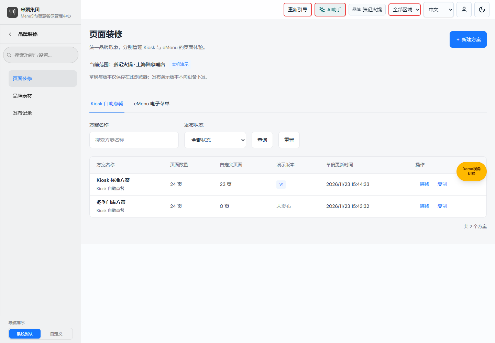
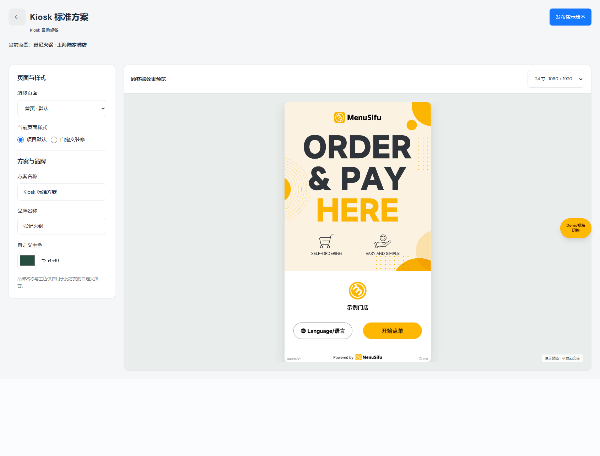
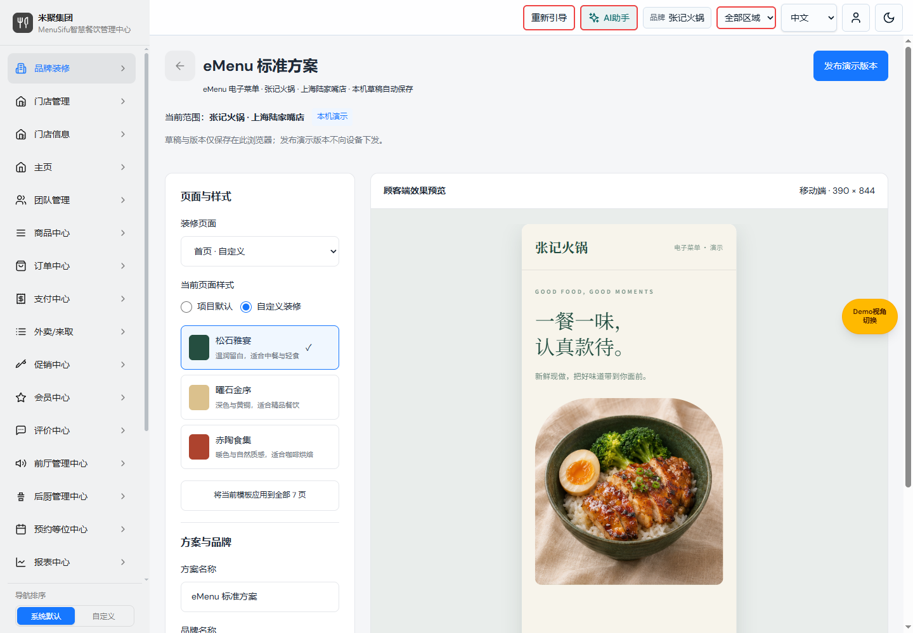
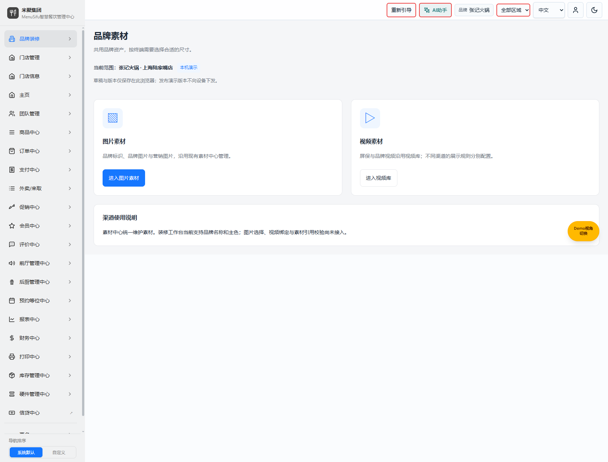
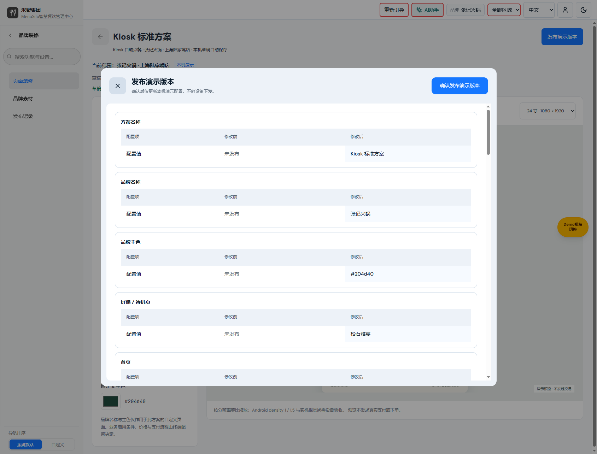
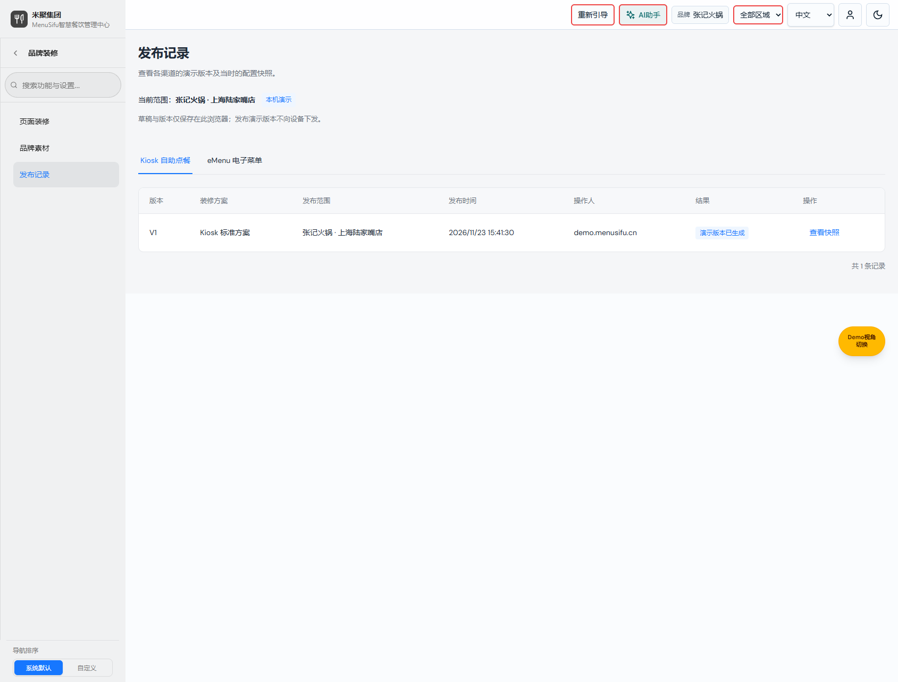

# 品牌装修产品权威需求文档

版本：1.8；共同业务基线：BRAND-DECORATION-20261123-01。状态：功能分支本机演示，未接入真实终端发布。

[品牌装修产品权威需求文档.md](品牌装修产品权威需求文档.md) | [品牌装修业务规格说明书（研发交付版）.md](品牌装修业务规格说明书（研发交付版）.md) | [品牌装修需求文档（个人规范版）.md](品牌装修需求文档（个人规范版）.md)

## 目标与入口

商家后台一级导航“品牌装修”，通过公共覆盖式子导航进入“页面装修、品牌素材、发布记录”。单店先完成当前门店装修；连锁在当前有权访问的品牌或门店范围维护方案。Kiosk 与 eMenu 共用入口和素材来源，页面、草稿、布局与版本分别管理。不更改终端功能启用、金额、交易与会员规则。

## 页面装修

图：页面装修／Kiosk 方案列表；2026-11-23 功能分支实际浏览器截图，含演示数据。

Kiosk 包含既有目录 24 页，eMenu 包含首页、菜单、详情、购物车、支付、完成、会员登录 7 页。切渠道保留各自草稿；搜索方案名称与发布状态，查询后显示匹配结果，重置恢复当前渠道全部方案。初次提供每渠道一个标准方案，各页默认使用项目默认配置。

创建方案输入 1–40 字名称；默认页初始化成功后进入装修工作台。复制生成独立编号和“副本”名称，不继承发布记录。本机总方案上限 20。只读账号可查看，不可新建、复制、修改、应用或发布。

## 装修工作台

图：Kiosk 装修工作台／自定义首页；2026-11-23 功能分支实际浏览器截图，含演示数据。

每页独立切换项目默认／自定义；自定义可选松石雅宴、曜石金序、赤陶食集。切回默认保留该页模板选择，恢复自定义时沿用。品牌名称和主色属于方案，作用于方案中全部自定义页面；点击某模板同时将方案主色切为其推荐色。整套模板应用需展示所有受影响页面的前后对照，确认后改当前渠道全部页面，取消保留原草稿。

草稿在修改控件失焦或选择完成后自动保存于当前浏览器；不会自动发布。名称 1–40 字，品牌名称 1–20 字，主色为六位十六进制颜色。校验失败恢复原值并提示；存储失败不改变已有持久化草稿，不显示保存成功。其他窗口更新过同一范围数据时阻止旧版本覆盖，提示刷新。返回、换页、换渠道不会丢失成功保存的草稿。

Kiosk 可切换 1080×1920 竖屏与 1920×1080 横屏预览，等比缩放，不代表实机显示密度验收。默认效果是既有原生参考包 f84dd529，演示商品与金额不是实时门店数据。

图：eMenu 装修工作台／移动端自定义首页；2026-11-23 功能分支实际浏览器截图，含演示数据。

eMenu 自定义使用独立的 390×844 移动端布局；不将 Kiosk 页面缩小代替。原生默认页尚未接入时直接显示缺口提示。

## 品牌素材

图：品牌素材入口；2026-11-23 功能分支实际浏览器截图，含演示数据。

图片与视频分别进入现有素材中心和视频库，继续沿用各自权限与能力。装修模块不复制资产库或新设上传规则；装修中选择图片、视频引用尚未接入。

## 发布演示版本与记录

图：发布演示版本／变更确认；2026-11-23 功能分支实际浏览器截图，含演示数据。

点击发布先校验当前范围、编辑权限和方案。按渠道与最近演示版本对比方案名称、品牌名称、主色和每页有效样式；没有变化时提示无需重复发布。对比确认后原子保存草稿及不可变快照，当前渠道版本递增。取消／Esc／遮罩关闭不生成记录、不撤销草稿。

图：发布记录／Kiosk V1；2026-11-23 功能分支实际浏览器截图，含演示数据。

记录包括渠道、版本、方案、范围、时间、操作账号和结果；查看快照展示发布时完整配置。后续编辑不能改变历史快照。结果仅表示本机演示版本生成，不表示服务器保存、门店下发或设备生效。

## 交付缺口与验收边界

- 未接入服务端持久化、真实下发、设备回执、发布回滚及正式发布权限接口。
- eMenu 默认原生效果、图片／视频选择绑定待接入；本机演示数据不能跨浏览器共享。
- Kiosk 默认参考包固定于 f84dd529，不声称等于 Kiosk 当前分支或 Android 实机。Android density 1 / 1.5 和两类硬件尚未实测。
- 当前有权范围沿用宿主；集团全局未明确品牌时不可装修，不隐式作用于所有品牌。品牌方案不会自动覆盖门店方案，终端继承规则待确认。
- 深色模式、非演示账号端到端权限组合和生产接口异常未完成浏览器验收；不得据此声称生产可用。

## 旧版数据兼容

在页面装修选定渠道和当前品牌／门店范围，进入「默认装修与活动排期」。默认装修可绑定该渠道的已发布版本，未设置时使用项目原生样式。活动绑定一个已发布版本，可勾选适用页面。未勾选页面沿用默认装修，勾选页面使用活动版本内的项目默认或自定义样式。

同范围、同渠道的活动不得重叠，允许首尾相接。从开始时刻起生效，到结束时刻失效。到期或提前结束后恢复当时的默认装修。待开始活动可编辑，进行中允许明确保存替换版本或提前结束。指定时间预览按当前排期和当前默认配置计算。当前版本支持在当前范围逐一配置，批量多门店排期和终端下发待接入。

## 全屏装修工作台

从方案列表点击「装修」或「查看」进入全屏独立工作台，工作区独立滚动。左侧返回按钮回到当前渠道方案列表，右侧保留发布操作。权限、草稿保存和发布规则沿用原定义。

## 装修方案统一流程

界面版本 1.7 使用四步流程，门店和活动有效期独立配置。方案名称在使用规则中编辑；品牌名称和主色收在方案品牌设置。活动名称继续作为排期和冲突提示的识别信息。

当前页面装修以一个「新建装修方案」入口组织日常装修和限时装修。列表展示方案、类型、渠道、门店、生效时间和状态。旧版数据保留在原范围，可经「查看已有装修数据」进入。

第一步设置方案信息和使用方式。第二步在全屏工作台逐页选样式。第三步选择门店，限时装修在此设置有效期并检查冲突。第四步核对逐店发布影响后确认。活动结束时恢复各店届时的默认风格，未装修页面在活动期间也继承默认。默认未配置时回到项目原生样式。跨时区的活动按时区分批。

当前为本机演示，正式下发、进行中活动替换或提前结束待接入新版流程。

## 方案效果预览

方案列表操作列提供「效果预览」，按选中的方案 ID 打开只读全屏预览。可切换已发布版本与草稿，按页面查看效果。限时装修可以选择适用门店，未覆盖的页面显示所选门店的当前日常装修并标明来源。Kiosk 可切换横竖屏。返回保留当前渠道。

使用方式的两个选项各提供说明图标，鼠标悬停或键盘聚焦时显示说明气泡。日常装修说明为「门店平时使用的装修。」限时装修说明为「在指定时间内展示，到期后恢复门店的日常装修。」
