# 品牌装修需求文档（个人规范版）

版本：1.20；共同业务基线：BRAND-DECORATION-20261123-01。状态：功能分支本机演示，未接入真实终端发布。

[品牌装修产品权威需求文档.md](品牌装修产品权威需求文档.md) | [品牌装修业务规格说明书（研发交付版）.md](品牌装修业务规格说明书（研发交付版）.md) | [品牌装修需求文档（个人规范版）.md](品牌装修需求文档（个人规范版）.md)

公共说明：以下页面均为当前授权范围内的本机演示；不承诺真实下发。产品边界与未闭合事项以产品权威文档的“交付缺口与验收边界”为准。图片来源均为本功能分支实际浏览器。

## 页面装修／方案列表

图：页面装修／方案列表；2026-11-23 功能分支实际浏览器截图，含演示数据。

入口：品牌装修 → 页面装修。

| 字段／操作 | 逻辑说明 |
|---|---|
| Kiosk／eMenu 页签 | 默认 Kiosk；点击切换渠道，重置当前筛选，不改变另一渠道草稿或版本。 |
| 当前范围 | 沿用宿主品牌／有效门店；无范围时提示选择，不落到其他品牌。 |
| 方案名称筛选 | 选填，最长 40 字，查询时按名称不区分大小写包含匹配；空值不过滤。 |
| 发布状态 | 默认全部；未发布表示没有该方案历史记录；有演示版本表示存在任一历史发布，不表示草稿等于已发布。 |
| 查询 | 读取当前筛选并刷新列表；无结果显示空态。 |
| 重置 | 清空名称、状态恢复全部，保留当前渠道。 |
| 新建方案 | 可编辑账号打开当前渠道新建框；只读禁用。 |
| 方案名称列 | 展示名称和所属渠道；名称来源为本范围草稿。 |
| 页面数量列 | Kiosk 24，eMenu 7，固定目录数量。 |
| 自定义页面列 | 计算 mode=custom 的页面数，与业务启用状态无关。 |
| 演示版本列 | 该方案最近版本号；无记录显示未发布。 |
| 草稿更新时间列 | 显示浏览器本地格式时间，不代表服务器时间。 |
| 装修／查看 | 带方案 ID 进入独立页；只读显示查看。 |
| 复制 | 可编辑时生成新编号副本、保留样式，不继承发布记录；超过 20 方案提示失败。 |
| 总数量 | 显示当前渠道筛选后方案数；表格自身横向滚动。 |

## 新建方案弹框

图：新建方案弹框；2026-11-23 功能分支实际浏览器截图，含演示数据。

入口：方案列表 → 新建方案。

| 字段／操作 | 逻辑说明 |
|---|---|
| 关闭／Esc／遮罩 | 取消新建，不新增方案，恢复触发点焦点。 |
| 方案名称 | 必填，去首尾空白后 1–40 字；空值提示并保留弹框。 |
| 创建方案 | 校验权限、范围、方案上限和存储；成功后进入新方案编辑页，初始化当前渠道全默认；失败提示，不关闭。 |

## 装修工作台／Kiosk

图：装修工作台／Kiosk；2026-11-23 功能分支实际浏览器截图，含演示数据。

入口：方案列表 → 装修。

| 字段／操作 | 逻辑说明 |
|---|---|
| 返回 | 标题左侧公共 48px 返回按钮；带当前渠道回方案列表。已自动保存的修改保留。 |
| 方案标题／渠道 | 展示方案名称及渠道。 |
| 装修页面 | 默认首页；列出当前渠道完整目录与默认／自定义状态，切换只改变编辑对象。 |
| 项目默认 | 当前页 mode=default；保留主题值；Kiosk 显示固定基线原生参考，不应用自定义主色。 |
| 自定义装修 | 当前页 mode=custom；恢复已选主题；按对应渠道布局预览。 |
| 模板选择 | 松石雅宴／曜石金序／赤陶食集；只改当前页主题，同时更新方案级推荐主色，影响全部自定义页按钮颜色。 |
| 应用全部页面 | 打开逐页面前后对照；确认修改全部页 mode/theme，取消保留现有配置。 |
| 方案名称 | 1–40 字；控件完成修改后校验、自动保存。失败恢复原值并显示错误。 |
| 品牌名称 | 1–20 字；仅此方案使用，不修改品牌档案。 |
| 自定义主色 | 有效 #RRGGBB；仅作用自定义页，模板按钮前景按亮度选择黑／白。 |
| 设备预览 | 24 寸 1080×1920／14 寸 1920×1080，等比缩放，选择不修改业务配置。 |
| 顾客端预览 | 只读样式参考，不发起支付下单；原生参考含演示商品与金额。 |
| 自动保存状态 | 成功后显示已保存；存储失败或数据冲突提示失败，不静默覆盖。 |
| 发布演示版本 | 页头右侧；校验后进入变更确认，无变化提示无需发布；只读禁用。 |

## 装修工作台／eMenu

图：装修工作台／eMenu；2026-11-23 功能分支实际浏览器截图，含演示数据。

入口：页面装修 → eMenu → 装修。

| 字段／操作 | 逻辑说明 |
|---|---|
| 页面目录 | 首页、菜单、详情、购物车、支付、完成、会员登录；与 Kiosk 配置独立。 |
| 自定义预览 | 390×844 移动端样式；三模板独立布局，品牌字段和操作规则复用工作台公共定义。 |
| 默认页面 | 保留默认配置，显示“原生默认效果尚未接入”，不冒用 Kiosk 或自定义页面。 |

## eMenu／默认效果缺口

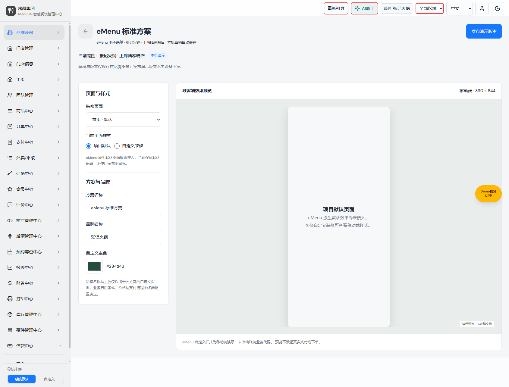

图：eMenu／默认效果缺口；2026-11-23 功能分支实际浏览器截图，含演示数据。

入口：eMenu 工作台 → 项目默认。

| 字段／操作 | 逻辑说明 |
|---|---|
| 待接入提示 | 只说明默认效果尚未接入；可切自定义预览，不伪造默认截图。 |

## 整套模板确认弹框

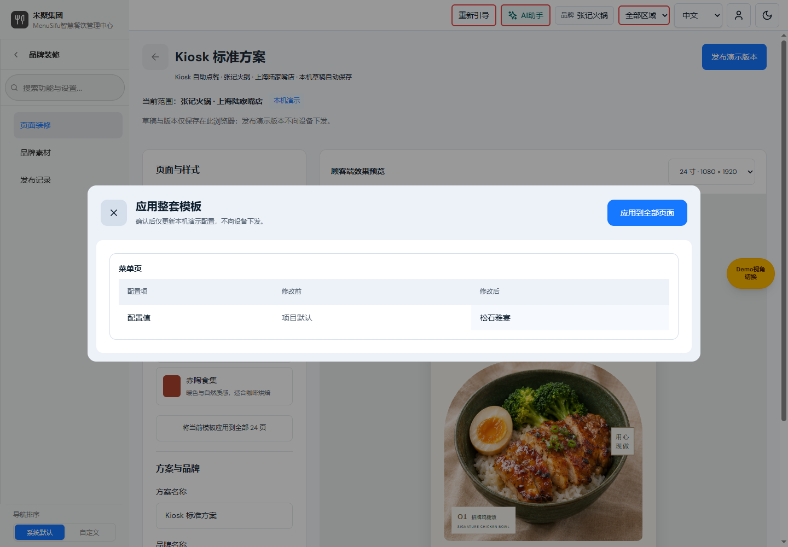

图：整套模板确认弹框；2026-11-23 功能分支实际浏览器截图，含演示数据。

入口：工作台 → 将当前模板应用到全部页面。

| 字段／操作 | 逻辑说明 |
|---|---|
| 受影响页面与前后值 | 逐页展示从默认／原主题到新主题的有效变化，不包含其他渠道。 |
| 应用到全部页面 | 重新检查权限和范围，成功自动保存草稿，不发布。 |
| 取消／Esc／遮罩 | 关闭弹框，不修改页面配置；焦点返回触发点。 |

## 发布演示版本确认弹框

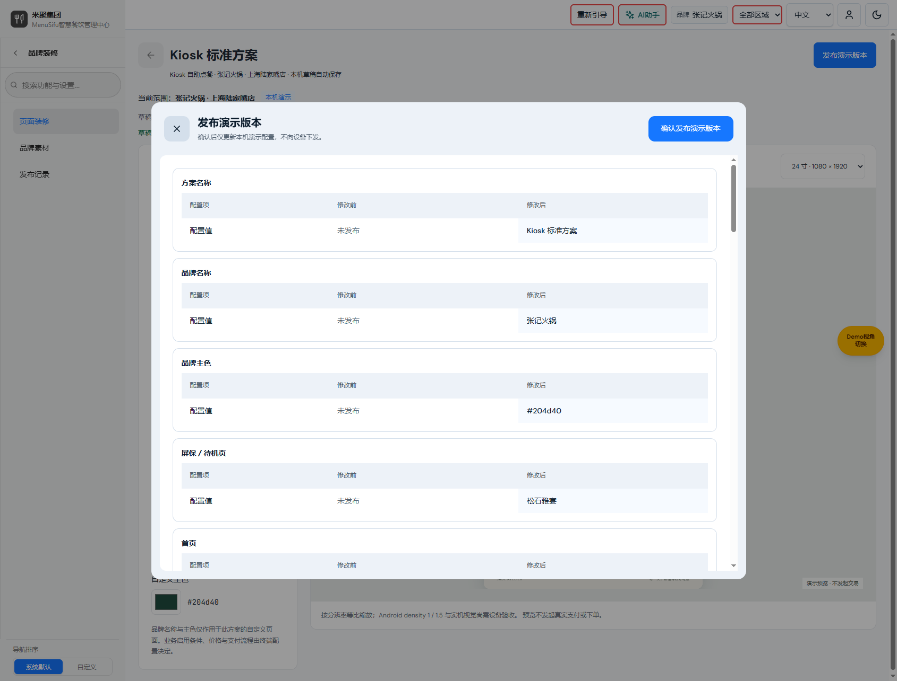

图：发布演示版本确认弹框；2026-11-23 功能分支实际浏览器截图，含演示数据。

入口：工作台 → 发布演示版本。

| 字段／操作 | 逻辑说明 |
|---|---|
| 配置项／修改前／修改后 | 与同渠道最近演示版本比较，列出名称、品牌、主色及有效页面样式；首次显示未发布。 |
| 确认发布演示版本 | 再次校验权限、范围、revision 后保存版本快照，渠道版本递增；失败提示且不生成记录。 |
| 关闭／Esc／遮罩 | 取消发布，不生成记录，不回退已自动保存的草稿。 |

## 发布成功状态

图：发布成功状态；2026-11-23 功能分支实际浏览器截图，含演示数据。

入口：发布确认成功。

| 字段／操作 | 逻辑说明 |
|---|---|
| 结果提示 | 明确演示版本已生成，可在发布记录查看；未向设备下发。编辑草稿仍可继续。 |

## 品牌素材

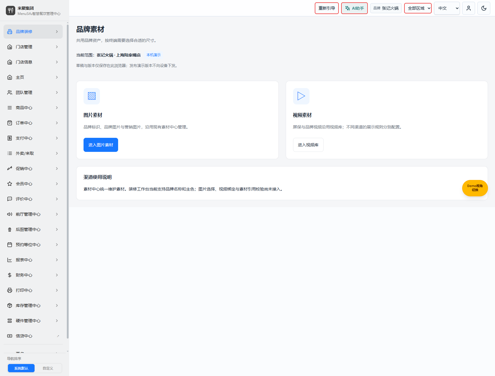

图：品牌素材；2026-11-23 功能分支实际浏览器截图，含演示数据。

入口：品牌装修 → 品牌素材。

| 字段／操作 | 逻辑说明 |
|---|---|
| 图片素材 | 链接现有 /asset-center/materials；权限由现有素材中心继续校验。 |
| 视频素材 | 链接现有 /asset-center/videos；不扩展其现有上传或管理能力。 |

## 发布记录

图：发布记录；2026-11-23 功能分支实际浏览器截图，含演示数据。

入口：品牌装修 → 发布记录。

| 字段／操作 | 逻辑说明 |
|---|---|
| 渠道页签 | 默认 Kiosk；切换只展示对应渠道版本。 |
| 版本 | 当前渠道递增 V1、V2；与另一渠道独立。 |
| 装修方案 | 发布时方案名称快照，后续改名不影响历史。 |
| 发布范围 | 发布时品牌／门店显示名。 |
| 发布时间 | 浏览器生成时间，按本地格式展示。 |
| 操作人 | 发布时当前登录账号。 |
| 结果 | 固定演示版本已生成；不显示设备同步成功。 |
| 查看快照 | 打开只读快照弹框，不修改草稿。 |
| 总数量／空态 | 显示当前渠道记录数量；无记录提示先发布演示版本。 |

## 版本快照弹框

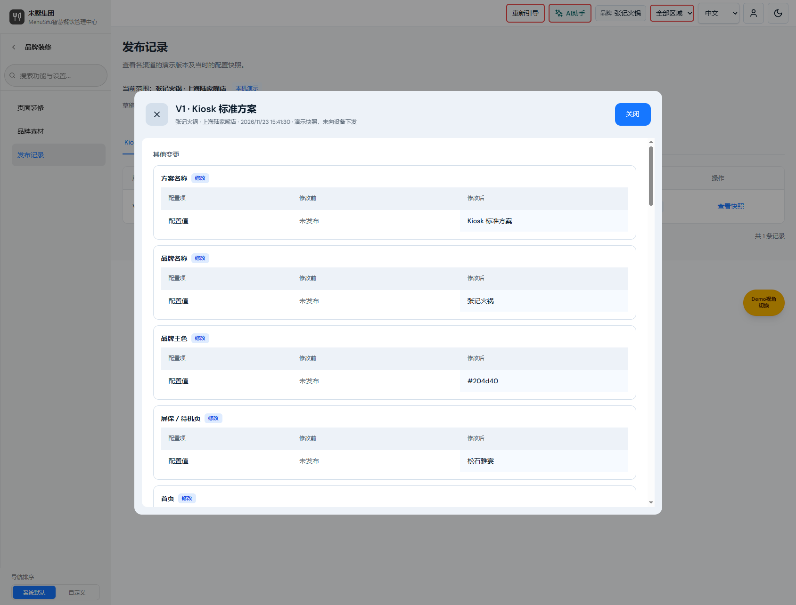

图：版本快照弹框；2026-11-23 功能分支实际浏览器截图，含演示数据。

入口：发布记录 → 查看快照。

| 字段／操作 | 逻辑说明 |
|---|---|
| 标题与说明 | 版本、方案、范围、时间，明确未下发。 |
| 全量配置 | 只读展示当时品牌字段和所有页面有效样式；作为完整快照，不声称是增量变更。 |
| 关闭／Esc／遮罩 | 关闭，不写入、不回滚，恢复原焦点。 |

## 方案列表／新建结果

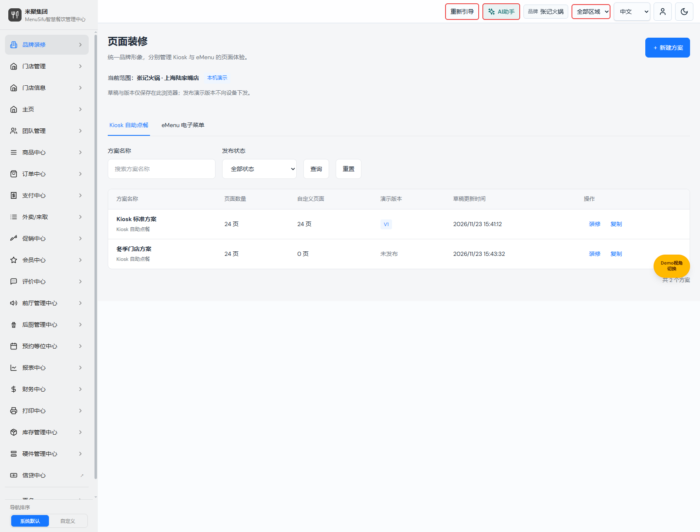

图：方案列表／新建结果；2026-11-23 功能分支实际浏览器截图，含演示数据。

入口：完成新建后返回列表。

| 字段／操作 | 逻辑说明 |
|---|---|
| 新方案行 | 显示独立方案、固定页面数量、0 自定义页和未发布；不复用其他方案版本。 |

## 方案列表／空结果

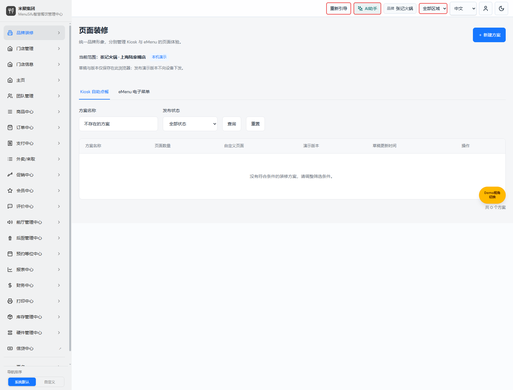

图：方案列表／空结果；2026-11-23 功能分支实际浏览器截图，含演示数据。

入口：输入未匹配名称并查询。

| 字段／操作 | 逻辑说明 |
|---|---|
| 空态提示 | 显示没有符合条件的方案，保持筛选可调整；不自动创建或删除数据。 |

## 方案列表／窄屏

图：方案列表／窄屏；2026-11-23 功能分支实际浏览器截图，含演示数据。

780px 浏览器视口。

| 字段／操作 | 逻辑说明 |
|---|---|
| 筛选与表格布局 | 筛选换行；仅表格内部横向滚动，整页不被表格撑宽。 |

## Kiosk／原生默认参考

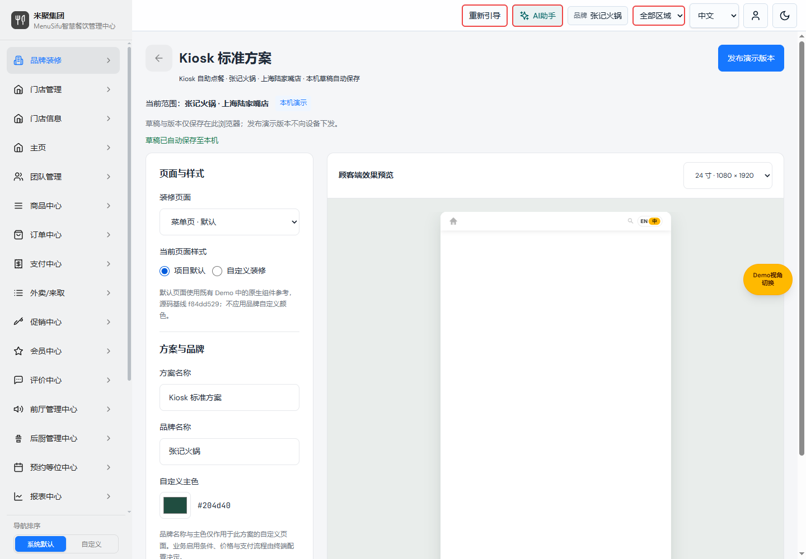

图：Kiosk／原生默认参考；2026-11-23 功能分支实际浏览器截图，含演示数据。

入口：Kiosk 工作台 → 项目默认。

| 字段／操作 | 逻辑说明 |
|---|---|
| 默认参考 | 既有固定版本原生组件；不代表当前 Kiosk 分支或实机验收，金额及商品为演示数据。 |

## Kiosk／横屏原生参考

图：Kiosk／横屏原生参考；2026-11-23 功能分支实际浏览器截图，含演示数据。

入口：Kiosk 工作台 → 横屏。

| 字段／操作 | 逻辑说明 |
|---|---|
| 横屏效果 | 1920×1080 等比参考；未实测 14 寸设备和 Android density。 |

## 截图与验收缺口

上述图片覆盖当前浏览器演示主要页面与关键操作；未完成只读账号、真实设备、真实发布失败、深色模式等状态截图，不声称全量生产验收。数据异常与存储失败仅通过自动化单元验证，尚无真实服务接口截图。

## 旧版数据兼容

待补页面图片（如本轮未生成浏览器截图）。

入口为页面装修 → 默认装修与活动排期。

| 字段／操作 | 逻辑说明 |
|---|---|
| 默认装修 | 列出当前渠道已发布版本，默认项目原生样式；保存后用于无活动或未选中的页面。 |
| 当前展示 | 展示当前生效活动或默认装修；按当前时间更新。 |
| 下一场活动 | 显示预览时间之后最早开始的活动，空值显示暂无。 |
| 活动结束后恢复 | 展示当前设置的默认方案。 |
| 指定时间预览 | 按展示时区填时间，选择页面预览；返回当前时间恢复实时判断。 |
| 活动列表 | 展示名称、版本、起止时间和状态，按开始时间排序。 |
| 编辑／替换版本 | 待开始时可修改排期，进行中只允许替换绑定版本。 |
| 提前结束 | 打开确认弹框。确认后活动立即结束，恢复默认；取消保留原排期。 |

## 新建／编辑活动

待补页面图片（如本轮未生成浏览器截图）。

| 字段／操作 | 逻辑说明 |
|---|---|
| 活动名称 | 必填，去首尾空白后 1–40 字。 |
| 已发布版本 | 必须选择当前渠道已有版本。 |
| 开始／结束时间 | 新建和编辑时起始时间须在未来，结束晚于开始；同范围同渠道禁止重叠。 |
| 应用活动版本的页面 | 新建默认全选，至少选一页。未选页面继承默认装修。 |
| 保存排期 | 校验权限、数据修订号及以上条件。成功后刷新列表，失败保留弹框并提示。 |
| 关闭 | 退出弹框，放弃本次输入。 |

## 提前结束活动确认

待补页面图片。

| 字段／操作 | 逻辑说明 |
|---|---|
| 展示方案对照 | 显示结束前活动和结束后默认装修。 |
| 结束活动 | 校验当前仍在生效，保存结束时间。 |
| 关闭 | 保留现有排期。 |

## 全屏装修工作台

从方案列表点击「装修」或「查看」进入全屏独立工作台，工作区独立滚动。左侧返回按钮回到当前渠道方案列表，右侧保留发布操作。权限、草稿保存和发布规则沿用原定义。

## 装修方案统一流程

界面版本 1.7 使用四步流程，门店和活动有效期独立配置。方案名称在使用规则中编辑；品牌名称和主色收在方案品牌设置。活动名称继续作为排期和冲突提示的识别信息。

当前页面装修以一个「新建装修方案」入口组织日常装修和限时装修。列表展示方案、类型、渠道、门店、生效时间和状态。旧版数据保留在原范围，可经「查看已有装修数据」进入。

### 装修方案列表

| 字段／操作 | 逻辑说明 |
|---|---|
| 新建装修方案 | 进入独立全屏四步流程。 |
| 类型、渠道、适用门店、生效时间 | 草稿展示当前规则；发布后展示生效快照的规则。 |
| 状态 | 草稿、日常使用中、部分门店使用中、已被替换，或待开始、进行中、已结束。 |
| 效果预览 | 在方案行的操作列打开独立预览。默认显示该方案的已发布版本，未发布时显示草稿。 |

### 第一步　方案信息

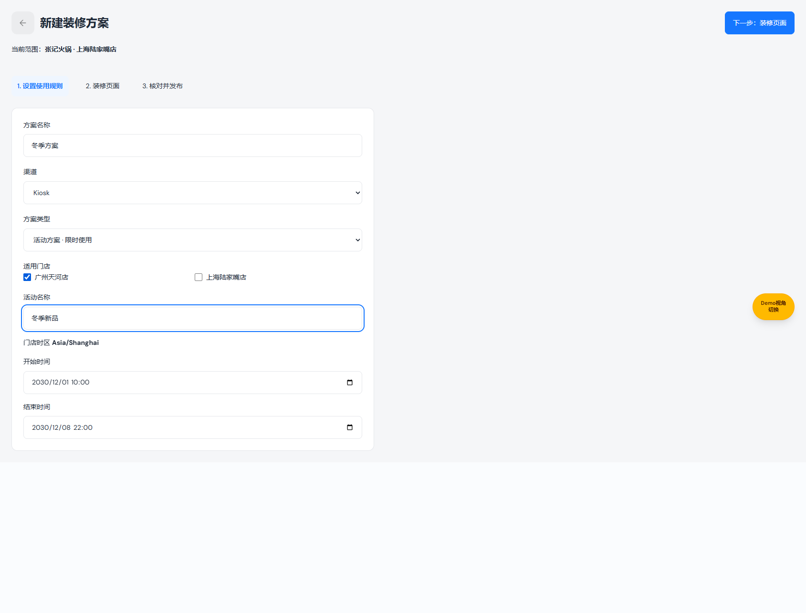

| 字段／操作 | 逻辑说明 |
|---|---|
| 方案名称 | 必填，1–40 字。 |
| 渠道 | Kiosk 或 eMenu，编辑已有方案时锁定。 |
| 使用方式 | 日常装修长期使用。限时装修在本步填写活动名称，时间在第三步设置。 |
| 下一步 | 校验并保存草稿，进入装修页面。 |

### 第二步　装修页面

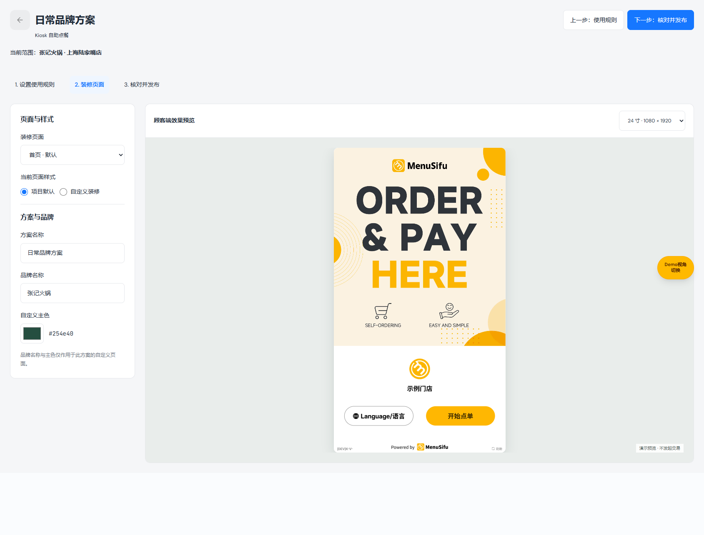

| 字段／操作 | 逻辑说明 |
|---|---|
| 当前页样式 | 限时装修提供沿用日常装修、使用项目原生样式、自定义装修。沿用默认时页面不进入活动覆盖清单。选择另外两项均覆盖此页。 |
| 上一步 | 返回使用规则，回显已保存草稿。 |
| 下一步 | 进入选择门店。未选门店时，继承页提示选择门店后可预览。 |

### 第三步　选择门店

待补本版门店选择截图。

| 字段／操作 | 逻辑说明 |
|---|---|
| 门店名称／区域 | 筛选当前有权管理的适用门店。筛选不清除已选项。 |
| 适用门店 | 多选，实时显示数量和门店名称。进入核对前至少选一家。 |
| 保存并返回装修 | 保存当前选择及已填有效期，返回第二步预览门店继承效果。 |
| 下一步 | 校验门店、活动时间和重叠场次。校验失败留在本页并保留输入。 |

### 第四步　核对并发布

| 字段／操作 | 逻辑说明 |
|---|---|
| 门店对照及生效时间 | 日常装修显示逐店替换对象；活动显示开始、结束和恢复规则。 |
| 确认发布演示版本 | 重新校验门店范围、排期冲突和数据修订号，一次保存快照，成功返回列表。 |
| 返回装修页面 | 保留草稿，当前展示继续使用已发布版本。 |

界面 1.5 截图待补。上述标记的旧截图仅供定位流程。

## 方案效果预览

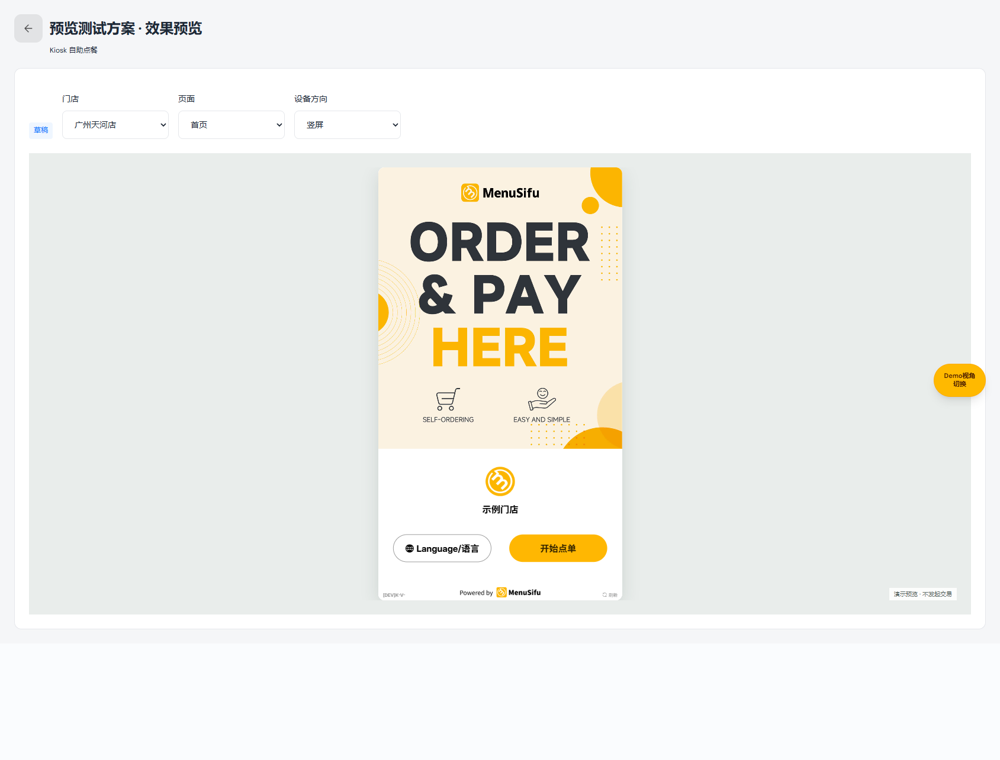

方案列表操作列提供「效果预览」，按选中的方案 ID 打开只读全屏预览。可切换已发布版本与草稿，按页面查看效果。限时装修可以选择适用门店，未覆盖的页面显示所选门店的当前日常装修并标明来源。Kiosk 可切换横竖屏。返回保留当前渠道。

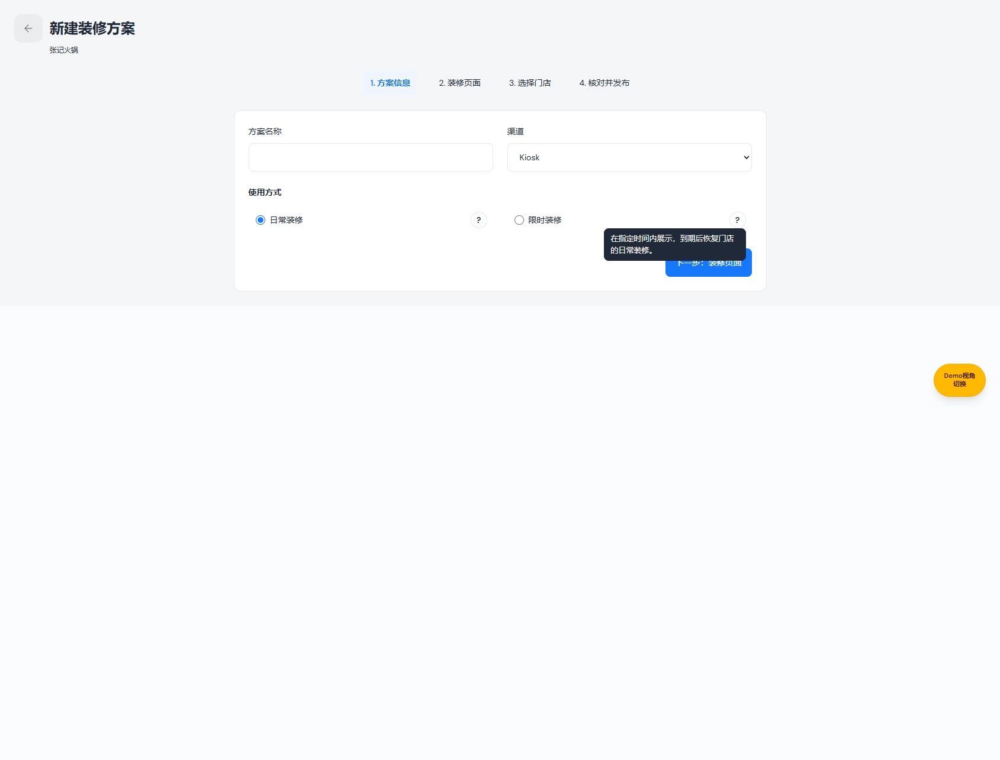

使用方式的两个选项各提供说明图标，鼠标悬停或键盘聚焦时显示说明气泡。日常装修说明为「门店平时使用的装修。」限时装修说明为「在指定时间内展示，到期后恢复门店的日常装修。」

四步共用顶部区域。宽屏左侧显示返回、方案名称和副标题，居中显示四步进度，右侧显示当前操作。宽度不足时，第一行保留标题和操作，第二行居中显示当前步数及名称。步骤一和三的下一步按钮从页头提交各自表单。

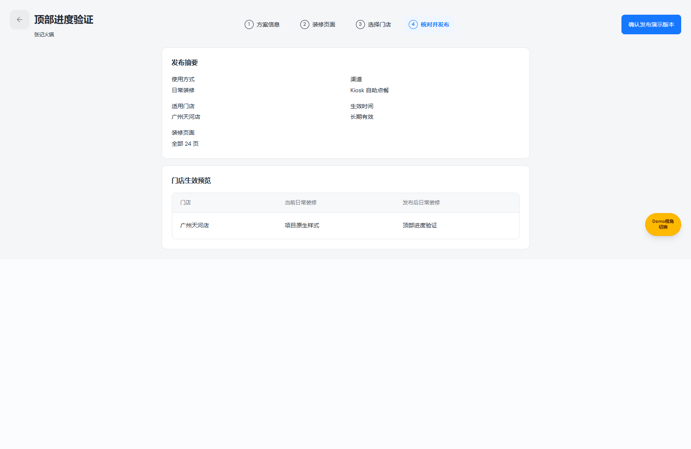

## 广告管理式的方案创建

四步的顶部共用标题、操作、步骤名称和细进度条。第一步以整卡单选呈现日常装修与限时装修，点击卡片选中，说明气泡独立可聚焦。第三步采用左侧门店列表与右侧已选门店区。限时装修在选择门店后进入独立的「活动有效期」步骤。

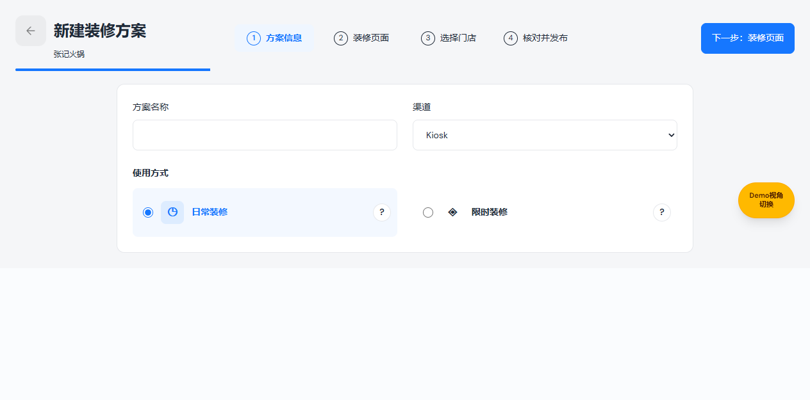

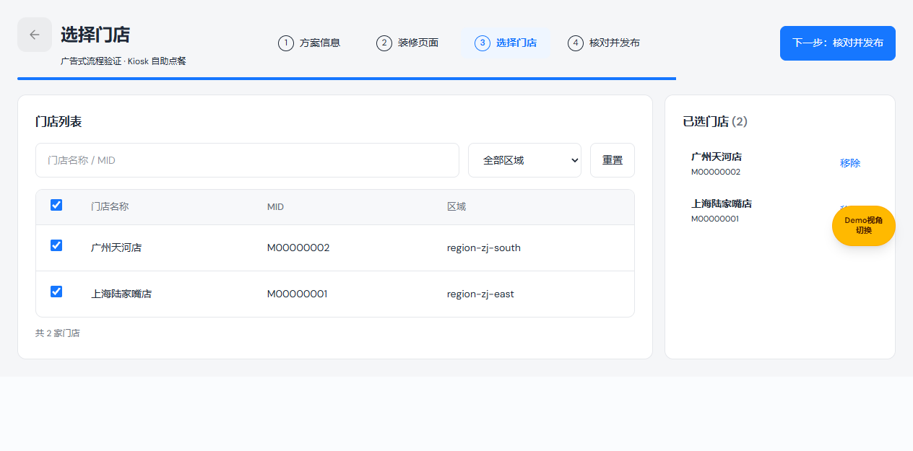

| 字段／操作 | 逻辑说明 |
|---|---|
| 门店搜索／区域 | 按名称、MID 和区域筛选，保留已选。 |
| 重置 | 清空筛选，保留已选门店。 |
| 全选当前筛选结果 | 只改变可见门店，部分选中时显示半选。 |
| 已选门店 | 实时显示已选数量、名称与 MID。移除后同步取消左侧勾选。 |
| 下一步 | 无已选门店时禁用。选中后继续使用时区、时间及冲突校验。 |

## 限时装修有效期

日常装修保留四步。限时装修有五步，选择门店之后单独设置活动有效期，再核对发布。门店页只负责选择门店。有效期页显示已选门店和适用时区，按该时区输入开始和结束时间，进入核对前检查时段冲突。返回修改门店时，同一时区保留已保存的有效期，时区变化需要重新填写。发布前再次校验。

| 字段／操作 | 逻辑说明 |
|---|---|
| 适用门店 | 只读展示上一步保存的门店。 |
| 门店时区 | 只读展示已选门店的共同配置。时区缺失或不同则禁止继续。 |
| 开始时间 | 必填，按页面显示的时区输入，须晚于当前时刻。 |
| 结束时间 | 必填，晚于开始时间。 |
| 下一步：核对并发布 | 校验时间和逐店冲突；成功保存草稿并进入核对，失败留在本页。 |
| 返回选择门店 | 回到上一步，保留此前已保存的配置。 |

## 保存并继续草稿

新版创建流程的每一步均提供「保存草稿」。首次保存须填写方案名称，活动名称、门店和起止时间可以未填完。保存成功后返回当前渠道列表，可通过「继续草稿」回到保存时的步骤。保存不生成新版本，已发布方案继续采用原发布快照。继续或发布仍须按当前步骤校验。

草稿位置随方案和所属渠道保存。已发布方案保存新草稿后仍显示原版本的生效状态，并提供「继续草稿」操作。再次成功发布会清除草稿位置。

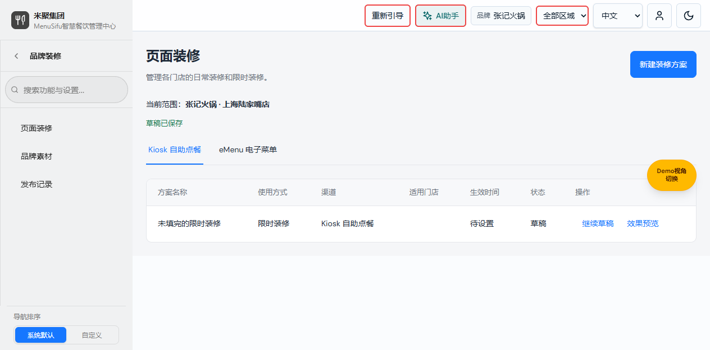

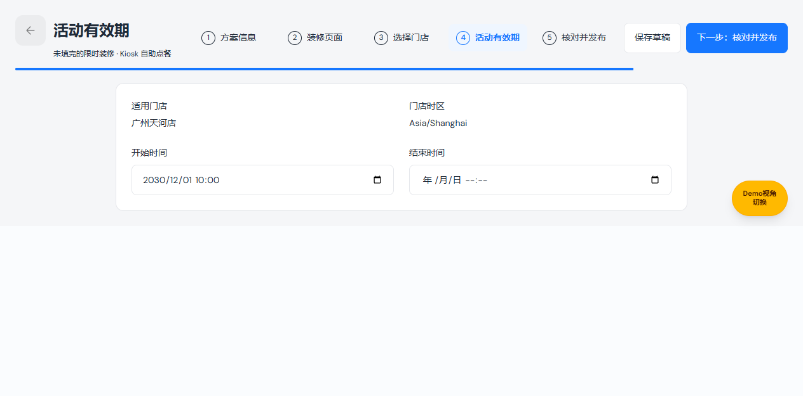

## 装修方案列表筛选

装修方案列表默认在同一张表展示全部产线。筛选选项与方案行的产线名称统一显示为 Kiosk、eMenu。可组合按方案名称、产线、使用方式和发布状态查询。「重置」清空全部筛选。返回列表时在当前浏览器会话保留筛选。列表中的产线、装修、预览和草稿恢复均使用该行方案所属产线。旧版方案列表同样按产线筛选，仅显示其已有字段。

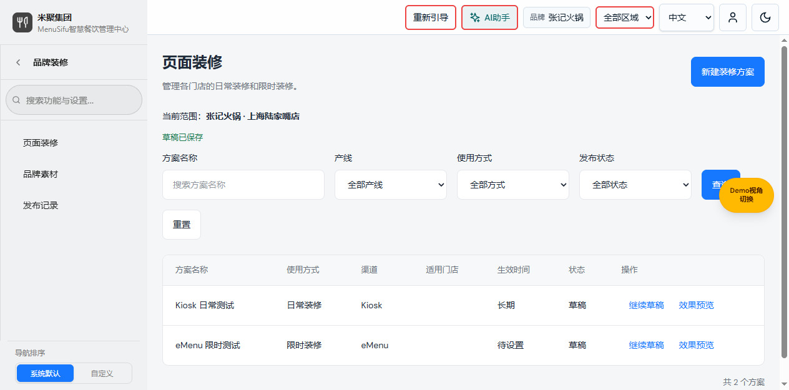

| 字段／操作 | 逻辑说明 |
|---|---|
| 方案名称 | 选填，按名称不区分大小写匹配。 |
| 产线 | 默认全部产线，可选 Kiosk 或 eMenu。 |
| 使用方式 | 默认全部方式，可选日常装修或限时装修。 |
| 发布状态 | 默认全部状态。未发布与已有发布版本按发布快照区分。 |
| 查询／重置 | 查询按所填条件取交集，重置恢复全部。 |
| 无结果 | 显示没有符合条件的装修方案，可重置后重新查看。 |

页面装修列表页头左侧显示标题，右侧显示「新建装修方案」或只读状态，下接筛选栏。方案列表按品牌及授权范围展示，发布门店在创建步骤中选择。草稿保存和异常状态出现时在页头下方提示。

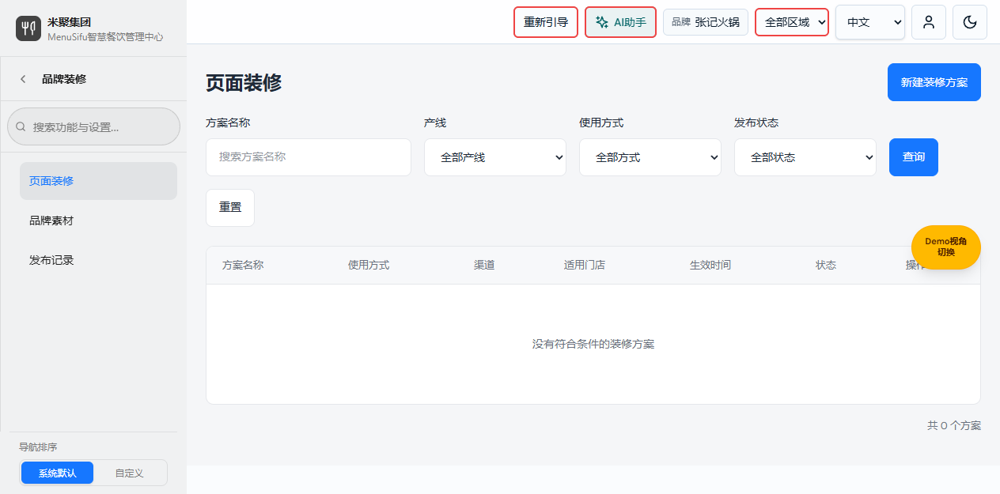

独立装修工作台使用贯穿整个视口的统一底色。新建流程的所有步骤共用通栏页头，浅色模式使用白底，底部显示通栏进度线。标题、步骤与操作都位于页头内，表单区域沿用工作区底色和卡片表面。

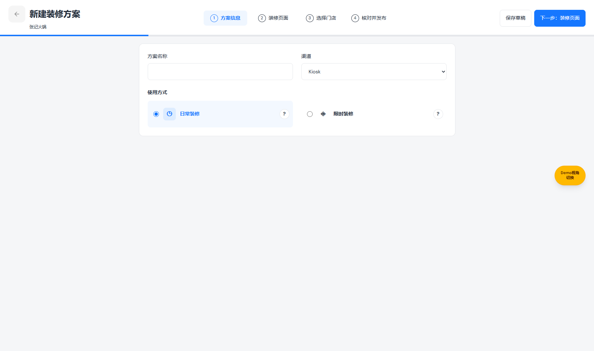

## 方案主题色

装修工作台在页面设置上方展示「方案主题色」。提供系统默认、松石绿、琥珀金、陶土红、靛蓝、石墨灰及自定义主色。新方案选择系统默认，配色为品牌装修内置的蓝色主色和浅灰底。既有方案继续使用已保存的主题。选择主题色时更新方案中的所有自定义页面，共用主色、背景、文字与强调色。单页模板只决定页面样式结构。项目原生页保留原生配色，继承页使用门店日常方案的配色。

主题选择随草稿保存，核对页显示名称，发布快照记录所选主题及主色。已有方案缺少主题标识时继续使用原配色，显式选择主题后按新规则预览。

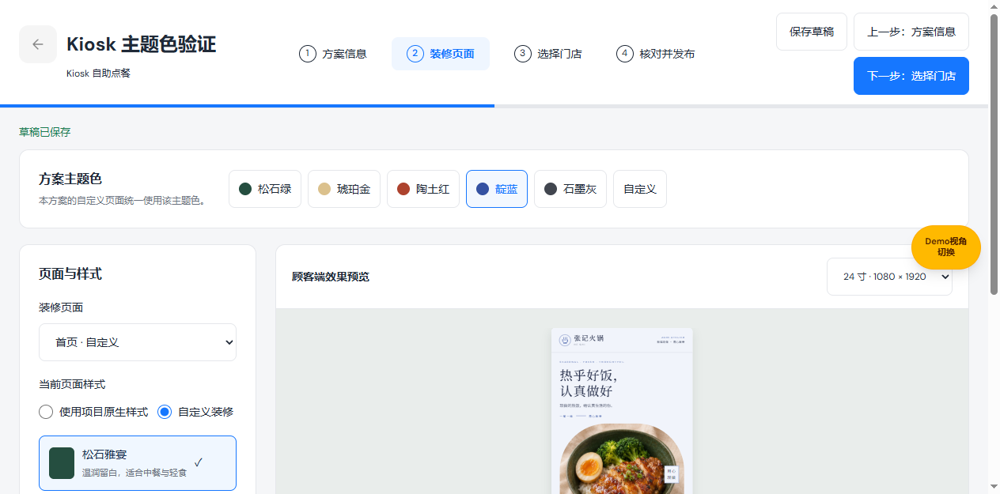

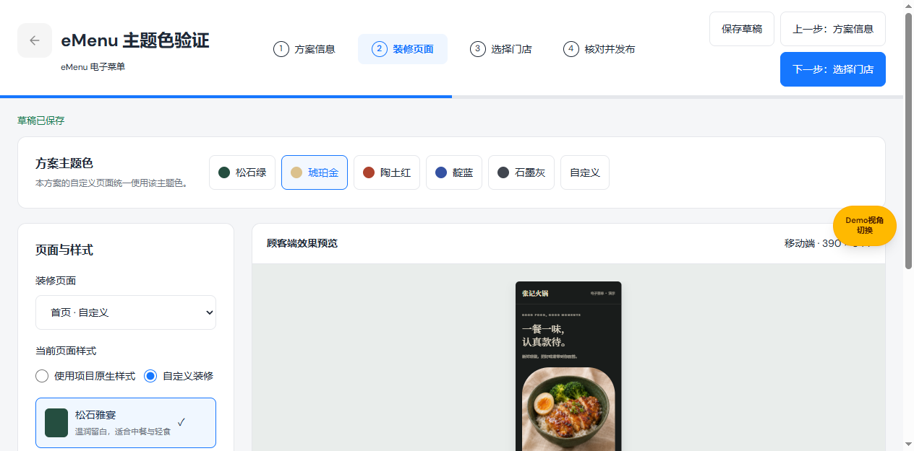

| 字段／操作 | 逻辑说明 |
|---|---|
| 主题色预设 | 点击选中并自动保存到方案草稿，切换页面时沿用所选主题。 |
| 自定义 | 选中后可输入主色，其他颜色根据主色生成。 |
| 核对主题色 | 核对页显示本次保存的主题名称，自定义时显示色值。 |

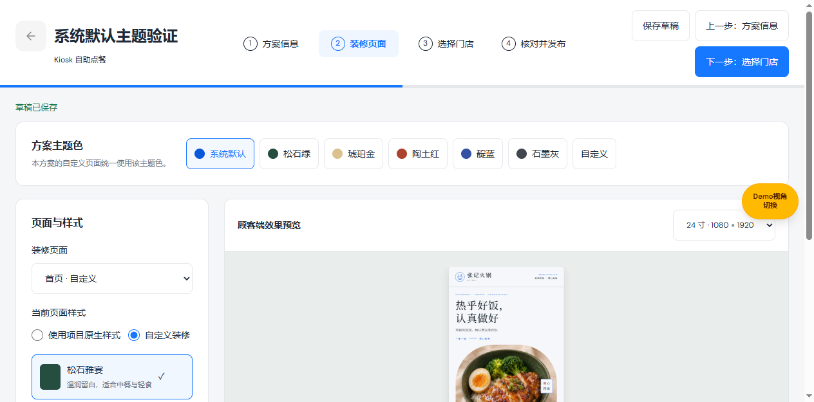

## 页面模板与方案主题

装修时，为每个自定义页面选择「留白图文」「紧凑列表」或「大图卡片」。模板随当前页保存，决定内容排布、间距和组件形态。方案主题独立选择，提供按钮、按钮文字、背景、正文、标签、选中态、成功、提醒和错误等颜色。选择主题后，所有使用本方案自定义装修的页面按同一套颜色角色渲染。项目原生页仍用原生配色，继承页使用所选门店日常方案的主题。

模板和主题可组合使用。例如，选择靛蓝作为方案主题，首页使用留白图文，菜单使用紧凑列表，换布局时按钮、标签和状态色保持一致。主题按角色提供前景与背景，按钮及状态文字通过对比度校验。已有页面模板标识继续使用原值。

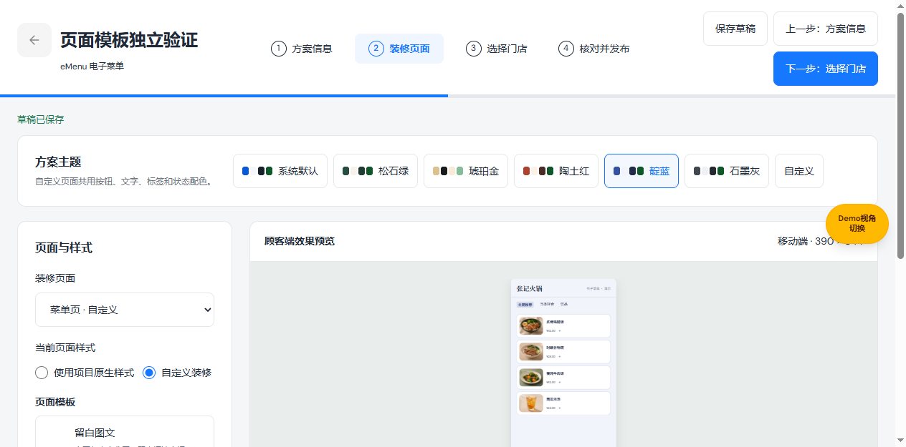

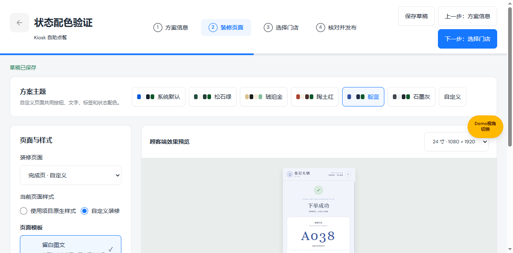

| 字段／操作 | 逻辑说明 |
|---|---|
| 方案主题 | 点选一组色板后保存草稿并刷新预览，影响本方案全部自定义页。 |
| 页面模板 | 切换当前页布局并保存草稿，方案主题继续生效。 |
| 原生／继承 | 原生页沿用项目样式，继承页沿用门店日常装修。 |

### 主题色即时预览

装修工作台选择方案主题色后，当前页立即更新配色。原生样式页显示套用主题的模板预览，可切回原生参考，保留已选的页面样式。继承页继续展示门店日常装修。
