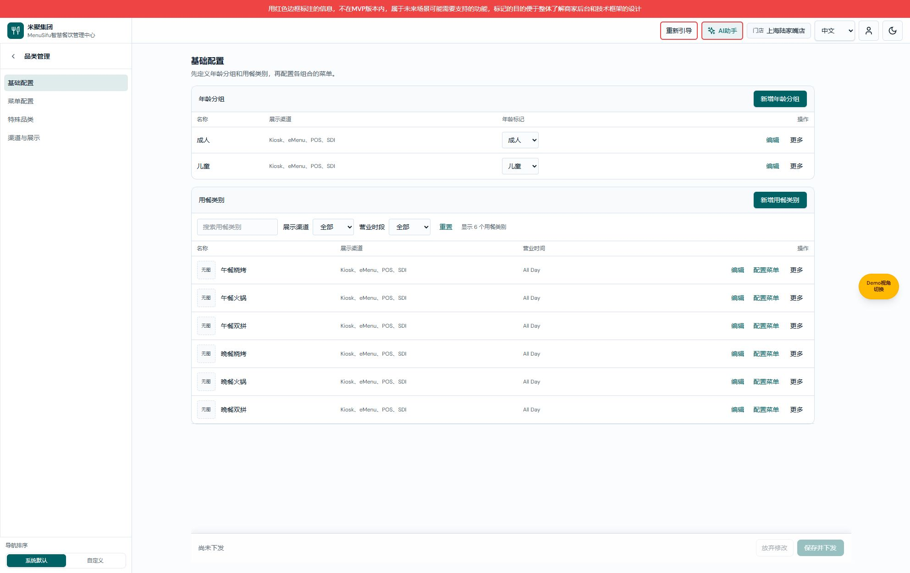
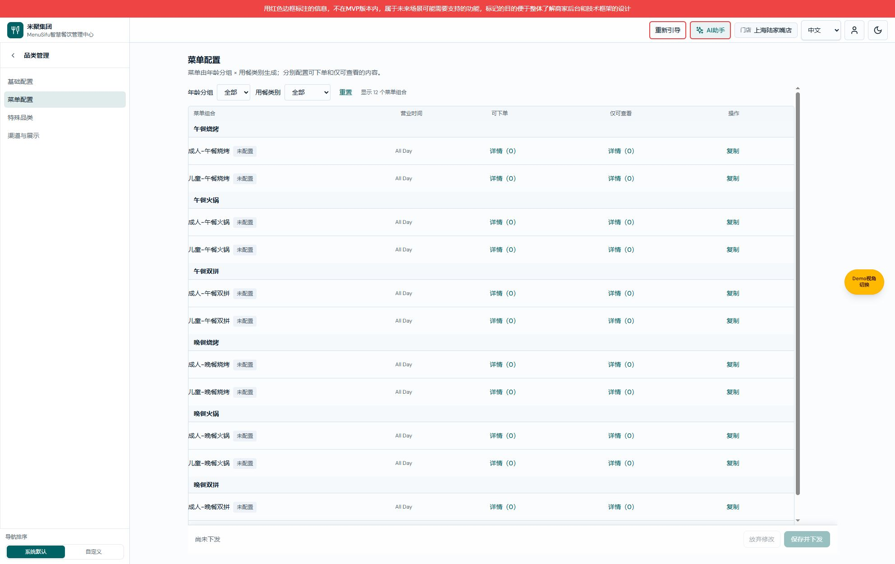
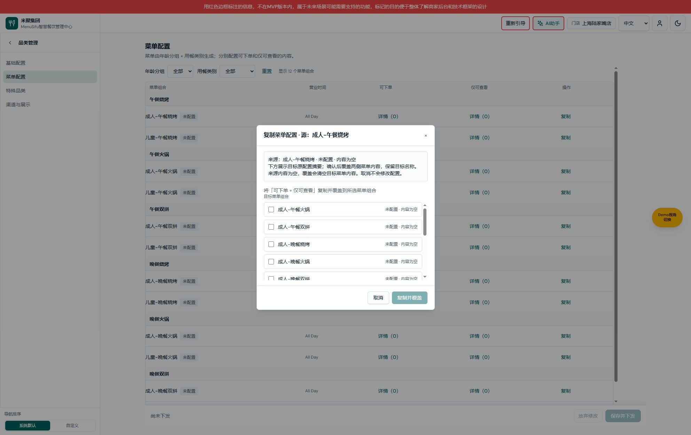
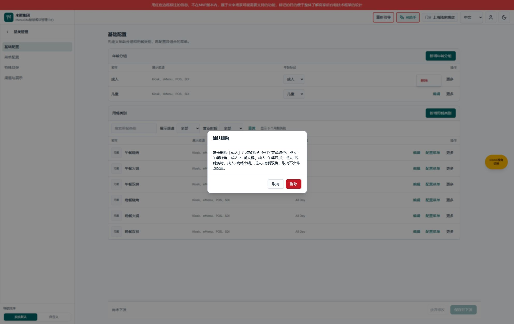
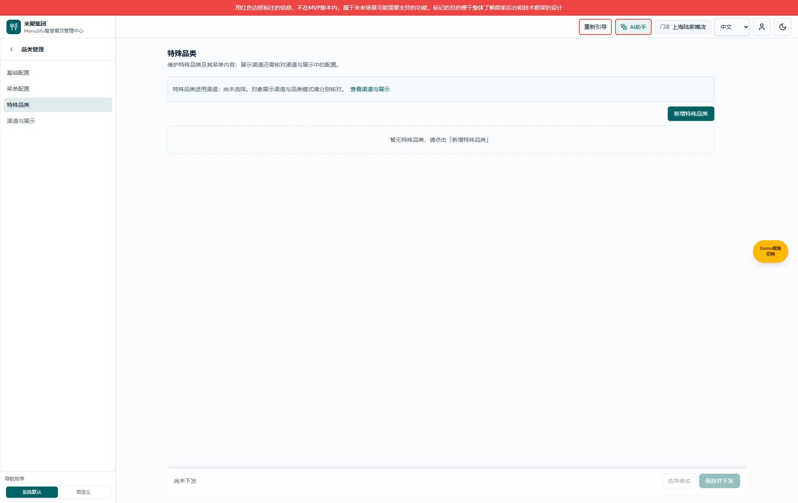
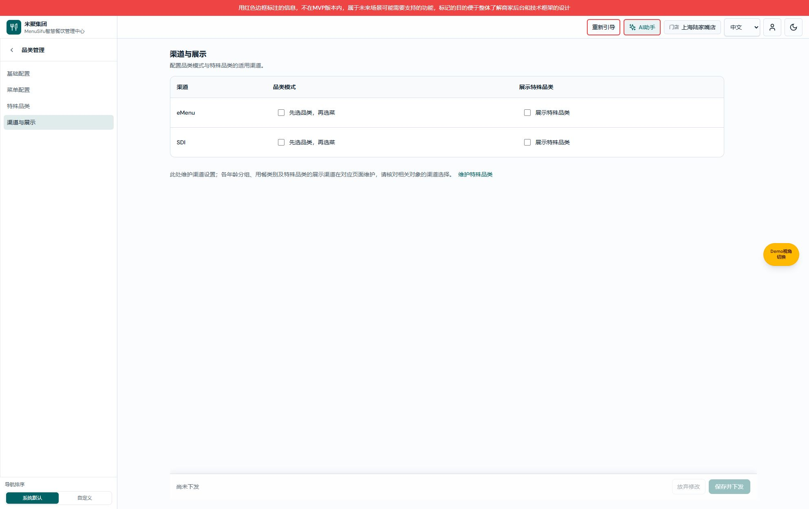

# 品类管理需求文档（个人规范版）

> 版本 V1.0；2026-10-15；变更 CATEGORY-20261015-01。共同基线：本轮用户明确确认的优化建议；本文件按页面元素定义本次变更，业务规则与配对文档一致。

[产品 V1.0](品类管理产品权威需求文档.md) · [研发 V1.0](品类管理业务规格说明书（研发交付版）.md) · [个人规范 V1.0](品类管理需求文档（个人规范版）.md)

| 版本 | 日期 | 变化 |
|---|---|---|
| V1.0 | 2026-10-15 | CATEGORY-20261015-01：四个子页面、基础筛选、菜单分组和状态、复制及删除影响提示、渠道对照布局；产品／研发均 V1.0 |

## 基础配置页面

图注：基础配置默认态，来源为 2026-10-15 本次 CATEGORY-20261015-01 本地实现；演示数据，非线上状态。

用途／入口：前厅管理中心 → 品类管理 → 基础配置。维护年龄分组和用餐类别，不继续拆分子菜单。

### 子导航区域

| 字段｜操作 | 逻辑说明 |
|---|---|
| 品类管理标题／返回 | 父菜单整行进入公共覆盖子导航；返回退一层，保持公共导航规则。 |
| 基础配置 | 进入年龄与类别配置，当前项高亮。 |
| 菜单配置 | 进入所有年龄 × 类别组合，默认全部；详情见下页。 |
| 特殊品类 | 进入独立特殊品类管理，保留公共访问控制。 |
| 渠道与展示 | 进入按渠道组织的两项设置。 |

### 年龄分组区域

| 字段｜操作 | 逻辑说明 |
|---|---|
| 名称 | 展示当前年龄分组名称，例如成人；不将该文本直接解释为具体年龄范围。 |
| 展示渠道 | 当前对象配置的渠道列表，按已有渠道名称显示。 |
| 年龄标记 | 成人、儿童、长者、未标记四选一；新增默认未标记；选择后写当前模块草稿。用途含义待确认 CATEGORY-Q01，不新增计价联动。 |
| 新增年龄分组 | 打开原名称与渠道表单，确认后添加分组并生成对应组合，取消不新增。输入校验沿用原表单，本次只调整明确对象的文案。 |
| 编辑 | 打开当前对象原表单，预填名称及渠道；成功写草稿，取消保留原值。 |
| 更多 | 展开当前行删除入口；点击其他位置收起，不写草稿。 |
| 删除 | 打开共用删除确认，说明关联影响；至少保留一个年龄分组的原限制不变。 |

### 用餐类别区域

| 字段｜操作 | 逻辑说明 |
|---|---|
| 图片与名称 | 同列展示当前类别图片与名称，图片无值显示无图；名称如午餐烧烤。 |
| 展示渠道 | 对象自身选择的渠道，不代表全局或终端最终可见性。 |
| 营业时间 | 引用门店营业时段名称；没有有效引用显示未设置，不根据“午餐”名称推断时间。 |
| 搜索用餐类别 | 默认空，即全部；去除两端空白后包含匹配，不区分大小写；即时筛选，不修改业务。 |
| 展示渠道筛选 | 单选，默认全部；候选 Kiosk、eMenu、POS、SDI，选中后匹配包含该渠道的类别。 |
| 营业时段筛选 | 单选，默认全部；候选来自已有门店营业时段，匹配引用该时段的类别。 |
| 重置 | 同时清空搜索、渠道与时段筛选，恢复当前全部类别；不重置业务配置。 |
| 显示 N 个用餐类别 | 三个筛选取交集后的可见行数，整数；无匹配为 0。 |
| 空结果 | 有类别但无匹配时显示无匹配类别，请调整筛选条件；无类别保留暂无类别状态。 |
| 新增用餐类别 | 打开原类别表单；确认成功后生成各年龄对应组合，取消不新增。 |
| 编辑 | 编辑当前类别的原字段，保留原校验与图片选择流程。 |
| 配置菜单 | 携带当前类别 ID 到菜单页，只显示此类别组合；不会隐式提交草稿。 |
| 更多／删除 | 展开删除入口，再打开共用确认；原至少保留一个类别约束不变。 |

## 菜单配置页面

图注：菜单配置默认态，来源为本次本地实现 CATEGORY-20261015-01；例示 2 个年龄 × 6 个类别。

用途／入口：子导航或基础类别的配置菜单链接。维护组合可下单、仅可查看内容。

| 字段｜操作 | 逻辑说明 |
|---|---|
| 年龄分组筛选 | 单选，候选来自当前年龄分组；普通入口默认全部。 |
| 用餐类别筛选 | 单选，候选来自当前类别；普通入口全部，关联入口预选携带类别；无效 ID 不应用。 |
| 重置 | 两项恢复全部；更新可见行和分组标题，不改变配置。 |
| 显示 N 个菜单组合 | 两筛选取交集后的组合数量；默认 2 × 6 = 12，单类别为 2，再选儿童为 1。 |
| 类别分组标题 | 按类别原顺序展示，组内按年龄原顺序排列；没有可见组合的组标题隐藏。 |
| 菜单组合 | 年龄分组与用餐类别的组合名称，沿用原命名。 |
| 配置状态 | 未配置／已配置；已配置表示曾确认或作为复制目标写入，兼容已有内容的旧记录；不是已下发或完整性通过。明确保存空菜单仍为已配置。 |
| 营业时间 | 引用组合所属类别时段，与基础页一致。 |
| 可下单详情 | 打开当前组合的原可下单编辑弹框，显示当前内容数量。 |
| 仅可查看详情 | 打开原查看侧编辑弹框；替代不可下单文案，允许查看的含义不变。分类模式数量为引用组合数，按菜模式为选菜数量。 |
| 复制 | 打开复制弹框，当前行作为来源；候选为其余全部组合，不局限于筛选可见行。 |
| 无基础配置 | 明确引导先配置至少一个年龄分组和一个类别，去配置链接进入基础页。 |

## 复制菜单配置弹框

图注：复制弹框未选目标态，来源为本次本地实现 CATEGORY-20261015-01；图中来源为空。

用途／入口：菜单组合行的复制；携带来源组合 key。

| 字段｜操作 | 逻辑说明 |
|---|---|
| 来源标题 | 显示当前来源组合名称，不能在弹框里切换来源。 |
| 来源内容摘要 | 显示两侧原配置摘要；内容为空时明确说明，不把 0 等同加载失败。 |
| 覆盖说明 | 两侧内容一起覆盖，保留目标名称；空来源明确提示将清空目标内容。 |
| 目标复选框 | 默认均不选，可多选，排除来源；每项显示目标名称及覆盖前摘要。 |
| 复制并覆盖 N 个组合 | 选中至少一个合法目标才启用，N 为所选数量；确认后沿用既有复制算法写模块草稿，完成后关闭并刷新列表，不自动下发。 |
| 取消／关闭 | 不写配置，关闭弹框，源和目标均保持原值。 |

## 删除确认弹框

图注：删除年龄分组确认态，来源为本次本地实现 CATEGORY-20261015-01；仅打开确认，未执行删除。

用途／入口：年龄分组或类别行的更多 → 删除；共用弹框，携带对象类型与 ID。

| 字段｜操作 | 逻辑说明 |
|---|---|
| 删除对象 | 展示所选名称，区分年龄分组或用餐类别。 |
| 关联组合数量 | 删除年龄时等于当前类别数，删除类别时等于当前年龄数；同步列出组合名称，便于核对。 |
| 删除 | 沿用原至少保留一个对象约束；通过后删除当前对象并清理相关组合与无效引用，写模块草稿。 |
| 取消／遮罩／Escape | 关闭确认，不修改对象或菜单。 |

## 特殊品类页面

图注：特殊品类空态，来源为本次本地实现 CATEGORY-20261015-01；仅表示本地演示没有对象。

用途／入口：子导航，维护独立特殊品类与菜单。

| 字段｜操作 | 逻辑说明 |
|---|---|
| 特殊品类适用渠道摘要 | 显示全局已选 eMenu／SDI；空数组显示尚未选择，不代替每个对象的渠道字段。 |
| 查看渠道与展示 | 进入渠道设置，同模块草稿保留。 |
| 新增特殊品类 | 打开既有表单，名称、图片、渠道与菜单选取沿用原功能；“特殊”的业务定义未扩展。 |
| 名称 | 当前对象名称。 |
| 图片 | 原对象图片，空值显示无图。 |
| 展示渠道 | 当前对象配置的渠道；不以此直接推断最终展示。 |
| 菜单 | 查看原菜单详情及数量，沿用原关联。 |
| 编辑 | 打开当前对象原表单，成功写草稿，取消保持原数据。 |
| 更多／删除 | 删除收纳进更多，仍使用原确认流程，不绕过校验。 |
| 暂无特殊品类 | 无记录时说明可通过新增建立对象。 |

## 渠道与展示页面

图注：渠道与展示默认态，来源为本次本地实现 CATEGORY-20261015-01；复选框是本地配置值。

用途／入口：子导航或特殊品类的查看渠道与展示。原两个设置整合为渠道对照布局。

| 字段｜操作 | 逻辑说明 |
|---|---|
| 渠道 | 固定 eMenu、SDI，来源为当前支持渠道，不增加 POS/Kiosk 适用性。 |
| eMenu 品类模式 | 是否将 eMenu 纳入已有品类模式渠道数组；标签“先选品类，再选菜”整段可点击。 |
| SDI 品类模式 | 同一设置的 SDI 渠道，独立勾选。 |
| eMenu 展示特殊品类 | 是否将 eMenu 纳入特殊品类全局适用渠道。 |
| SDI 展示特殊品类 | 同一设置的 SDI 渠道，独立勾选。 |
| 对象渠道说明 | 提醒到对应对象页面核对自身渠道，不宣称最终终端生效结果；CATEGORY-Q02 待确认。 |
| 维护特殊品类 | 进入特殊品类页面，保留模块草稿。 |

打开页面不无条件修改开关；操作后由原公共绑定写草稿，保存或放弃走共用栏。

## 公共保存区域

四页图片底部均包含共用保存栏。字段：待保存数量表示公共配置键变更数，点击进入已有变更预览；尚未下发／上次下发显示已有下发记录；放弃修改执行原确认与草稿丢弃；保存并下发执行公共校验、预览及原结果反馈。无改动时两操作禁用。整份品类 JSON 可能计为一项，不能解释为只改动一行。同模块切换保留草稿，离开模块执行公共保护。

## 图片缺口与待确认项

本轮四页和新增覆盖／影响提示的弹框就近配图。年龄新增／编辑、类别编辑、菜单内容编辑、特殊品类新增编辑、保存预览与错误态未在本文重新展开原表单全部字段；其完整状态图片仍待补，不宣称全模块图片覆盖完整。年龄编辑命名与菜单查看侧标题变化可通过实际页面核对，完整弹框图不以父页面图代替。

CATEGORY-Q01 年龄标记业务语义、CATEGORY-Q02 终端渠道联动优先级、CATEGORY-Q03 特殊品类定义与完整性标准，与产品、研发版同状态；本次未批准这些缺失规则。
