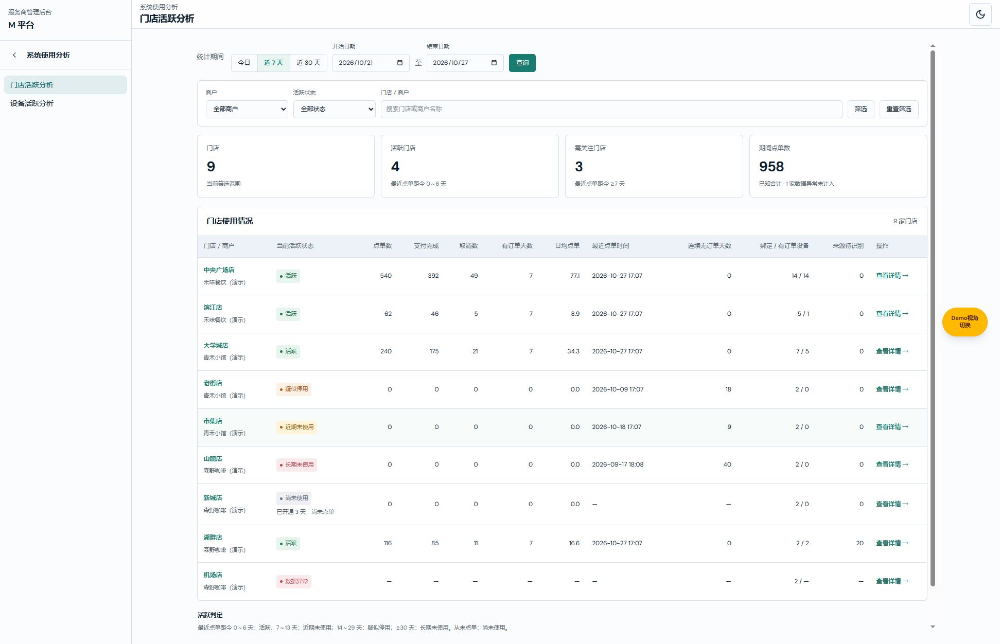
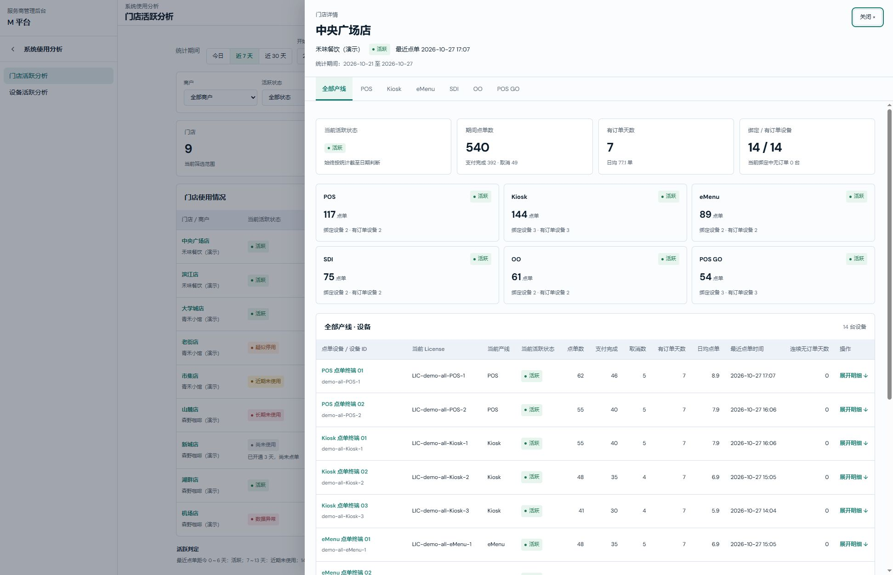
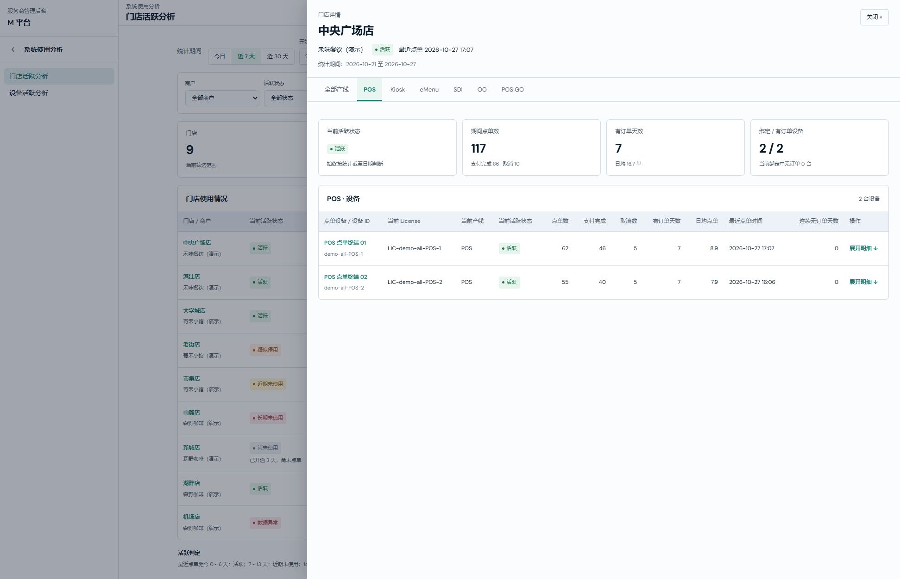
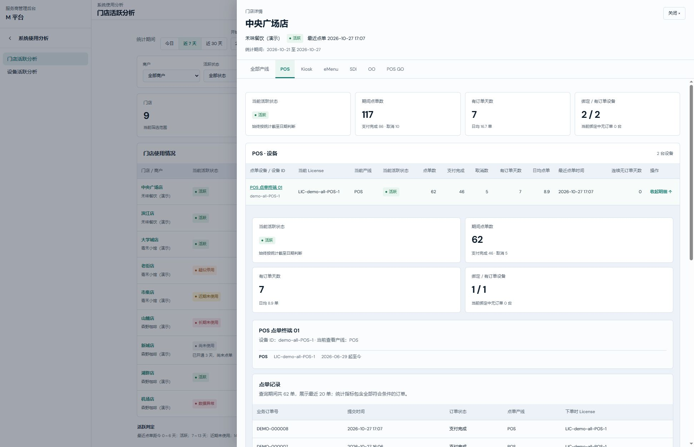
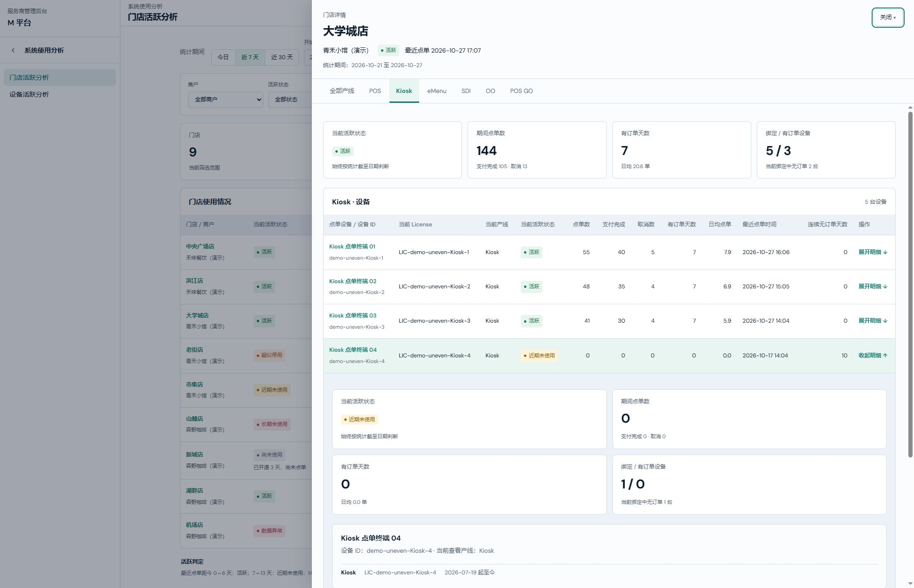
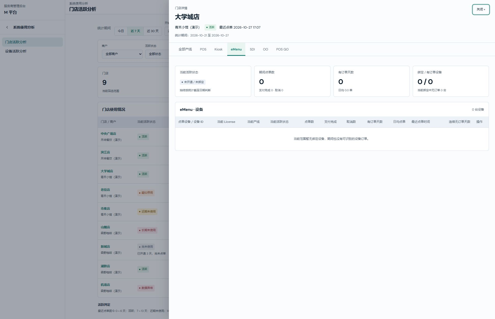
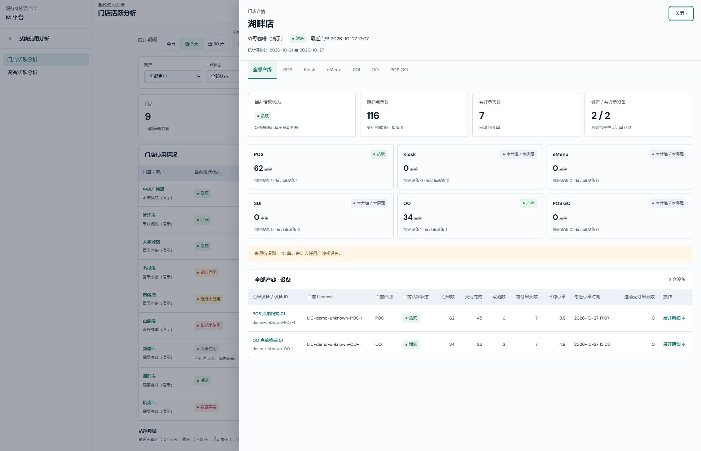
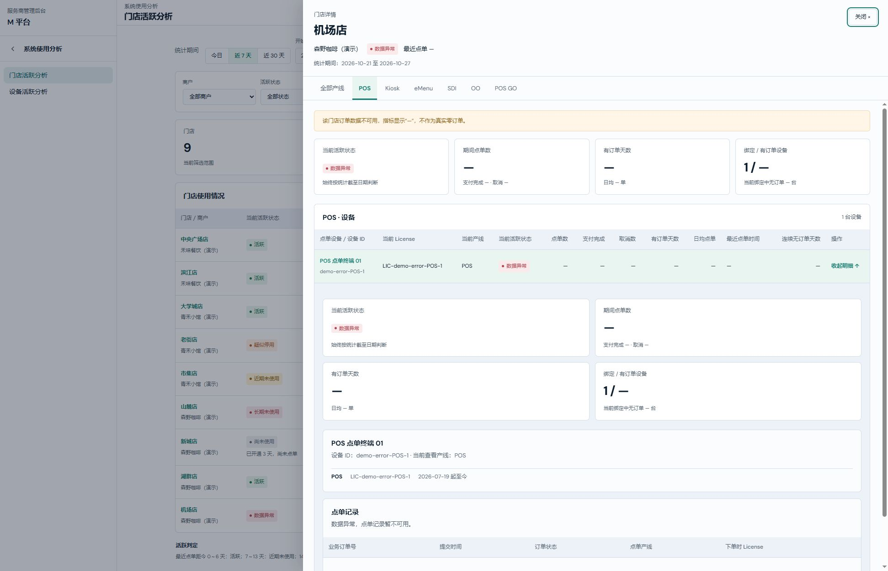
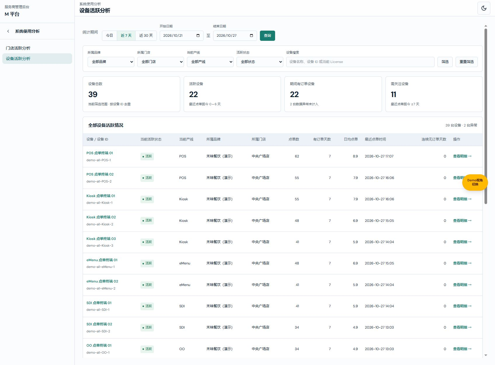

# 门店活跃分析业务规格说明书（研发交付版）

版本：V2.0｜日期：2026-10-27｜共同业务基线：预设 Demo、7/14/30 天、门店详情抽屉及独立设备视角｜变更编号：STORE-ACTIVITY-DRAWER-20261027-01。

职责：对象、字段、计算、状态、异常及研发验收。

配套文档：[门店活跃分析产品权威需求文档](商户使用活跃分析产品权威需求文档.md)（V2.0）。

配套文档：[门店活跃分析需求文档（个人规范版）](商户使用活跃分析需求文档（个人规范版）.md)（V2.0）。

状态：已确认需求及本地演示实现；开发起始基线 main@a62200d9，Git 交付结果以验证记录和主线日志为准。已确认交互为列表打开宽抽屉、产线页签切换和设备行内展开。验证证据及限制见[验证与交付记录](验证与交付记录.md)，操作图片索引见[逐操作覆盖清单](逐操作覆盖清单.md)。历史依据由 Git 追溯。

## 范围、导航与权限

图注：门店活跃分析／根列表；2026-10-27，V2.0 功能预览，基线 main@a62200d9，未提交。

| 字段／操作 | 逻辑说明 |
| --- | --- |
| 系统使用分析 | 与品牌管理中心、硬件资产中心同级；公共子导航滑层依次展示门店活跃分析、设备活跃分析。返回只退一层菜单，保留当前业务页面。 |
| 门店活跃分析 | 门店列表、门店详情抽屉及其产线页签、设备行内明细；根地址 /m-platform/merchants/activity。 |
| 设备活跃分析 | 独立查看全部设备及当前品牌、门店、产线归属；入口、统计范围、分页和独立详情保持下文定义。 |
| 权限门禁 | 保留 m:module:merchants 父资源及 m:page:merchant-activity、m:page:device-activity 独立页面资源；先过滤再分组，角色并集、默认拒绝及已保存角色授权不变。 |
| 只读浏览 | 有页面可见权限即可查询、切换页签和展开详情；只在当前页面资源范围放行这些浏览控件，不授予其他页面写权限。无权限直达由宿主拦截，不渲染分析内容。 |
| 演示边界 | 仅内存预设 Demo，不接真实订单，不更改 License 绑定，不自动停用或通知；阈值不提供配置。 |

## 统一业务口径

| 规则 | 当前定义 |
| --- | --- |
| 产线范围 | POS、Kiosk、eMenu、SDI、OO、POS GO，固定六条。 |
| 点单订单 | 成功提交的原始业务订单；提交后取消仍属于一次点单，取消数单列；草稿不计入。 |
| 去重 | 同一门店内原始业务订单 ID 去重；重传、收款流转不增加点单数。Demo 中重复记录为同一份订单快照。 |
| 点单归属 | 使用下单时来源设备 ID，匹配该时刻唯一有效的 License 绑定关系，取得门店和产线；收款设备不改归属。 |
| 历史绑定 | 绑定区间为 [生效时间, 失效时间)，失效为空表示持续有效。历史订单不随当前设备产线变化而迁移。 |
| 来源待识别 | 来源设备缺失、无匹配绑定或绑定不唯一的订单，仅计入其已知门店总量；不计入产线与设备。 |
| 查询时间 | Demo 全部门店时区为 Asia/Shanghai；含起止自然日；今日 1 天、近 7 天含当天和前 6 天、近 30 天含当天和前 29 天。自定义限截至日及前 89 天。 |
| 截至日期 | 页面加载时以 Asia/Shanghai 的当天生成整套预设数据；根列表不重复展示截至日期；门店抽屉展示有效统计期间，状态仍按演示截至日判断。同日刷新不随机变化；跨日重新加载生成对应日期的演示快照。 |
| 点单数 | 有效查询期内去重订单数。支付完成数、取消数为其中的状态子集，未支付但已提交订单保留在总数中。 |
| 有订单天数 | 查询期内至少发生 1 笔点单的不同自然日数量。 |
| 日均点单 | 期间点单数 ÷ 含起止日的自然日天数；保留原始计算精度，展示 1 位小数。未营业日期也计入分母。 |
| 最近点单时间 | 截至日期日末以前，全历史最近一次成功提交时间，不受查询起日影响；展示至分钟。 |
| 连续无订单天数 | 截至日期与最近点单日期的自然日差，今天有订单为 0；从未下单或数据异常显示 —。不按 24 小时滚动。 |
| 绑定设备数 | 截至日期日末有效的 License 绑定设备 ID 去重数；不是 License 条数。 |
| 有订单设备数 | 查询期间至少产生 1 笔可归属点单的设备 ID 去重数，包含历史绑定设备。 |
| 绑定中无订单 | 当前绑定设备集合中，查询期间未产生点单的设备数量；不能简单用绑定数减所有有订单设备数，因为后者可含历史设备。 |
| 门店抽屉设备列表 | 当前绑定设备集合与查询期间有订单的历史绑定设备集合取并集；保留零订单设备。显式历史设备深链可额外展示所指定设备，统计集合和公式不因此扩大。 |
| 分层核对 | 门店点单数 = 六条已识别产线点单数合计 + 来源待识别点单数；同一产线点单数 = 其设备点单数合计。 |
| 跨产线设备 | 一台设备可在不同历史时间用于不同产线，产线设备数不能直接加总为门店设备总数；门店按设备 ID 去重。 |
| 数据异常 | 订单数、支付完成、取消、有订单天数、日均、最近点单、连续无订单天数及有订单/无订单设备数显示 —；已知资产绑定数量可显示。门店总览订单卡片仅汇总已知门店，并明确排除异常门店数。 |
| 权限 | M 平台系统使用分析分类下的独立只读页面资源，授权仍由品牌管理中心父资源门禁控制，只有不可见/可见两种页面权限；沿用角色并集和父模块门禁。既有已保存角色不自动获得新页面权限。 |
| 数据边界 | 所有商户、门店、设备、License、订单均为预设演示数据；不调用真实业务接口，不保存订单，不发送提醒、不自动停用。 |

## 活跃状态

活跃状态始终针对截至日期，以全历史最近点单判定；修改查询期间不改变当前活跃状态。

| 状态 | 条件 |
| --- | --- |
| 活跃 | 最近点单距今 0～6 天。 |
| 近期未使用 | 最近点单距今 7～13 天。 |
| 疑似停用 | 最近点单距今 14～29 天，只表示需关注，不判定真实关店。 |
| 长期未使用 | 最近点单距今至少 30 天。 |
| 尚未使用 | 已开通或已绑定，但从未成功提交订单；门店显示已开通天数，设备显示已绑定天数。 |
| 未开通／未绑定 | 产线未开通，或设备无配置且没有历史点单。未开通产线仍可通过页签查看空设备列表。 |
| 数据异常 | 受控异常门店无法提供订单统计；不作为零订单。当前实现优先标识数据异常。 |

阈值固定为 7/14/30 天，首版无配置页面；不划分统一订单量的高、中、低活跃档位。

## 研发对象与字段

所有业务数据为内存生成，读取不写入 localStorage；业务数据无编辑接口。页面筛选仅保存在当前 JavaScript 页面会话中，刷新恢复默认近 7 天、全部商户、全部状态和空名称。有效期间在钻取和返回时保留；门店抽屉打开、切换与关闭保留未提交的筛选和日期草稿；刷新不保留。

| 对象字段 | 类型、来源与约束 |
| --- | --- |
| ActivityDataset.asOf | 必填 YYYY-MM-DD，Asia/Shanghai 的演示截至日期。 |
| ActivityDataset.timezone | 必填固定 Asia/Shanghai。 |
| ActivityStore.id | 必填唯一演示门店 ID，汇总边界。 |
| ActivityStore.merchantId | 必填所属演示商户 ID，用于商户筛选。 |
| ActivityStore.merchantName | 必填展示名，仅预设商户。 |
| ActivityStore.name | 必填门店名称，用于名称搜索和链接。 |
| ActivityStore.openedOn | 必填开通自然日，用于从未点单门店的开通天数说明。 |
| ActivityStore.lines | 必填已开通产线枚举数组。 |
| ActivityStore.quality | complete 或 error；error 是受控异常，并非真实接口结果。 |
| ActivityStore.scenario | 必填演示场景说明。 |
| ActivityDevice.id | 必填设备 ID，连接来源设备与绑定记录。 |
| ActivityDevice.name | 必填设备显示名称。 |
| LicenseBinding.licenseId | 必填 License 标识，不等同于设备 ID。 |
| LicenseBinding.deviceId | 必填绑定的物理设备 ID。 |
| LicenseBinding.storeId | 必填该段绑定所属门店。 |
| LicenseBinding.line | 必填六产线之一。 |
| LicenseBinding.from | 必填带 +08:00 偏移时间戳，区间起点包含。 |
| LicenseBinding.to | 可空同格式时间戳，终点不包含；null 表示持续有效。 |
| ActivityOrder.id | 必填原始业务订单 ID，门店内唯一去重；真实拆合单与状态事件接入须另定义转换。 |
| ActivityOrder.storeId | 必填订单已知门店 ID，来源无法识别时仍可汇总门店。 |
| ActivityOrder.deviceId | 来源点单设备 ID，可空；不使用收款终端替代。 |
| ActivityOrder.submittedAt | 必填带 +08:00 的原始成功提交时间；查询按本演示时区日期部分。 |
| ActivityOrder.status | submitted、paid、cancelled、draft；前三者计点单，draft 不计。 |
| ActivityPeriod.start | 必填有效起日，含当天边界。 |
| ActivityPeriod.end | 必填有效止日，含截至当日日末。 |
| ActivityScope.storeId | 必填；门店不存在时页面显示未找到。 |
| ActivityScope.line | 可选，存在时按下单有效绑定的产线限定。 |
| ActivityScope.deviceId | 可选，与所选门店及产线形成组合范围，不跨范围取单。 |

### 计算顺序

1. 生成截至日期的固定预设数据；排除草稿与截至日之后记录。
2. 按门店 ID + 原始业务订单 ID 去重，保留固定原始来源；重复记录为同一订单快照，非状态事件日志。
3. 以订单来源设备、门店、提交时刻匹配唯一有效 License；零条或多条均判为来源待识别。
4. 用全历史匹配对象订单计算最近点单日期及当前状态。
5. 用有效起止日筛选订单，计算数量、支付完成、取消、有订单天数与日均。
6. 取截至日末的有效绑定集合；分别计算当前绑定设备、期间有单设备和绑定集合中的无单设备。
7. null 展示为 —、真实零值为 0；日均仅展示时保留 1 位小数。

### 可复算算例与边界

| 输入 | 结果 |
| --- | --- |
| 截至 2026-10-27，最近点单 10-21 / 10-20 | 距今 6 天为活跃；7 天为近期未使用。 |
| 最近点单 10-14 / 10-13 | 距今 13 天为近期未使用；14 天为疑似停用。 |
| 最近点单 09-28 / 09-27 | 距今 29 天为疑似停用；30 天为长期未使用。 |
| 大学城店 Kiosk，10-21 至 10-27 | 144 单，7 个有订单日，日均 144 ÷ 7 = 20.6；绑定 5、有单 3、绑定中无单 2。 |
| 湖畔店同期间 | 门店 116 单 = POS/OO 已识别 96 + 来源待识别 20。 |
| eMenu License 截止 10-22 00:00，POS GO 从此时生效 | 截止前订单归 eMenu，截止时刻及之后归 POS GO；同设备不改写历史订单。 |
| 相同订单快照重复 2 次 | 门店、产线和设备均只计 1 单。 |
| 提交后取消、支付完成、仅提交各 1 单，另有草稿 1 单 | 点单总数 3、取消 1、支付完成 1；草稿排除。 |
| error 门店 | 订单与使用指标 null/—，已知绑定数可为 2；有订单设备不是 0。 |
| 查询起日晚于止日 | 不更新有效查询；保留输入及上次结果，显示错误。 |

### 代码接口与验证

- merchant-activity-domain.ts：resolveOrders、summarizeActivity、currentBindings、devicesForScope、validatePeriod、classifyActivity。
- merchant-activity-demo.ts：createActivityDemo(asOf)，固定日期输入生成完全相同数据。
- scripts/verify-merchant-activity.ts：覆盖阈值边界、闰年、去重、未来订单、歧义绑定、1/7/30/90 天三级汇总、零订单设备及权限默认拒绝。
- merchant-activity-drilldown.ts：activityScopeHref、parseActivityScope；旧门店/产线/设备地址及全部产线设备地址均见路由章节。scripts/verify-activity-drilldown.ts 校验兼容与跨范围拒绝。
- 新资源为 m:page:merchant-activity，父资源 m:module:merchants；无业务写操作权限项。
- 页面只读浏览标记仅在当前页面资源范围内放行日期与筛选，不放开其他页面写控件。

## 门店列表

图注：门店列表／默认近 7 天；2026-10-27，V2.0 功能预览，基线 main@a62200d9，未提交。

入口：系统使用分析 → 门店活跃分析。默认近 7 天、全部商户、全部状态、空搜索。根列表不重复展示英文标识、演示标签、介绍、位置导航或快照标题区。

### 统计期间

| 字段／操作 | 逻辑说明 |
| --- | --- |
| 今日 | 立即应用截至日当天，含当天；同步日期输入及全部统计。 |
| 近 7 天 | 立即应用截至日及前 6 天；默认选中。 |
| 近 30 天 | 立即应用截至日及前 29 天。 |
| 开始日期 | 必填 YYYY-MM-DD；下界为截至日前 89 天，上界截至日；编辑只改输入，不立即更新结果。 |
| 结束日期 | 必填同格式及上下界；不得早于开始日期。 |
| 查询 | 原生必填校验后验证有效日期、先后及范围；通过才应用到列表、抽屉和设备统计并取消快捷选中。失败保留输入和上次有效结果，显示原因；无业务写入。 |
| 原生日历 | 使用浏览器原生日期控件。选择只改变输入，查询后应用；关闭不提交。弹层截图缺口见独立交付清单 G34～G36。 |

### 筛选区

| 字段／操作 | 逻辑说明 |
| --- | --- |
| 商户 | 单选预设商户；空值为全部。结果中的所属品牌使用相同 merchantId/merchantName。选择后须点击筛选。 |
| 活跃状态 | 全部、活跃、近期未使用、疑似停用、长期未使用、尚未使用、数据异常；状态依据全历史及截至日。门店不提供未开通筛选。 |
| 门店／商户搜索 | 最多 80 字，门店名与商户名包含匹配；提交时去首尾空白，忽略英文大小写；不搜索设备。 |
| 筛选 | 三项条件取交集，同时更新门店行与统计卡片；未提交的输入不影响当前结果。无匹配显示提示及 0 项汇总，不造占位门店。 |
| 重置筛选 | 立即清空商户、状态、搜索及对应草稿；保留有效期间。 |

### 汇总区

| 字段／操作 | 逻辑说明 |
| --- | --- |
| 门店 | 当前已应用筛选结果数量，单位家。 |
| 活跃门店 | 结果中状态为活跃的门店数。 |
| 需关注门店 | 结果中近期未使用、疑似停用、长期未使用的门店数；不包含尚未使用及数据异常。 |
| 期间点单数 | 当前结果中可用门店的期间点单数之和；异常门店排除并明确显示排除数量。 |

### 门店表格

| 字段／操作 | 逻辑说明 |
| --- | --- |
| 门店／商户 | 门店名称下显示商户名；点击门店名打开对应详情抽屉，默认全部产线。 |
| 当前活跃状态 | 该门店全历史最近点单按截至日判断，定义见活跃状态；尚未使用补充已开通天数。 |
| 点单数 | 当前对象、有效期间内成功提交的业务订单去重数；取消单计入，草稿排除。单位单；异常 —，真实无单 0。 |
| 支付完成 | 点单数中当前订单状态为支付完成的数量，单位单。 |
| 取消数 | 点单数中提交后取消的数量，单位单。 |
| 有订单天数 | 期间内至少 1 笔点单的自然日数，单位天。 |
| 日均点单 | 点单数 ÷ 含起止日的自然日数；展示 1 位小数，含无单日。 |
| 最近点单时间 | 截至日末的全历史最近成功提交时间，精确至分钟；从未使用或异常显示 —。 |
| 连续无订单天数 | 截至日与最近点单日期的自然日差；今日有单为 0，从未点单或异常为 —。 |
| 绑定 / 有订单设备 | 前者截至日末有效绑定去重数；后者期间至少有 1 单的设备去重数，含历史绑定设备；不能直接相减得到无单数。 |
| 来源待识别 | 已知门店但无法匹配唯一有效 License 的期间点单数；异常为 —。 |
| 查看详情 → | 与门店名称打开同一抽屉，带入 storeId 及有效期间。保存已应用筛选、未提交输入、列表滚动位置和返回焦点。 |

## 门店详情抽屉／全部产线

图注：中央广场店／全部产线；2026-10-27，V2.0 功能预览，基线 main@a62200d9，未提交。

入口：门店名称或查看详情。右侧宽抽屉覆盖列表右部，列表作为背景保留；窄屏抽屉占满视口。不再跳转到相似布局的独立产线列表页。

### 固定上下文与关闭

| 字段／操作 | 逻辑说明 |
| --- | --- |
| 门店详情 | 固定标题区标识当前为门店详情。 |
| 门店名称 | 当前 storeId 对应名称，固定展示，切换产线不改变。 |
| 所属品牌 | 门店的 merchantName，固定展示。 |
| 门店活跃状态 | 固定标题区始终为该门店整体状态，不随页签改变。 |
| 最近点单 | 固定标题区为门店全历史最近点单；非当前产线最近点单。 |
| 统计期间 | 固定只读展示当前已生效起止日；日期调整在关闭后的列表完成，不使用未提交草稿。 |
| 关闭 × | 关闭整个抽屉，回到原门店列表；恢复列表位置与该门店名称焦点。 |
| 遮罩空白 | 仅直接点击抽屉外遮罩关闭；点击抽屉内容、表格空白不关闭。 |
| Escape | 焦点在抽屉内时关闭并恢复上下文。 |
| 键盘焦点 | 打开初始焦点在关闭按钮；Tab/Shift+Tab 在抽屉可用控件内循环；背景列表 inert，不允许误操作。 |

### 产线页签与汇总

| 字段／操作 | 逻辑说明 |
| --- | --- |
| 全部产线 | 默认选中；按门店去重汇总，不把六条产线设备数直接相加。展示六条产线卡片及合并后的设备表。 |
| POS | 切换到当前门店 POS，重置设备展开及抽屉正文滚动，固定门店上下文保留。 |
| Kiosk | 同上，范围为 Kiosk。 |
| eMenu | 同上，范围为 eMenu；未配置仍保留页签并显示对应状态/空表。 |
| SDI | 同上，范围为 SDI。 |
| OO | 同上，范围为 OO。 |
| POS GO | 同上，范围为 POS GO。 |
| 页签键盘 | 左右方向键切换相邻页签，首尾循环；Home 到全部产线，End 到 POS GO；切换后焦点保留于选中页签。 |
| 当前活跃状态卡片 | 正文卡片针对当前范围：全部产线为门店，单产线为该门店该产线；按截至日判断。 |
| 期间点单数卡片 | 当前范围点单数；辅助展示支付完成及取消数。 |
| 有订单天数卡片 | 当前范围期间有单日数；辅助展示日均点单。 |
| 绑定 / 有订单设备卡片 | 当前范围截至日绑定数及期间有单数；辅助展示当前绑定中期间无单设备数。 |
| 产线卡片名称 | 固定六条，每张链接进入对应单产线页签；不会再打开新页。 |
| 产线卡片状态 | 该门店该产线的当前活跃状态。 |
| 产线卡片点单 | 当前有效期间该产线点单数，单位单。 |
| 产线卡片绑定设备 | 截至日末该产线有效绑定设备去重数。 |
| 产线卡片有订单设备 | 期间该产线有单设备去重数。 |
| 来源待识别提示 | 仅全部产线且数量大于 0 时展示；说明没有分入任何产线和设备，避免门店与产线合计差异被误解。 |

## 门店详情抽屉／单产线

图注：中央广场店／POS 页签；2026-10-27，V2.0 功能预览，基线 main@a62200d9，未提交。

入口：产线页签、全部产线卡片或兼容地址。七个页签始终显示，选中项明确高亮；正文为当前产线四张汇总卡片及设备表，六条产线概览隐藏。所有单产线复用此布局，指标范围随所选产线变化。

### 设备表格

| 字段／操作 | 逻辑说明 |
| --- | --- |
| 设备集合 | 当前范围的当前绑定设备与期间有可识别点单的历史设备取并集，以设备 ID 去重，保留当前绑定零订单设备。显式历史设备深链可额外展示其指定设备，即使期间无订单。 |
| 点单设备／设备 ID | 展示设备名称及物理设备 ID；点击名称切换当前设备行内明细。设备 ID 是汇总键，不按 License 条数重复列行。 |
| 当前 License | 显示当前范围内有效绑定 License；没有当前绑定而以历史订单/深链进入时显示历史绑定。 |
| 当前产线 | 当前范围内有效绑定产线，去重展示；只有历史绑定显示历史绑定，历史点单归属在展开记录查看。 |
| 当前活跃状态 | 当前门店、可选产线及设备组成的范围状态；尚未点单与期间无单不能混同。 |
| 点单数 | 当前对象、有效期间内成功提交的业务订单去重数；取消单计入，草稿排除。单位单；异常 —，真实无单 0。 |
| 支付完成 | 点单数中当前订单状态为支付完成的数量，单位单。 |
| 取消数 | 点单数中提交后取消的数量，单位单。 |
| 有订单天数 | 期间内至少 1 笔点单的自然日数，单位天。 |
| 日均点单 | 点单数 ÷ 含起止日的自然日数；展示 1 位小数，含无单日。 |
| 最近点单时间 | 截至日末的全历史最近成功提交时间，精确至分钟；从未使用或异常显示 —。 |
| 连续无订单天数 | 截至日与最近点单日期的自然日差；今日有单为 0，从未点单或异常为 —。 |
| 展开明细 ↓ | 在本设备行正下方展开；同一时间只保留一台设备明细。切换设备收起前一台。 |
| 收起明细 ↑ | 再次点击设备名称或收起链接，收起当前设备；保留页签、有效期间及抽屉正文滚动。 |

## 设备行内明细

图注：POS 终端 01／行内展开；2026-10-27，V2.0 功能预览，基线 main@a62200d9，未提交。

入口：设备名称或展开明细。明细在原表格行下展开，不增加第二个抽屉，不进入独立设备分析页面。

| 字段／操作 | 逻辑说明 |
| --- | --- |
| 设备范围卡片 | 与设备表相同 storeId、可选 line、deviceId 及有效期间；四张卡片沿用上述指标定义。 |
| 设备名称 | 展开设备的显示名称。 |
| 设备 ID | 物理设备唯一 ID，只读。 |
| 当前查看产线 | 所选单产线名称；全部产线时显示全部产线，订单仍限定当前门店。 |
| 绑定历史／产线 | 该设备全部历史绑定产线；绑定历史作为溯源信息，不扩大点单统计范围。 |
| 绑定历史／License | 对应每段历史绑定的 License ID。 |
| 绑定历史／时间 | 生效日期包含，失效日期不含；无失效显示起至今；按生效时间降序。 |
| 点单记录说明 | 显示有效期间符合当前范围的总单数及最近 20 单限制；指标计算包含所有符合条件订单。 |
| 业务订单号 | 按门店去重的原始业务订单 ID。 |
| 提交时间 | 原成功提交时间，降序展示，至分钟。 |
| 订单状态 | 已提交、支付完成、已取消；草稿不进入点单记录。 |
| 点单产线 | 下单时有效 License 对应产线，不以当前归属重写历史。 |
| 下单时 License | 匹配该次下单来源设备及提交时刻的唯一有效 License。 |

## 空数据、异常及无效地址

### 期间零订单设备

图注：大学城店／Kiosk 终端 04／近 7 天零订单；2026-10-27，V2.0 功能预览，基线 main@a62200d9，未提交。

点单和频率指标显示真实 0，点单记录显示统计期间无点单记录；全历史最近点单距今 10 天，状态为近期未使用，不改成尚未使用。

### 未配置产线

图注：大学城店／eMenu／未开通或未绑定；2026-10-27，V2.0 功能预览，基线 main@a62200d9，未提交。

保留当前页签；没有有效绑定且期间无识别订单时显示当前范围暂无绑定设备，期间也没有可识别的设备订单，不隐藏该产线。

### 来源待识别

图注：湖畔店／全部产线／待识别 20 单；2026-10-27，V2.0 功能预览，基线 main@a62200d9，未提交。

近 7 天门店 116 单 = 已识别产线 96 单 + 待识别 20 单；不分摊待识别订单到设备。

### 订单数据异常

图注：机场店／POS／异常设备行内明细；2026-10-27，V2.0 功能预览，基线 main@a62200d9，未提交。

固定提示订单数据不可用；订单和频率指标 —，已知绑定数量可展示；展开明细记录区显示不可用，不以 0 单作为使用结论。

### 无效或跨范围地址

图注：无效门店或跨范围设备地址；2026-10-27，V2.0 功能预览，基线 main@a62200d9，未提交。

不存在的对象、未知产线、无法解码片段、格式错误或设备与门店/产线无历史绑定时，显示未找到演示页面及返回全部门店；不回退到其他设备。宿主权限检查先于内容渲染。

## 路由、状态与操作结果

| 字段／操作 | 逻辑说明 |
| --- | --- |
| 根地址 | /m-platform/merchants/activity，显示列表；关闭抽屉切回该地址。 |
| 门店地址 | /store/:storeId，显示全部产线抽屉。 |
| 单产线地址 | /store/:storeId/line/:line，显示对应页签，兼容已有地址；POS GO 需 URL 编码。 |
| 设备地址 | /store/:storeId/line/:line/device/:deviceId，选中产线并展开对应设备；新 /store/:storeId/device/:deviceId 在全部产线展开设备。 |
| 地址校验 | 先校验门店、六产线和路径层次，再校验设备存在及门店/可选产线历史绑定；无效对象不得读取其他范围数据。 |
| 列表上下文 | 打开前保存已应用筛选、未提交筛选/日期输入、列表 scrollTop 和门店 ID。关闭后恢复；未提交条件不会被隐式应用。 |
| 抽屉正文滚动 | 设备展开/收起保持当前正文 scrollTop 与设备链接焦点；产线切换回正文顶部，设备展开清空。 |
| 浏览器前进后退 | 按地址恢复门店、页签和设备展开；有效查询状态仍在当前 JS 会话；不向 URL 或持久存储写入草稿。 |
| 首次深链与刷新 | 直接进入详情使用默认近 7 天及未筛选背景列表；刷新重新生成当天 Demo 并恢复默认期间。深链解析位置保留。 |
| 数据写入 | 所有操作仅改变浏览状态，无业务保存、提交、绑定编辑、通知及确认框。 |

### 门店操作验收矩阵

| 编号 | 操作 | 可验收结果 |
| --- | --- | --- |
| S01 | 打开门店列表 | 默认近 7 天及完整预设门店。 |
| S02 | 切换今日 | 期间为截至日单日；汇总及行指标同步。 |
| S03 | 切换近 7 天 | 含当日及前 6 天；状态不被查询区间改变。 |
| S04 | 切换近 30 天 | 含当日及前 29 天。 |
| S05 | 编辑开始日期 | 结果保持上次有效期间，输入待查询。 |
| S06 | 编辑结束日期 | 同 S05，遵守截至日及 90 天边界。 |
| S07 | 查询有效期间 | 应用有效期间，快捷选中取消。 |
| S08 | 提交缺少、倒置、超范围或非法日期 | 原生必填或自定义错误阻止应用；输入及上次结果保留。 |
| S09 | 按商户筛选 | 仅匹配 merchantId 的门店。 |
| S10 | 按状态筛选 | 按截至日全历史状态限定。 |
| S11 | 搜索及组合筛选 | 三项交集；名称忽略大小写、去首尾空白。 |
| S12 | 无匹配及重置 | 空列表不造数据；重置清空筛选并保留期间。 |
| S13 | 点击门店名 | 右侧抽屉默认全部产线，固定上下文正确。 |
| S14 | 点击查看详情 | 与 S13 同一目标；保存列表输入、位置和返回焦点。 |
| S15 | 点击产线页签 | 只切当前门店产线，收起设备并置正文顶部。 |
| S16 | 点击产线卡片 | 进入对应页签，不打开新业务页。 |
| S17 | 点击设备名称或展开 | 本行下展开一台设备；其他已展开设备收起。 |
| S18 | 重复点击设备或收起 | 行内明细收起，抽屉位置和焦点保留。 |
| S19 | 关闭按钮 | 列表有效条件、未提交输入和滚动保留，焦点回门店。 |
| S20 | 点击遮罩空白 | 与关闭相同；抽屉内点击不关闭。 |
| S21 | Escape | 与关闭相同，且不退出系统使用分析导航。 |
| S22 | Tab/Shift+Tab及产线方向键 | 焦点约束在抽屉；页签键盘选择与点击一致。 |
| S23 | 旧地址及全部产线设备深链 | 打开指定抽屉、页签、设备；无单历史设备仍可展开。 |
| S24 | 浏览器前进后退 | 地址决定的展开位置恢复，无业务写入。 |
| S25 | 无效及跨范围地址 | 未找到提示，返回根列表。 |
| S26 | 零订单、未配置、未知来源及异常 | 依对应状态定义展示 0、空表、待识别或 —，不混同。 |
| S27 | 只读及无权限访问 | 只读可浏览；无权限先拦截。测试与截图边界见验证记录。 |
| S28 | 返回上一级菜单及重新进入 | 沿用公共导航滑层；只返回导航不清空当前分析页面。 |

<!-- 独立设备 UI 未变；以下配图标明其来源版本，当前宿主名称及导航按范围章节。 -->

## 独立设备活跃视角

图注：独立设备列表／当前归属及物理设备统计；2026-10-27，Demo V1.5，功能基线 main@bfaabd97。

入口：系统使用分析 → 设备活跃分析；实现模块 device-activity-domain.ts 与 device-activity-ui.ts。

### 独立设备研发映射

| 字段或接口 | 类型、来源与约束 |
| --- | --- |
| DeviceActivityRow.device | ActivityDevice，来自资产清单，Map 按 id 去重；列表不从订单反查资产全集。 |
| DeviceActivityRow.history | LicenseBinding[]，设备截至日期前开始的历史记录。 |
| DeviceActivityRow.current | LicenseBinding[]，from ≤ 截至日末 且 (to=null 或 截至日末 < to)。 |
| DeviceActivityRow.binding | 仅 current.length=1 时取该项，否则 null，不用第一条掩盖冲突。 |
| DeviceActivityRow.store | 当前 binding.storeId 对应门店；当前门店不存在判归属异常。 |
| 所属品牌数据来源 | 沿用现有 ActivityStore.merchantId / merchantName 演示品牌，不新增商户—品牌实体层级。 |
| DeviceActivityRow.issue | null、data 或 binding；历史涉及 error 门店为 data，多重当前绑定或门店缺失为 binding。 |
| DeviceActivityRow.metrics | ActivityMetrics；独立统计范围为设备 ID，不再限定单个 storeId/line。异常值用 null。 |
| deviceLifetimeOrders | 仅取 ResolvedOrder.binding.deviceId 等于设备 ID 的可归属订单；无法匹配的来源不分摊。 |
| globalDeviceRows | 输入共享 Dataset、ResolvedOrder[]、有效期间，输出每物理设备一行；状态用全历史，数量用期间。 |
| filterDeviceRows | 按当前品牌、门店、产线、状态和搜索取 AND；line=__unbound 取当前绑定数组为空，区别于 never。 |
| 页面路由 | /m-platform/merchants/device-activity；详情 /m-platform/merchants/device-activity/:deviceId；不存在 ID 显示未找到。 |
| 权限资源 | m:page:device-activity，editable=false，父 m:module:merchants；原 merchant-activity 资源不被替代。 |
| 页面状态 | period、quick、五项筛选、page 在模块会话内；每页 20 台，筛选或日期生效回 1，详情返回保留页码。 |
| 单例快照 | merchant-activity-data.ts 导出 activityDemoData / activityDemoOrders，两个视角共用。 |
| 正常/异常验证 | verify-device-activity.ts 覆盖 39 唯一设备、所有筛选、跨产线累计、跨店累计与当前归属、重复资产、绑定冲突、独立只读与默认拒绝。 |
### 界面字段与计算对应

| 字段 | 逻辑说明 |
| --- | --- |
| 快照截至日期 | 与商户视角共享同一演示快照；Asia/Shanghai，当天加载生成。根列表不展示，设备详情保留明确日期。 |
| 今日 | 立即查询截至日当天；保留已应用筛选、页码回到 1。 |
| 近 7 天 | 默认；含截至日与前 6 天。 |
| 近 30 天 | 含截至日与前 29 天；设备跨产线历史点单一并统计。 |
| 开始日期 | 必填；默认截至日减 6 天，最早截至日减 89 天，不晚于结束日；编辑仅形成待查询值。 |
| 结束日期 | 必填；默认截至日，最晚截至日，不早于开始日；编辑不立即计算。 |
| 查询 | 先进行原生日期必填/上下界校验，再检查起止关系；成功清空快捷选中并回到第 1 页，其他筛选保持；失败保留上一次有效结果。 |
| 所属品牌筛选 | 默认全部品牌，当前唯一有效绑定的品牌；改变品牌立即刷新门店候选并清空已选门店，结果等点击筛选后才更新。 |
| 所属门店筛选 | 默认全部门店，候选受品牌限制；筛选当前所属门店，不筛设备历史订单所属门店。 |
| 当前产线筛选 | 默认全部产线，六条产线加未绑定；未绑定按截至日无有效 License 判断，可包括有历史点单的设备。 |
| 活跃状态筛选 | 默认全部状态；活跃、近期未使用、疑似停用、长期未使用、尚未使用、未绑定、数据异常。 |
| 设备搜索 | 可选，最多 80 字；匹配设备名称、设备 ID、当前 License；去首尾空白、英文忽略大小写，默认空。 |
| 筛选 | 五项条件取交集，生效后卡片及列表同步更新、页码回到 1；保留有效期间。 |
| 重置筛选 | 恢复全部品牌/门店/产线/状态和空搜索，页码回 1；不重置有效期间。 |
| 设备总数 | 当前已应用筛选范围内，设备 ID 去重总数，包含无订单、未绑定和异常设备；与分页无关。 |
| 活跃设备 | 当前筛选范围中，最近点单距截至日为 0～6 天的设备数；异常设备不计入。 |
| 期间有订单设备 | 筛选范围中查询期至少有 1 笔可识别点单的设备数；异常不按 0 判定，附未计入异常数量。 |
| 需关注设备 | 近期未使用、疑似停用、长期未使用三种状态数量之和；不包含尚未使用、未绑定及异常。 |
| 设备名称 | 一台物理设备一行，可点击进入独立设备详情；同设备历史上切换产线或迁店不拆成多行。 |
| 设备 ID | 稳定物理设备标识，展示于设备名称下；用于全列表及统计去重。 |
| 当前活跃状态 | 以截至日前全历史可识别点单的最近日期判定，7/14/30 天阈值不变；与查询期间及当前绑定产线内的局部状态不同。 |
| 当前产线 | 截至日末唯一有效 License 的产线；未绑定为未绑定，多个有效绑定或缺失归属为归属待核对。 |
| 所属品牌 | 当前绑定所属门店关联的品牌名称；未绑定显示未绑定，归属异常显示归属待核对。 |
| 所属门店 | 当前唯一有效绑定所属门店；不以历史点单门店覆盖当前归属。 |
| 点单数 | 查询期内该设备所有历史产线、品牌及门店的可识别点单总数；不被当前归属筛选重新切分订单。 |
| 有订单天数 | 设备在查询期发生可识别点单的不同自然日数量；跨产线同一天只计一天。 |
| 日均点单 | 该设备期间点单数 ÷ 查询自然日天数，展示 1 位小数；异常为 —。 |
| 最近点单时间 | 设备全历史最近可识别提交时间，展示至分钟；从未使用和异常为 —。 |
| 连续无订单天数 | 截至日期减设备全历史最近点单日期，今天有单为 0，从未点单及异常为 —。 |
| 查看明细 | 按设备 ID 打开独立明细，与点击设备名称一致；不打开原门店/产线组合范围的设备明细。 |
| 页码与总数 | 每页 20 台，默认第 1 页，按预设登记顺序；39 台分为 20/19 两页。卡片统计全部筛选结果。 |
| 下一页 | 存在下一页时可用；末页禁用。日期或筛选生效时页码回到 1。 |
| 上一页 | 页码大于 1 可用；第 1 页禁用。翻页保持期间及筛选。 |
| 空结果 | 列表显示没有符合筛选条件的设备，卡片为 0，第 1/1 页，两个翻页按钮均禁用。 |

## 独立设备明细

图注：设备 ID 明细／当前归属与历史点单同时展示；2026-10-27，Demo V1.1，功能基线 main@5c30e3c5。数据和权限异常图为受控演示状态，不代表真实业务记录。

| 字段 | 逻辑说明 |
| --- | --- |
| 返回全部设备 | 返回独立总列表，保留有效期间、已应用筛选和原页码；刷新浏览器恢复默认值。 |
| 设备名称与 ID | 沿用独立列表所选的物理设备，不将门店/产线拼接为新的设备身份。 |
| 当前产线 | 当前唯一有效 License 的产线；没有当前绑定为未绑定。 |
| 所属品牌 | 当前绑定门店关联品牌；不跟随查询起止日回退历史归属。 |
| 所属门店 | 当前绑定所属门店；历史迁店记录在绑定历史及订单中另行展示。 |
| 当前 License | 当前唯一有效绑定的 License ID；没有为未绑定，多重有效绑定为归属待核对。 |
| 当前活跃状态卡片 | 按设备全部历史最近点单，不按当前单一产线计算。 |
| 期间点单数卡片 | 该设备查询期所有可识别点单；附支付完成及取消子集，取消仍计入点单。 |
| 有订单天数卡片 | 跨历史归属去重后的有订单日期数，附日均点单。 |
| 最近点单卡片 | 展示月-日至分钟的最近点单，附连续无订单天数；从未点单和异常为 —。 |
| 绑定历史 License | 按生效时间降序展示；不修改绑定。 |
| 绑定历史产线 | 对应每段绑定的产线，保留切换前值。 |
| 绑定历史品牌 | 对应每段绑定所属门店的品牌。 |
| 绑定历史门店 | 每段绑定所属门店；跨店迁移保留旧门店。 |
| 绑定历史生效时间 | 区间起点包含，展示至分钟；实际匹配使用完整时间戳。 |
| 绑定历史失效时间 | 区间终点不包含，null 展示至今；重叠有效绑定不自动挑选。 |
| 业务订单号 | 门店 ID + 原始业务订单 ID 去重后展示业务订单号。 |
| 提交时间 | 按原始成功提交时间降序，展示至分钟。 |
| 订单状态 | 支付完成、已提交、已取消；不展示草稿。 |
| 下单产线 | 按下单时有效 License 的产线，可能不同于当前产线。 |
| 下单品牌 | 下单时绑定门店关联的品牌，可能不同于当前品牌。 |
| 下单门店 | 下单时所属门店，可能不同于当前门店。 |
| 下单时 License | 该订单发生时唯一匹配的 License。 |
| 点单记录数量 | 展示查询期最近 20 笔，不影响全量统计；无结果显示统计期间无点单记录。 |
| 数据异常 | 涉及历史数据异常门店、多个当前有效绑定或当前绑定门店缺失时，订单统计和记录均不可用，以 — 和不可用说明代替真实 0。 |
| 未绑定状态 | 未绑定资产仍可查看；无历史点单且当前未绑定时状态未绑定，当前未绑定但有历史点单仍按最近点单判断活跃。 |

### 独立设备统计规则

1. 全量范围是预设设备资产清单，按设备 ID 去重，不依赖先选门店或有订单；共 39 台，包含 1 台未绑定备用终端。
2. 品牌、门店、产线列及对应筛选以截至日末的当前唯一有效绑定为准。未绑定资产不强行归属历史门店；历史归属在详情中可查。
3. 点单量与活跃状态以物理设备 ID 聚合所有历史产线与门店。按当前品牌/门店筛选是在选设备集合，不是在裁剪该设备历史订单。
4. 独立设备详情和原门店/产线组合详情同时存在，范围名称明确区分；同一设备在某旧产线已久未点单，不妨碍该设备在新产线仍为活跃。
5. 绑定不唯一不猜测归属。数据异常不作为零订单；设备涉及历史数据异常时，独立统计保守显示不可用，避免将部分已知记录当作完整总量。
6. 六条产线、成功提交计单、取消计入、草稿排除、去重和 7/14/30 天阈值沿用统一定义。来源待识别订单不分摊到设备。
7. 页面仅有不可见/可见权限，与商户活跃页面独立授权，仍受品牌管理中心父资源门禁及角色并集约束；不自动给既有保存角色新增权限。
8. 两个视角读取同一个内存 Demo 快照。有效期间和已应用筛选在各自页面会话内保留；互不覆盖；刷新恢复默认近 7 天、全部条件、第 1 页。

### 独立设备可复算示例

| 场景 | 结果 |
| --- | --- |
| 移动点单终端 demo-all-switched，近 30 天 | 共 12 单、4 个有订单日、日均 12÷30=0.4；当前 POS GO。记录含切换前 eMenu 5 单及切换后 POS GO 7 单，不能只算当前产线的 7 单。 |
| 大学城 Kiosk，近 7 天 | 当前有 5 台设备，3 台有单，2 台真实 0；终端 04 距最近点单 10 天，终端 05 距最近点单 32 天。 |
| 当前品牌为禾味的迁店设备 | 当前归属列显示禾味及现门店；符合查询期的旧门店历史点单仍属于该设备，详情保留旧品牌/门店。迁店场景由受控算例验证。 |
| 备用未绑定终端 | 全列表存在；产线、品牌、门店和 License 为未绑定；0 单，尚无绑定历史。 |
| 机场店设备 | 当前已知产线、品牌及门店可展示；订单、使用天数、日均和最近点单显示 —，记录不可用。 |

## 独立设备逐操作说明

所有操作只影响浏览状态，无订单、资产、绑定或授权写入。查询校验失败保留上一份有效结果；日期原生弹层的截图限制单独登记。

### G01 打开独立设备入口

图注：打开独立设备入口／入口或操作前；2026-10-27，Demo V1.5，功能基线 main@bfaabd97。

图注：打开独立设备入口／操作后结果；2026-10-27，Demo V1.5，功能基线 main@bfaabd97。

| 字段 | 逻辑说明 |
| --- | --- |
| 触发入口 | 系统使用分析 → 设备活跃分析 |
| 处理与结果 | 默认最近 7 天、全部品牌/门店/产线/状态、空搜索、第 1 页；不需要先选门店。 |
| 写入、确认与取消 | 无业务写入、无自定义确认框；筛选草稿不应用可直接离开，日期原生日历可关闭。权限与日期失败分支按本项及公共定义处理。 |

### G02 切换今日

图注：切换今日／入口或操作前；2026-10-27，Demo V1.5，功能基线 main@bfaabd97。

图注：切换今日／操作后结果；2026-10-27，Demo V1.1，功能基线 main@5c30e3c5。数据和权限异常图为受控演示状态，不代表真实业务记录。

| 字段 | 逻辑说明 |
| --- | --- |
| 触发入口 | 统计期间 → 今日 |
| 处理与结果 | 查询仅截至日当天；当前归属及活跃状态不因查询期间改变。 |
| 写入、确认与取消 | 无业务写入、无自定义确认框；筛选草稿不应用可直接离开，日期原生日历可关闭。权限与日期失败分支按本项及公共定义处理。 |

### G03 切换近 7 天

图注：切换近 7 天／入口或操作前；2026-10-27，Demo V1.1，功能基线 main@5c30e3c5。数据和权限异常图为受控演示状态，不代表真实业务记录。

图注：切换近 7 天／操作后结果；2026-10-27，Demo V1.1，功能基线 main@5c30e3c5。数据和权限异常图为受控演示状态，不代表真实业务记录。

| 字段 | 逻辑说明 |
| --- | --- |
| 触发入口 | 统计期间 → 近 7 天 |
| 处理与结果 | 起日为截至日减 6 天，含当天；回到第 1 页。 |
| 写入、确认与取消 | 无业务写入、无自定义确认框；筛选草稿不应用可直接离开，日期原生日历可关闭。权限与日期失败分支按本项及公共定义处理。 |

### G04 切换近 30 天

图注：切换近 30 天／入口或操作前；2026-10-27，Demo V1.1，功能基线 main@5c30e3c5。数据和权限异常图为受控演示状态，不代表真实业务记录。

图注：切换近 30 天／操作后结果；2026-10-27，Demo V1.1，功能基线 main@5c30e3c5。数据和权限异常图为受控演示状态，不代表真实业务记录。

| 字段 | 逻辑说明 |
| --- | --- |
| 触发入口 | 统计期间 → 近 30 天 |
| 处理与结果 | 含截至日及前 29 天；回到第 1 页，保留已应用筛选。 |
| 写入、确认与取消 | 无业务写入、无自定义确认框；筛选草稿不应用可直接离开，日期原生日历可关闭。权限与日期失败分支按本项及公共定义处理。 |

### G05 编辑开始日期

图注：编辑开始日期／入口或操作前；2026-10-27，Demo V1.5，功能基线 main@bfaabd97。

图注：编辑开始日期／操作后结果；2026-10-27，Demo V1.1，功能基线 main@5c30e3c5。数据和权限异常图为受控演示状态，不代表真实业务记录。

| 字段 | 逻辑说明 |
| --- | --- |
| 触发入口 | 开始日期输入框 |
| 处理与结果 | 只改变待查询日期；输入有效后点击查询才应用。 |
| 写入、确认与取消 | 无业务写入、无自定义确认框；筛选草稿不应用可直接离开，日期原生日历可关闭。权限与日期失败分支按本项及公共定义处理。 |

### G06 编辑结束日期

图注：编辑结束日期／入口或操作前；2026-10-27，Demo V1.5，功能基线 main@bfaabd97。

图注：编辑结束日期／操作后结果；2026-10-27，Demo V1.1，功能基线 main@5c30e3c5。数据和权限异常图为受控演示状态，不代表真实业务记录。

| 字段 | 逻辑说明 |
| --- | --- |
| 触发入口 | 结束日期输入框 |
| 处理与结果 | 只改变待查询日期；允许最近 90 天范围内有效起止日。 |
| 写入、确认与取消 | 无业务写入、无自定义确认框；筛选草稿不应用可直接离开，日期原生日历可关闭。权限与日期失败分支按本项及公共定义处理。 |

### G07 应用自定义日期

图注：应用自定义日期／入口或操作前；2026-10-27，Demo V1.1，功能基线 main@5c30e3c5。数据和权限异常图为受控演示状态，不代表真实业务记录。

图注：应用自定义日期／操作后结果；2026-10-27，Demo V1.1，功能基线 main@5c30e3c5。数据和权限异常图为受控演示状态，不代表真实业务记录。

| 字段 | 逻辑说明 |
| --- | --- |
| 触发入口 | 查询 |
| 处理与结果 | 通过必填、上下界和起止关系校验后应用，快捷选中清空、页码回 1；筛选保留。 |
| 写入、确认与取消 | 无业务写入、无自定义确认框；筛选草稿不应用可直接离开，日期原生日历可关闭。权限与日期失败分支按本项及公共定义处理。 |

### G08 提交起止错误日期

图注：提交起止错误日期／入口或操作前；2026-10-27，Demo V1.1，功能基线 main@5c30e3c5。数据和权限异常图为受控演示状态，不代表真实业务记录。

图注：提交起止错误日期／操作后结果；2026-10-27，Demo V1.1，功能基线 main@5c30e3c5。数据和权限异常图为受控演示状态，不代表真实业务记录。

| 字段 | 逻辑说明 |
| --- | --- |
| 触发入口 | 起日 10-27、止日 10-26 → 查询 |
| 处理与结果 | 显示开始日期不能晚于结束日期；保留输入及上一次有效统计，不应用错误日期。 |
| 写入、确认与取消 | 无业务写入、无自定义确认框；筛选草稿不应用可直接离开，日期原生日历可关闭。权限与日期失败分支按本项及公共定义处理。 |

### G09 缺少日期时提交

图注：缺少日期时提交／入口或操作前；2026-10-27，Demo V1.5，功能基线 main@bfaabd97。

图注：缺少日期时提交／操作后结果；2026-10-27，Demo V1.1，功能基线 main@5c30e3c5。数据和权限异常图为受控演示状态，不代表真实业务记录。

| 字段 | 逻辑说明 |
| --- | --- |
| 触发入口 | 开始日期为空 → 查询 |
| 处理与结果 | 浏览器原生必填阻止提交，上一份有效统计保持；原生文案随浏览器语言变化。 |
| 写入、确认与取消 | 无业务写入、无自定义确认框；筛选草稿不应用可直接离开，日期原生日历可关闭。权限与日期失败分支按本项及公共定义处理。 |

### G10 按品牌筛选

图注：按品牌筛选／入口或操作前；2026-10-27，Demo V1.1，功能基线 main@5c30e3c5。数据和权限异常图为受控演示状态，不代表真实业务记录。

图注：按品牌筛选／操作后结果；2026-10-27，Demo V1.1，功能基线 main@5c30e3c5。数据和权限异常图为受控演示状态，不代表真实业务记录。

| 字段 | 逻辑说明 |
| --- | --- |
| 触发入口 | 所属品牌 → 青禾小馆 → 筛选 |
| 处理与结果 | 按当前唯一有效绑定的品牌限定设备，统计卡片与列表范围一致；仅改变下拉值时不应用。 |
| 写入、确认与取消 | 无业务写入、无自定义确认框；筛选草稿不应用可直接离开，日期原生日历可关闭。权限与日期失败分支按本项及公共定义处理。 |

### G11 按门店筛选

图注：按门店筛选／入口或操作前；2026-10-27，Demo V1.1，功能基线 main@5c30e3c5。数据和权限异常图为受控演示状态，不代表真实业务记录。

图注：按门店筛选／操作后结果；2026-10-27，Demo V1.1，功能基线 main@5c30e3c5。数据和权限异常图为受控演示状态，不代表真实业务记录。

| 字段 | 逻辑说明 |
| --- | --- |
| 触发入口 | 所属门店 → 大学城店 → 筛选 |
| 处理与结果 | 以当前所属门店取设备，保留品牌条件；不是按历史订单门店筛选订单。 |
| 写入、确认与取消 | 无业务写入、无自定义确认框；筛选草稿不应用可直接离开，日期原生日历可关闭。权限与日期失败分支按本项及公共定义处理。 |

### G12 按产线筛选

图注：按产线筛选／入口或操作前；2026-10-27，Demo V1.1，功能基线 main@5c30e3c5。数据和权限异常图为受控演示状态，不代表真实业务记录。

图注：按产线筛选／操作后结果；2026-10-27，Demo V1.1，功能基线 main@5c30e3c5。数据和权限异常图为受控演示状态，不代表真实业务记录。

| 字段 | 逻辑说明 |
| --- | --- |
| 触发入口 | 当前产线 → Kiosk → 筛选 |
| 处理与结果 | 按当前绑定产线取设备，演示结果 5 台；其中近 7 天有单 3 台。 |
| 写入、确认与取消 | 无业务写入、无自定义确认框；筛选草稿不应用可直接离开，日期原生日历可关闭。权限与日期失败分支按本项及公共定义处理。 |

### G13 按状态筛选

图注：按状态筛选／入口或操作前；2026-10-27，Demo V1.1，功能基线 main@5c30e3c5。数据和权限异常图为受控演示状态，不代表真实业务记录。

图注：按状态筛选／操作后结果；2026-10-27，Demo V1.1，功能基线 main@5c30e3c5。数据和权限异常图为受控演示状态，不代表真实业务记录。

| 字段 | 逻辑说明 |
| --- | --- |
| 触发入口 | 活跃状态 → 近期未使用 → 筛选 |
| 处理与结果 | 与品牌、门店、产线、名称取交集；演示 Kiosk 终端 04 最近点单距今 10 天。 |
| 写入、确认与取消 | 无业务写入、无自定义确认框；筛选草稿不应用可直接离开，日期原生日历可关闭。权限与日期失败分支按本项及公共定义处理。 |

### G14 搜索设备

图注：搜索设备／入口或操作前；2026-10-27，Demo V1.1，功能基线 main@5c30e3c5。数据和权限异常图为受控演示状态，不代表真实业务记录。

图注：搜索设备／操作后结果；2026-10-27，Demo V1.1，功能基线 main@5c30e3c5。数据和权限异常图为受控演示状态，不代表真实业务记录。

| 字段 | 逻辑说明 |
| --- | --- |
| 触发入口 | 设备搜索 → demo-all-switched → 筛选 |
| 处理与结果 | 支持设备名、设备 ID、当前 License 的包含匹配，首尾空白忽略、英文大小写忽略；回到第 1 页。 |
| 写入、确认与取消 | 无业务写入、无自定义确认框；筛选草稿不应用可直接离开，日期原生日历可关闭。权限与日期失败分支按本项及公共定义处理。 |

### G15 无匹配设备

图注：无匹配设备／入口或操作前；2026-10-27，Demo V1.1，功能基线 main@5c30e3c5。数据和权限异常图为受控演示状态，不代表真实业务记录。

图注：无匹配设备／操作后结果；2026-10-27，Demo V1.1，功能基线 main@5c30e3c5。数据和权限异常图为受控演示状态，不代表真实业务记录。

| 字段 | 逻辑说明 |
| --- | --- |
| 触发入口 | 输入没有这台演示设备 → 筛选 |
| 处理与结果 | 显示无匹配说明；四项卡片为 0，页码为第 1/1 页，翻页按钮禁用。 |
| 写入、确认与取消 | 无业务写入、无自定义确认框；筛选草稿不应用可直接离开，日期原生日历可关闭。权限与日期失败分支按本项及公共定义处理。 |

### G16 重置筛选

图注：重置筛选／入口或操作前；2026-10-27，Demo V1.1，功能基线 main@5c30e3c5。数据和权限异常图为受控演示状态，不代表真实业务记录。

图注：重置筛选／操作后结果；2026-10-27，Demo V1.1，功能基线 main@5c30e3c5。数据和权限异常图为受控演示状态，不代表真实业务记录。

| 字段 | 逻辑说明 |
| --- | --- |
| 触发入口 | 重置筛选 |
| 处理与结果 | 清空五个筛选项并回到第 1 页；有效统计日期保留。 |
| 写入、确认与取消 | 无业务写入、无自定义确认框；筛选草稿不应用可直接离开，日期原生日历可关闭。权限与日期失败分支按本项及公共定义处理。 |

### G17 下一页

图注：下一页／入口或操作前；2026-10-27，Demo V1.1，功能基线 main@5c30e3c5。数据和权限异常图为受控演示状态，不代表真实业务记录。

图注：下一页／操作后结果；2026-10-27，Demo V1.1，功能基线 main@5c30e3c5。数据和权限异常图为受控演示状态，不代表真实业务记录。

| 字段 | 逻辑说明 |
| --- | --- |
| 触发入口 | 列表底部 → 下一页 |
| 处理与结果 | 每页 20 台，第 2 页展示余下 19 台；全部设备及卡片统计不截断为当前页数量。 |
| 写入、确认与取消 | 无业务写入、无自定义确认框；筛选草稿不应用可直接离开，日期原生日历可关闭。权限与日期失败分支按本项及公共定义处理。 |

### G18 上一页

图注：上一页／入口或操作前；2026-10-27，Demo V1.1，功能基线 main@5c30e3c5。数据和权限异常图为受控演示状态，不代表真实业务记录。

图注：上一页／操作后结果；2026-10-27，Demo V1.1，功能基线 main@5c30e3c5。数据和权限异常图为受控演示状态，不代表真实业务记录。

| 字段 | 逻辑说明 |
| --- | --- |
| 触发入口 | 列表底部 → 上一页 |
| 处理与结果 | 保留有效期间与筛选，返回前一页；第 1 页上一页禁用，末页下一页禁用。 |
| 写入、确认与取消 | 无业务写入、无自定义确认框；筛选草稿不应用可直接离开，日期原生日历可关闭。权限与日期失败分支按本项及公共定义处理。 |

### G19 通过设备名查看明细

图注：通过设备名查看明细／入口或操作前；2026-10-27，Demo V1.1，功能基线 main@5c30e3c5。数据和权限异常图为受控演示状态，不代表真实业务记录。

图注：通过设备名查看明细／操作后结果；2026-10-27，Demo V1.1，功能基线 main@5c30e3c5。数据和权限异常图为受控演示状态，不代表真实业务记录。

| 字段 | 逻辑说明 |
| --- | --- |
| 触发入口 | 移动点单终端名称 |
| 处理与结果 | 独立设备详情按设备 ID 汇总全部历史产线与门店；不进入原门店/产线组合明细。 |
| 写入、确认与取消 | 无业务写入、无自定义确认框；筛选草稿不应用可直接离开，日期原生日历可关闭。权限与日期失败分支按本项及公共定义处理。 |

### G20 通过行操作查看明细

图注：通过行操作查看明细／入口或操作前；2026-10-27，Demo V1.1，功能基线 main@5c30e3c5。数据和权限异常图为受控演示状态，不代表真实业务记录。

图注：通过行操作查看明细／操作后结果；2026-10-27，Demo V1.1，功能基线 main@5c30e3c5。数据和权限异常图为受控演示状态，不代表真实业务记录。

| 字段 | 逻辑说明 |
| --- | --- |
| 触发入口 | 移动点单终端 → 查看明细 |
| 处理与结果 | 与设备名打开同一页面；复用同一真实结果截图。 |
| 写入、确认与取消 | 无业务写入、无自定义确认框；筛选草稿不应用可直接离开，日期原生日历可关闭。权限与日期失败分支按本项及公共定义处理。 |

### G21 返回设备列表

图注：返回设备列表／入口或操作前；2026-10-27，Demo V1.1，功能基线 main@5c30e3c5。数据和权限异常图为受控演示状态，不代表真实业务记录。

图注：返回设备列表／操作后结果；2026-10-27，Demo V1.1，功能基线 main@5c30e3c5。数据和权限异常图为受控演示状态，不代表真实业务记录。

| 字段 | 逻辑说明 |
| --- | --- |
| 触发入口 | 返回全部设备 |
| 处理与结果 | 保留有效日期、已应用筛选及列表页码；日期查询或重置才回到第 1 页。 |
| 写入、确认与取消 | 无业务写入、无自定义确认框；筛选草稿不应用可直接离开，日期原生日历可关闭。权限与日期失败分支按本项及公共定义处理。 |

### G22 查看未绑定设备

图注：查看未绑定设备／入口或操作前；2026-10-27，Demo V1.5，功能基线 main@bfaabd97。

图注：查看未绑定设备／操作后结果；2026-10-27，Demo V1.1，功能基线 main@5c30e3c5。数据和权限异常图为受控演示状态，不代表真实业务记录。

| 字段 | 逻辑说明 |
| --- | --- |
| 触发入口 | 当前产线 → 未绑定 → 筛选 |
| 处理与结果 | 包括没有当前有效 License 的设备；无品牌/门店归属时显示未绑定，不分配虚拟门店。 |
| 写入、确认与取消 | 无业务写入、无自定义确认框；筛选草稿不应用可直接离开，日期原生日历可关闭。权限与日期失败分支按本项及公共定义处理。 |

### G23 查看未绑定设备详情

图注：查看未绑定设备详情／入口或操作前；2026-10-27，Demo V1.1，功能基线 main@5c30e3c5。数据和权限异常图为受控演示状态，不代表真实业务记录。

图注：查看未绑定设备详情／操作后结果；2026-10-27，Demo V1.1，功能基线 main@5c30e3c5。数据和权限异常图为受控演示状态，不代表真实业务记录。

| 字段 | 逻辑说明 |
| --- | --- |
| 触发入口 | 备用点单终端 → 查看明细 |
| 处理与结果 | 当前产线、品牌、门店、License 显示未绑定，绑定历史为空；无历史订单为真实 0。 |
| 写入、确认与取消 | 无业务写入、无自定义确认框；筛选草稿不应用可直接离开，日期原生日历可关闭。权限与日期失败分支按本项及公共定义处理。 |

### G24 查看异常设备

图注：查看异常设备／入口或操作前；2026-10-27，Demo V1.5，功能基线 main@bfaabd97。

图注：查看异常设备／操作后结果；2026-10-27，Demo V1.1，功能基线 main@5c30e3c5。数据和权限异常图为受控演示状态，不代表真实业务记录。

| 字段 | 逻辑说明 |
| --- | --- |
| 触发入口 | 活跃状态 → 数据异常 → 筛选 |
| 处理与结果 | 异常设备保留已知当前产线、品牌和门店；订单和使用指标显示 —。 |
| 写入、确认与取消 | 无业务写入、无自定义确认框；筛选草稿不应用可直接离开，日期原生日历可关闭。权限与日期失败分支按本项及公共定义处理。 |

### G25 查看异常设备详情

图注：查看异常设备详情／入口或操作前；2026-10-27，Demo V1.1，功能基线 main@5c30e3c5。数据和权限异常图为受控演示状态，不代表真实业务记录。

图注：查看异常设备详情／操作后结果；2026-10-27，Demo V1.1，功能基线 main@5c30e3c5。数据和权限异常图为受控演示状态，不代表真实业务记录。

| 字段 | 逻辑说明 |
| --- | --- |
| 触发入口 | 机场店 POS 设备 → 查看明细 |
| 处理与结果 | 记录区显示订单数据不可用，不能展示为查询期间 0 单。 |
| 写入、确认与取消 | 无业务写入、无自定义确认框；筛选草稿不应用可直接离开，日期原生日历可关闭。权限与日期失败分支按本项及公共定义处理。 |

### G26 查看绑定冲突设备

图注：查看绑定冲突设备／入口或操作前；2026-10-27，Demo V1.5，功能基线 main@bfaabd97。

图注：查看绑定冲突设备／操作后结果；2026-10-27，Demo V1.1，功能基线 main@5c30e3c5。数据和权限异常图为受控演示状态，不代表真实业务记录。

| 字段 | 逻辑说明 |
| --- | --- |
| 触发入口 | 当前列表存在同时有效的多个 License 绑定 |
| 处理与结果 | 一台设备仍仅一行，归属显示待核对、状态数据异常、订单指标 —；页面不提供绑定修改。 |
| 写入、确认与取消 | 无业务写入、无自定义确认框；筛选草稿不应用可直接离开，日期原生日历可关闭。权限与日期失败分支按本项及公共定义处理。 |

### G27 查看绑定冲突详情

图注：查看绑定冲突详情／入口或操作前；2026-10-27，Demo V1.1，功能基线 main@5c30e3c5。数据和权限异常图为受控演示状态，不代表真实业务记录。

图注：查看绑定冲突详情／操作后结果；2026-10-27，Demo V1.1，功能基线 main@5c30e3c5。数据和权限异常图为受控演示状态，不代表真实业务记录。

| 字段 | 逻辑说明 |
| --- | --- |
| 触发入口 | 冲突设备 → 查看明细 |
| 处理与结果 | 说明多个有效 License 或归属缺失；保留绑定记录，订单记录不可用。 |
| 写入、确认与取消 | 无业务写入、无自定义确认框；筛选草稿不应用可直接离开，日期原生日历可关闭。权限与日期失败分支按本项及公共定义处理。 |

### G28 只读权限查询

图注：只读权限查询／入口或操作前；2026-10-27，Demo V1.5，功能基线 main@bfaabd97。

图注：只读权限查询／操作后结果；2026-10-27，Demo V1.1，功能基线 main@5c30e3c5。数据和权限异常图为受控演示状态，不代表真实业务记录。

| 字段 | 逻辑说明 |
| --- | --- |
| 触发入口 | 角色仅具备设备页面可见权限，查询大学城 Kiosk |
| 处理与结果 | 可独立进入设备页、筛选并得到 5 台，不依赖原商户活跃页面可见权限。 |
| 写入、确认与取消 | 无业务写入、无自定义确认框；筛选草稿不应用可直接离开，日期原生日历可关闭。权限与日期失败分支按本项及公共定义处理。 |

### G29 只读权限查看零订单明细

图注：只读权限查看零订单明细／入口或操作前；2026-10-27，Demo V1.1，功能基线 main@5c30e3c5。数据和权限异常图为受控演示状态，不代表真实业务记录。

图注：只读权限查看零订单明细／操作后结果；2026-10-27，Demo V1.1，功能基线 main@5c30e3c5。数据和权限异常图为受控演示状态，不代表真实业务记录。

| 字段 | 逻辑说明 |
| --- | --- |
| 触发入口 | Kiosk 终端 04 → 明细 |
| 处理与结果 | 统计期真实 0 单但距最近点单 10 天，状态近期未使用；不误标尚未使用。 |
| 写入、确认与取消 | 无业务写入、无自定义确认框；筛选草稿不应用可直接离开，日期原生日历可关闭。权限与日期失败分支按本项及公共定义处理。 |

### G30 无权限直达设备详情

图注：无权限直达设备详情／入口或操作前；2026-10-27，Demo V1.1，功能基线 main@5c30e3c5。数据和权限异常图为受控演示状态，不代表真实业务记录。

图注：无权限直达设备详情／操作后结果；2026-10-27，Demo V1.1，功能基线 main@5c30e3c5。数据和权限异常图为受控演示状态，不代表真实业务记录。

| 字段 | 逻辑说明 |
| --- | --- |
| 触发入口 | 不具备设备页面权限时直接访问明细地址 |
| 处理与结果 | 显示暂无 M 平台访问权限，不渲染设备内容。 |
| 写入、确认与取消 | 无业务写入、无自定义确认框；筛选草稿不应用可直接离开，日期原生日历可关闭。权限与日期失败分支按本项及公共定义处理。 |

### G31 切换品牌时联动门店

图注：切换品牌时联动门店／入口或操作前；2026-10-27，Demo V1.1，功能基线 main@5c30e3c5。数据和权限异常图为受控演示状态，不代表真实业务记录。

图注：切换品牌时联动门店／操作后结果；2026-10-27，Demo V1.1，功能基线 main@5c30e3c5。数据和权限异常图为受控演示状态，不代表真实业务记录。

| 字段 | 逻辑说明 |
| --- | --- |
| 触发入口 | 已选择青禾/大学城，再将品牌切为禾味 |
| 处理与结果 | 门店候选改为新品牌门店，已选门店清空为全部门店；应用前结果仍是上一次有效查询。 |
| 写入、确认与取消 | 无业务写入、无自定义确认框；筛选草稿不应用可直接离开，日期原生日历可关闭。权限与日期失败分支按本项及公共定义处理。 |

### G32 访问无效设备地址

图注：访问无效设备地址／入口或操作前；2026-10-27，Demo V1.5，功能基线 main@bfaabd97。

图注：访问无效设备地址／操作后结果；2026-10-27，Demo V1.1，功能基线 main@5c30e3c5。数据和权限异常图为受控演示状态，不代表真实业务记录。

| 字段 | 逻辑说明 |
| --- | --- |
| 触发入口 | 打开不存在的设备 ID |
| 处理与结果 | 显示未找到演示设备，不退回错误的门店或显示其他设备。 |
| 写入、确认与取消 | 无业务写入、无自定义确认框；筛选草稿不应用可直接离开，日期原生日历可关闭。权限与日期失败分支按本项及公共定义处理。 |

### G33 无效设备返回列表

图注：无效设备返回列表／入口或操作前；2026-10-27，Demo V1.1，功能基线 main@5c30e3c5。数据和权限异常图为受控演示状态，不代表真实业务记录。

图注：无效设备返回列表／操作后结果；2026-10-27，Demo V1.5，功能基线 main@bfaabd97。

| 字段 | 逻辑说明 |
| --- | --- |
| 触发入口 | 返回全部设备 |
| 处理与结果 | 恢复设备根列表；无业务写入。 |
| 写入、确认与取消 | 无业务写入、无自定义确认框；筛选草稿不应用可直接离开，日期原生日历可关闭。权限与日期失败分支按本项及公共定义处理。 |

### G34 开始日期原生日历

图注：开始日期原生日历／入口页面；2026-10-27，Demo V1.5，功能基线 main@bfaabd97。

**待补页面图片：开始日期的浏览器原生日历弹层。** 操作入口为开始日期日历图标，选日只编辑日期，查询才生效。自动化截图未可靠捕获该原生层，不能以列表或其他页面日历代替。

### G35 结束日期原生日历

图注：结束日期原生日历／入口页面；2026-10-27，Demo V1.5，功能基线 main@bfaabd97。

**待补页面图片：结束日期的浏览器原生日历弹层。** 日期上下界沿用查询定义；选日后仍需查询。与 G34 关联同一原生层采集限制。

### G36 关闭原生日历

**待补页面图片：日历关闭前的原生层画面。** 可 Escape 或点击日历外关闭；未提交查询不会改变有效结果。

图注：原生日历关闭后／查询结果保持；2026-10-27，Demo V1.5，功能基线 main@bfaabd97。

该截图仅证明常规页面结果，不证明原生日历弹层已完整采集；G34～G36 的图片缺口见独立交付记录。
