# 商户使用活跃分析业务规格说明书（研发交付版）

版本：V1.3｜日期：2026-10-27｜共同业务基线：Demo、7/14/30 天及独立设备视角｜变更编号：ACTIVITY-HEADER-20261027-01。

配套文档：[商户使用活跃分析产品权威需求文档.md](商户使用活跃分析产品权威需求文档.md)（V1.3）。

本文职责：对象、字段、状态、计算、异常与测试交付。

配套文档：[商户使用活跃分析需求文档（个人规范版）.md](商户使用活跃分析需求文档（个人规范版）.md)（V1.3）。

状态：本地演示功能及对应文档；Git 整合状态以验证与交付记录及主线日志为准。实现基线 main@5c30e3c542514662fcfc71082c27d736f3ace802。验证证据及边界见[验证与交付记录](验证与交付记录.md)。

## 根列表展示

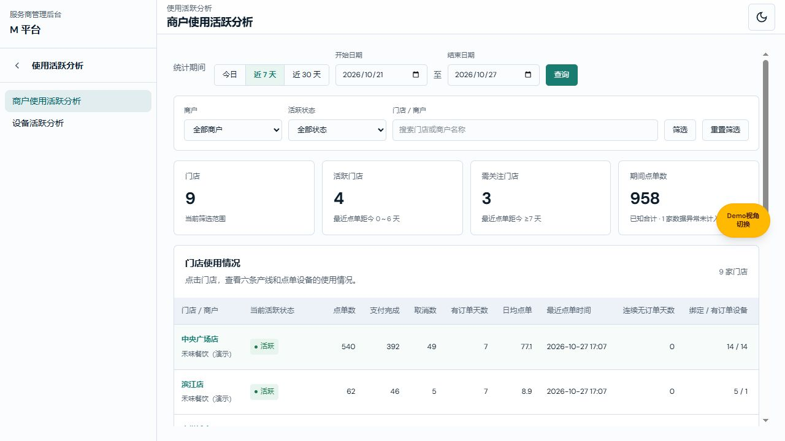

图注：商户根列表／近 7 天／V1.3，2026-10-27，功能基线 main@a7ca5874。

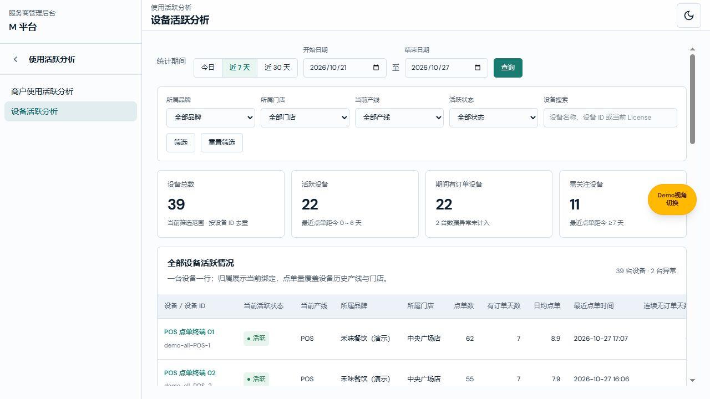

图注：设备根列表／近 7 天／V1.3，同一日期及功能基线。

入口：M 平台 → 使用活跃分析 → 对应分析页面。

| 字段／区域 | 逻辑说明 |
| --- | --- |
| 宿主页面标题 | 顶栏显示对应分析页面名称，所属分类为使用活跃分析。 |
| 统计期间 | 根列表业务内容从日期快捷筛选及起止日期开始展示，沿用现有默认值、校验和计算。 |
| 根列表顶部内容 | 不展示内部英文标识、演示标签、重复标题、介绍、快照截至日期、门店时区、全部门店或全部设备位置文字及演示说明。 |
| 钻取与详情上下文 | 门店、产线、门店内设备及独立设备详情保留现有标题、归属、快照信息、位置导航和返回入口。 |
| 数据口径 | 仍使用演示快照，计算截至日期和 Asia/Shanghai 时区保持原定义；根列表不单独展示这些信息。 |

V1.0～V1.2 状态图用于对应业务区域参考；根列表顶部按本节 V1.3 图片定位，旧图中的顶部说明区不属于根列表有效展示。原生日历图片缺口保持独立登记。

## 使用活跃分析导航分类

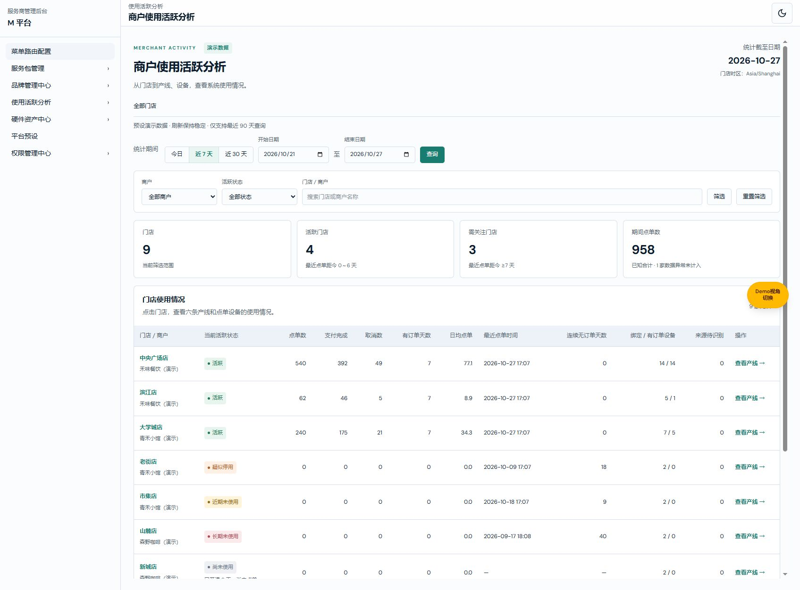

图注：M 平台父层／V1.2／ACTIVITY-NAV-20261027-01，2026-10-27，功能基线 main@5b57958c。

图注：使用活跃分析子层／V1.2／2026-10-27，同一功能基线。
；2026-10-27，Demo V1.3，功能基线 main@a7ca5874。

入口：M 平台 → 使用活跃分析。该分类与品牌管理中心、硬件资产中心同级。

| 字段／操作 | 逻辑说明 |
| --- | --- |
| 使用活跃分析 | 一级导航分类；整行点击进入覆盖父层的子导航滑层。至少一个子页面可访问时显示，否则隐藏；仅一个子页面可访问时仍保留分类。 |
| 商户使用活跃分析 | 第一个子项；打开 /m-platform/merchants/activity，详情地址及门店钻取保持原定义。 |
| 设备活跃分析 | 第二个子项；打开 /m-platform/merchants/device-activity，详情地址保持原定义。 |
| 当前页面定位 | 从任意列表或详情地址进入，自动显示使用活跃分析子层并高亮对应叶子；页面标题上方显示使用活跃分析。 |
| 返回上一级菜单 | 只返回 M 平台导航父层，不离开分析页面，不清空统计期间和筛选。 |
| 品牌管理中心 | 子导航保留总览、集团、品牌、门店、组织树、报表及变更记录，不展示两个分析入口。 |
| 可见性与访问权限 | 导航分类是展示分组，不新增权限资源；保留 m:module:merchants 父资源、m:page:merchant-activity 和 m:page:device-activity 独立页面权限。先执行既有角色并集及父级门禁，再分组展示。权限管理仍在原父资源下配置，不自动新增或迁移授权。 |

三份文档使用同一 V1.3 基线及变更编号。其余 V1.0～V1.2 状态截图仅用于业务区域和对应状态参考；侧栏位置以导航分类定义为准，根列表顶部以 V1.3 根列表图片为准。原生日历图片缺口继续见独立交付缺口清单。

## 目标与范围

1. 门店维度识别是否有点单，以及最近使用时间。
2. 产线维度识别使用 POS、Kiosk、eMenu、SDI、OO、POS GO 的数量与频率。
3. 设备维度提供独立入口直接查看全部设备、当前产线、所属品牌与门店，按 License 绑定设备 ID 汇总点单；保留门店内钻取、零订单设备及历史绑定归属。
4. 首版仅预设 Demo，不接真实数据，不配置阈值，不自动关停或通知。

## 研发对象与字段

所有业务数据为内存生成，读取不写入 localStorage；业务数据无编辑接口。页面筛选仅保存在当前 JavaScript 页面会话中，刷新恢复默认近 7 天、全部商户、全部状态和空名称。有效期间在钻取和返回时保留；未提交的筛选和日期草稿不保证跨导航保留。

| 对象字段 | 类型、来源与约束 |
| --- | --- |
| ActivityDataset.asOf | 必填 YYYY-MM-DD，Asia/Shanghai 的演示截至日期。 |
| ActivityDataset.timezone | 必填固定 Asia/Shanghai。 |
| ActivityStore.id | 必填唯一演示门店 ID，汇总边界。 |
| ActivityStore.merchantId | 必填所属演示商户 ID，用于商户筛选。 |
| ActivityStore.merchantName | 必填展示名，仅预设商户。 |
| ActivityStore.name | 必填门店名称，用于名称搜索和链接。 |
| ActivityStore.openedOn | 必填开通自然日，用于从未点单门店的开通天数说明。 |
| ActivityStore.lines | 必填已开通产线枚举数组。 |
| ActivityStore.quality | complete 或 error；error 是受控异常，并非真实接口结果。 |
| ActivityStore.scenario | 必填演示场景说明。 |
| ActivityDevice.id | 必填设备 ID，连接来源设备与绑定记录。 |
| ActivityDevice.name | 必填设备显示名称。 |
| LicenseBinding.licenseId | 必填 License 标识，不等同于设备 ID。 |
| LicenseBinding.deviceId | 必填绑定的物理设备 ID。 |
| LicenseBinding.storeId | 必填该段绑定所属门店。 |
| LicenseBinding.line | 必填六产线之一。 |
| LicenseBinding.from | 必填带 +08:00 偏移时间戳，区间起点包含。 |
| LicenseBinding.to | 可空同格式时间戳，终点不包含；null 表示持续有效。 |
| ActivityOrder.id | 必填原始业务订单 ID，门店内唯一去重；真实拆合单与状态事件接入须另定义转换。 |
| ActivityOrder.storeId | 必填订单已知门店 ID，来源无法识别时仍可汇总门店。 |
| ActivityOrder.deviceId | 来源点单设备 ID，可空；不使用收款终端替代。 |
| ActivityOrder.submittedAt | 必填带 +08:00 的原始成功提交时间；查询按本演示时区日期部分。 |
| ActivityOrder.status | submitted、paid、cancelled、draft；前三者计点单，draft 不计。 |
| ActivityPeriod.start | 必填有效起日，含当天边界。 |
| ActivityPeriod.end | 必填有效止日，含截至当日日末。 |
| ActivityScope.storeId | 必填；门店不存在时页面显示未找到。 |
| ActivityScope.line | 可选，存在时按下单有效绑定的产线限定。 |
| ActivityScope.deviceId | 可选，与所选门店及产线形成组合范围，不跨范围取单。 |

### 计算顺序

1. 生成截至日期的固定预设数据；排除草稿与截至日之后记录。
2. 按门店 ID + 原始业务订单 ID 去重，保留固定原始来源；重复记录为同一订单快照，非状态事件日志。
3. 以订单来源设备、门店、提交时刻匹配唯一有效 License；零条或多条均判为来源待识别。
4. 用全历史匹配对象订单计算最近点单日期及当前状态。
5. 用有效起止日筛选订单，计算数量、支付完成、取消、有订单天数与日均。
6. 取截至日末的有效绑定集合；分别计算当前绑定设备、期间有单设备和绑定集合中的无单设备。
7. null 展示为 —、真实零值为 0；日均仅展示时保留 1 位小数。

### 可复算算例与边界

| 输入 | 结果 |
| --- | --- |
| 截至 2026-10-27，最近点单 10-21 / 10-20 | 距今 6 天为活跃；7 天为近期未使用。 |
| 最近点单 10-14 / 10-13 | 距今 13 天为近期未使用；14 天为疑似停用。 |
| 最近点单 09-28 / 09-27 | 距今 29 天为疑似停用；30 天为长期未使用。 |
| 大学城店 Kiosk，10-21 至 10-27 | 144 单，7 个有订单日，日均 144 ÷ 7 = 20.6；绑定 5、有单 3、绑定中无单 2。 |
| 湖畔店同期间 | 门店 116 单 = POS/OO 已识别 96 + 来源待识别 20。 |
| eMenu License 截止 10-22 00:00，POS GO 从此时生效 | 截止前订单归 eMenu，截止时刻及之后归 POS GO；同设备不改写历史订单。 |
| 相同订单快照重复 2 次 | 门店、产线和设备均只计 1 单。 |
| 提交后取消、支付完成、仅提交各 1 单，另有草稿 1 单 | 点单总数 3、取消 1、支付完成 1；草稿排除。 |
| error 门店 | 订单与使用指标 null/—，已知绑定数可为 2；有订单设备不是 0。 |
| 查询起日晚于止日 | 不更新有效查询；保留输入及上次结果，显示错误。 |

### 代码接口与验证

- merchant-activity-domain.ts：resolveOrders、summarizeActivity、currentBindings、devicesForScope、validatePeriod、classifyActivity。
- merchant-activity-demo.ts：createActivityDemo(asOf)，固定日期输入生成完全相同数据。
- scripts/verify-merchant-activity.ts：覆盖阈值边界、闰年、去重、未来订单、歧义绑定、1/7/30/90 天三级汇总、零订单设备及权限默认拒绝。
- 路由根为 /m-platform/merchants/activity；明细为 /store/:storeId/line/:line/device/:deviceId；line、device 片段可逐层省略。
- 新资源为 m:page:merchant-activity，父资源 m:module:merchants；无业务写操作权限项。
- 页面只读浏览标记仅在当前页面资源范围内放行日期与筛选，不放开其他页面写控件。

## 独立设备活跃视角

图注：独立设备列表／当前归属及物理设备统计；2026-10-27，Demo V1.3，功能基线 main@a7ca5874。

入口：使用活跃分析 → 设备活跃分析；实现模块 device-activity-domain.ts 与 device-activity-ui.ts。

### 独立设备研发映射

| 字段或接口 | 类型、来源与约束 |
| --- | --- |
| DeviceActivityRow.device | ActivityDevice，来自资产清单，Map 按 id 去重；列表不从订单反查资产全集。 |
| DeviceActivityRow.history | LicenseBinding[]，设备截至日期前开始的历史记录。 |
| DeviceActivityRow.current | LicenseBinding[]，from ≤ 截至日末 且 (to=null 或 截至日末 < to)。 |
| DeviceActivityRow.binding | 仅 current.length=1 时取该项，否则 null，不用第一条掩盖冲突。 |
| DeviceActivityRow.store | 当前 binding.storeId 对应门店；当前门店不存在判归属异常。 |
| 所属品牌数据来源 | 沿用现有 ActivityStore.merchantId / merchantName 演示品牌，不新增商户—品牌实体层级。 |
| DeviceActivityRow.issue | null、data 或 binding；历史涉及 error 门店为 data，多重当前绑定或门店缺失为 binding。 |
| DeviceActivityRow.metrics | ActivityMetrics；独立统计范围为设备 ID，不再限定单个 storeId/line。异常值用 null。 |
| deviceLifetimeOrders | 仅取 ResolvedOrder.binding.deviceId 等于设备 ID 的可归属订单；无法匹配的来源不分摊。 |
| globalDeviceRows | 输入共享 Dataset、ResolvedOrder[]、有效期间，输出每物理设备一行；状态用全历史，数量用期间。 |
| filterDeviceRows | 按当前品牌、门店、产线、状态和搜索取 AND；line=__unbound 取当前绑定数组为空，区别于 never。 |
| 页面路由 | /m-platform/merchants/device-activity；详情 /m-platform/merchants/device-activity/:deviceId；不存在 ID 显示未找到。 |
| 权限资源 | m:page:device-activity，editable=false，父 m:module:merchants；原 merchant-activity 资源不被替代。 |
| 页面状态 | period、quick、五项筛选、page 在模块会话内；每页 20 台，筛选或日期生效回 1，详情返回保留页码。 |
| 单例快照 | merchant-activity-data.ts 导出 activityDemoData / activityDemoOrders，两个视角共用。 |
| 正常/异常验证 | verify-device-activity.ts 覆盖 39 唯一设备、所有筛选、跨产线累计、跨店累计与当前归属、重复资产、绑定冲突、独立只读与默认拒绝。 |
### 界面字段与计算对应

| 字段 | 逻辑说明 |
| --- | --- |
| 快照截至日期 | 与商户视角共享同一演示快照；Asia/Shanghai，当天加载生成。根列表不展示，设备详情保留明确日期。 |
| 今日 | 立即查询截至日当天；保留已应用筛选、页码回到 1。 |
| 近 7 天 | 默认；含截至日与前 6 天。 |
| 近 30 天 | 含截至日与前 29 天；设备跨产线历史点单一并统计。 |
| 开始日期 | 必填；默认截至日减 6 天，最早截至日减 89 天，不晚于结束日；编辑仅形成待查询值。 |
| 结束日期 | 必填；默认截至日，最晚截至日，不早于开始日；编辑不立即计算。 |
| 查询 | 先进行原生日期必填/上下界校验，再检查起止关系；成功清空快捷选中并回到第 1 页，其他筛选保持；失败保留上一次有效结果。 |
| 所属品牌筛选 | 默认全部品牌，当前唯一有效绑定的品牌；改变品牌立即刷新门店候选并清空已选门店，结果等点击筛选后才更新。 |
| 所属门店筛选 | 默认全部门店，候选受品牌限制；筛选当前所属门店，不筛设备历史订单所属门店。 |
| 当前产线筛选 | 默认全部产线，六条产线加未绑定；未绑定按截至日无有效 License 判断，可包括有历史点单的设备。 |
| 活跃状态筛选 | 默认全部状态；活跃、近期未使用、疑似停用、长期未使用、尚未使用、未绑定、数据异常。 |
| 设备搜索 | 可选，最多 80 字；匹配设备名称、设备 ID、当前 License；去首尾空白、英文忽略大小写，默认空。 |
| 筛选 | 五项条件取交集，生效后卡片及列表同步更新、页码回到 1；保留有效期间。 |
| 重置筛选 | 恢复全部品牌/门店/产线/状态和空搜索，页码回 1；不重置有效期间。 |
| 设备总数 | 当前已应用筛选范围内，设备 ID 去重总数，包含无订单、未绑定和异常设备；与分页无关。 |
| 活跃设备 | 当前筛选范围中，最近点单距截至日为 0～6 天的设备数；异常设备不计入。 |
| 期间有订单设备 | 筛选范围中查询期至少有 1 笔可识别点单的设备数；异常不按 0 判定，附未计入异常数量。 |
| 需关注设备 | 近期未使用、疑似停用、长期未使用三种状态数量之和；不包含尚未使用、未绑定及异常。 |
| 设备名称 | 一台物理设备一行，可点击进入独立设备详情；同设备历史上切换产线或迁店不拆成多行。 |
| 设备 ID | 稳定物理设备标识，展示于设备名称下；用于全列表及统计去重。 |
| 当前活跃状态 | 以截至日前全历史可识别点单的最近日期判定，7/14/30 天阈值不变；与查询期间及当前绑定产线内的局部状态不同。 |
| 当前产线 | 截至日末唯一有效 License 的产线；未绑定为未绑定，多个有效绑定或缺失归属为归属待核对。 |
| 所属品牌 | 当前绑定所属门店关联的品牌名称；未绑定显示未绑定，归属异常显示归属待核对。 |
| 所属门店 | 当前唯一有效绑定所属门店；不以历史点单门店覆盖当前归属。 |
| 点单数 | 查询期内该设备所有历史产线、品牌及门店的可识别点单总数；不被当前归属筛选重新切分订单。 |
| 有订单天数 | 设备在查询期发生可识别点单的不同自然日数量；跨产线同一天只计一天。 |
| 日均点单 | 该设备期间点单数 ÷ 查询自然日天数，展示 1 位小数；异常为 —。 |
| 最近点单时间 | 设备全历史最近可识别提交时间，展示至分钟；从未使用和异常为 —。 |
| 连续无订单天数 | 截至日期减设备全历史最近点单日期，今天有单为 0，从未点单及异常为 —。 |
| 查看明细 | 按设备 ID 打开独立明细，与点击设备名称一致；不打开原门店/产线组合范围的设备明细。 |
| 页码与总数 | 每页 20 台，默认第 1 页，按预设登记顺序；39 台分为 20/19 两页。卡片统计全部筛选结果。 |
| 下一页 | 存在下一页时可用；末页禁用。日期或筛选生效时页码回到 1。 |
| 上一页 | 页码大于 1 可用；第 1 页禁用。翻页保持期间及筛选。 |
| 空结果 | 列表显示没有符合筛选条件的设备，卡片为 0，第 1/1 页，两个翻页按钮均禁用。 |

## 独立设备明细

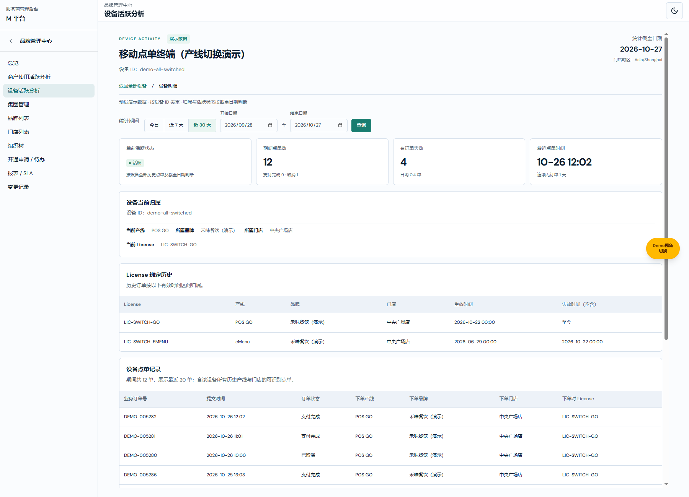

图注：设备 ID 明细／当前归属与历史点单同时展示；2026-10-27，Demo V1.1，功能基线 main@5c30e3c5。数据和权限异常图为受控演示状态，不代表真实业务记录。

| 字段 | 逻辑说明 |
| --- | --- |
| 返回全部设备 | 返回独立总列表，保留有效期间、已应用筛选和原页码；刷新浏览器恢复默认值。 |
| 设备名称与 ID | 沿用独立列表所选的物理设备，不将门店/产线拼接为新的设备身份。 |
| 当前产线 | 当前唯一有效 License 的产线；没有当前绑定为未绑定。 |
| 所属品牌 | 当前绑定门店关联品牌；不跟随查询起止日回退历史归属。 |
| 所属门店 | 当前绑定所属门店；历史迁店记录在绑定历史及订单中另行展示。 |
| 当前 License | 当前唯一有效绑定的 License ID；没有为未绑定，多重有效绑定为归属待核对。 |
| 当前活跃状态卡片 | 按设备全部历史最近点单，不按当前单一产线计算。 |
| 期间点单数卡片 | 该设备查询期所有可识别点单；附支付完成及取消子集，取消仍计入点单。 |
| 有订单天数卡片 | 跨历史归属去重后的有订单日期数，附日均点单。 |
| 最近点单卡片 | 展示月-日至分钟的最近点单，附连续无订单天数；从未点单和异常为 —。 |
| 绑定历史 License | 按生效时间降序展示；不修改绑定。 |
| 绑定历史产线 | 对应每段绑定的产线，保留切换前值。 |
| 绑定历史品牌 | 对应每段绑定所属门店的品牌。 |
| 绑定历史门店 | 每段绑定所属门店；跨店迁移保留旧门店。 |
| 绑定历史生效时间 | 区间起点包含，展示至分钟；实际匹配使用完整时间戳。 |
| 绑定历史失效时间 | 区间终点不包含，null 展示至今；重叠有效绑定不自动挑选。 |
| 业务订单号 | 门店 ID + 原始业务订单 ID 去重后展示业务订单号。 |
| 提交时间 | 按原始成功提交时间降序，展示至分钟。 |
| 订单状态 | 支付完成、已提交、已取消；不展示草稿。 |
| 下单产线 | 按下单时有效 License 的产线，可能不同于当前产线。 |
| 下单品牌 | 下单时绑定门店关联的品牌，可能不同于当前品牌。 |
| 下单门店 | 下单时所属门店，可能不同于当前门店。 |
| 下单时 License | 该订单发生时唯一匹配的 License。 |
| 点单记录数量 | 展示查询期最近 20 笔，不影响全量统计；无结果显示统计期间无点单记录。 |
| 数据异常 | 涉及历史数据异常门店、多个当前有效绑定或当前绑定门店缺失时，订单统计和记录均不可用，以 — 和不可用说明代替真实 0。 |
| 未绑定状态 | 未绑定资产仍可查看；无历史点单且当前未绑定时状态未绑定，当前未绑定但有历史点单仍按最近点单判断活跃。 |

### 独立设备统计规则

1. 全量范围是预设设备资产清单，按设备 ID 去重，不依赖先选门店或有订单；共 39 台，包含 1 台未绑定备用终端。
2. 品牌、门店、产线列及对应筛选以截至日末的当前唯一有效绑定为准。未绑定资产不强行归属历史门店；历史归属在详情中可查。
3. 点单量与活跃状态以物理设备 ID 聚合所有历史产线与门店。按当前品牌/门店筛选是在选设备集合，不是在裁剪该设备历史订单。
4. 独立设备详情和原门店/产线组合详情同时存在，范围名称明确区分；同一设备在某旧产线已久未点单，不妨碍该设备在新产线仍为活跃。
5. 绑定不唯一不猜测归属。数据异常不作为零订单；设备涉及历史数据异常时，独立统计保守显示不可用，避免将部分已知记录当作完整总量。
6. 六条产线、成功提交计单、取消计入、草稿排除、去重和 7/14/30 天阈值沿用统一定义。来源待识别订单不分摊到设备。
7. 页面仅有不可见/可见权限，与商户活跃页面独立授权，仍受品牌管理中心父资源门禁及角色并集约束；不自动给既有保存角色新增权限。
8. 两个视角读取同一个内存 Demo 快照。有效期间和已应用筛选在各自页面会话内保留；互不覆盖；刷新恢复默认近 7 天、全部条件、第 1 页。

### 独立设备可复算示例

| 场景 | 结果 |
| --- | --- |
| 移动点单终端 demo-all-switched，近 30 天 | 共 12 单、4 个有订单日、日均 12÷30=0.4；当前 POS GO。记录含切换前 eMenu 5 单及切换后 POS GO 7 单，不能只算当前产线的 7 单。 |
| 大学城 Kiosk，近 7 天 | 当前有 5 台设备，3 台有单，2 台真实 0；终端 04 距最近点单 10 天，终端 05 距最近点单 32 天。 |
| 当前品牌为禾味的迁店设备 | 当前归属列显示禾味及现门店；符合查询期的旧门店历史点单仍属于该设备，详情保留旧品牌/门店。迁店场景由受控算例验证。 |
| 备用未绑定终端 | 全列表存在；产线、品牌、门店和 License 为未绑定；0 单，尚无绑定历史。 |
| 机场店设备 | 当前已知产线、品牌及门店可展示；订单、使用天数、日均和最近点单显示 —，记录不可用。 |

## 独立设备逐操作说明

所有操作只影响浏览状态，无订单、资产、绑定或授权写入。查询校验失败保留上一份有效结果；日期原生弹层的截图限制单独登记。

### G01 打开独立设备入口

图注：打开独立设备入口／入口或操作前；2026-10-27，Demo V1.3，功能基线 main@a7ca5874。

图注：打开独立设备入口／操作后结果；2026-10-27，Demo V1.3，功能基线 main@a7ca5874。

| 字段 | 逻辑说明 |
| --- | --- |
| 触发入口 | 使用活跃分析 → 设备活跃分析 |
| 处理与结果 | 默认最近 7 天、全部品牌/门店/产线/状态、空搜索、第 1 页；不需要先选门店。 |
| 写入、确认与取消 | 无业务写入、无自定义确认框；筛选草稿不应用可直接离开，日期原生日历可关闭。权限与日期失败分支按本项及公共定义处理。 |

### G02 切换今日

图注：切换今日／入口或操作前；2026-10-27，Demo V1.3，功能基线 main@a7ca5874。

图注：切换今日／操作后结果；2026-10-27，Demo V1.1，功能基线 main@5c30e3c5。数据和权限异常图为受控演示状态，不代表真实业务记录。

| 字段 | 逻辑说明 |
| --- | --- |
| 触发入口 | 统计期间 → 今日 |
| 处理与结果 | 查询仅截至日当天；当前归属及活跃状态不因查询期间改变。 |
| 写入、确认与取消 | 无业务写入、无自定义确认框；筛选草稿不应用可直接离开，日期原生日历可关闭。权限与日期失败分支按本项及公共定义处理。 |

### G03 切换近 7 天

图注：切换近 7 天／入口或操作前；2026-10-27，Demo V1.1，功能基线 main@5c30e3c5。数据和权限异常图为受控演示状态，不代表真实业务记录。

图注：切换近 7 天／操作后结果；2026-10-27，Demo V1.1，功能基线 main@5c30e3c5。数据和权限异常图为受控演示状态，不代表真实业务记录。

| 字段 | 逻辑说明 |
| --- | --- |
| 触发入口 | 统计期间 → 近 7 天 |
| 处理与结果 | 起日为截至日减 6 天，含当天；回到第 1 页。 |
| 写入、确认与取消 | 无业务写入、无自定义确认框；筛选草稿不应用可直接离开，日期原生日历可关闭。权限与日期失败分支按本项及公共定义处理。 |

### G04 切换近 30 天

图注：切换近 30 天／入口或操作前；2026-10-27，Demo V1.1，功能基线 main@5c30e3c5。数据和权限异常图为受控演示状态，不代表真实业务记录。

图注：切换近 30 天／操作后结果；2026-10-27，Demo V1.1，功能基线 main@5c30e3c5。数据和权限异常图为受控演示状态，不代表真实业务记录。

| 字段 | 逻辑说明 |
| --- | --- |
| 触发入口 | 统计期间 → 近 30 天 |
| 处理与结果 | 含截至日及前 29 天；回到第 1 页，保留已应用筛选。 |
| 写入、确认与取消 | 无业务写入、无自定义确认框；筛选草稿不应用可直接离开，日期原生日历可关闭。权限与日期失败分支按本项及公共定义处理。 |

### G05 编辑开始日期

图注：编辑开始日期／入口或操作前；2026-10-27，Demo V1.3，功能基线 main@a7ca5874。

图注：编辑开始日期／操作后结果；2026-10-27，Demo V1.1，功能基线 main@5c30e3c5。数据和权限异常图为受控演示状态，不代表真实业务记录。

| 字段 | 逻辑说明 |
| --- | --- |
| 触发入口 | 开始日期输入框 |
| 处理与结果 | 只改变待查询日期；输入有效后点击查询才应用。 |
| 写入、确认与取消 | 无业务写入、无自定义确认框；筛选草稿不应用可直接离开，日期原生日历可关闭。权限与日期失败分支按本项及公共定义处理。 |

### G06 编辑结束日期

图注：编辑结束日期／入口或操作前；2026-10-27，Demo V1.3，功能基线 main@a7ca5874。

图注：编辑结束日期／操作后结果；2026-10-27，Demo V1.1，功能基线 main@5c30e3c5。数据和权限异常图为受控演示状态，不代表真实业务记录。

| 字段 | 逻辑说明 |
| --- | --- |
| 触发入口 | 结束日期输入框 |
| 处理与结果 | 只改变待查询日期；允许最近 90 天范围内有效起止日。 |
| 写入、确认与取消 | 无业务写入、无自定义确认框；筛选草稿不应用可直接离开，日期原生日历可关闭。权限与日期失败分支按本项及公共定义处理。 |

### G07 应用自定义日期

图注：应用自定义日期／入口或操作前；2026-10-27，Demo V1.1，功能基线 main@5c30e3c5。数据和权限异常图为受控演示状态，不代表真实业务记录。

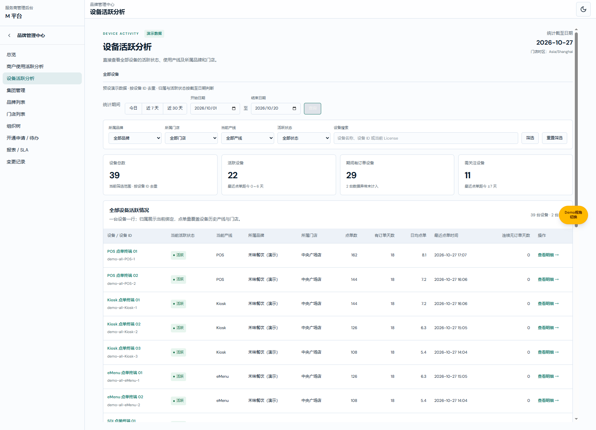

图注：应用自定义日期／操作后结果；2026-10-27，Demo V1.1，功能基线 main@5c30e3c5。数据和权限异常图为受控演示状态，不代表真实业务记录。

| 字段 | 逻辑说明 |
| --- | --- |
| 触发入口 | 查询 |
| 处理与结果 | 通过必填、上下界和起止关系校验后应用，快捷选中清空、页码回 1；筛选保留。 |
| 写入、确认与取消 | 无业务写入、无自定义确认框；筛选草稿不应用可直接离开，日期原生日历可关闭。权限与日期失败分支按本项及公共定义处理。 |

### G08 提交起止错误日期

图注：提交起止错误日期／入口或操作前；2026-10-27，Demo V1.1，功能基线 main@5c30e3c5。数据和权限异常图为受控演示状态，不代表真实业务记录。

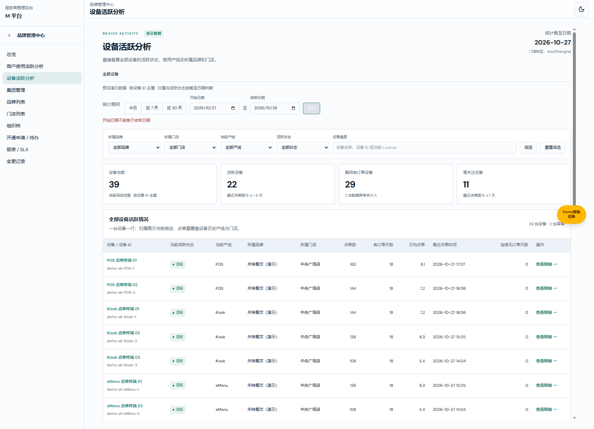

图注：提交起止错误日期／操作后结果；2026-10-27，Demo V1.1，功能基线 main@5c30e3c5。数据和权限异常图为受控演示状态，不代表真实业务记录。

| 字段 | 逻辑说明 |
| --- | --- |
| 触发入口 | 起日 10-27、止日 10-26 → 查询 |
| 处理与结果 | 显示开始日期不能晚于结束日期；保留输入及上一次有效统计，不应用错误日期。 |
| 写入、确认与取消 | 无业务写入、无自定义确认框；筛选草稿不应用可直接离开，日期原生日历可关闭。权限与日期失败分支按本项及公共定义处理。 |

### G09 缺少日期时提交

图注：缺少日期时提交／入口或操作前；2026-10-27，Demo V1.3，功能基线 main@a7ca5874。

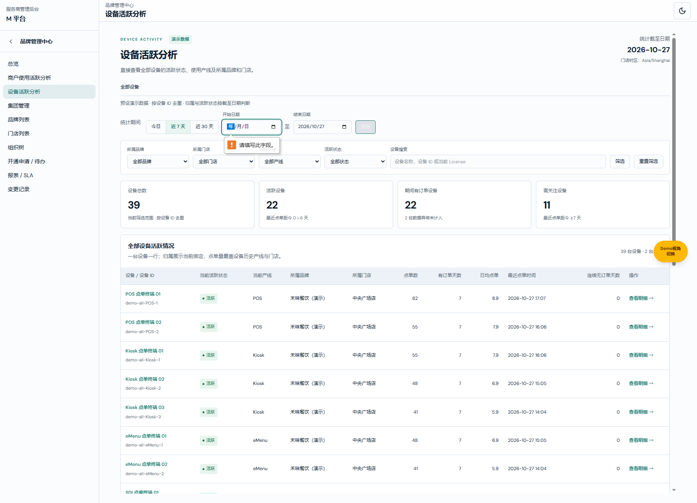

图注：缺少日期时提交／操作后结果；2026-10-27，Demo V1.1，功能基线 main@5c30e3c5。数据和权限异常图为受控演示状态，不代表真实业务记录。

| 字段 | 逻辑说明 |
| --- | --- |
| 触发入口 | 开始日期为空 → 查询 |
| 处理与结果 | 浏览器原生必填阻止提交，上一份有效统计保持；原生文案随浏览器语言变化。 |
| 写入、确认与取消 | 无业务写入、无自定义确认框；筛选草稿不应用可直接离开，日期原生日历可关闭。权限与日期失败分支按本项及公共定义处理。 |

### G10 按品牌筛选

图注：按品牌筛选／入口或操作前；2026-10-27，Demo V1.1，功能基线 main@5c30e3c5。数据和权限异常图为受控演示状态，不代表真实业务记录。

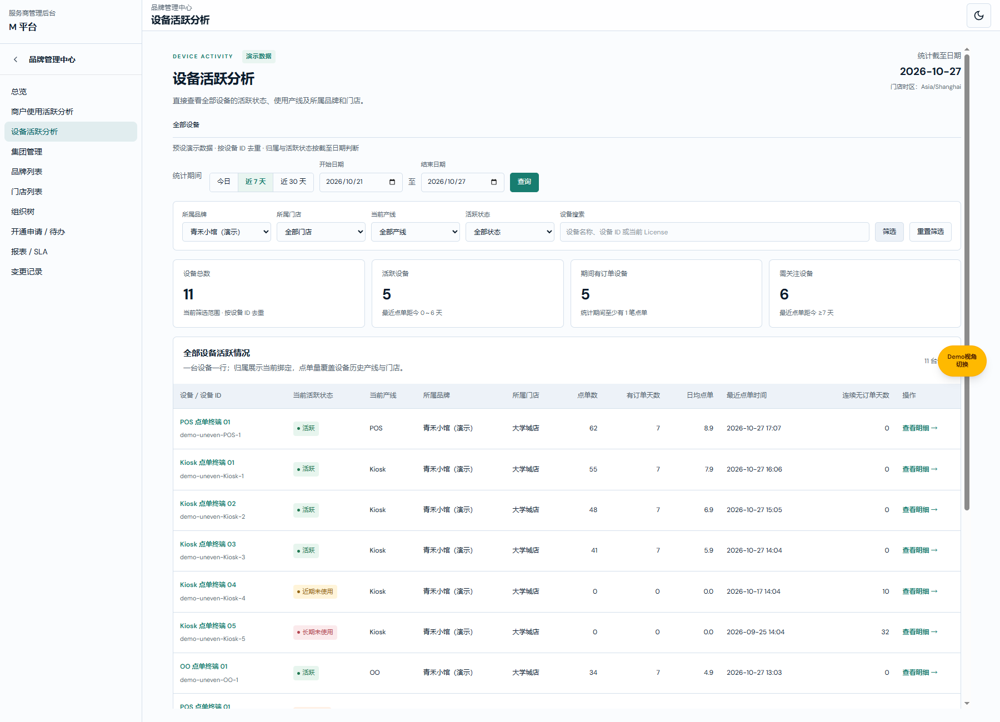

图注：按品牌筛选／操作后结果；2026-10-27，Demo V1.1，功能基线 main@5c30e3c5。数据和权限异常图为受控演示状态，不代表真实业务记录。

| 字段 | 逻辑说明 |
| --- | --- |
| 触发入口 | 所属品牌 → 青禾小馆 → 筛选 |
| 处理与结果 | 按当前唯一有效绑定的品牌限定设备，统计卡片与列表范围一致；仅改变下拉值时不应用。 |
| 写入、确认与取消 | 无业务写入、无自定义确认框；筛选草稿不应用可直接离开，日期原生日历可关闭。权限与日期失败分支按本项及公共定义处理。 |

### G11 按门店筛选

图注：按门店筛选／入口或操作前；2026-10-27，Demo V1.1，功能基线 main@5c30e3c5。数据和权限异常图为受控演示状态，不代表真实业务记录。

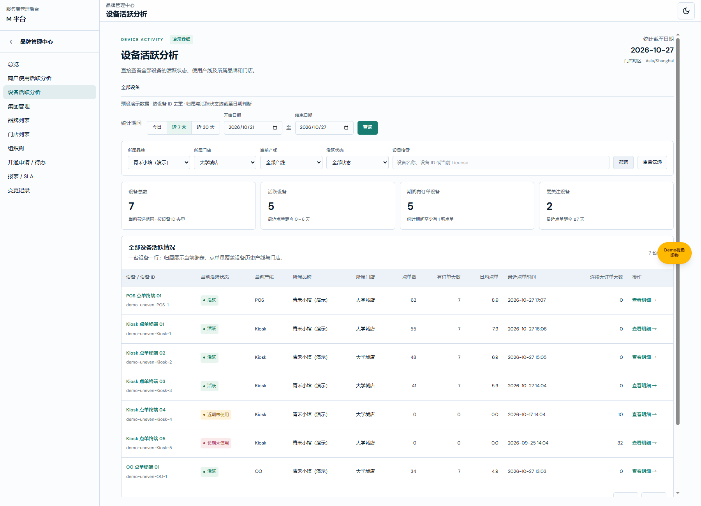

图注：按门店筛选／操作后结果；2026-10-27，Demo V1.1，功能基线 main@5c30e3c5。数据和权限异常图为受控演示状态，不代表真实业务记录。

| 字段 | 逻辑说明 |
| --- | --- |
| 触发入口 | 所属门店 → 大学城店 → 筛选 |
| 处理与结果 | 以当前所属门店取设备，保留品牌条件；不是按历史订单门店筛选订单。 |
| 写入、确认与取消 | 无业务写入、无自定义确认框；筛选草稿不应用可直接离开，日期原生日历可关闭。权限与日期失败分支按本项及公共定义处理。 |

### G12 按产线筛选

图注：按产线筛选／入口或操作前；2026-10-27，Demo V1.1，功能基线 main@5c30e3c5。数据和权限异常图为受控演示状态，不代表真实业务记录。

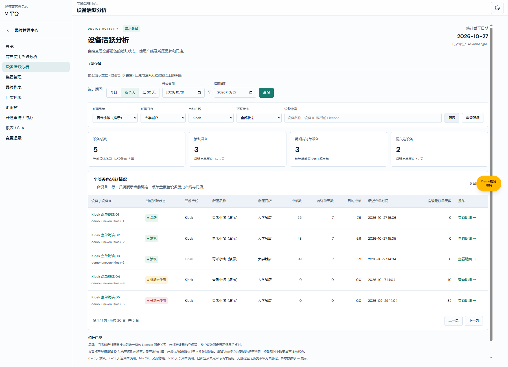

图注：按产线筛选／操作后结果；2026-10-27，Demo V1.1，功能基线 main@5c30e3c5。数据和权限异常图为受控演示状态，不代表真实业务记录。

| 字段 | 逻辑说明 |
| --- | --- |
| 触发入口 | 当前产线 → Kiosk → 筛选 |
| 处理与结果 | 按当前绑定产线取设备，演示结果 5 台；其中近 7 天有单 3 台。 |
| 写入、确认与取消 | 无业务写入、无自定义确认框；筛选草稿不应用可直接离开，日期原生日历可关闭。权限与日期失败分支按本项及公共定义处理。 |

### G13 按状态筛选

图注：按状态筛选／入口或操作前；2026-10-27，Demo V1.1，功能基线 main@5c30e3c5。数据和权限异常图为受控演示状态，不代表真实业务记录。

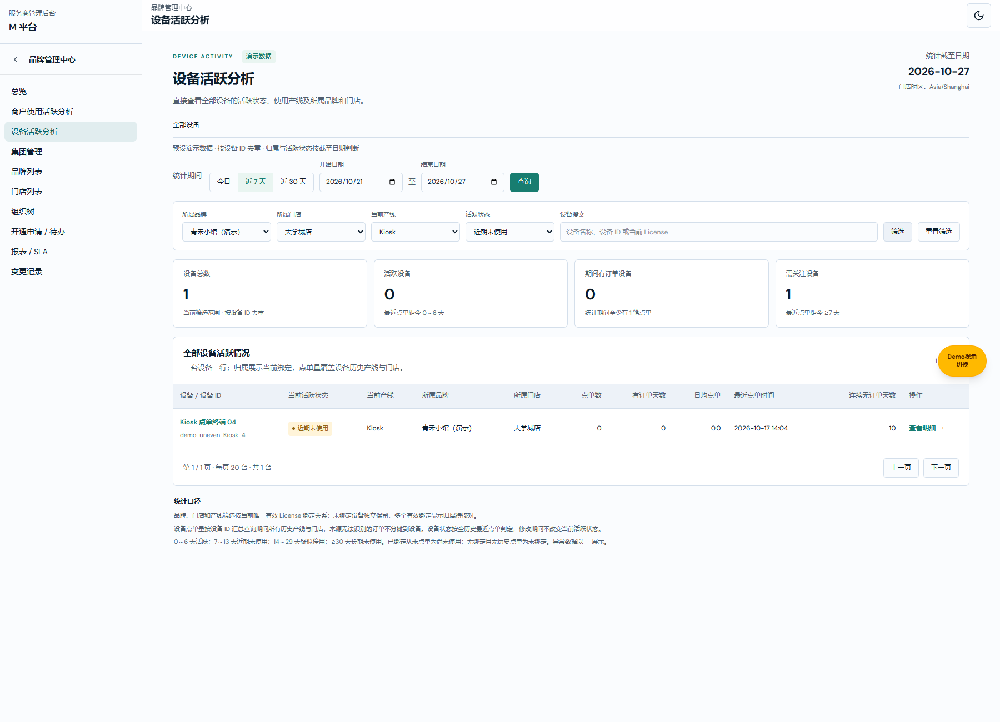

图注：按状态筛选／操作后结果；2026-10-27，Demo V1.1，功能基线 main@5c30e3c5。数据和权限异常图为受控演示状态，不代表真实业务记录。

| 字段 | 逻辑说明 |
| --- | --- |
| 触发入口 | 活跃状态 → 近期未使用 → 筛选 |
| 处理与结果 | 与品牌、门店、产线、名称取交集；演示 Kiosk 终端 04 最近点单距今 10 天。 |
| 写入、确认与取消 | 无业务写入、无自定义确认框；筛选草稿不应用可直接离开，日期原生日历可关闭。权限与日期失败分支按本项及公共定义处理。 |

### G14 搜索设备

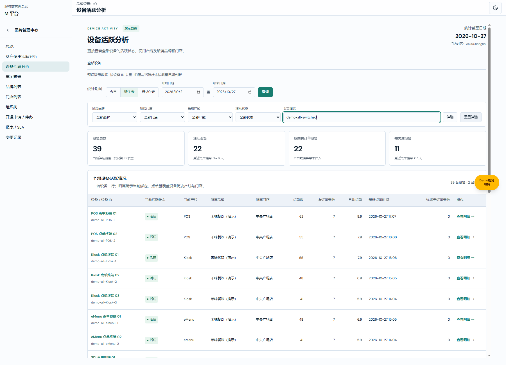

图注：搜索设备／入口或操作前；2026-10-27，Demo V1.1，功能基线 main@5c30e3c5。数据和权限异常图为受控演示状态，不代表真实业务记录。

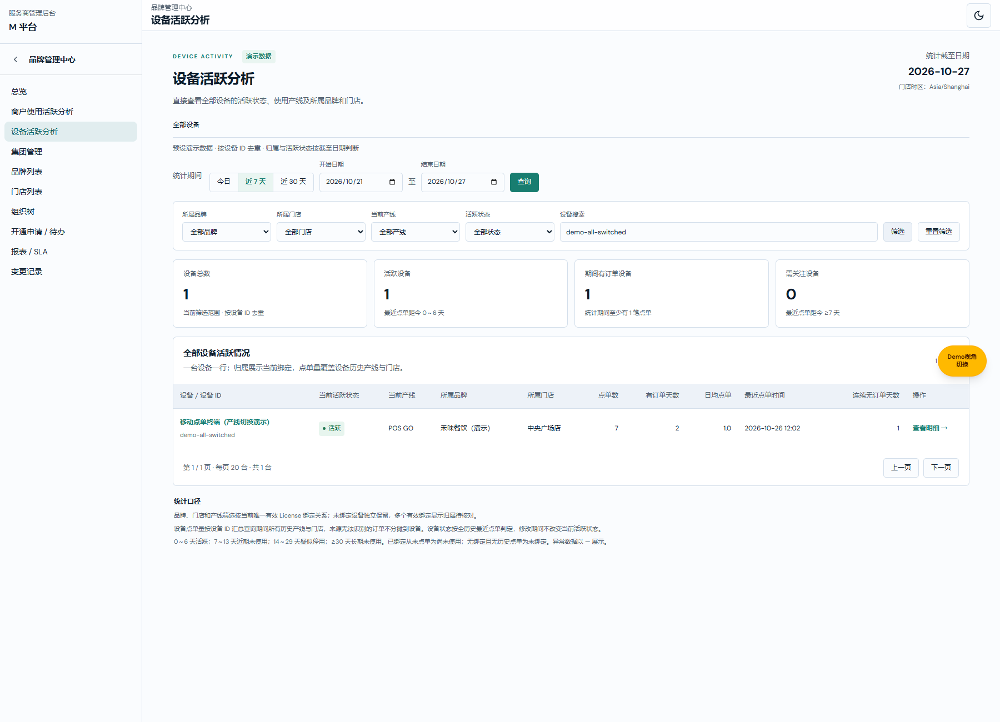

图注：搜索设备／操作后结果；2026-10-27，Demo V1.1，功能基线 main@5c30e3c5。数据和权限异常图为受控演示状态，不代表真实业务记录。

| 字段 | 逻辑说明 |
| --- | --- |
| 触发入口 | 设备搜索 → demo-all-switched → 筛选 |
| 处理与结果 | 支持设备名、设备 ID、当前 License 的包含匹配，首尾空白忽略、英文大小写忽略；回到第 1 页。 |
| 写入、确认与取消 | 无业务写入、无自定义确认框；筛选草稿不应用可直接离开，日期原生日历可关闭。权限与日期失败分支按本项及公共定义处理。 |

### G15 无匹配设备

图注：无匹配设备／入口或操作前；2026-10-27，Demo V1.1，功能基线 main@5c30e3c5。数据和权限异常图为受控演示状态，不代表真实业务记录。

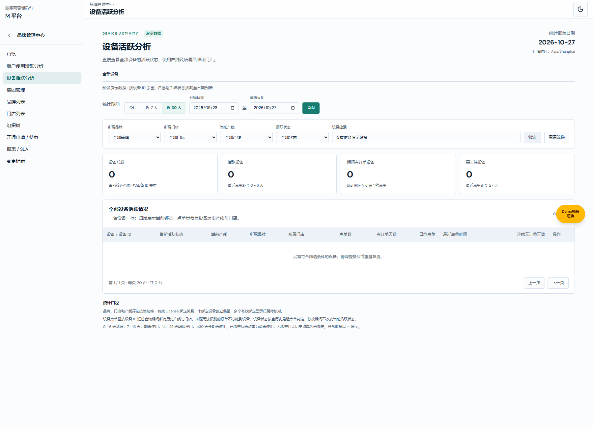

图注：无匹配设备／操作后结果；2026-10-27，Demo V1.1，功能基线 main@5c30e3c5。数据和权限异常图为受控演示状态，不代表真实业务记录。

| 字段 | 逻辑说明 |
| --- | --- |
| 触发入口 | 输入没有这台演示设备 → 筛选 |
| 处理与结果 | 显示无匹配说明；四项卡片为 0，页码为第 1/1 页，翻页按钮禁用。 |
| 写入、确认与取消 | 无业务写入、无自定义确认框；筛选草稿不应用可直接离开，日期原生日历可关闭。权限与日期失败分支按本项及公共定义处理。 |

### G16 重置筛选

图注：重置筛选／入口或操作前；2026-10-27，Demo V1.1，功能基线 main@5c30e3c5。数据和权限异常图为受控演示状态，不代表真实业务记录。

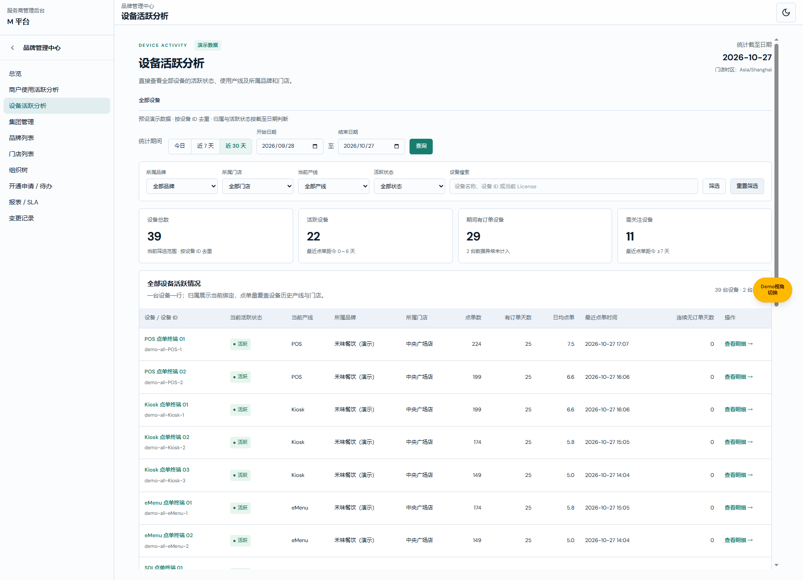

图注：重置筛选／操作后结果；2026-10-27，Demo V1.1，功能基线 main@5c30e3c5。数据和权限异常图为受控演示状态，不代表真实业务记录。

| 字段 | 逻辑说明 |
| --- | --- |
| 触发入口 | 重置筛选 |
| 处理与结果 | 清空五个筛选项并回到第 1 页；有效统计日期保留。 |
| 写入、确认与取消 | 无业务写入、无自定义确认框；筛选草稿不应用可直接离开，日期原生日历可关闭。权限与日期失败分支按本项及公共定义处理。 |

### G17 下一页

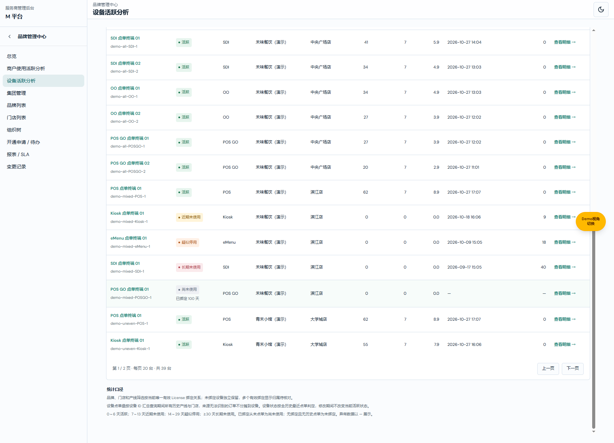

图注：下一页／入口或操作前；2026-10-27，Demo V1.1，功能基线 main@5c30e3c5。数据和权限异常图为受控演示状态，不代表真实业务记录。

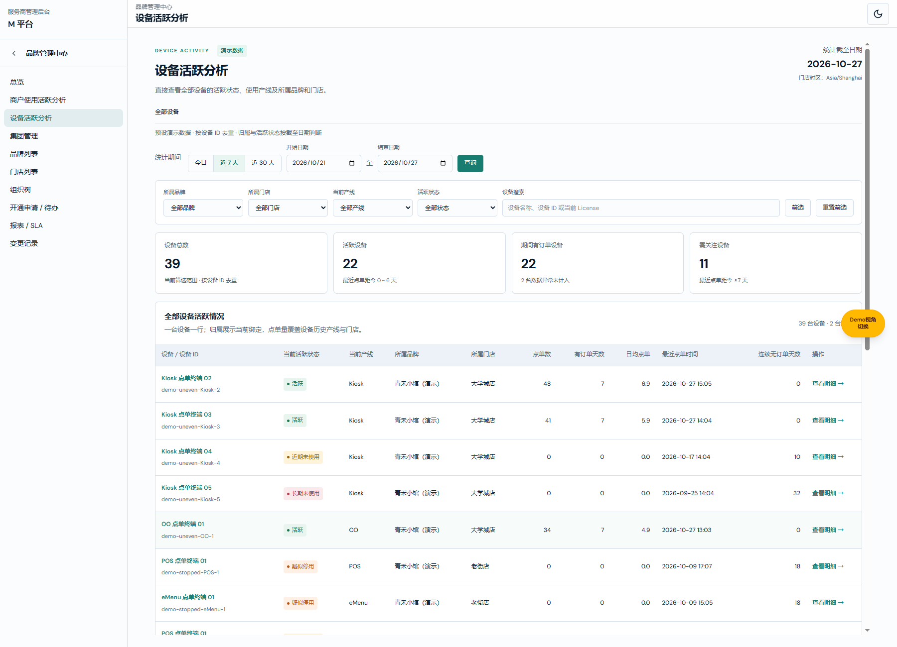

图注：下一页／操作后结果；2026-10-27，Demo V1.1，功能基线 main@5c30e3c5。数据和权限异常图为受控演示状态，不代表真实业务记录。

| 字段 | 逻辑说明 |
| --- | --- |
| 触发入口 | 列表底部 → 下一页 |
| 处理与结果 | 每页 20 台，第 2 页展示余下 19 台；全部设备及卡片统计不截断为当前页数量。 |
| 写入、确认与取消 | 无业务写入、无自定义确认框；筛选草稿不应用可直接离开，日期原生日历可关闭。权限与日期失败分支按本项及公共定义处理。 |

### G18 上一页

图注：上一页／入口或操作前；2026-10-27，Demo V1.1，功能基线 main@5c30e3c5。数据和权限异常图为受控演示状态，不代表真实业务记录。

图注：上一页／操作后结果；2026-10-27，Demo V1.1，功能基线 main@5c30e3c5。数据和权限异常图为受控演示状态，不代表真实业务记录。

| 字段 | 逻辑说明 |
| --- | --- |
| 触发入口 | 列表底部 → 上一页 |
| 处理与结果 | 保留有效期间与筛选，返回前一页；第 1 页上一页禁用，末页下一页禁用。 |
| 写入、确认与取消 | 无业务写入、无自定义确认框；筛选草稿不应用可直接离开，日期原生日历可关闭。权限与日期失败分支按本项及公共定义处理。 |

### G19 通过设备名查看明细

图注：通过设备名查看明细／入口或操作前；2026-10-27，Demo V1.1，功能基线 main@5c30e3c5。数据和权限异常图为受控演示状态，不代表真实业务记录。

图注：通过设备名查看明细／操作后结果；2026-10-27，Demo V1.1，功能基线 main@5c30e3c5。数据和权限异常图为受控演示状态，不代表真实业务记录。

| 字段 | 逻辑说明 |
| --- | --- |
| 触发入口 | 移动点单终端名称 |
| 处理与结果 | 独立设备详情按设备 ID 汇总全部历史产线与门店；不进入原门店/产线组合明细。 |
| 写入、确认与取消 | 无业务写入、无自定义确认框；筛选草稿不应用可直接离开，日期原生日历可关闭。权限与日期失败分支按本项及公共定义处理。 |

### G20 通过行操作查看明细

图注：通过行操作查看明细／入口或操作前；2026-10-27，Demo V1.1，功能基线 main@5c30e3c5。数据和权限异常图为受控演示状态，不代表真实业务记录。

图注：通过行操作查看明细／操作后结果；2026-10-27，Demo V1.1，功能基线 main@5c30e3c5。数据和权限异常图为受控演示状态，不代表真实业务记录。

| 字段 | 逻辑说明 |
| --- | --- |
| 触发入口 | 移动点单终端 → 查看明细 |
| 处理与结果 | 与设备名打开同一页面；复用同一真实结果截图。 |
| 写入、确认与取消 | 无业务写入、无自定义确认框；筛选草稿不应用可直接离开，日期原生日历可关闭。权限与日期失败分支按本项及公共定义处理。 |

### G21 返回设备列表

图注：返回设备列表／入口或操作前；2026-10-27，Demo V1.1，功能基线 main@5c30e3c5。数据和权限异常图为受控演示状态，不代表真实业务记录。

图注：返回设备列表／操作后结果；2026-10-27，Demo V1.1，功能基线 main@5c30e3c5。数据和权限异常图为受控演示状态，不代表真实业务记录。

| 字段 | 逻辑说明 |
| --- | --- |
| 触发入口 | 返回全部设备 |
| 处理与结果 | 保留有效日期、已应用筛选及列表页码；日期查询或重置才回到第 1 页。 |
| 写入、确认与取消 | 无业务写入、无自定义确认框；筛选草稿不应用可直接离开，日期原生日历可关闭。权限与日期失败分支按本项及公共定义处理。 |

### G22 查看未绑定设备

图注：查看未绑定设备／入口或操作前；2026-10-27，Demo V1.3，功能基线 main@a7ca5874。

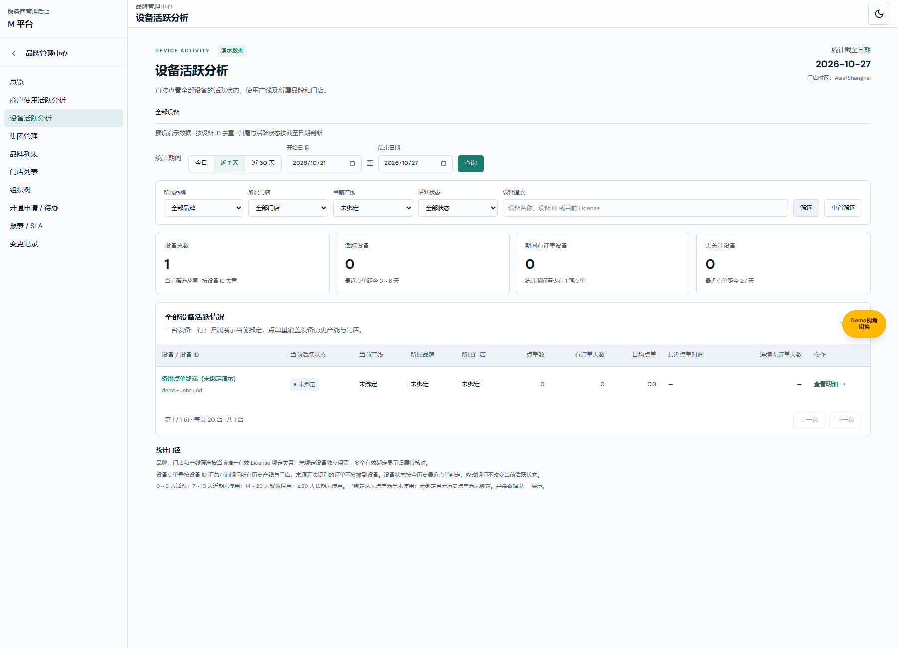

图注：查看未绑定设备／操作后结果；2026-10-27，Demo V1.1，功能基线 main@5c30e3c5。数据和权限异常图为受控演示状态，不代表真实业务记录。

| 字段 | 逻辑说明 |
| --- | --- |
| 触发入口 | 当前产线 → 未绑定 → 筛选 |
| 处理与结果 | 包括没有当前有效 License 的设备；无品牌/门店归属时显示未绑定，不分配虚拟门店。 |
| 写入、确认与取消 | 无业务写入、无自定义确认框；筛选草稿不应用可直接离开，日期原生日历可关闭。权限与日期失败分支按本项及公共定义处理。 |

### G23 查看未绑定设备详情

图注：查看未绑定设备详情／入口或操作前；2026-10-27，Demo V1.1，功能基线 main@5c30e3c5。数据和权限异常图为受控演示状态，不代表真实业务记录。

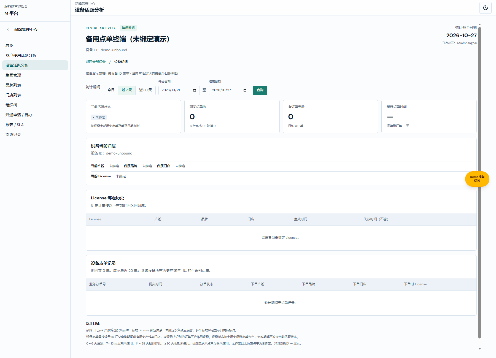

图注：查看未绑定设备详情／操作后结果；2026-10-27，Demo V1.1，功能基线 main@5c30e3c5。数据和权限异常图为受控演示状态，不代表真实业务记录。

| 字段 | 逻辑说明 |
| --- | --- |
| 触发入口 | 备用点单终端 → 查看明细 |
| 处理与结果 | 当前产线、品牌、门店、License 显示未绑定，绑定历史为空；无历史订单为真实 0。 |
| 写入、确认与取消 | 无业务写入、无自定义确认框；筛选草稿不应用可直接离开，日期原生日历可关闭。权限与日期失败分支按本项及公共定义处理。 |

### G24 查看异常设备

图注：查看异常设备／入口或操作前；2026-10-27，Demo V1.3，功能基线 main@a7ca5874。

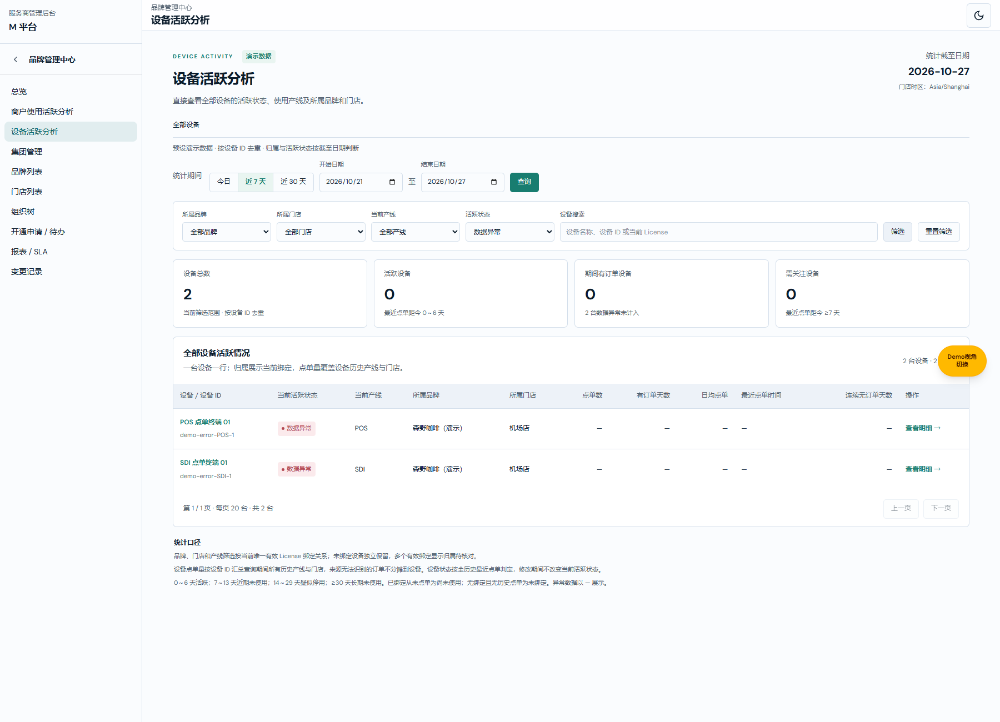

图注：查看异常设备／操作后结果；2026-10-27，Demo V1.1，功能基线 main@5c30e3c5。数据和权限异常图为受控演示状态，不代表真实业务记录。

| 字段 | 逻辑说明 |
| --- | --- |
| 触发入口 | 活跃状态 → 数据异常 → 筛选 |
| 处理与结果 | 异常设备保留已知当前产线、品牌和门店；订单和使用指标显示 —。 |
| 写入、确认与取消 | 无业务写入、无自定义确认框；筛选草稿不应用可直接离开，日期原生日历可关闭。权限与日期失败分支按本项及公共定义处理。 |

### G25 查看异常设备详情

图注：查看异常设备详情／入口或操作前；2026-10-27，Demo V1.1，功能基线 main@5c30e3c5。数据和权限异常图为受控演示状态，不代表真实业务记录。

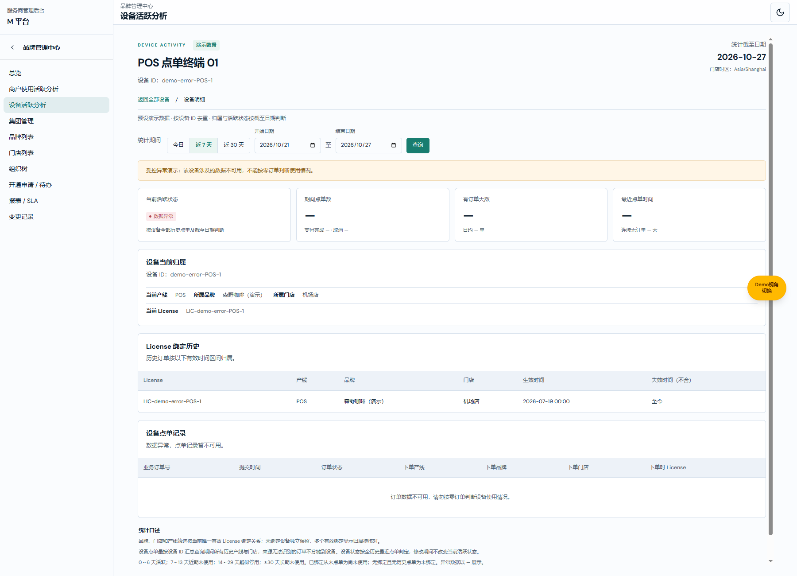

图注：查看异常设备详情／操作后结果；2026-10-27，Demo V1.1，功能基线 main@5c30e3c5。数据和权限异常图为受控演示状态，不代表真实业务记录。

| 字段 | 逻辑说明 |
| --- | --- |
| 触发入口 | 机场店 POS 设备 → 查看明细 |
| 处理与结果 | 记录区显示订单数据不可用，不能展示为查询期间 0 单。 |
| 写入、确认与取消 | 无业务写入、无自定义确认框；筛选草稿不应用可直接离开，日期原生日历可关闭。权限与日期失败分支按本项及公共定义处理。 |

### G26 查看绑定冲突设备

图注：查看绑定冲突设备／入口或操作前；2026-10-27，Demo V1.3，功能基线 main@a7ca5874。

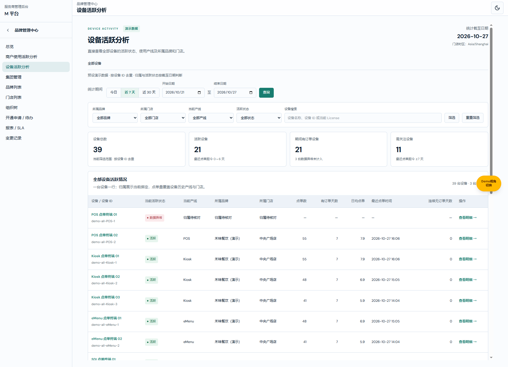

图注：查看绑定冲突设备／操作后结果；2026-10-27，Demo V1.1，功能基线 main@5c30e3c5。数据和权限异常图为受控演示状态，不代表真实业务记录。

| 字段 | 逻辑说明 |
| --- | --- |
| 触发入口 | 当前列表存在同时有效的多个 License 绑定 |
| 处理与结果 | 一台设备仍仅一行，归属显示待核对、状态数据异常、订单指标 —；页面不提供绑定修改。 |
| 写入、确认与取消 | 无业务写入、无自定义确认框；筛选草稿不应用可直接离开，日期原生日历可关闭。权限与日期失败分支按本项及公共定义处理。 |

### G27 查看绑定冲突详情

图注：查看绑定冲突详情／入口或操作前；2026-10-27，Demo V1.1，功能基线 main@5c30e3c5。数据和权限异常图为受控演示状态，不代表真实业务记录。

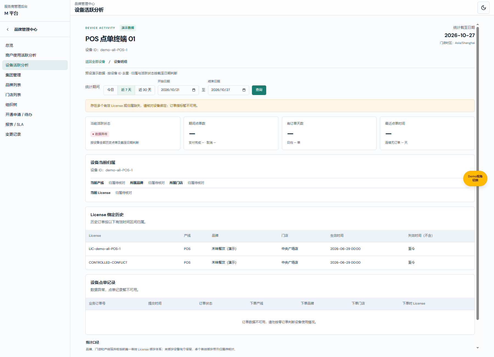

图注：查看绑定冲突详情／操作后结果；2026-10-27，Demo V1.1，功能基线 main@5c30e3c5。数据和权限异常图为受控演示状态，不代表真实业务记录。

| 字段 | 逻辑说明 |
| --- | --- |
| 触发入口 | 冲突设备 → 查看明细 |
| 处理与结果 | 说明多个有效 License 或归属缺失；保留绑定记录，订单记录不可用。 |
| 写入、确认与取消 | 无业务写入、无自定义确认框；筛选草稿不应用可直接离开，日期原生日历可关闭。权限与日期失败分支按本项及公共定义处理。 |

### G28 只读权限查询

图注：只读权限查询／入口或操作前；2026-10-27，Demo V1.3，功能基线 main@a7ca5874。

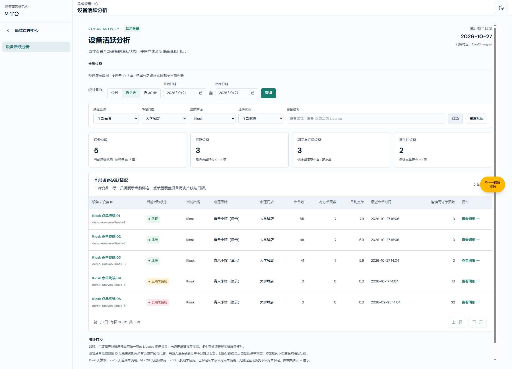

图注：只读权限查询／操作后结果；2026-10-27，Demo V1.1，功能基线 main@5c30e3c5。数据和权限异常图为受控演示状态，不代表真实业务记录。

| 字段 | 逻辑说明 |
| --- | --- |
| 触发入口 | 角色仅具备设备页面可见权限，查询大学城 Kiosk |
| 处理与结果 | 可独立进入设备页、筛选并得到 5 台，不依赖原商户活跃页面可见权限。 |
| 写入、确认与取消 | 无业务写入、无自定义确认框；筛选草稿不应用可直接离开，日期原生日历可关闭。权限与日期失败分支按本项及公共定义处理。 |

### G29 只读权限查看零订单明细

图注：只读权限查看零订单明细／入口或操作前；2026-10-27，Demo V1.1，功能基线 main@5c30e3c5。数据和权限异常图为受控演示状态，不代表真实业务记录。

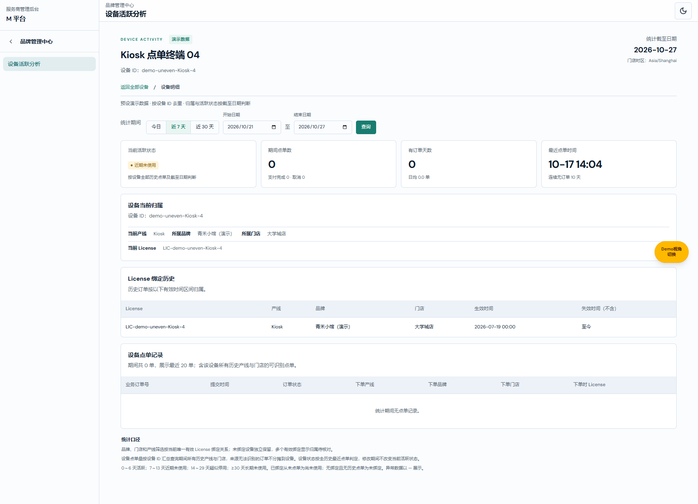

图注：只读权限查看零订单明细／操作后结果；2026-10-27，Demo V1.1，功能基线 main@5c30e3c5。数据和权限异常图为受控演示状态，不代表真实业务记录。

| 字段 | 逻辑说明 |
| --- | --- |
| 触发入口 | Kiosk 终端 04 → 明细 |
| 处理与结果 | 统计期真实 0 单但距最近点单 10 天，状态近期未使用；不误标尚未使用。 |
| 写入、确认与取消 | 无业务写入、无自定义确认框；筛选草稿不应用可直接离开，日期原生日历可关闭。权限与日期失败分支按本项及公共定义处理。 |

### G30 无权限直达设备详情

图注：无权限直达设备详情／入口或操作前；2026-10-27，Demo V1.1，功能基线 main@5c30e3c5。数据和权限异常图为受控演示状态，不代表真实业务记录。

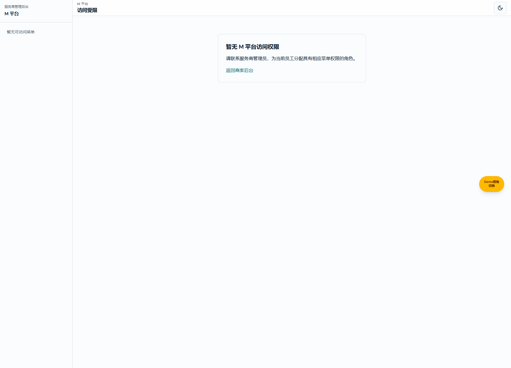

图注：无权限直达设备详情／操作后结果；2026-10-27，Demo V1.1，功能基线 main@5c30e3c5。数据和权限异常图为受控演示状态，不代表真实业务记录。

| 字段 | 逻辑说明 |
| --- | --- |
| 触发入口 | 不具备设备页面权限时直接访问明细地址 |
| 处理与结果 | 显示暂无 M 平台访问权限，不渲染设备内容。 |
| 写入、确认与取消 | 无业务写入、无自定义确认框；筛选草稿不应用可直接离开，日期原生日历可关闭。权限与日期失败分支按本项及公共定义处理。 |

### G31 切换品牌时联动门店

图注：切换品牌时联动门店／入口或操作前；2026-10-27，Demo V1.1，功能基线 main@5c30e3c5。数据和权限异常图为受控演示状态，不代表真实业务记录。

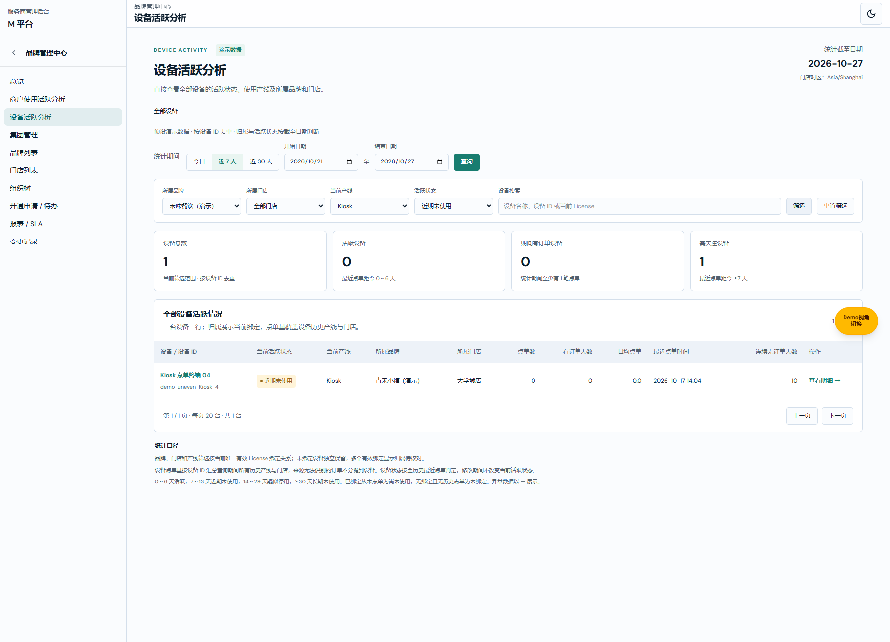

图注：切换品牌时联动门店／操作后结果；2026-10-27，Demo V1.1，功能基线 main@5c30e3c5。数据和权限异常图为受控演示状态，不代表真实业务记录。

| 字段 | 逻辑说明 |
| --- | --- |
| 触发入口 | 已选择青禾/大学城，再将品牌切为禾味 |
| 处理与结果 | 门店候选改为新品牌门店，已选门店清空为全部门店；应用前结果仍是上一次有效查询。 |
| 写入、确认与取消 | 无业务写入、无自定义确认框；筛选草稿不应用可直接离开，日期原生日历可关闭。权限与日期失败分支按本项及公共定义处理。 |

### G32 访问无效设备地址

图注：访问无效设备地址／入口或操作前；2026-10-27，Demo V1.3，功能基线 main@a7ca5874。

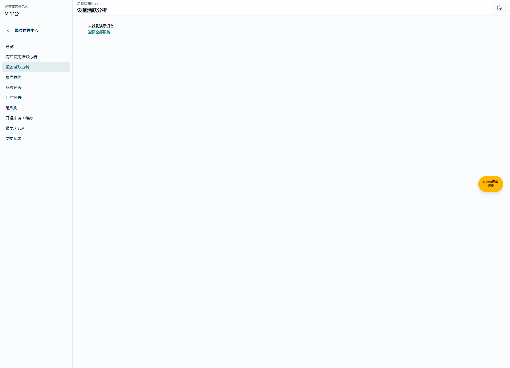

图注：访问无效设备地址／操作后结果；2026-10-27，Demo V1.1，功能基线 main@5c30e3c5。数据和权限异常图为受控演示状态，不代表真实业务记录。

| 字段 | 逻辑说明 |
| --- | --- |
| 触发入口 | 打开不存在的设备 ID |
| 处理与结果 | 显示未找到演示设备，不退回错误的门店或显示其他设备。 |
| 写入、确认与取消 | 无业务写入、无自定义确认框；筛选草稿不应用可直接离开，日期原生日历可关闭。权限与日期失败分支按本项及公共定义处理。 |

### G33 无效设备返回列表

图注：无效设备返回列表／入口或操作前；2026-10-27，Demo V1.1，功能基线 main@5c30e3c5。数据和权限异常图为受控演示状态，不代表真实业务记录。

图注：无效设备返回列表／操作后结果；2026-10-27，Demo V1.3，功能基线 main@a7ca5874。

| 字段 | 逻辑说明 |
| --- | --- |
| 触发入口 | 返回全部设备 |
| 处理与结果 | 恢复设备根列表；无业务写入。 |
| 写入、确认与取消 | 无业务写入、无自定义确认框；筛选草稿不应用可直接离开，日期原生日历可关闭。权限与日期失败分支按本项及公共定义处理。 |

### G34 开始日期原生日历

图注：开始日期原生日历／入口页面；2026-10-27，Demo V1.3，功能基线 main@a7ca5874。

**待补页面图片：开始日期的浏览器原生日历弹层。** 操作入口为开始日期日历图标，选日只编辑日期，查询才生效。自动化截图未可靠捕获该原生层，不能以列表或其他页面日历代替。

### G35 结束日期原生日历

图注：结束日期原生日历／入口页面；2026-10-27，Demo V1.3，功能基线 main@a7ca5874。

**待补页面图片：结束日期的浏览器原生日历弹层。** 日期上下界沿用查询定义；选日后仍需查询。与 G34 关联同一原生层采集限制。

### G36 关闭原生日历

**待补页面图片：日历关闭前的原生层画面。** 可 Escape 或点击日历外关闭；未提交查询不会改变有效结果。

图注：原生日历关闭后／查询结果保持；2026-10-27，Demo V1.3，功能基线 main@a7ca5874。

该截图仅证明常规页面结果，不证明原生日历弹层已完整采集；G34～G36 的图片缺口见独立交付记录。

## 统一业务口径

| 规则 | 当前定义 |
| --- | --- |
| 产线范围 | POS、Kiosk、eMenu、SDI、OO、POS GO，固定六条。 |
| 点单订单 | 成功提交的原始业务订单；提交后取消仍属于一次点单，取消数单列；草稿不计入。 |
| 去重 | 同一门店内原始业务订单 ID 去重；重传、收款流转不增加点单数。Demo 中重复记录为同一份订单快照。 |
| 点单归属 | 使用下单时来源设备 ID，匹配该时刻唯一有效的 License 绑定关系，取得门店和产线；收款设备不改归属。 |
| 历史绑定 | 绑定区间为 [生效时间, 失效时间)，失效为空表示持续有效。历史订单不随当前设备产线变化而迁移。 |
| 来源待识别 | 来源设备缺失、无匹配绑定或绑定不唯一的订单，仅计入其已知门店总量；不计入产线与设备。 |
| 查询时间 | Demo 全部门店时区为 Asia/Shanghai；含起止自然日；今日 1 天、近 7 天含当天和前 6 天、近 30 天含当天和前 29 天。自定义限截至日及前 89 天。 |
| 截至日期 | 页面加载时以 Asia/Shanghai 的当天生成整套预设数据；页面显示明确截至日期。同日刷新不随机变化；跨日重新加载生成对应日期的演示快照。 |
| 点单数 | 有效查询期内去重订单数。支付完成数、取消数为其中的状态子集，未支付但已提交订单保留在总数中。 |
| 有订单天数 | 查询期内至少发生 1 笔点单的不同自然日数量。 |
| 日均点单 | 期间点单数 ÷ 含起止日的自然日天数；保留原始计算精度，展示 1 位小数。未营业日期也计入分母。 |
| 最近点单时间 | 截至日期日末以前，全历史最近一次成功提交时间，不受查询起日影响；展示至分钟。 |
| 连续无订单天数 | 截至日期与最近点单日期的自然日差，今天有订单为 0；从未下单或数据异常显示 —。不按 24 小时滚动。 |
| 绑定设备数 | 截至日期日末有效的 License 绑定设备 ID 去重数；不是 License 条数。 |
| 有订单设备数 | 查询期间至少产生 1 笔可归属点单的设备 ID 去重数，包含历史绑定设备。 |
| 绑定中无订单 | 当前绑定设备集合中，查询期间未产生点单的设备数量；不能简单用绑定数减所有有订单设备数，因为后者可含历史设备。 |
| 门店产线内设备列表 | 当前绑定设备集合与查询期间有订单的历史绑定设备集合取并集；保留零订单设备。 |
| 分层核对 | 门店点单数 = 六条已识别产线点单数合计 + 来源待识别点单数；同一产线点单数 = 其设备点单数合计。 |
| 跨产线设备 | 一台设备可在不同历史时间用于不同产线，产线设备数不能直接加总为门店设备总数；门店按设备 ID 去重。 |
| 数据异常 | 订单数、支付完成、取消、有订单天数、日均、最近点单、连续无订单天数及有订单/无订单设备数显示 —；已知资产绑定数量可显示。门店总览订单卡片仅汇总已知门店，并明确排除异常门店数。 |
| 权限 | M 平台使用活跃分析分类下的独立只读页面资源，授权仍由品牌管理中心父资源门禁控制，只有不可见/可见两种页面权限；沿用角色并集和父模块门禁。既有已保存角色不自动获得新页面权限。 |
| 数据边界 | 所有商户、门店、设备、License、订单均为预设演示数据；不调用真实业务接口，不保存订单，不发送提醒、不自动停用。 |

## 活跃状态

活跃状态始终针对截至日期，以全历史最近点单判定；修改查询期间不改变当前活跃状态。

| 状态 | 条件 |
| --- | --- |
| 活跃 | 最近点单距今 0～6 天。 |
| 近期未使用 | 最近点单距今 7～13 天。 |
| 疑似停用 | 最近点单距今 14～29 天，只表示需关注，不判定真实关店。 |
| 长期未使用 | 最近点单距今至少 30 天。 |
| 尚未使用 | 已开通或已绑定，但从未成功提交订单；门店显示已开通天数，设备显示已绑定天数。 |
| 未开通／未绑定 | 产线未开通，或设备无配置且没有历史点单。未开通产线没有查看设备链接。 |
| 数据异常 | 受控异常门店无法提供订单统计；不作为零订单。当前实现优先标识数据异常。 |

阈值固定为 7/14/30 天，首版无配置页面；不划分统一订单量的高、中、低活跃档位。

## 门店列表

图注：门店列表／默认近 7 天／全部商户；2026-10-27，Demo V1.3，功能基线 main@a7ca5874。

用途：入口为 M 平台 → 使用活跃分析 → 商户使用活跃分析，查看商户下各门店是否使用系统。

### 页面标识、位置与统计期间

| 字段 | 逻辑说明 |
| --- | --- |
| 演示数据标识 | 钻取页及设备详情展示，说明数据为预设演示；根列表不展示该标签。 |
| 快照截至日期 | Asia/Shanghai 当日；页面加载生成并固定本次演示快照。根列表不展示，钻取页及详情保留。 |
| 时区口径 | 演示数据统一为 Asia/Shanghai，根列表不展示时区说明。真实多时区接入不属于当前范围。 |
| 今日 | 点击后立即使用截至日当天，重算所有期间指标。 |
| 近 7 天 | 默认选中，点击立即应用截至日与前 6 天。 |
| 近 30 天 | 点击立即应用截至日与前 29 天。 |
| 开始日期 | 必填日期；默认截至日减 6 天；最早截至日减 89 天，不晚于结束日。编辑后等待查询，不立即重算。 |
| 结束日期 | 必填日期；默认截至日；不晚于截至日，不早于开始日；编辑后等待查询。 |
| 查询 | 先执行浏览器日期必填及范围校验，再校验起止关系；通过后更新有效期间、清空快捷日期选中，保留其他已应用筛选；失败保留输入与原有效结果。 |
| 日期错误提示 | 开始晚于结束显示“开始日期不能晚于结束日期”；浏览器原生必填/上下界提示遵循实际浏览器语言，截图不作为跨浏览器固定文案。 |
| 位置导航 | 仅钻取页展示：全部门店、所选门店、所选产线逐级返回；携带有效期间，返回根页保留已应用筛选。根列表不展示位置文字。 |

### 筛选、汇总与列表

| 字段 | 逻辑说明 |
| --- | --- |
| 商户筛选 | 单选，默认全部商户，候选来自预设商户；选择后点击筛选生效。 |
| 活跃状态筛选 | 单选，默认全部状态；候选为活跃、近期未使用、疑似停用、长期未使用、尚未使用、数据异常。根门店不存在未开通状态。 |
| 门店／商户搜索 | 可选文本，最多 80 字，默认空；匹配名称包含关系，首尾空格忽略，英文忽略大小写；点击筛选生效。 |
| 筛选 | 商户、当前状态、名称取交集，同时更新列表及四项汇总；不改变有效统计期间。 |
| 重置筛选 | 恢复全部商户、全部状态和空名称，立即刷新列表及四项汇总；有效统计期间保留。 |
| 门店汇总 | 当前已应用条件匹配门店数量，整数；无匹配为 0。 |
| 活跃门店汇总 | 当前匹配门店中状态为活跃的数量，整数。 |
| 需关注门店汇总 | 当前匹配门店中近期未使用、疑似停用和长期未使用三状态数量之和。尚未使用及数据异常不计入。 |
| 期间点单数汇总 | 匹配门店的已知订单数量之和；若含数据异常门店，标明“已知合计 · X 家数据异常未计入”，不冒充完整总量。 |
| 门店／商户 | 展示门店名称与所属商户；门店名可点击，打开该门店产线列表。 |
| 绑定 / 有订单设备 | 分别为截至日末绑定设备数和期间有订单设备数；二者时间口径不同，不能据此相减计算全部无订单设备。 |
| 来源待识别 | 无法唯一匹配下单时 License 绑定关系的门店订单数量。未知设备订单仍计入门店总数。 |
| 查看产线 | 作用于所在行门店，与点击门店名称结果一致；保留有效统计期间。 |
| 空结果 | 显示“没有符合筛选条件的门店，请调整条件或重置筛选。”；四项已知汇总为 0，无写入。 |
| 当前活跃状态 | 所属对象为当前门店、产线或设备；按统一状态规则显示名称和颜色，颜色不替代文字；不随查询日期变化。 |
| 点单数 | 当前对象、有效查询期间内去重的成功提交业务订单数量；整数，真实无订单为 0，数据异常为 —。 |
| 支付完成 | 点单数中状态为支付完成的订单数量；整数，不等同于全部点单数。 |
| 取消数 | 点单数中状态为取消的订单数量；提交后取消仍计入点单总量，不重复计单。 |
| 有订单天数 | 当前对象在查询期间发生点单的自然日数；0 到查询天数之间，数据异常为 —。 |
| 日均点单 | 点单数除以查询自然日数，显示 1 位小数；零为 0.0，异常为 —。 |
| 最近点单时间 | 全历史截至日末最近提交时间，格式 YYYY-MM-DD HH:mm；从未点单或异常为 —。 |
| 连续无订单天数 | 截至日期减最近点单日期的自然日差；今天有单为 0，从未点单及异常为 —。 |

## 门店产线列表

图注：大学城店／产线列表／近 7 天；2026-10-27，功能分支 Demo V1.0，起始 main@64ddec8f，统计截至日 2026-10-27，受控演示数据。

用途：从门店名称或查看产线进入。固定展示六条产线，沿用有效统计期间。

### 汇总区

| 字段 | 逻辑说明 |
| --- | --- |
| 当前活跃状态 | 所选门店状态；不是六条产线状态的简单平均。 |
| 期间点单数 | 所选门店期间点单数，附支付完成和取消数量。 |
| 有订单天数 | 所选门店有订单天数，附日均点单。 |
| 绑定 / 有订单设备 | 门店级设备 ID 去重数量，附当前绑定中无订单数量。 |

### 产线表格

| 字段 | 逻辑说明 |
| --- | --- |
| 产线 | 固定 POS、Kiosk、eMenu、SDI、OO、POS GO。 |
| 当前活跃状态 | 所属对象为当前门店、产线或设备；按统一状态规则显示名称和颜色，颜色不替代文字；不随查询日期变化。 |
| 点单数 | 当前对象、有效查询期间内去重的成功提交业务订单数量；整数，真实无订单为 0，数据异常为 —。 |
| 支付完成 | 点单数中状态为支付完成的订单数量；整数，不等同于全部点单数。 |
| 取消数 | 点单数中状态为取消的订单数量；提交后取消仍计入点单总量，不重复计单。 |
| 有订单天数 | 当前对象在查询期间发生点单的自然日数；0 到查询天数之间，数据异常为 —。 |
| 日均点单 | 点单数除以查询自然日数，显示 1 位小数；零为 0.0，异常为 —。 |
| 最近点单时间 | 全历史截至日末最近提交时间，格式 YYYY-MM-DD HH:mm；从未点单或异常为 —。 |
| 连续无订单天数 | 截至日期减最近点单日期的自然日差；今天有单为 0，从未点单及异常为 —。 |
| 绑定设备 | 截至日末仍有效的绑定设备 ID 去重数量；包括零订单设备。 |
| 有订单设备 | 查询期内有可识别点单的设备 ID 去重数量，包含历史设备；异常为 —。 |
| 绑定中无订单 | 当前绑定设备中查询期间无点单的设备数量；历史有单设备不会导致此值出现负数；异常为 —。 |
| 查看设备 | 打开所在行产线设备列表，保留所选门店与有效期间；未开通行显示 —，没有链接。 |
| 门店订单核对说明 | 门店总数 = 已识别产线合计 + 来源待识别；异常时只提示数据不可用。 |
| 来源待识别提示 | 数量大于 0 才显示，说明缺失或无法唯一匹配设备绑定的原因。 |

## 产线设备列表

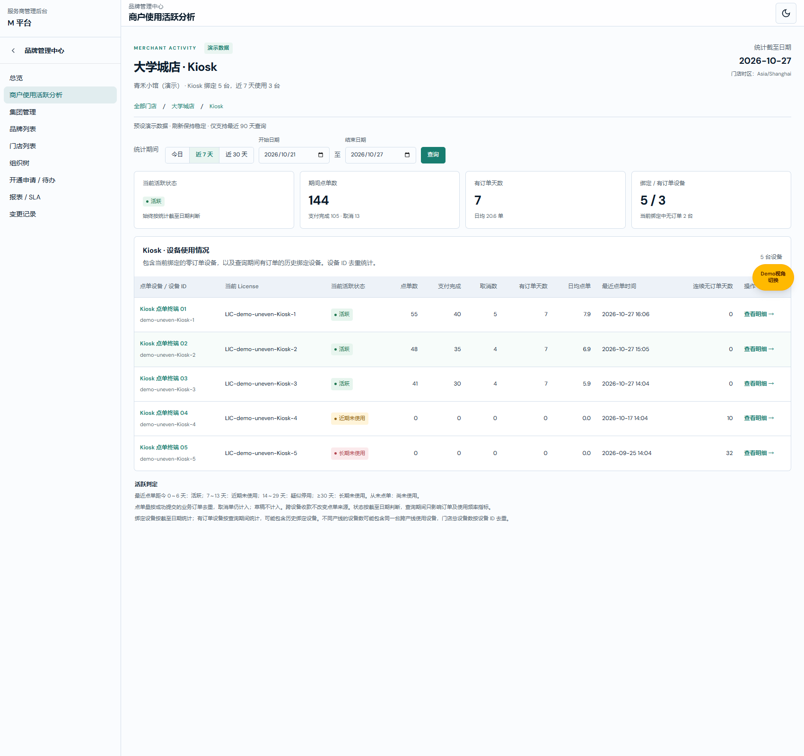

图注：大学城店／Kiosk 设备列表／绑定 5 台、期间有订单 3 台；2026-10-27，功能分支 Demo V1.0，起始 main@64ddec8f，统计截至日 2026-10-27，受控演示数据。

用途：从所选产线的查看设备进入，查询对象为门店和该产线。汇总区指标限定到当前产线。

### 设备表格

| 字段 | 逻辑说明 |
| --- | --- |
| 点单设备名称 | 可点击进入当前门店、产线和设备的明细；同一物理设备可能出现在不同历史产线列表。 |
| 设备 ID | 来源设备稳定标识，展示于设备名下；用于订单与 License 关联及设备数量去重。 |
| 当前 License | 截至日末当前门店/产线下有效的 License ID；只有历史绑定时显示“历史绑定”。 |
| 当前活跃状态 | 所属对象为当前门店、产线或设备；按统一状态规则显示名称和颜色，颜色不替代文字；不随查询日期变化。 |
| 点单数 | 当前对象、有效查询期间内去重的成功提交业务订单数量；整数，真实无订单为 0，数据异常为 —。 |
| 支付完成 | 点单数中状态为支付完成的订单数量；整数，不等同于全部点单数。 |
| 取消数 | 点单数中状态为取消的订单数量；提交后取消仍计入点单总量，不重复计单。 |
| 有订单天数 | 当前对象在查询期间发生点单的自然日数；0 到查询天数之间，数据异常为 —。 |
| 日均点单 | 点单数除以查询自然日数，显示 1 位小数；零为 0.0，异常为 —。 |
| 最近点单时间 | 全历史截至日末最近提交时间，格式 YYYY-MM-DD HH:mm；从未点单或异常为 —。 |
| 连续无订单天数 | 截至日期减最近点单日期的自然日差；今天有单为 0，从未点单及异常为 —。 |
| 查看明细 | 与设备名打开相同设备页面；页面只读，不修改设备或 License。 |
| 设备列表空态 | 没有当前绑定、期间也无历史可识别设备时，显示暂无绑定及订单说明；不创建虚拟设备。 |

## 门店产线内的设备明细

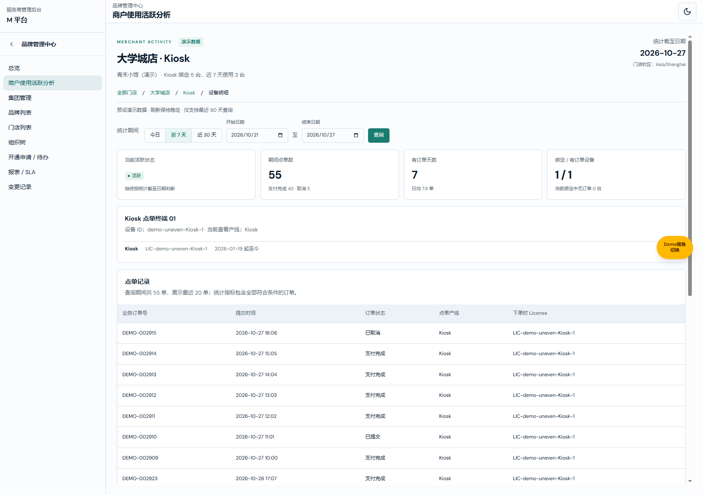

图注：大学城店／Kiosk 终端 01／设备明细及点单记录；2026-10-27，功能分支 Demo V1.0，起始 main@64ddec8f，统计截至日 2026-10-27，受控演示数据。

用途：从设备名或查看明细进入，当前统计对象为选中门店、产线和设备组合。汇总区沿用公共指标并限定至该组合。

### 设备信息与 License 历史

| 字段 | 逻辑说明 |
| --- | --- |
| 设备名称 | 所选预设设备名称，只读。 |
| 设备 ID | 原始点单设备 ID，只读。 |
| 当前查看产线 | 来自钻取上下文，限定当前页面订单归属；不强行改写历史绑定。 |
| 历史产线 | 列出该设备各绑定记录对应的产线。 |
| 历史 License | 显示每段绑定的 License ID。 |
| 绑定起始日期 | License 生效日期，含起始时刻。 |
| 绑定截止日期 | 无截止显示至今；有截止明确标记不含该截止时刻。设备表当前为日期展示，实际匹配使用时间戳。 |

### 点单记录

| 字段 | 逻辑说明 |
| --- | --- |
| 业务订单号 | 门店内原始业务订单 ID，重复上报不重复展示。 |
| 提交时间 | 点单成功提交时间，展示至分钟，按时间降序。 |
| 订单状态 | 支付完成、已取消、已提交；草稿不进入列表。 |
| 点单产线 | 按下单时有效绑定获得的产线，与当前设备用途可不同。 |
| 下单时 License | 该笔订单发生时匹配的唯一有效 License ID。 |
| 记录数量说明 | 展示当前查询期最近 20 单；所有指标统计全部符合条件订单，不受展示上限影响。 |
| 无点单记录 | 数据完整且期间无符合订单时显示“统计期间无点单记录。”；异常时显示“订单数据不可用，请勿按零订单判断设备使用情况。”；设备仍可有历史点单。 |

## 逐操作说明

本模块无保存、删除、发布、导出或自定义确认弹框。所有操作仅改变浏览视角；除原生日期选择器关闭外无业务确认/取消流程，不存在业务写入成功/失败分支。日期校验失败、空结果、异常及权限受限分别记录。

### A01 打开分析页面

图注：打开分析页面／入口或操作前；2026-10-27，Demo V1.3，功能基线 main@a7ca5874。

图注：打开分析页面／操作后及结果；2026-10-27，Demo V1.3，功能基线 main@a7ca5874。

| 字段 | 逻辑说明 |
| --- | --- |
| 触发入口 | 使用活跃分析 → 商户使用活跃分析 |
| 对象与前置条件 | 在有效角色权限下查看本模块；权限限制场景按该项指定的隔离角色前置。 |
| 处理与结果 | 获得默认近 7 天、全部商户和全部状态的门店列表；不写业务数据。 |
| 写入、失败及取消 | 无业务数据写入。校验失败不应用新查询；权限失败不渲染分析内容；导航无二次确认，原生日期选择器可关闭。 |

### A02 切换今日

图注：切换今日／入口或操作前；2026-10-27，Demo V1.3，功能基线 main@a7ca5874。

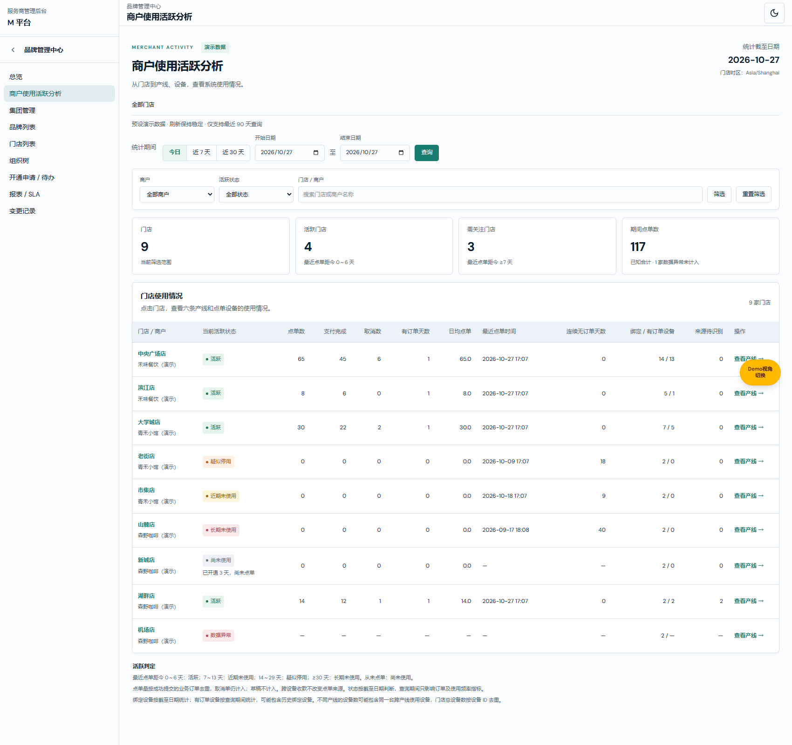

图注：切换今日／操作后及结果；2026-10-27，功能分支 Demo V1.0，起始 main@64ddec8f，统计截至日 2026-10-27，受控演示数据。

| 字段 | 逻辑说明 |
| --- | --- |
| 触发入口 | 统计期间 → 今日 |
| 对象与前置条件 | 在有效角色权限下查看本模块；权限限制场景按该项指定的隔离角色前置。 |
| 处理与结果 | 日期为截至日当天；点单、有订单天数、设备使用数重算；活跃状态不随查询期变化。 |
| 写入、失败及取消 | 无业务数据写入。校验失败不应用新查询；权限失败不渲染分析内容；导航无二次确认，原生日期选择器可关闭。 |

### A03 切换近 7 天

图注：切换近 7 天／入口或操作前；2026-10-27，功能分支 Demo V1.0，起始 main@64ddec8f，统计截至日 2026-10-27，受控演示数据。

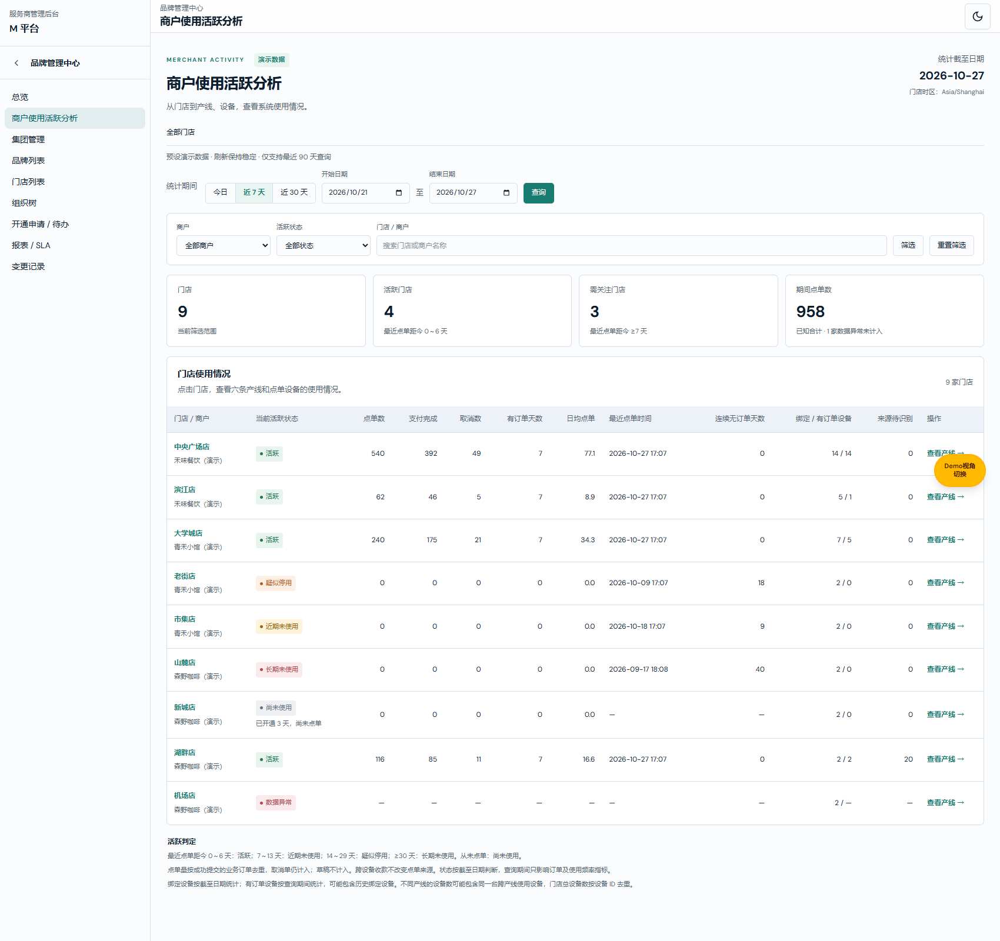

图注：切换近 7 天／操作后及结果；2026-10-27，功能分支 Demo V1.0，起始 main@64ddec8f，统计截至日 2026-10-27，受控演示数据。

| 字段 | 逻辑说明 |
| --- | --- |
| 触发入口 | 统计期间 → 近 7 天 |
| 对象与前置条件 | 在有效角色权限下查看本模块；权限限制场景按该项指定的隔离角色前置。 |
| 处理与结果 | 起日为截至日减 6 天，包含当天，共 7 个自然日。 |
| 写入、失败及取消 | 无业务数据写入。校验失败不应用新查询；权限失败不渲染分析内容；导航无二次确认，原生日期选择器可关闭。 |

### A04 切换近 30 天

图注：切换近 30 天／入口或操作前；2026-10-27，功能分支 Demo V1.0，起始 main@64ddec8f，统计截至日 2026-10-27，受控演示数据。

图注：切换近 30 天／操作后及结果；2026-10-27，功能分支 Demo V1.0，起始 main@64ddec8f，统计截至日 2026-10-27，受控演示数据。

| 字段 | 逻辑说明 |
| --- | --- |
| 触发入口 | 统计期间 → 近 30 天 |
| 对象与前置条件 | 在有效角色权限下查看本模块；权限限制场景按该项指定的隔离角色前置。 |
| 处理与结果 | 起日为截至日减 29 天，共 30 个自然日。 |
| 写入、失败及取消 | 无业务数据写入。校验失败不应用新查询；权限失败不渲染分析内容；导航无二次确认，原生日期选择器可关闭。 |

### A05 编辑开始日期

图注：编辑开始日期／入口或操作前；2026-10-27，Demo V1.3，功能基线 main@a7ca5874。

图注：编辑开始日期／操作后及结果；2026-10-27，功能分支 Demo V1.0，起始 main@64ddec8f，统计截至日 2026-10-27，受控演示数据。

| 字段 | 逻辑说明 |
| --- | --- |
| 触发入口 | 开始日期输入框 |
| 对象与前置条件 | 在有效角色权限下查看本模块；权限限制场景按该项指定的隔离角色前置。 |
| 处理与结果 | 输入仅改变待查询值；点击查询后才更新统计，快捷日期选中态随后清空。 |
| 写入、失败及取消 | 无业务数据写入。校验失败不应用新查询；权限失败不渲染分析内容；导航无二次确认，原生日期选择器可关闭。 |

### A06 编辑结束日期

图注：编辑结束日期／入口或操作前；2026-10-27，Demo V1.3，功能基线 main@a7ca5874。

图注：编辑结束日期／操作后及结果；2026-10-27，功能分支 Demo V1.0，起始 main@64ddec8f，统计截至日 2026-10-27，受控演示数据。

| 字段 | 逻辑说明 |
| --- | --- |
| 触发入口 | 结束日期输入框 |
| 对象与前置条件 | 在有效角色权限下查看本模块；权限限制场景按该项指定的隔离角色前置。 |
| 处理与结果 | 输入仅改变待查询值；日期上下界受最近 90 天和截至日限制。 |
| 写入、失败及取消 | 无业务数据写入。校验失败不应用新查询；权限失败不渲染分析内容；导航无二次确认，原生日期选择器可关闭。 |

### A07 提交日期查询

图注：提交日期查询／入口或操作前；2026-10-27，功能分支 Demo V1.0，起始 main@64ddec8f，统计截至日 2026-10-27，受控演示数据。

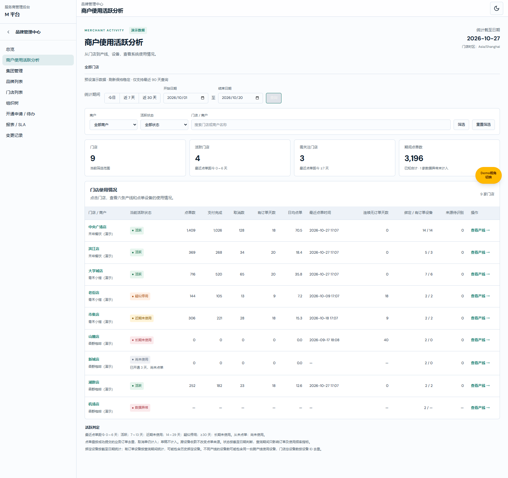

图注：提交日期查询／操作后及结果；2026-10-27，功能分支 Demo V1.0，起始 main@64ddec8f，统计截至日 2026-10-27，受控演示数据。

| 字段 | 逻辑说明 |
| --- | --- |
| 触发入口 | 查询 |
| 对象与前置条件 | 在有效角色权限下查看本模块；权限限制场景按该项指定的隔离角色前置。 |
| 处理与结果 | 有效日期同时作用于当前层级及后续钻取；更改日期保留商户、状态、名称筛选。 |
| 写入、失败及取消 | 无业务数据写入。校验失败不应用新查询；权限失败不渲染分析内容；导航无二次确认，原生日期选择器可关闭。 |

### A08 提交起止错误日期

图注：提交起止错误日期／入口或操作前；2026-10-27，功能分支 Demo V1.0，起始 main@64ddec8f，统计截至日 2026-10-27，受控演示数据。

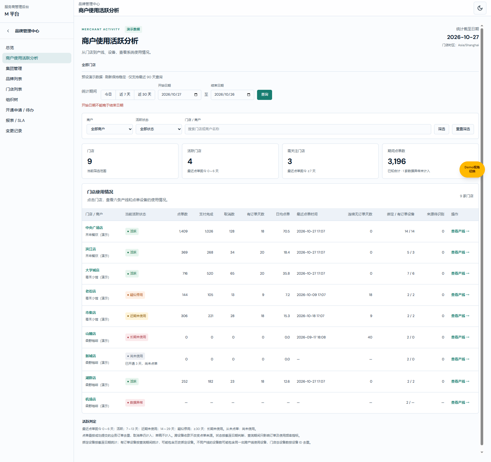

图注：提交起止错误日期／操作后及结果；2026-10-27，功能分支 Demo V1.0，起始 main@64ddec8f，统计截至日 2026-10-27，受控演示数据。

| 字段 | 逻辑说明 |
| --- | --- |
| 触发入口 | 开始日期晚于结束日期 → 查询 |
| 对象与前置条件 | 在有效角色权限下查看本模块；权限限制场景按该项指定的隔离角色前置。 |
| 处理与结果 | 显示“开始日期不能晚于结束日期”，保留错误输入和上一份有效统计，不更新查询期。 |
| 写入、失败及取消 | 无业务数据写入。校验失败不应用新查询；权限失败不渲染分析内容；导航无二次确认，原生日期选择器可关闭。 |

### A09 提交缺少日期的查询

图注：提交缺少日期的查询／入口或操作前；2026-10-27，Demo V1.3，功能基线 main@a7ca5874。

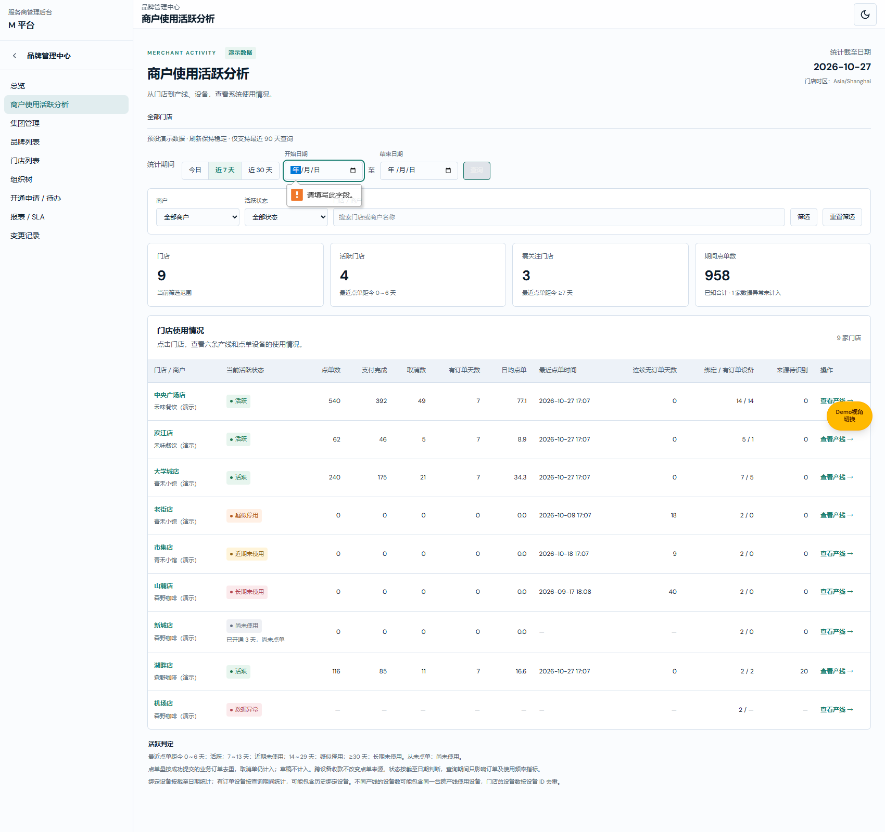

图注：提交缺少日期的查询／操作后及结果；2026-10-27，功能分支 Demo V1.0，起始 main@64ddec8f，统计截至日 2026-10-27，受控演示数据。

| 字段 | 逻辑说明 |
| --- | --- |
| 触发入口 | 清空日期 → 查询 |
| 对象与前置条件 | 在有效角色权限下查看本模块；权限限制场景按该项指定的隔离角色前置。 |
| 处理与结果 | 浏览器原生必填校验阻止提交；保留上一份有效统计，无业务写入。截图为真实原生必填提示。 |
| 写入、失败及取消 | 无业务数据写入。校验失败不应用新查询；权限失败不渲染分析内容；导航无二次确认，原生日期选择器可关闭。 |

### A10 选择商户并应用

图注：选择商户并应用／入口或操作前；2026-10-27，功能分支 Demo V1.0，起始 main@64ddec8f，统计截至日 2026-10-27，受控演示数据。

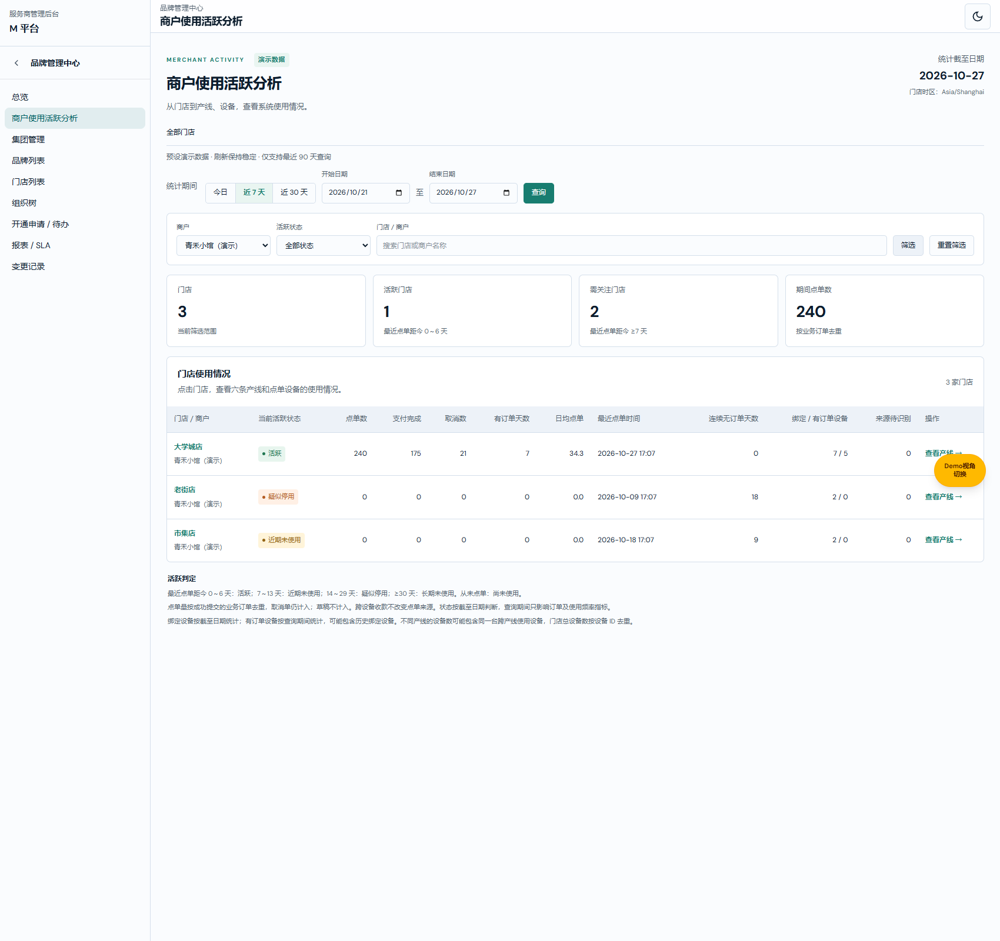

图注：选择商户并应用／操作后及结果；2026-10-27，功能分支 Demo V1.0，起始 main@64ddec8f，统计截至日 2026-10-27，受控演示数据。

| 字段 | 逻辑说明 |
| --- | --- |
| 触发入口 | 商户 → 青禾小馆（演示） → 筛选 |
| 对象与前置条件 | 在有效角色权限下查看本模块；权限限制场景按该项指定的隔离角色前置。 |
| 处理与结果 | 只展示该商户下 3 家门店；列表和四项汇总使用相同筛选范围。仅选择时不更新结果。 |
| 写入、失败及取消 | 无业务数据写入。校验失败不应用新查询；权限失败不渲染分析内容；导航无二次确认，原生日期选择器可关闭。 |

### A11 选择活跃状态并应用

图注：选择活跃状态并应用／入口或操作前；2026-10-27，功能分支 Demo V1.0，起始 main@64ddec8f，统计截至日 2026-10-27，受控演示数据。

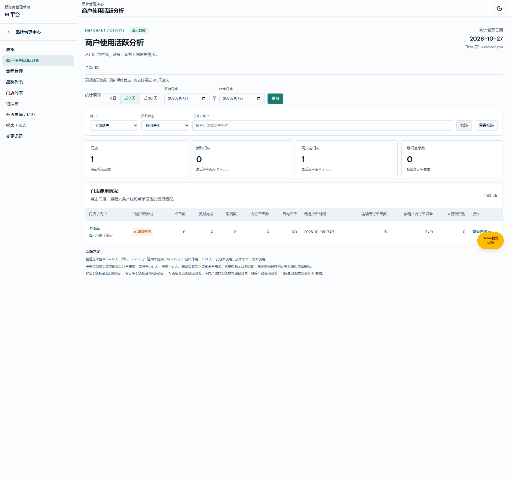

图注：选择活跃状态并应用／操作后及结果；2026-10-27，功能分支 Demo V1.0，起始 main@64ddec8f，统计截至日 2026-10-27，受控演示数据。

| 字段 | 逻辑说明 |
| --- | --- |
| 触发入口 | 活跃状态 → 疑似停用 → 筛选 |
| 对象与前置条件 | 在有效角色权限下查看本模块；权限限制场景按该项指定的隔离角色前置。 |
| 处理与结果 | 按截至日期的当前状态筛选；演示结果为老街店。仅选择时不更新结果。 |
| 写入、失败及取消 | 无业务数据写入。校验失败不应用新查询；权限失败不渲染分析内容；导航无二次确认，原生日期选择器可关闭。 |

### A12 搜索名称并应用

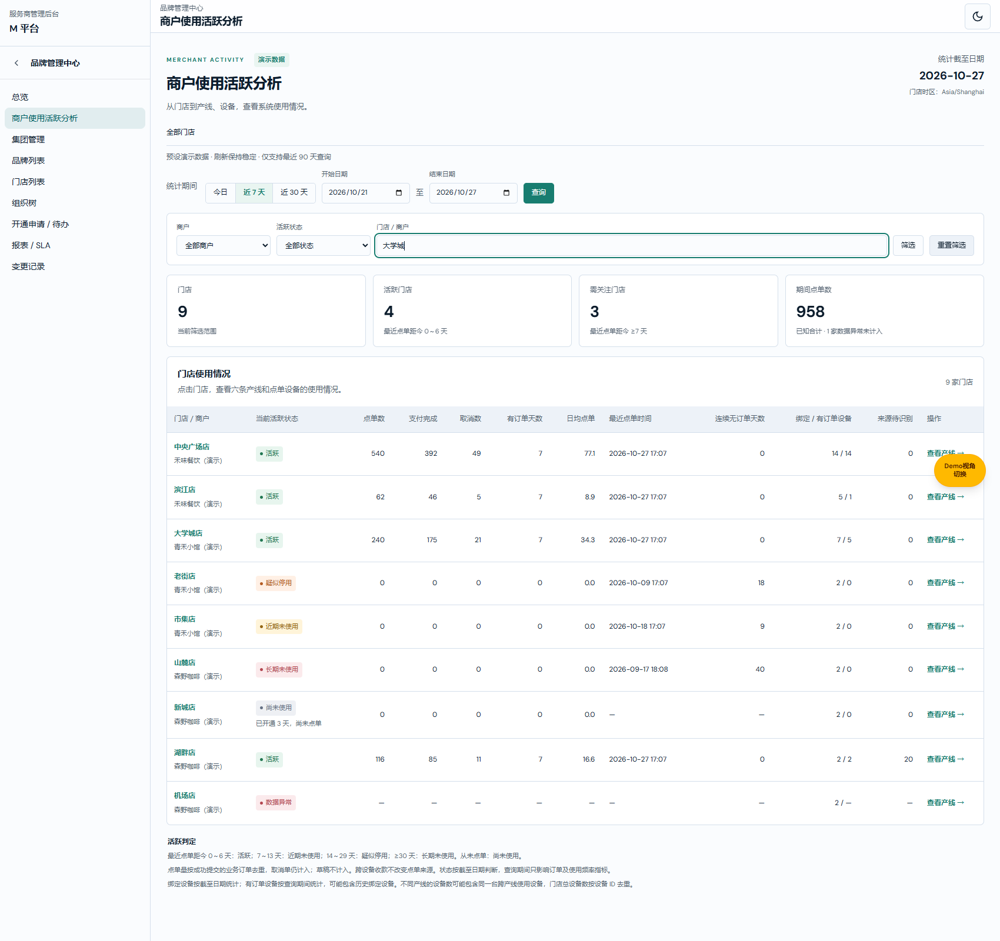

图注：搜索名称并应用／入口或操作前；2026-10-27，功能分支 Demo V1.0，起始 main@64ddec8f，统计截至日 2026-10-27，受控演示数据。

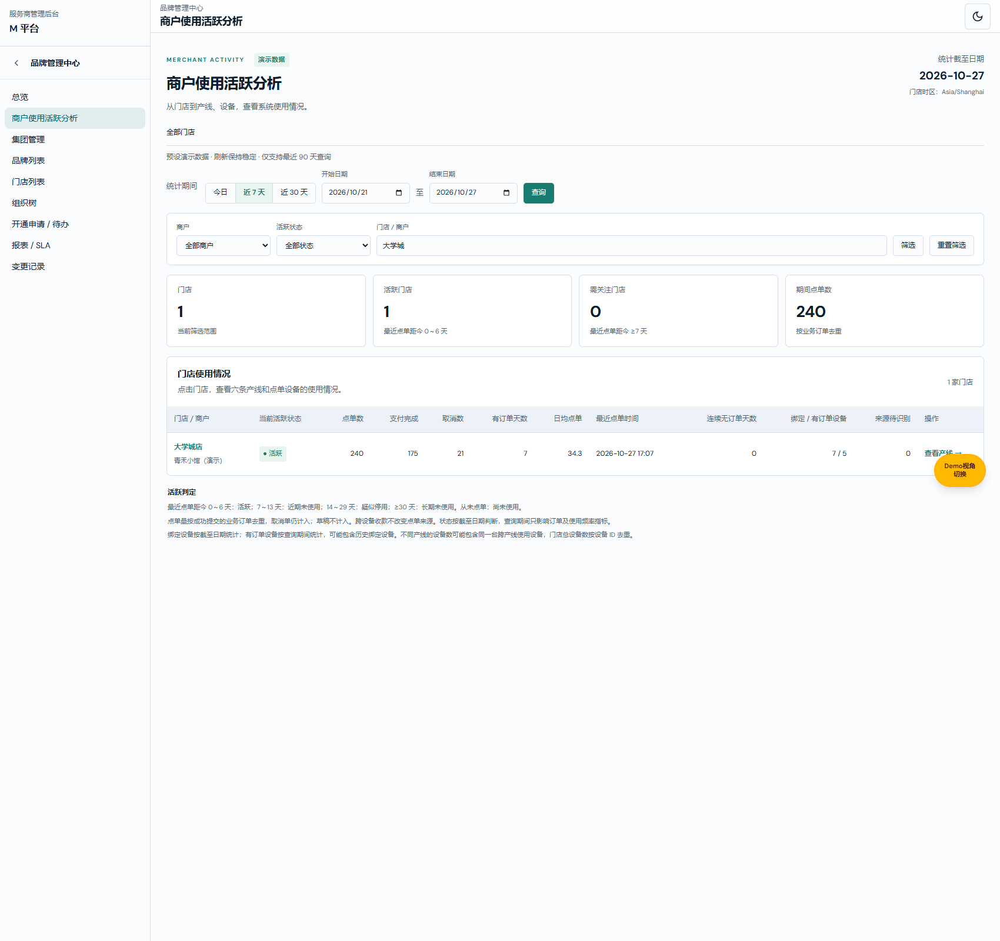

图注：搜索名称并应用／操作后及结果；2026-10-27，功能分支 Demo V1.0，起始 main@64ddec8f，统计截至日 2026-10-27，受控演示数据。

| 字段 | 逻辑说明 |
| --- | --- |
| 触发入口 | 名称输入大学城 → 筛选 |
| 对象与前置条件 | 在有效角色权限下查看本模块；权限限制场景按该项指定的隔离角色前置。 |
| 处理与结果 | 按门店名或商户名包含匹配，忽略英文大小写，去掉首尾空格，演示结果为大学城店。 |
| 写入、失败及取消 | 无业务数据写入。校验失败不应用新查询；权限失败不渲染分析内容；导航无二次确认，原生日期选择器可关闭。 |

### A13 提交组合筛选

图注：提交组合筛选／入口或操作前；2026-10-27，Demo V1.3，功能基线 main@a7ca5874。

图注：提交组合筛选／操作后及结果；2026-10-27，功能分支 Demo V1.0，起始 main@64ddec8f，统计截至日 2026-10-27，受控演示数据。

| 字段 | 逻辑说明 |
| --- | --- |
| 触发入口 | 填写商户、状态或名称 → 筛选 |
| 对象与前置条件 | 在有效角色权限下查看本模块；权限限制场景按该项指定的隔离角色前置。 |
| 处理与结果 | 三个条件取交集，结果与汇总同时更新；无结果见空结果状态。日期条件独立保留。 |
| 写入、失败及取消 | 无业务数据写入。校验失败不应用新查询；权限失败不渲染分析内容；导航无二次确认，原生日期选择器可关闭。 |

### A14 查询无匹配门店

图注：查询无匹配门店／入口或操作前；2026-10-27，功能分支 Demo V1.0，起始 main@64ddec8f，统计截至日 2026-10-27，受控演示数据。

图注：查询无匹配门店／操作后及结果；2026-10-27，功能分支 Demo V1.0，起始 main@64ddec8f，统计截至日 2026-10-27，受控演示数据。

| 字段 | 逻辑说明 |
| --- | --- |
| 触发入口 | 名称输入不存在的演示门店 → 筛选 |
| 对象与前置条件 | 在有效角色权限下查看本模块；权限限制场景按该项指定的隔离角色前置。 |
| 处理与结果 | 列表显示无匹配说明，门店/活跃/关注/已知订单合计均为 0；不改变预设数据。 |
| 写入、失败及取消 | 无业务数据写入。校验失败不应用新查询；权限失败不渲染分析内容；导航无二次确认，原生日期选择器可关闭。 |

### A15 重置筛选

图注：重置筛选／入口或操作前；2026-10-27，功能分支 Demo V1.0，起始 main@64ddec8f，统计截至日 2026-10-27，受控演示数据。

图注：重置筛选／操作后及结果；2026-10-27，功能分支 Demo V1.0，起始 main@64ddec8f，统计截至日 2026-10-27，受控演示数据。

| 字段 | 逻辑说明 |
| --- | --- |
| 触发入口 | 重置筛选 |
| 对象与前置条件 | 在有效角色权限下查看本模块；权限限制场景按该项指定的隔离角色前置。 |
| 处理与结果 | 恢复全部商户、全部状态、空名称；保留当前统计期间。没有确认框与取消动作。 |
| 写入、失败及取消 | 无业务数据写入。校验失败不应用新查询；权限失败不渲染分析内容；导航无二次确认，原生日期选择器可关闭。 |

### A16 通过门店名称查看产线

图注：通过门店名称查看产线／入口或操作前；2026-10-27，Demo V1.3，功能基线 main@a7ca5874。

图注：通过门店名称查看产线／操作后及结果；2026-10-27，功能分支 Demo V1.0，起始 main@64ddec8f，统计截至日 2026-10-27，受控演示数据。

| 字段 | 逻辑说明 |
| --- | --- |
| 触发入口 | 大学城店名称 |
| 对象与前置条件 | 在有效角色权限下查看本模块；权限限制场景按该项指定的隔离角色前置。 |
| 处理与结果 | 打开该门店六条产线，携带有效统计期；根页已应用筛选在内存中保留。 |
| 写入、失败及取消 | 无业务数据写入。校验失败不应用新查询；权限失败不渲染分析内容；导航无二次确认，原生日期选择器可关闭。 |

### A17 通过行操作查看产线

图注：通过行操作查看产线／入口或操作前；2026-10-27，Demo V1.3，功能基线 main@a7ca5874。

图注：通过行操作查看产线／操作后及结果；2026-10-27，功能分支 Demo V1.0，起始 main@64ddec8f，统计截至日 2026-10-27，受控演示数据。

| 字段 | 逻辑说明 |
| --- | --- |
| 触发入口 | 大学城店 → 查看产线 |
| 对象与前置条件 | 在有效角色权限下查看本模块；权限限制场景按该项指定的隔离角色前置。 |
| 处理与结果 | 与门店名称打开同一页面，可复用同一真实结果图；不修改门店档案。 |
| 写入、失败及取消 | 无业务数据写入。校验失败不应用新查询；权限失败不渲染分析内容；导航无二次确认，原生日期选择器可关闭。 |

### A18 查看产线设备

图注：查看产线设备／入口或操作前；2026-10-27，功能分支 Demo V1.0，起始 main@64ddec8f，统计截至日 2026-10-27，受控演示数据。

图注：查看产线设备／操作后及结果；2026-10-27，功能分支 Demo V1.0，起始 main@64ddec8f，统计截至日 2026-10-27，受控演示数据。

| 字段 | 逻辑说明 |
| --- | --- |
| 触发入口 | Kiosk → 查看设备 |
| 对象与前置条件 | 在有效角色权限下查看本模块；权限限制场景按该项指定的隔离角色前置。 |
| 处理与结果 | 展示当前绑定设备与查询期有订单的历史绑定设备，包含零订单设备；未开通产线无此链接。 |
| 写入、失败及取消 | 无业务数据写入。校验失败不应用新查询；权限失败不渲染分析内容；导航无二次确认，原生日期选择器可关闭。 |

### A19 通过设备名称查看明细

图注：通过设备名称查看明细／入口或操作前；2026-10-27，功能分支 Demo V1.0，起始 main@64ddec8f，统计截至日 2026-10-27，受控演示数据。

图注：通过设备名称查看明细／操作后及结果；2026-10-27，功能分支 Demo V1.0，起始 main@64ddec8f，统计截至日 2026-10-27，受控演示数据。

| 字段 | 逻辑说明 |
| --- | --- |
| 触发入口 | Kiosk 点单终端 01 名称 |
| 对象与前置条件 | 在有效角色权限下查看本模块；权限限制场景按该项指定的隔离角色前置。 |
| 处理与结果 | 进入所选门店/产线/设备的明细，展示绑定历史及查询期间最近 20 笔订单。 |
| 写入、失败及取消 | 无业务数据写入。校验失败不应用新查询；权限失败不渲染分析内容；导航无二次确认，原生日期选择器可关闭。 |

### A20 通过行操作查看设备明细

图注：通过行操作查看设备明细／入口或操作前；2026-10-27，功能分支 Demo V1.0，起始 main@64ddec8f，统计截至日 2026-10-27，受控演示数据。

图注：通过行操作查看设备明细／操作后及结果；2026-10-27，功能分支 Demo V1.0，起始 main@64ddec8f，统计截至日 2026-10-27，受控演示数据。

| 字段 | 逻辑说明 |
| --- | --- |
| 触发入口 | 终端 01 → 查看明细 |
| 对象与前置条件 | 在有效角色权限下查看本模块；权限限制场景按该项指定的隔离角色前置。 |
| 处理与结果 | 与设备名称打开同一页面，复用同一真实结果图；全部统计不受 20 笔展示上限影响。 |
| 写入、失败及取消 | 无业务数据写入。校验失败不应用新查询；权限失败不渲染分析内容；导航无二次确认，原生日期选择器可关闭。 |

### A21 返回产线设备列表

图注：返回产线设备列表／入口或操作前；2026-10-27，功能分支 Demo V1.0，起始 main@64ddec8f，统计截至日 2026-10-27，受控演示数据。

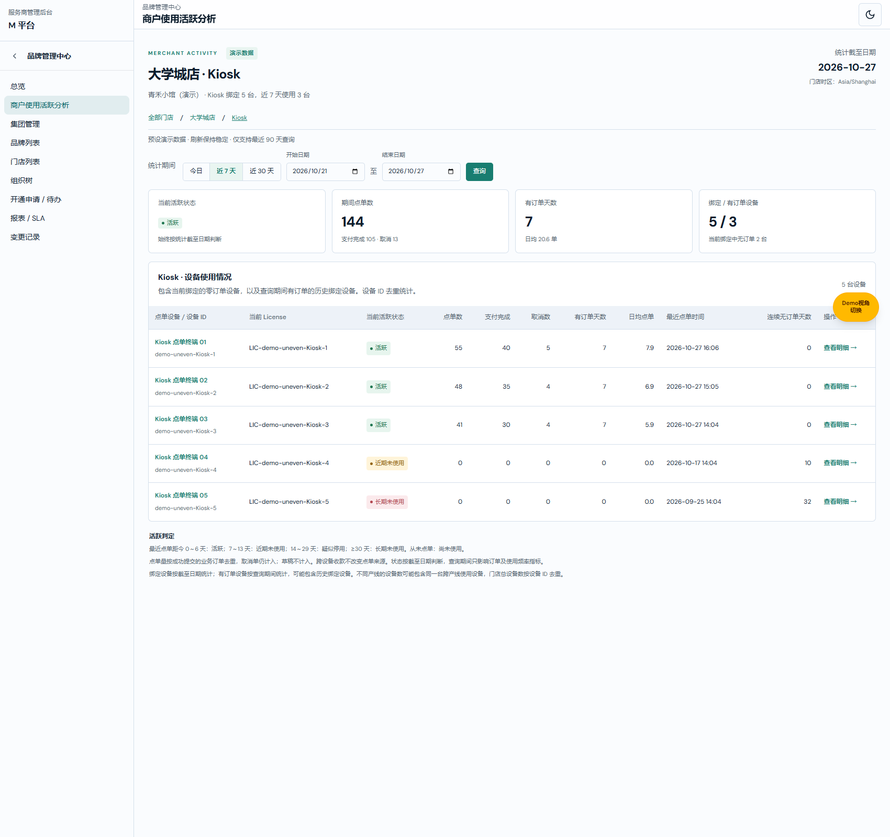

图注：返回产线设备列表／操作后及结果；2026-10-27，功能分支 Demo V1.0，起始 main@64ddec8f，统计截至日 2026-10-27，受控演示数据。

| 字段 | 逻辑说明 |
| --- | --- |
| 触发入口 | 位置导航 → Kiosk |
| 对象与前置条件 | 在有效角色权限下查看本模块；权限限制场景按该项指定的隔离角色前置。 |
| 处理与结果 | 返回同一门店的 Kiosk 设备列表，保留有效统计期。 |
| 写入、失败及取消 | 无业务数据写入。校验失败不应用新查询；权限失败不渲染分析内容；导航无二次确认，原生日期选择器可关闭。 |

### A22 返回门店产线列表

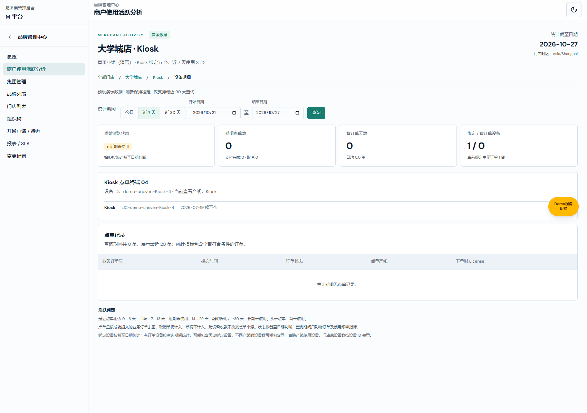

图注：返回门店产线列表／入口或操作前；2026-10-27，功能分支 Demo V1.0，起始 main@64ddec8f，统计截至日 2026-10-27，受控演示数据。

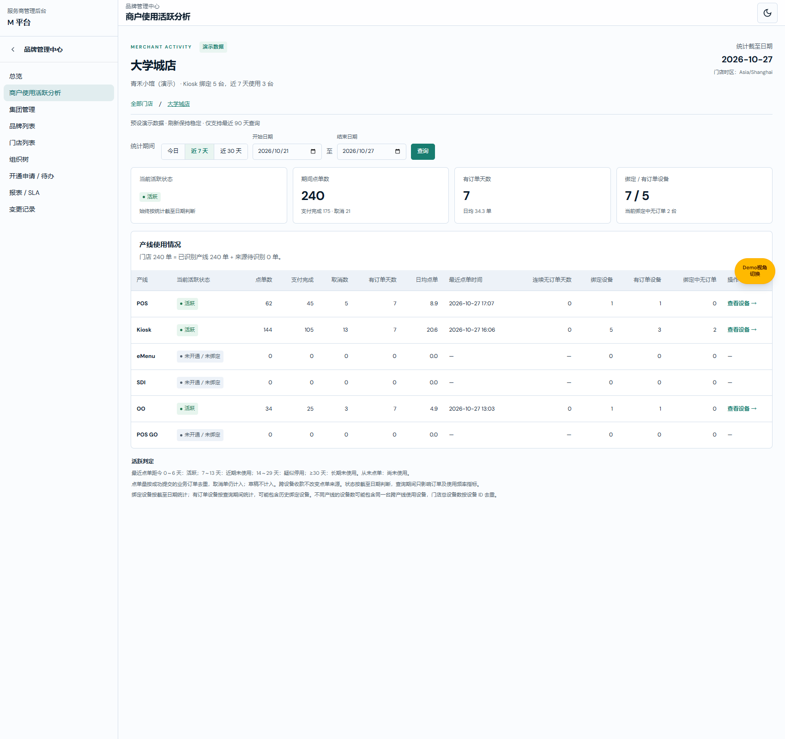

图注：返回门店产线列表／操作后及结果；2026-10-27，功能分支 Demo V1.0，起始 main@64ddec8f，统计截至日 2026-10-27，受控演示数据。

| 字段 | 逻辑说明 |
| --- | --- |
| 触发入口 | 位置导航 → 大学城店 |
| 对象与前置条件 | 在有效角色权限下查看本模块；权限限制场景按该项指定的隔离角色前置。 |
| 处理与结果 | 返回同一门店六条产线，保留有效统计期。 |
| 写入、失败及取消 | 无业务数据写入。校验失败不应用新查询；权限失败不渲染分析内容；导航无二次确认，原生日期选择器可关闭。 |

### A23 返回全部门店

图注：返回全部门店／入口或操作前；2026-10-27，功能分支 Demo V1.0，起始 main@64ddec8f，统计截至日 2026-10-27，受控演示数据。

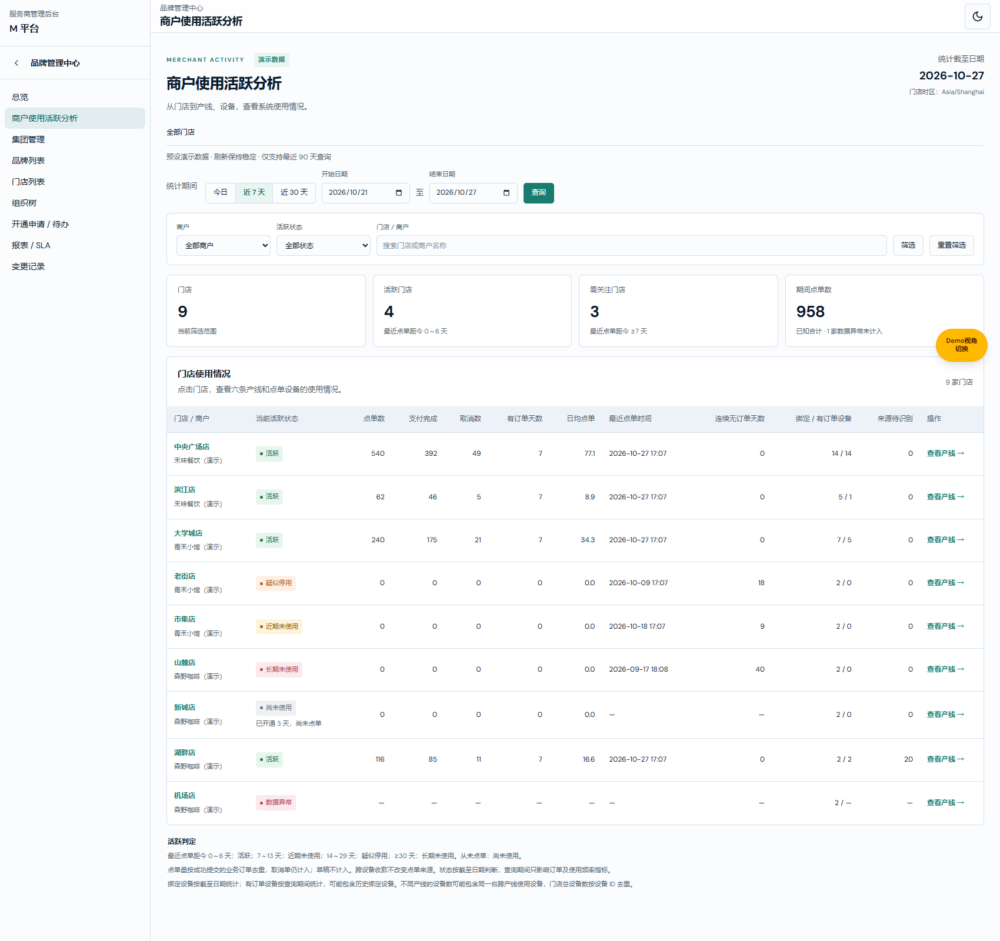

图注：返回全部门店／操作后及结果；2026-10-27，功能分支 Demo V1.0，起始 main@64ddec8f，统计截至日 2026-10-27，受控演示数据。

| 字段 | 逻辑说明 |
| --- | --- |
| 触发入口 | 位置导航 → 全部门店 |
| 对象与前置条件 | 在有效角色权限下查看本模块；权限限制场景按该项指定的隔离角色前置。 |
| 处理与结果 | 恢复根列表，保留当前页面会话内已应用筛选和有效统计期。 |
| 写入、失败及取消 | 无业务数据写入。校验失败不应用新查询；权限失败不渲染分析内容；导航无二次确认，原生日期选择器可关闭。 |

### A24 无效明细返回列表

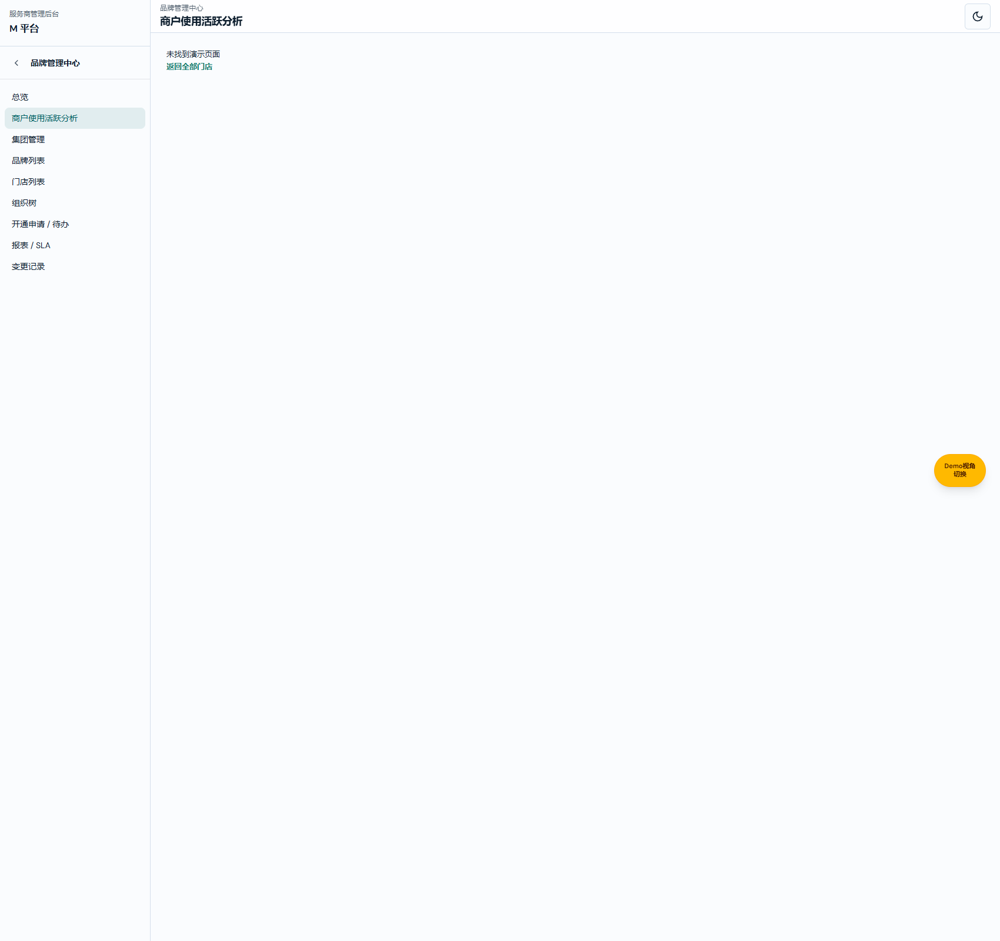

图注：无效明细返回列表／入口或操作前；2026-10-27，功能分支 Demo V1.0，起始 main@64ddec8f，统计截至日 2026-10-27，受控演示数据。

图注：无效明细返回列表／操作后及结果；2026-10-27，Demo V1.3，功能基线 main@a7ca5874。

| 字段 | 逻辑说明 |
| --- | --- |
| 触发入口 | 未找到演示页面 → 返回全部门店 |
| 对象与前置条件 | 在有效角色权限下查看本模块；权限限制场景按该项指定的隔离角色前置。 |
| 处理与结果 | 无效 ID、非法产线或不属于所选门店产线的设备，显示未找到；返回时不产生写入。 |
| 写入、失败及取消 | 无业务数据写入。校验失败不应用新查询；权限失败不渲染分析内容；导航无二次确认，原生日期选择器可关闭。 |

### A25 只读角色筛选与钻取

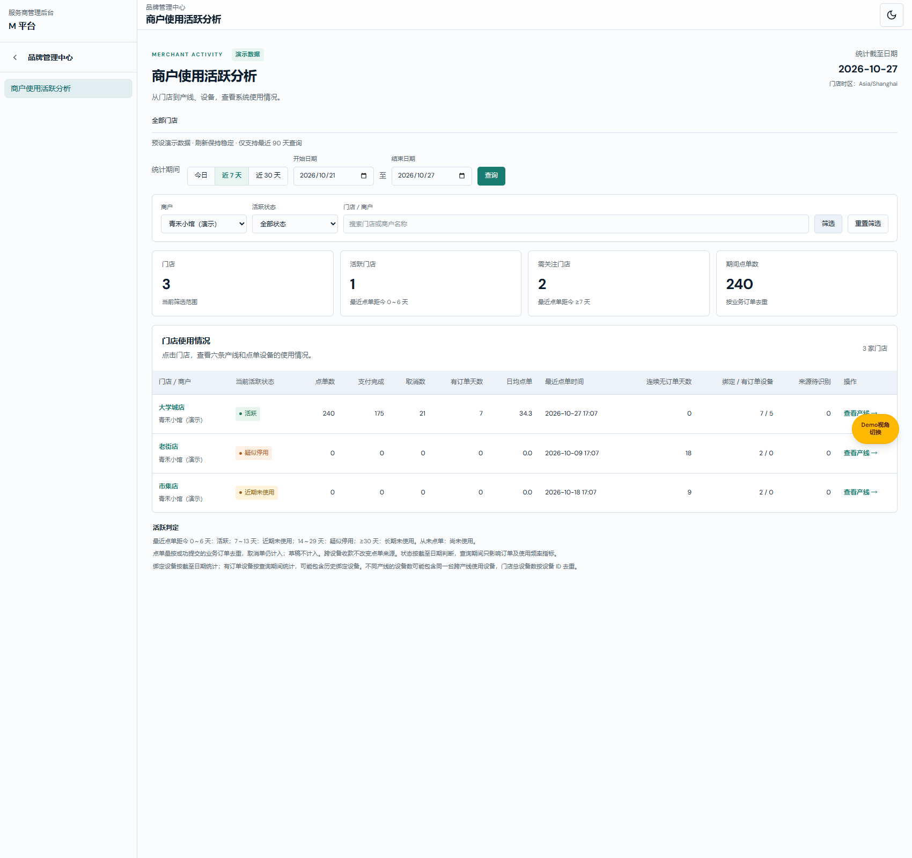

图注：只读角色筛选与钻取／入口或操作前；2026-10-27，功能分支 Demo V1.0，起始 main@64ddec8f，统计截至日 2026-10-27，受控演示数据。

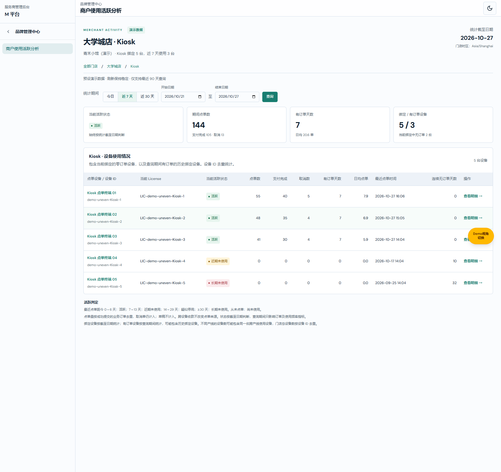

图注：只读角色筛选与钻取／操作后及结果；2026-10-27，功能分支 Demo V1.0，起始 main@64ddec8f，统计截至日 2026-10-27，受控演示数据。

| 字段 | 逻辑说明 |
| --- | --- |
| 触发入口 | 隔离演示角色仅授予本模块及页面可见权限 |
| 对象与前置条件 | 在有效角色权限下查看本模块；权限限制场景按该项指定的隔离角色前置。 |
| 处理与结果 | 筛选不被写操作守卫拦截，可打开设备列表；受控权限数据仅用于验收，已恢复。 |
| 写入、失败及取消 | 无业务数据写入。校验失败不应用新查询；权限失败不渲染分析内容；导航无二次确认，原生日期选择器可关闭。 |

### A26 无权限直达明细

图注：无权限直达明细／入口或操作前；2026-10-27，功能分支 Demo V1.0，起始 main@64ddec8f，统计截至日 2026-10-27，受控演示数据。

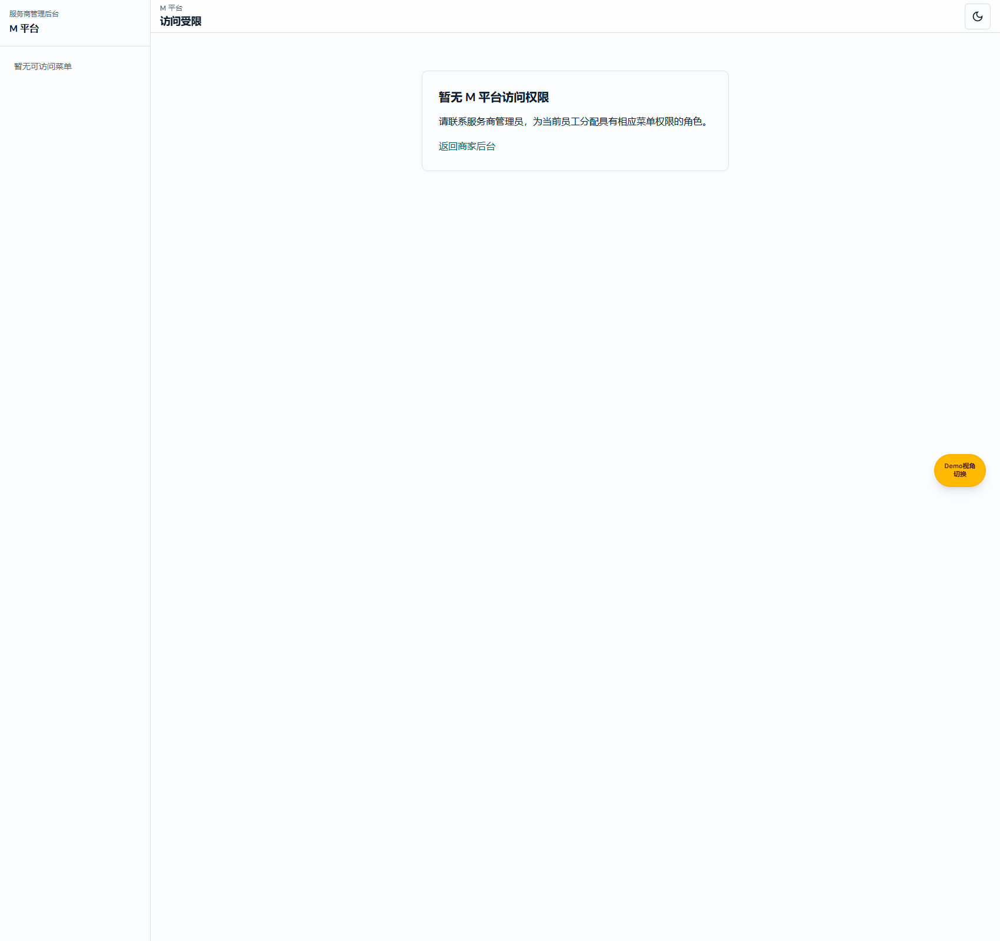

图注：无权限直达明细／操作后及结果；2026-10-27，功能分支 Demo V1.0，起始 main@64ddec8f，统计截至日 2026-10-27，受控演示数据。

| 字段 | 逻辑说明 |
| --- | --- |
| 触发入口 | 隔离角色移除本页面权限后刷新明细地址 |
| 对象与前置条件 | 在有效角色权限下查看本模块；权限限制场景按该项指定的隔离角色前置。 |
| 处理与结果 | 显示暂无 M 平台访问权限，分析数据不渲染；不会因已有地址绕过角色权限。 |
| 写入、失败及取消 | 无业务数据写入。校验失败不应用新查询；权限失败不渲染分析内容；导航无二次确认，原生日期选择器可关闭。 |

### A27 打开始日期日历

图注：打开始日期日历／入口或操作前；2026-10-27，Demo V1.3，功能基线 main@a7ca5874。

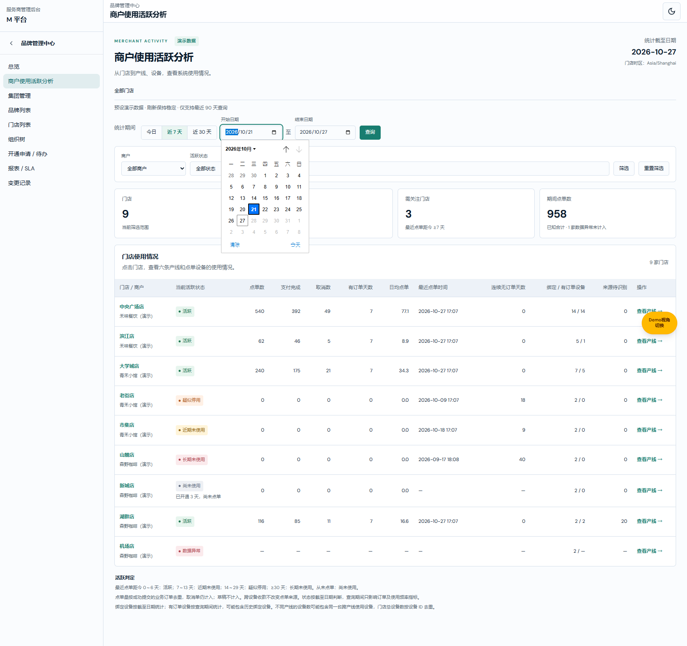

图注：打开始日期日历／操作后及结果；2026-10-27，功能分支 Demo V1.0，起始 main@64ddec8f，统计截至日 2026-10-27，受控演示数据。

| 字段 | 逻辑说明 |
| --- | --- |
| 触发入口 | 开始日期 → 原生日历入口 |
| 对象与前置条件 | 在有效角色权限下查看本模块；权限限制场景按该项指定的隔离角色前置。 |
| 处理与结果 | 展示浏览器原生日历；选择日期只编辑输入值，点击查询才应用。截图来自实际 Chromium 日历。 |
| 写入、失败及取消 | 无业务数据写入。校验失败不应用新查询；权限失败不渲染分析内容；导航无二次确认，原生日期选择器可关闭。 |

### A28 打开结束日期日历

图注：打开结束日期日历／入口或操作前；2026-10-27，Demo V1.3，功能基线 main@a7ca5874。

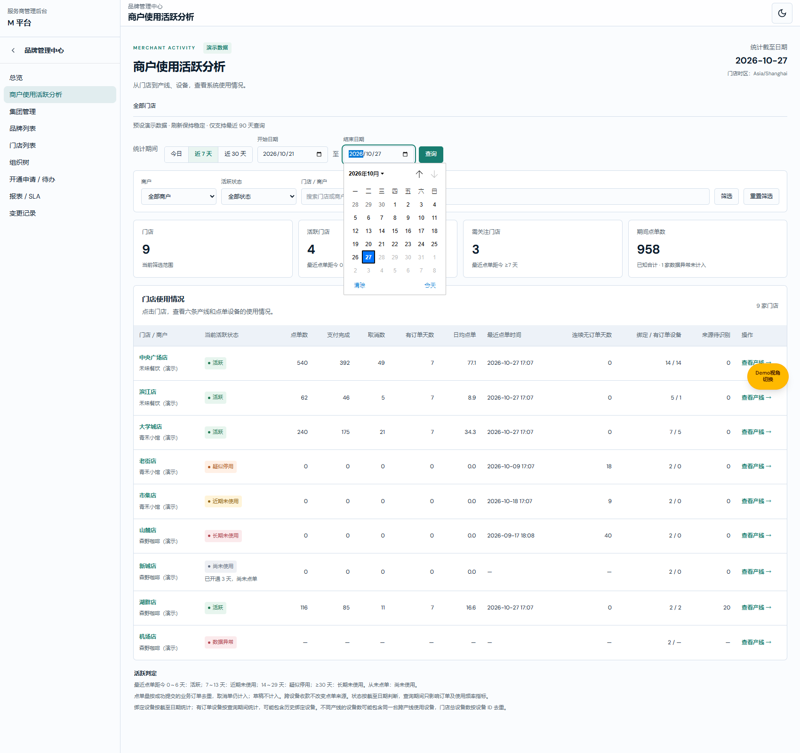

图注：打开结束日期日历／操作后及结果；2026-10-27，功能分支 Demo V1.0，起始 main@64ddec8f，统计截至日 2026-10-27，受控演示数据。

| 字段 | 逻辑说明 |
| --- | --- |
| 触发入口 | 结束日期 → 原生日历入口 |
| 对象与前置条件 | 在有效角色权限下查看本模块；权限限制场景按该项指定的隔离角色前置。 |
| 处理与结果 | 展示结束日期原生日历；上界为截至日期，下界为最近 90 天起日。 |
| 写入、失败及取消 | 无业务数据写入。校验失败不应用新查询；权限失败不渲染分析内容；导航无二次确认，原生日期选择器可关闭。 |

### A29 关闭日期日历

图注：关闭日期日历／入口或操作前；2026-10-27，功能分支 Demo V1.0，起始 main@64ddec8f，统计截至日 2026-10-27，受控演示数据。

图注：关闭日期日历／操作后及结果；2026-10-27，Demo V1.3，功能基线 main@a7ca5874。

| 字段 | 逻辑说明 |
| --- | --- |
| 触发入口 | 日历展开 → Escape 或点击日历外 |
| 对象与前置条件 | 在有效角色权限下查看本模块；权限限制场景按该项指定的隔离角色前置。 |
| 处理与结果 | 关闭原生日历，不提交查询；未选择新日期时有效查询不变。 |
| 写入、失败及取消 | 无业务数据写入。校验失败不应用新查询；权限失败不渲染分析内容；导航无二次确认，原生日期选择器可关闭。 |

### A30 返回导航父层

图注：返回导航父层／入口或操作前；2026-10-27，Demo V1.3，功能基线 main@a7ca5874。

图注：返回导航父层／操作后及结果；2026-10-27，Demo V1.2，功能基线 main@5b57958c。

| 字段 | 逻辑说明 |
| --- | --- |
| 触发入口 | 使用活跃分析导航 → 返回上一级菜单 |
| 对象与前置条件 | 在有效角色权限下查看本模块；权限限制场景按该项指定的隔离角色前置。 |
| 处理与结果 | 仅返回 M 平台导航父层，分析页面内容与筛选不变。复用公共滑层。 |
| 写入、失败及取消 | 无业务数据写入。校验失败不应用新查询；权限失败不渲染分析内容；导航无二次确认，原生日期选择器可关闭。 |

### A31 打开活跃分析导航子层

图注：打开活跃分析导航子层／入口或操作前；2026-10-27，Demo V1.2，功能基线 main@5b57958c。

图注：打开活跃分析导航子层／操作后及结果；2026-10-27，Demo V1.3，功能基线 main@a7ca5874。

| 字段 | 逻辑说明 |
| --- | --- |
| 触发入口 | M 平台导航 → 使用活跃分析 |
| 对象与前置条件 | 在有效角色权限下查看本模块；权限限制场景按该项指定的隔离角色前置。 |
| 处理与结果 | 子层覆盖父导航，展示可访问叶子；整行点击，不内嵌展开。 |
| 写入、失败及取消 | 无业务数据写入。校验失败不应用新查询；权限失败不渲染分析内容；导航无二次确认，原生日期选择器可关闭。 |

## 页面状态与演示场景

### 六产线正常使用

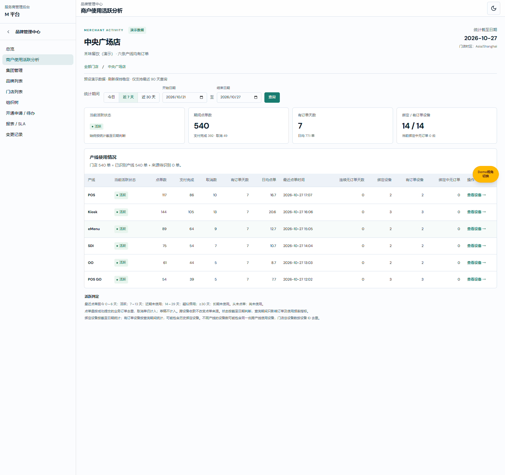

图注：六产线正常使用／预设受控演示；2026-10-27，功能分支 Demo V1.0，起始 main@64ddec8f，统计截至日 2026-10-27，受控演示数据。

| 字段 | 逻辑说明 |
| --- | --- |
| 状态说明 | 中央广场店六条产线均有近期订单。 |
| 统计与展示 | 按统一业务口径计算，不以页面截图数量替代规则或订单汇总核对。 |

### 同门店产线状态不同

图注：同门店产线状态不同／预设受控演示；2026-10-27，功能分支 Demo V1.0，起始 main@64ddec8f，统计截至日 2026-10-27，受控演示数据。

| 字段 | 逻辑说明 |
| --- | --- |
| 状态说明 | 滨江店 POS 活跃、Kiosk 近期未使用、eMenu 疑似停用、SDI 长期未使用、POS GO 尚未使用、OO 未开通。 |
| 统计与展示 | 按统一业务口径计算，不以页面截图数量替代规则或订单汇总核对。 |

### 首次使用前

图注：首次使用前／预设受控演示；2026-10-27，功能分支 Demo V1.0，起始 main@64ddec8f，统计截至日 2026-10-27，受控演示数据。

| 字段 | 逻辑说明 |
| --- | --- |
| 状态说明 | 新城店已开通 3 天，点单数量为 0、最近点单为 —、状态尚未使用。 |
| 统计与展示 | 按统一业务口径计算，不以页面截图数量替代规则或订单汇总核对。 |

### 设备期间无订单

图注：设备期间无订单／预设受控演示；2026-10-27，功能分支 Demo V1.0，起始 main@64ddec8f，统计截至日 2026-10-27，受控演示数据。

| 字段 | 逻辑说明 |
| --- | --- |
| 状态说明 | 终端 04 期间为 0 单，但全历史距最近点单 10 天，属于近期未使用。 |
| 统计与展示 | 按统一业务口径计算，不以页面截图数量替代规则或订单汇总核对。 |

### 近期未使用

图注：近期未使用／预设受控演示；2026-10-27，功能分支 Demo V1.0，起始 main@64ddec8f，统计截至日 2026-10-27，受控演示数据。

| 字段 | 逻辑说明 |
| --- | --- |
| 状态说明 | 市集店最近点单距今 9 天，近 7 天为 0 单。 |
| 统计与展示 | 按统一业务口径计算，不以页面截图数量替代规则或订单汇总核对。 |

### 疑似停用

图注：疑似停用／预设受控演示；2026-10-27，功能分支 Demo V1.0，起始 main@64ddec8f，统计截至日 2026-10-27，受控演示数据。

| 字段 | 逻辑说明 |
| --- | --- |
| 状态说明 | 老街店距最近点单 18 天；不代表真实停业。 |
| 统计与展示 | 按统一业务口径计算，不以页面截图数量替代规则或订单汇总核对。 |

### 长期未使用

图注：长期未使用／预设受控演示；2026-10-27，功能分支 Demo V1.0，起始 main@64ddec8f，统计截至日 2026-10-27，受控演示数据。

| 字段 | 逻辑说明 |
| --- | --- |
| 状态说明 | 山麓店距最近点单 40 天；近 30 天也无订单。 |
| 统计与展示 | 按统一业务口径计算，不以页面截图数量替代规则或订单汇总核对。 |

### 来源待识别

图注：来源待识别／预设受控演示；2026-10-27，功能分支 Demo V1.0，起始 main@64ddec8f，统计截至日 2026-10-27，受控演示数据。

| 字段 | 逻辑说明 |
| --- | --- |
| 状态说明 | 湖畔店近 7 天门店 116 单 = POS 与 OO 合计 96 单 + 待识别 20 单。 |
| 统计与展示 | 按统一业务口径计算，不以页面截图数量替代规则或订单汇总核对。 |

### 数据异常

图注：数据异常／预设受控演示；2026-10-27，功能分支 Demo V1.0，起始 main@64ddec8f，统计截至日 2026-10-27，受控演示数据。

| 字段 | 逻辑说明 |
| --- | --- |
| 状态说明 | 机场店已知绑定数量可显示；订单和使用数量显示 —，不按零处理。 |
| 统计与展示 | 按统一业务口径计算，不以页面截图数量替代规则或订单汇总核对。 |

### 历史产线归属

图注：历史产线归属／预设受控演示；2026-10-27，功能分支 Demo V1.0，起始 main@64ddec8f，统计截至日 2026-10-27，受控演示数据。

| 字段 | 逻辑说明 |
| --- | --- |
| 状态说明 | 同一设备在 eMenu 与 POS GO 间切换，下单时归属保留；eMenu 近 30 天可见历史绑定设备，当前 License 标记为历史绑定。 |
| 统计与展示 | 按统一业务口径计算，不以页面截图数量替代规则或订单汇总核对。 |

## A32 异常门店查看设备

图注：异常门店查看设备入口；2026-10-27，受控 Demo V1.0，main@64ddec8f。

图注：异常门店查看设备结果；2026-10-27，受控 Demo V1.0，main@64ddec8f。

| 字段 | 逻辑说明 |
| --- | --- |
| 入口 | 机场店 → POS → 查看设备 |
| 结果 | 已知绑定设备可见，订单与有订单设备指标显示 —，不展示为真实零订单。 |
| 写入、确认与取消 | 无业务写入，无确认弹框；位置导航可返回。 |

## A33 异常设备查看明细

图注：异常设备查看明细入口；2026-10-27，受控 Demo V1.0，main@64ddec8f。

图注：异常设备查看明细结果；2026-10-27，受控 Demo V1.0，main@64ddec8f。

| 字段 | 逻辑说明 |
| --- | --- |
| 入口 | 机场店 POS 终端 → 查看明细 |
| 结果 | 设备资产和绑定可见，点单记录显示暂不可用；不显示查询期间共 0 单或无点单记录。 |
| 写入、确认与取消 | 无业务写入，无确认弹框；位置导航可返回。 |
