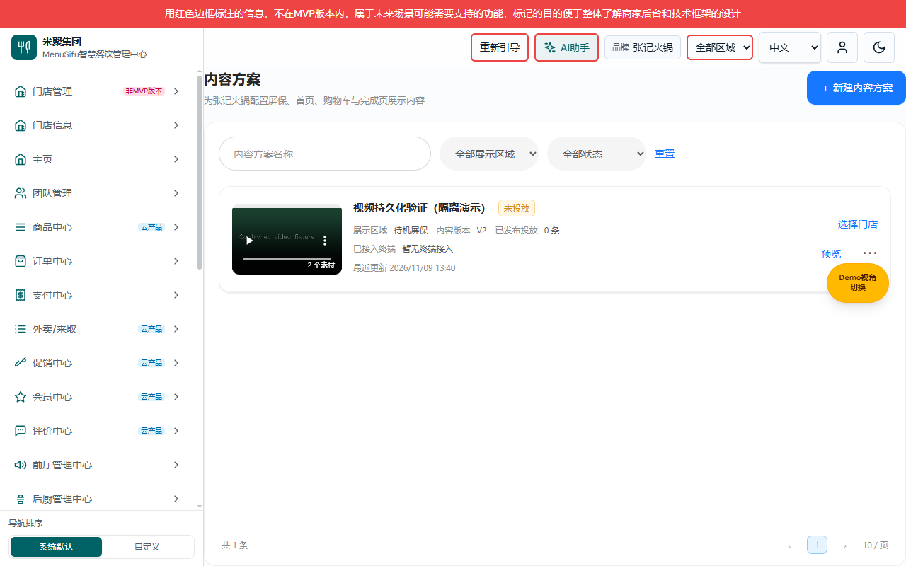
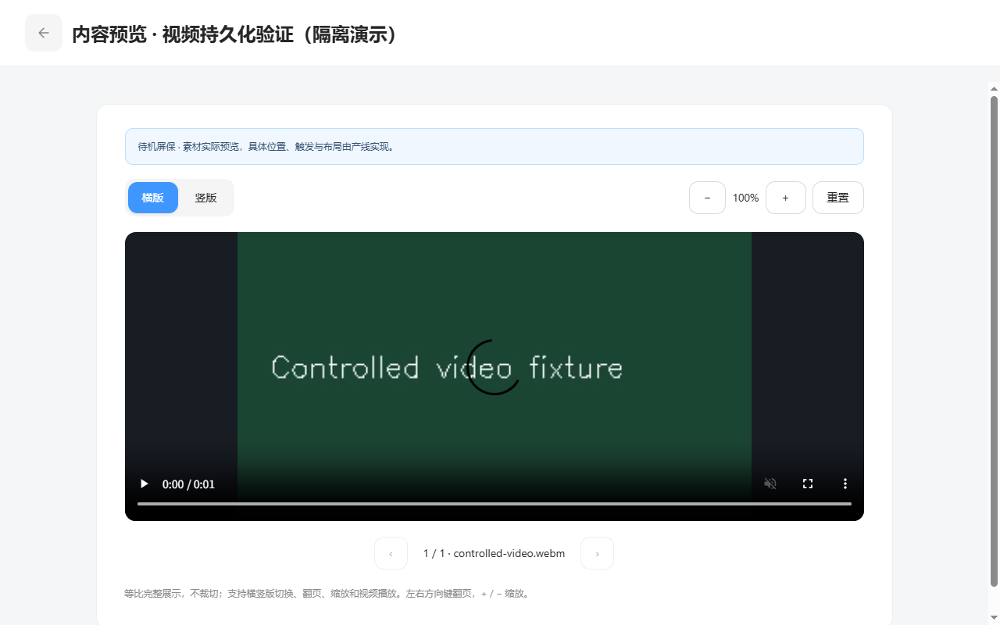

# 展示内容交付缺口与逐操作截图清单

版本V1.6；变更MARKETING-AD-COPY-20261109-07；2026-11-09。配套：[产品V1.6](展示内容产品权威需求文档.md) · [研发V1.6](展示内容业务规格说明书（研发交付版）.md) · [个人规范V1.6](展示内容需求文档（个人规范版）.md)。

## V1.6 广告文案验收

基线main@13d51d69，分支codex/marketing-ad-copy-20261109；整合状态以Git记录及交付回复为准；实际目录C:/Users/27273/.codex/worktrees/marketing-ad-copy-20261109/new-bp/admin-web；功能预览5309，PID37856。远端main本轮fetch为2d7893b4，本地main保留已合并未推送功能。

范围仅导航／权限显示名和原HTML广告流程的文案与适用说明；原路由、存储键、字段、用户数据和素材分类不变。位置、全屏、权限、公共递归导航及TypeScript检查通过；HTML内联脚本和重叠助手语法检查通过。实际页面证据：[导航](assets/v16-ad-navigation.png)、[空列表](assets/v16-ad-list.png)、[新建](assets/v16-ad-create.png)、[编辑](assets/v16-ad-edit.png)、[渠道](assets/v16-ad-channels.png)。菜单、页头、iframe标题及广告名称筛选已核验。编辑使用qa-copy隔离演示数据，不改真实账户数据。门店、时间、预览／删除／重叠确认的当前文案截图未采，源码文案已核对；本次未重走媒体上传、保存和终端播放。旧截图保持原版本来源，不作为当前改名证据。

## V1.5 展示位置验收

分支 codex/marketing-display-positions-20261109，基线 main@ee9bd75c；提交与整合状态以 Git 记录及交付回复为准；当前工作区 marketing-display-positions-20261109/new-bp/admin-web。远端 main 本轮 fetch 为2d7893b4，本地main保留已合并未推送成果。

当前范围为原屏保 HTML 配置及浏览器持久化，不代表真实设备已支持首页展示。原内容方案／投放管理未增加同名选项；原重叠规则仍按门店、渠道、时间判定，本轮不增加位置冲突维度。原静态页“原封不动”的描述只对应V1.3入口恢复；V1.5所涉及渠道、时间及临时选择清理代码按本节扩展。

位置助手测试通过：默认空、多选去重、空选优先、主题隔离、保存回显、历史字段缺失、存储异常；原全屏流程回归通过。嵌入静态HTML直接由本次worktree的Vite服务5308提供，PID26252，未修改宿主或eMenu源码，无需重建嵌入包。

| 操作／状态 | 证据与结果 |
| --- | --- |
| 新建默认空 | [截图](assets/v15-position-empty.png)，两组均空、下一步禁用 |
| 位置必选 | [截图](assets/v15-position-required.png)，仅Kiosk时下一步禁用 |
| 单选与半选 | [截图](assets/v15-position-single.png)，首页单选可下一步，全选半选 |
| 全选／取消全选 | [全选](assets/v15-position-all.png)，仅改变两位置；取消后为空且禁用下一步，DOM状态已核验 |
| 渠道必选 | 位置首页有值、渠道全空，下一步仍禁用；DOM状态核验，单独截图未采 |
| 刷新及返回 | [返回截图](assets/v15-position-return.png)，从时间页返回保留首页；全选后刷新也保留 |
| 绕过校验 | [截图](assets/v15-position-save-block.png)，隔离QA在时间页主动清空临时位置，点保存被拦截，主题未写入 |
| 保存成功 | [截图](assets/v15-position-save-success.png)，实际点保存后返回列表；读取原kiosk_themes验证distributePositions和lastDistributePrefs.positions均为screensaver/home，临时位置已清理 |
| 保存后回显 | [截图](assets/v15-position-saved-restore.png)，重新指定同一QA主题入口，渠道Kiosk与两位置回显 |
| 窄屏 | [390×844截图](assets/v15-position-mobile.png)，documentElement.scrollWidth与innerWidth均390，无横向溢出 |

保存测试使用独立浏览器会话的QA主题qa-positions和QA-POS-001门店，均为临时造数，不是实际门店。日期通过DOM值与input/change事件填写，位置选择、下一步、保存走真实UI；未写持久化位置伪造保存结果。未验收真实终端播放、服务端接口、位置维度冲突策略；既有媒体上传和上下架流程不在本次回归范围。

## V1.4 菜单名称验收

分支 codex/marketing-advertising-label-20261109，起始 main@ec4c1c67；整合状态以 Git 记录及交付回复为准。实际目录 C:/Users/27273/.codex/worktrees/marketing-advertising-label-20261109/new-bp/admin-web；端口5307，PID33832。远端main本轮fetch为2d7893b4，本地main保留已合并未推送成果。

父菜单与子导航标题“营销广告”已在真实页面验证，三个子菜单保持。中文与英文、模块归属文案同步；原路由、权限键、业务代码及静态资源无改动。公共递归菜单、营销权限回归和TypeScript检查通过。证据：[父菜单](assets/v14-marketing-parent.png)、[子导航](assets/v14-marketing-subnav.png)。本轮仅验收名称，既有业务流程缺口仍保留于下文。

## V1.3 原屏保入口验收

本分支 codex/marketing-legacy-screensaver-20261109，起始 main@4f572e92；提交与整合状态以 Git 记录及交付回复为准。目录 C:/Users/27273/.codex/worktrees/marketing-legacy-screensaver-20261109/new-bp/admin-web；服务5306，PID30664。远端 main 本轮 fetch 为2d7893b4，本地 main 含已合并未推送的展示内容功能。

| 验证 | 结果／证据 |
| --- | --- |
| 三个二级菜单 | 内容方案、投放管理、屏保均可进入；屏保选中高亮。[截图](assets/v13-legacy-navigation.png) |
| 原页面入口 | /marketing/screensaver 保持原路径，iframe进入原列表；隔离源无旧屏保，显示空列表。 |
| 新建及返回 | 点击原新建进入原编辑页，全屏类已验证；返回列表退出全屏。[截图](assets/v13-legacy-create.png) |
| 原文件完整性 | git diff --exit-code 4f572e92 -- dist/Configuration\ center，无差异。 |
| 自动校验 | 原全屏流程、营销权限只读／编辑／隐藏、公共递归菜单、展示内容域、参考投放流程、TypeScript通过。宿主构建成功，产物仅在D盘任务临时目录。 |
| 本轮未覆盖 | 未完成媒体上传、编辑已有记录、门店／渠道／时间、保存及上下架全流程；原文件保持不变，既有规则测试不等于上述操作验收。 |

## 既有内容方案与投放验收证据

当前为原生三步配置：选择门店→选择渠道→展示生效时间，保存后弹框确认。采用用户三张截图的全宽双卡、624px居中卡、公共页头与进度线；参考图片及示例不是实现证据，[来源记录](验证记录/V1.2参考与验收.md)单独保存。

功能分支codex/marketing-display-regions-20261109，起始e16c7f90。Git整合状态以仓库提交记录及本次交付回复为准。实际目录 `C:/Users/27273/.codex/worktrees/marketing-display-regions-20261109/new-bp/admin-web`；功能服务端口5298，进程36348，从同一检出启动。远端main在本次fetch时为2d7893b4，本分支未自动合并或rebase。

V1.2主要图片1920×911，另有1280×800复验。隔离演示merchant-zhangji的两家授权门店、Kiosk/OO接入登记仅为QA，非生产数据或设备能力承诺。日期输入通过DOM值与input事件自动填写，保存及校验走实际UI，不改持久化记录伪造成功。此前V1.1媒体、编辑等未变化页面保留原版本来源图片。

## 逐操作覆盖

图片为索引，正文就近配图；未采状态明确标记，未声明全操作截图完整。

| 页面 | 操作 | 图片 | 验证及缺口 |
| --- | --- | --- | --- |
| 内容列表 | 更多菜单/编辑/选择门店 | [图片](assets/v11-content-menu.png) | 已验证；更多菜单复用原屏保样式 |
| 内容列表 | 复制 | [图片](assets/v11-duplicate-success.png) | 已验证新V1草稿，不复制投放 |
| 内容列表 | 删除确认/取消/成功/有效投放拦截 | [确认](assets/v11-delete-confirm.png) / [取消](assets/v11-delete-cancel.png) / [成功](assets/v11-delete-success.png) | 确认、取消和无投放内容删除成功已验证；有效投放拦截域测试通过，UI拦截图待补 |
| 内容列表 | 名称、区域、状态筛选与重置 | 待补页面图片 | 实现沿用；新版本逐筛选前后图待补 |
| 内容编辑 | 新建与横竖分区 | [图片](assets/v11-content-create.png) | 已验证 |
| 内容编辑 | 填写参数并保存 | [图片](assets/v11-editor-filled.png) | 素材库内容成功保存并投放；fade保存值需独立终端展示验证 |
| 内容编辑 | 切换区域 | 待补页面图片 | 实现；不兼容比例转通用分组，前后图待补 |
| 内容编辑 | 切换图片视频确认 | [图片](assets/v11-media-type-confirm.png) | 已验证 |
| 内容编辑 | 取消类型切换 | [图片](assets/v11-media-type-cancel.png) | 已验证保留原素材 |
| 内容编辑 | 类型确认后清除当前比例素材 | [图片](assets/v11-video-source.png) | 已验证进入视频上传 |
| 内容编辑 | 移除/前移/后移 | 待补页面图片 | 实现；素材移除已操作，逐步前后截图待补 |
| 内容编辑 | 返回未保存确认与取消 | 待补页面图片 | 公共既定保护，V1.0已验证；新布局截图待补 |
| 上传 | 来源弹框 | [图片](assets/v11-upload-source.png) | 已验证 |
| 上传 | 素材库分类/多选/取消选择 | [图片](assets/v11-material-library.png) | 分类数据已显示，多选已操作；分类筛选及取消选择单独图待补 |
| 上传 | 确定素材 | [图片](assets/v11-material-selected.png) | 已验证两竖一横，返回编辑并成功保存 |
| 上传 | 取消素材选择 | 待补页面图片 | 实现；独立结果图待补 |
| 上传 | 本地图片/同步素材库/原生取消 | [同步选择](assets/v11-upload-copy-library.png) / [图片加入](assets/v11-local-image-upload.png) | 实际本地图片上传、保存及同步屏保素材分类已验证；原生取消/失败截图待补 |
| 上传 | 视频来源/禁用素材库 | [图片](assets/v11-video-source.png) | 已验证 |
| 上传 | 视频超过20MB | [图片](assets/v11-video-size-error.png) | 受控21MB文件已拦截 |
| 上传 | 视频上传保存与刷新播放 | [图片](assets/v11-video-upload.png) | 实际视频上传、保存、刷新与播放通过，播放见v11-video-preview.png |
| 预览 | 打开/比例切换 | [图片](assets/v11-preview-portrait.png) | 已验证 |
| 预览 | 横版完整适配 | [图片](assets/v11-preview-landscape.png) | 已验证100% contain完整显示 |
| 预览 | 翻页与放大 | [图片](assets/v11-preview-zoom.png) | 已验证 |
| 预览 | 缩小/重置/键盘/关闭 | 待补页面图片 | 关闭已操作，键盘/缩小重置逐操作图待补 |
| 预览 | 视频播放 | [图片](assets/v11-video-preview.png) | 有效VP8文件刷新后play成功，duration1.5秒、readyState4 |
| 投放列表 | 投放记录与状态 | [图片](assets/v11-placements.png) | 已验证 |
| 投放列表 | 整体上下架确认/取消/结果 | 待补页面图片 | 既有发布撤销机制及域测试；新文案界面图待补 |
| 投放列表 | 编辑草稿/再次投放 | 待补页面图片 | 实现；新截图待补 |
| 投放列表 | 详情快照 | 待补页面图片 | 域快照回归通过；新布局图待补 |
| 关联门店 | 打开/关闭 | [图片](assets/v11-associated-stores.png) | 已验证 |
| 关联门店 | 名称MID搜索 | [图片](assets/v11-associated-search.png) | 已验证 |
| 关联门店 | 生效状态筛选 | 待补页面图片 | 实现；新结果图待补 |
| 关联门店 | 单目标下架确认 | [图片](assets/v11-store-line-confirm.png) | 已验证 |
| 关联门店 | 单目标下架成功 | [图片](assets/v11-store-line-disabled.png) | 已验证上海Kiosk下架，广州不受影响 |
| 关联门店 | 单目标取消/重新上架/冲突 | 待补页面图片 | 域测试含重叠替代投放后重新上架拒绝；新界面图待补 |
| 公共 | 门店/品牌权限、只读、并发与存储损坏 | 待补页面图片 | 域与营销权限回归；实际只读账号/并发错误图待补 |
| 公共 | 分页上/下页 | 待补页面图片 | 首尾禁用沿用；多页切换图待补 |
| 平台区域 | 区域/接入/停用启用 | [图片](assets/regions-final.png) | V1.0实际证据仍适用于未改字段；新增transition勾选新图待补 |
| 旧数据 | 完整素材/IndexedDB解析/幂等 | 待补页面图片 | 实现与域测试；当前实际导入界面图待补 |
| 门店配置 | 空选择/下一步禁用 | [图片](assets/v12-stores-empty.png) | 已验证 |
| 门店配置 | 当前页全选/取消 | [图片](assets/v12-stores.png) | 已验证；跨页23门店由纯逻辑测试覆盖，真实UI授权只有2店 |
| 门店配置 | 搜索名称MID | [图片](assets/v12-store-search.png) | 已验证筛选外已选保留 |
| 门店配置 | 重置 | [图片](assets/v12-stores.png) | 已验证回第一页且选择保留 |
| 门店配置 | 移除单店 | [图片](assets/v12-store-remove.png) | 已验证数量和勾选同步 |
| 门店配置 | 无结果 | [图片](assets/v12-store-no-match.png) | 已验证0结果、已选不清空 |
| 门店配置 | 分页前后页 | [图片](assets/v12-stores.png) | 首尾禁用已采；跨页UI多店图待补，分页/选择逻辑测试通过 |
| 门店配置 | 地址邮编 | [图片](assets/v12-stores.png) | 真实元数据；邮编缺失—，无示例88条 |
| 渠道配置 | 禁用和空选择 | [图片](assets/v12-channels-empty.png) | 已验证灰色未接入项和禁用下一步 |
| 渠道配置 | 单选/全选 | [图片](assets/v12-channels.png) | 已验证Kiosk/OO选择和蓝色状态；仅可用项全选 |
| 渠道配置 | 返回门店 | [图片](assets/v12-stores-preserved.png) | 已验证保留完整集合 |
| 时间配置 | 日期时分空态 | [图片](assets/v12-time-empty.png) | 已验证4个原生输入，右上保存 |
| 时间配置 | 此刻 | [图片](assets/v12-time-now.png) | 已验证开始日期时分更新 |
| 时间配置 | 时区展开/折叠 | [图片](assets/v12-timezone.png) | 已验证六时区入口；实际切换结果图待补 |
| 时间配置 | 不完整日期错误 | [图片](assets/v12-time-error.png) | 已验证输入保留 |
| 时间配置 | 返回及再次进入 | [图片](assets/v12-time-preserved.png) | 已验证；渠道/门店亦保留 |
| 保存 | 确认摘要 | [图片](assets/v12-save-confirm.png) | 已验证不是独立第四步 |
| 保存 | 取消 | [图片](assets/v12-save-cancel.png) | 已验证停留时间页 |
| 保存 | 确定保存成功 | [图片](assets/v12-save-success.png) | 最终独立会话中，界面新增内容、选素材、3步配置、确认保存成功，已重采当前结果 |
| 保存 | 排期冲突 | [图片](assets/v12-save-conflict.png) | 已验证相同目标/区域重叠拒绝，输入保留 |
| 保存 | 结果管理列表 | [图片](assets/v12-placement-result.png) | 已验证发布时间/范围/状态 |
| 公共页头 | 33%/67%/100%进度和80px页头 | [图片](assets/v12-stores.png) | 实际样式计算确认progress.top=80，按钮16px，公共headermargin=0 |
| 公共页头 | 放弃未保存配置 | [图片](assets/v12-discard-confirm.png) | 确认后不写入未保存投放，原内容保留；取消结果图待补 |
| 窄屏 | 门店/渠道/时间1280×800 | [图片](assets/v12-stores-1280.png) | 最终样式在1280×800已重采主要页面，页头进度位置80px |
| 只读与异常 | 权限/时区DST/存储失败 | 待补页面图片 | 域及权限回归覆盖；实际UI对应异常图待补 |

## 接入与交付边界

| 编号 | 项目 | 当前边界 |
| --- | --- | --- |
| G1 | 服务端 | 当前localStorage/IndexedDB管理端，无真实API、服务端授权、审计、媒体服务。大视频引用为浏览器本地资源，真实下发需转换为媒体服务URL。 |
| G2 | 并发 | revision是本地重检，非跨窗口原子CAS；线上编码唯一性、目标状态和冲突须服务端事务。 |
| G3 | 终端 | resolver是纯解析合同；未接通真实设备的布局、触发、播放、缓存、断网回退与到期清空。 |
| G4 | 回执 | 未实现设备身份、接收/展示/失败回执及重试监控；界面仅待终端回执。 |
| G5 | 本地媒体 | IndexedDB可用且媒体存在时可迁移；丢失引用、超量或混合类型旧方案保留待处理。不自动沿用旧门店排期；孤立未引用视频尚无清理工具。 |
| G6 | 截图 | 上表待补项、只读/存储异常及多页需分别验收；1280×800内容列表与预览已实际检查；已采图不等于全操作覆盖。 |
| G7 | Git与桌面登记 | 本次已授权提交与本地合并，未授权推送。Git worktree有效，桌面任务归属attach异常沿用原记录；不改原工作区。 |

[V1.0独立验证记录](验证记录/V1.0操作覆盖记录.md)与[V1.1独立验证记录](验证记录/V1.1操作覆盖记录.md)仅供追溯，当前三步流程以V1.2正文为准。

## 已完成自动检查

域测试（含素材限制、复制删除、过去开始时间、单目标下架与重叠重新上架）、TypeScript、公共递归导航和营销权限回归通过。本期最终TypeScript及独立宿主构建成功（718模块）；此前完整npm run build亦已通过，保留既有大包与混合导入告警，并提示本检出缺Kiosk嵌入构建目录；本任务未改设备源码。构建产生的无关tracked dist及自动生成文件恢复基线；后端/设备部署不在本期完成范围。

## 1280×800显示复验

图：本期原生页面，隔离演示会话。图片与视频预览、顶部返回及比例/缩放操作可用；内容列表保留菜单与筛选。

## 最终验收说明

最终独立浏览器会话使用当前源码与1920×911／1280×800视口采集v12-stores、v12-channels、v12-time-empty、v12-save-success及窄屏图片。该会话仅在localStorage设置受控Kiosk/OO接入fixture；内容方案通过实际新建、素材库选图和保存操作产生，随后门店→渠道→时间→确认保存成功，浏览器errors为空。此前会话的保存冲突、返回保留和字段错误证据仍为真实UI操作；自动化通讯中断后未伪造成功记录。

部分辅助状态图片为V1.2间距细调前采集，字段与操作行为未变；最新主页面图片已按最终间距重新采集。真实设备、后端接口、服务端鉴权及原子并发仍见上方G1—G4。
