# 广告位管理业务规格说明书（研发交付版）

版本：V1.12；日期：2026-11-12；共同变更编号：AD-EDITOR-COPY-20261112-01。业务基线：已确认单渠道、单位置，M平台按产线配置广告位与多套素材规格。

职责：字段、对象关系、状态与校验。配对文档：[产品 V1.12](展示内容产品权威需求文档.md) · [研发 V1.12](展示内容业务规格说明书（研发交付版）.md) · [个人规范 V1.12](展示内容需求文档（个人规范版）.md)。

## 范围与公共规则

PC端广告位管理与M平台展示区域配置使用同一套业务定义。一条广告对应一个渠道、一个展示位置；位置身份为“所属产线＋位置编码”，同名位置及同名规格在不同产线间不共享配置。内容方案、投放管理的其他功能不在本文展开。

图片为2026-11-12当前功能分支的实际PC页面，1920×1080，使用隔离示例数据。Kiosk内置兼容位置为屏保、首页广告；其他产线由M平台配置并登记接入后开放。eMenu的300×600、600×900为验证用配置，不代表该产线统一标准。

## 商家端：广告列表

入口：营销中心 → 营销广告 → 广告位管理。

| 字段／操作 | 逻辑说明 |
| --- | --- |
| 广告名称筛选 | 按名称筛选；重置恢复完整列表，渠道与位置标签跟随结果。 |
| 上架状态、日期筛选 | 沿用现有状态与日期筛选，不因新增广告位改变原含义。 |
| 新建 | 进入“选择渠道与广告位”，不自动创建活动。 |
| 广告卡片 | 保留素材缩略图、广告名称、上架状态、创建时间、生效时间与关联门店。 |
| 投放渠道 | 新广告显示唯一渠道；历史多渠道记录保留原标签，不自动拆分。 |
| 展示位置 | 新广告显示所选位置名称；历史缺失显示未配置，历史双位置仍保留两个标签，不自动改写。 |
| 编辑 | 已有广告位快照回显原渠道、位置及规格版本；缺少可靠归属的历史记录先明确选择渠道与位置。 |
| 复制广告 | 进入新建流程，名称加“（副本）”，带入源素材；须重新确认位置，保存前校验目标规格。原广告、投放范围和排期不修改，不自动发布副本。 |
| 素材预览 | 打开现有预览弹框；保留横竖版切换、上一张、下一张、缩放和关闭。 |
| 上架 | 新广告再次校验广告位启用与接入、保存的规格版本及素材规则，再执行原排期和冲突校验。 |
| 下架、删除 | 保留现有确认、成功和失败流程；不因广告位配置变化自动删除活动。 |

## 商家端：选择渠道与广告位

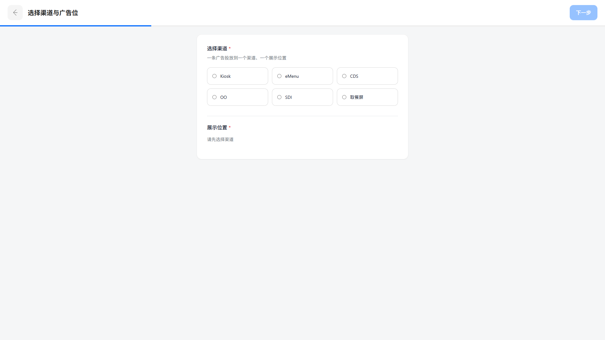

新建第一步，进入时渠道、位置均不选；复制广告可带入源渠道，但位置仍须确认。

| 字段／操作 | 逻辑说明 |
| --- | --- |
| 选择渠道 | 单选Kiosk、eMenu、CDS、OO、SDI或取餐屏，沿用原渠道范围。 |
| 展示位置 | 仅加载所选渠道下已启用、有规格且已登记接入的位置；必选单选，无全选。 |
| 无可用位置 | 显示“该渠道暂无可用广告位，请联系平台管理员配置并登记接入”，下一步禁用。 |
| 下一步 | 渠道与位置均有效才启用；进入广告内容页，读取所选广告位规格。 |
| 返回 | 新建返回列表；已有新建草稿沿用原放弃清理。编辑返回保留原放弃确认。 |

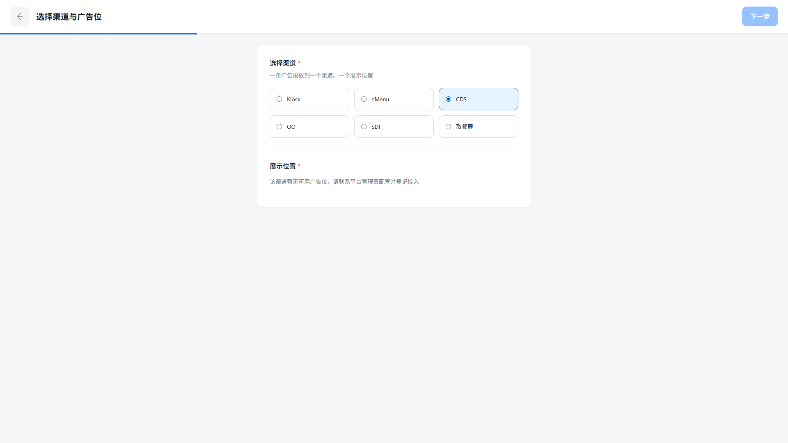

图：CDS暂无可用广告位。

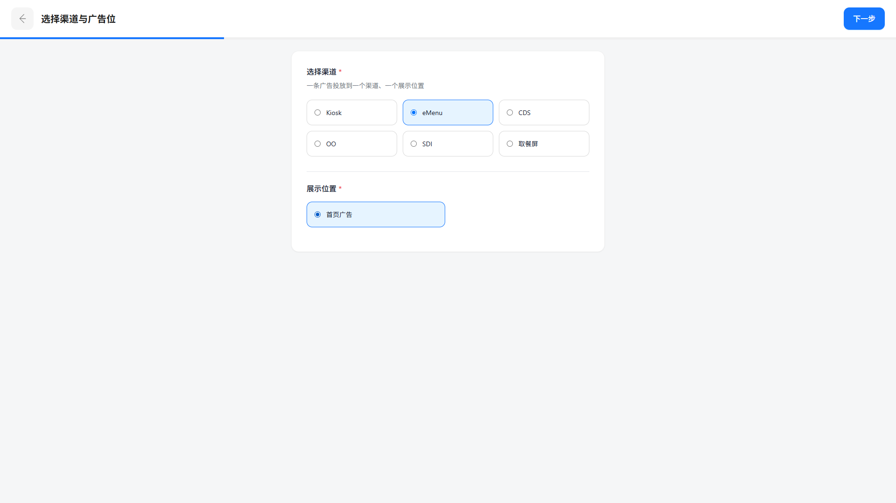

图：eMenu只显示其已接入的首页广告，与Kiosk同名位置分别配置。

## 商家端：广告内容与素材

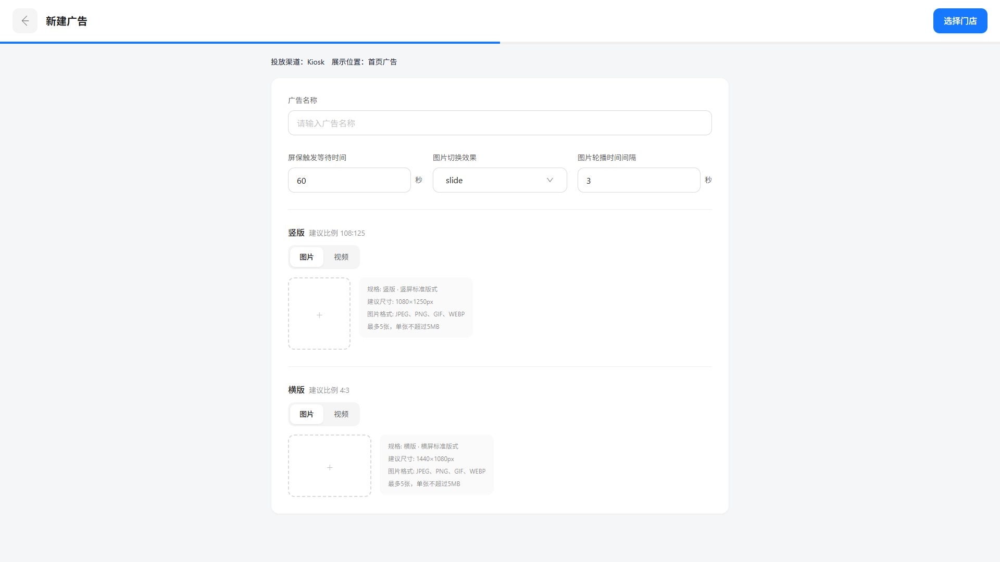

用途：填写广告内容，按所选位置的规格上传素材。

| 字段／操作 | 逻辑说明 |
| --- | --- |
| 渠道、位置摘要 | 只读显示当前渠道与位置，不展示规格版本号。内部保留规格版本及校验。 |
| 广告名称 | 必填；编辑回显，复制带入副本名称；沿用原名称保存校验。 |
| 屏保触发等待时间 | 秒，默认60，正整数；仅用于屏保，不控制首页触发。 |
| 图片切换效果 | 默认slide，保留原slide、fade、zoom、rotate、bounce、flip选择。 |
| 图片轮播时间间隔 | 秒，默认3，正整数；沿用原播放设置。 |
| 素材规格选择 | 同方向有多套规格时可切换；每套分别保留素材、类型与顺序。没有配置的方向不显示上传区。 |
| 尺寸与比例 | 来自广告位规格；Kiosk首页竖版1080×1250、横版1440×1080，屏保竖版1080×1920、横版1920×1080。其他产线独立配置。 |
| 图片／视频 | 仅展示规格与接入能力共同支持的类型。同一规格不混用图片与视频；切换类型清空当前规格素材，其他规格保留。 |
| 本地上传 | 校验格式、大小、尺寸及视频时长；严格尺寸不符合时不加入素材，提示具体规格要求。 |
| 素材库选择 | 复用现有分类、多选与确定流程；加入和保存时按同一规格规则校验，不因来自素材库而跳过。 |
| 数量 | 每套规格按M平台配置限制，图片1～20张上限、视频最多1个；不同规格分别计数。 |
| 排序、删除 | 保留原拖动排序、删除行为，仅影响当前规格。 |
| 选择门店 | 至少一套规格有素材且原表单校验通过，才保存内容草稿并进入门店页；推荐尺寸不一致时提示确认，取消留在内容页。 |
| 保存失败 | 保留页面和输入，提示素材或存储错误；不显示保存成功、不继续跳转。 |

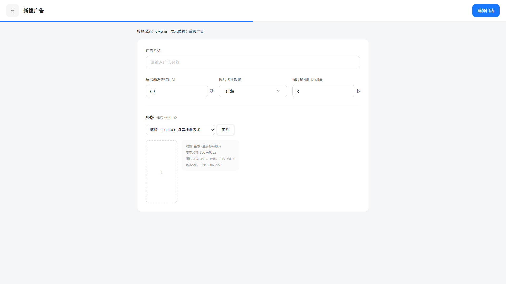

图：eMenu配置仅支持图片、300×600严格尺寸。

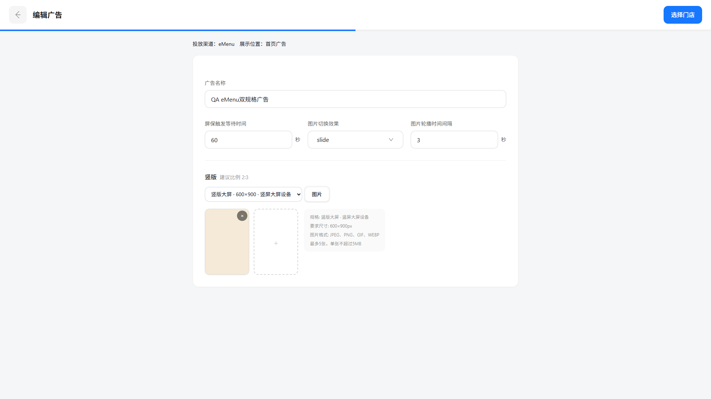

图：同一位置的竖版标准屏与竖版大屏分别配置素材。

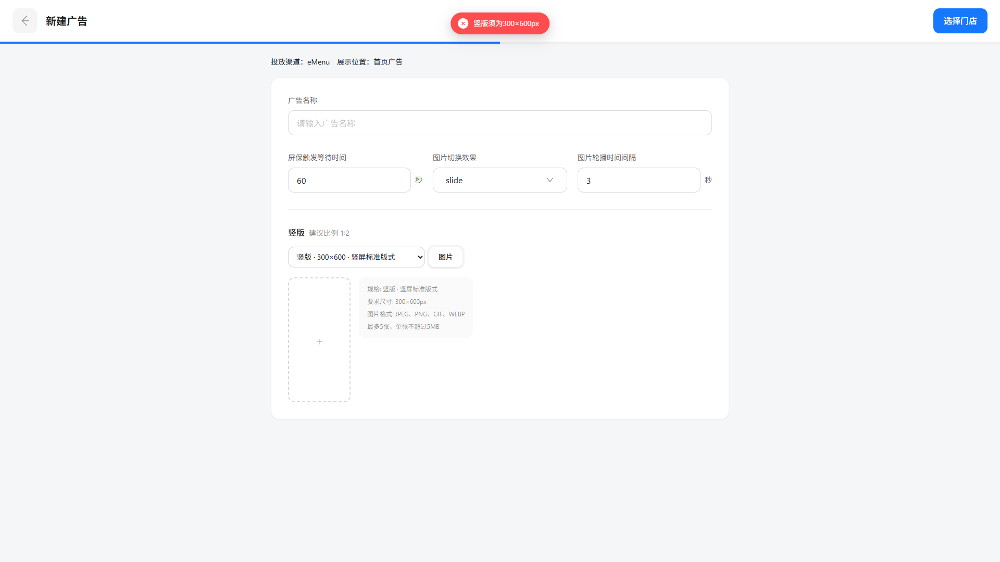

图：300×600严格规格拦截500×600图片。

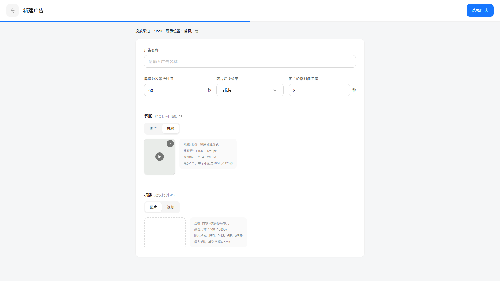

图：视频规格显示格式、大小、时长和数量要求。

### 新建返回首步后切换确认

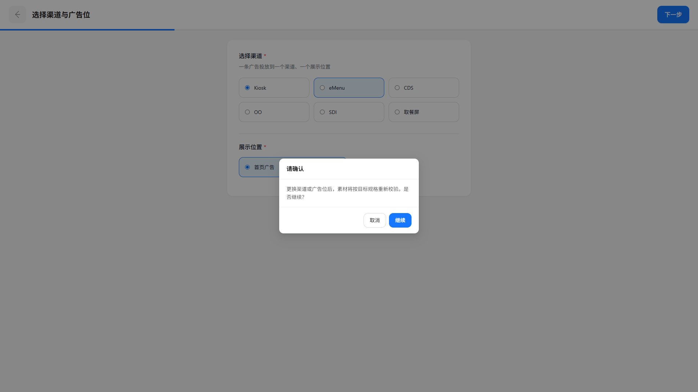

| 字段／操作 | 逻辑说明 |
| --- | --- |
| 继续 | 进入目标渠道／位置选择，素材按新规格校验；不立即改写原活动。 |
| 取消／Esc | 保持修改前渠道、位置、素材及输入。 |

### 素材预览

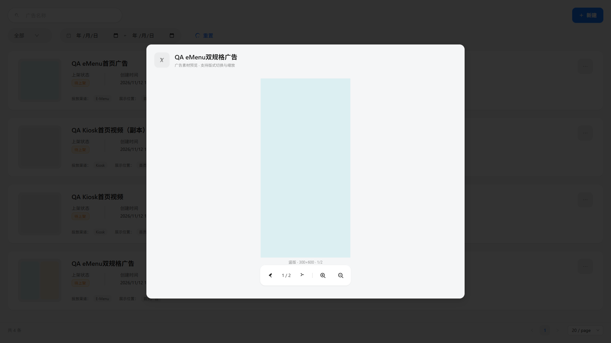

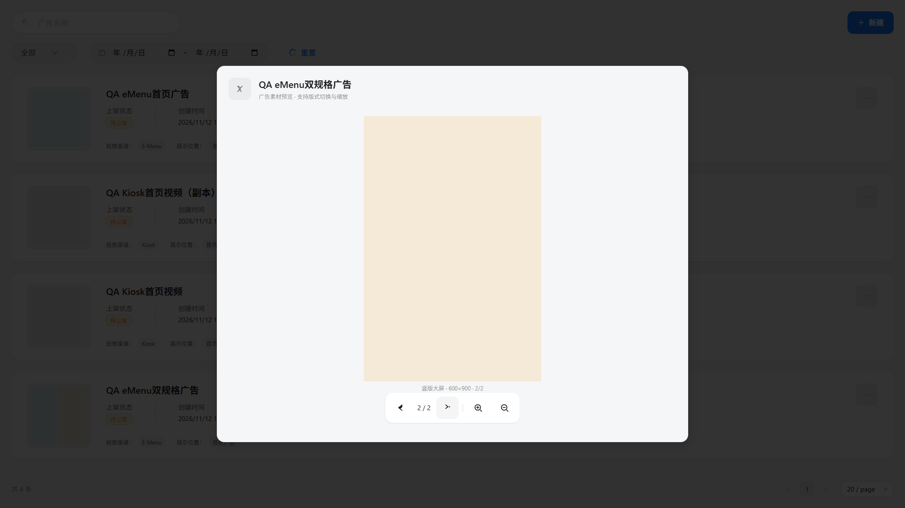

| 字段／操作 | 逻辑说明 |
| --- | --- |
| 预览区域 | 按当前素材所属规格宽高建立画框，采用配置的等比完整展示或等比裁切；不强行拉伸。 |
| 规格说明 | 显示规格名称、尺寸及当前序号，区分同方向的不同规格。 |
| 上一张／下一张 | 在当前横／竖版素材中切换，对应画框和说明同时更新。 |
| 横／竖版切换 | 同时有两个方向素材时显示，沿用原分组；同方向多规格通过上一张／下一张查看。 |
| 放大／缩小、关闭 | 保留原缩放、拖动及关闭行为，不改写素材和位置。 |

## 商家端：门店与生效时间

### 选择门店

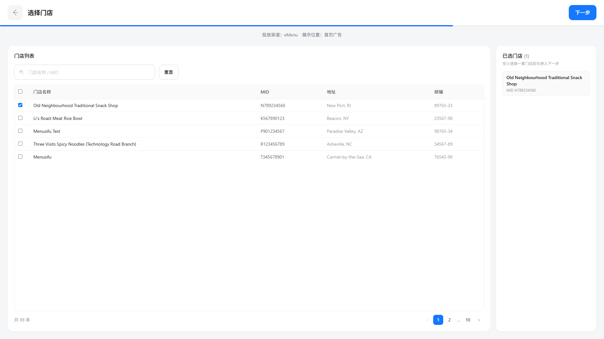

| 字段／操作 | 逻辑说明 |
| --- | --- |
| 上下文摘要 | 只读显示已选渠道与位置，不展示规格版本号，不提供第二次渠道选择。 |
| 搜索、重置、分页 | 保留原门店名称／MID搜索、重置及分页。 |
| 门店勾选、全选 | 保留原门店列表和已选门店联动，至少选择一家。 |
| 下一步 | 保存所选门店后直接进入生效时间页，不再经过渠道页。 |
| 返回 | 回到对应新建／编辑内容页，保留本活动上下文。 |

### 设置生效时间

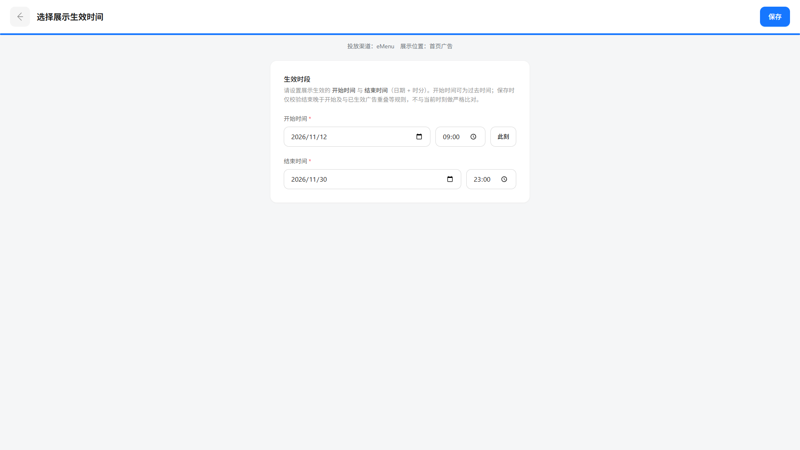

| 字段／操作 | 逻辑说明 |
| --- | --- |
| 开始日期 | 必填，使用原日期选择；允许过去的开始日期。 |
| 开始时分 | 必填，与开始日期共同确定开始时间。 |
| 此刻 | 将开始日期与时分设置为当前时间。 |
| 结束日期 | 必填，与结束时分共同确定结束时间。 |
| 结束时分 | 必填，结束时间须晚于开始时间，沿用原时间校验。 |
| 返回 | 回到门店页，保留对应广告、来源页、门店和时间上下文。 |
| 保存 | 重新校验单渠道、单位置、广告位启用与接入、规格版本、素材及原时间规则；成功保存投放偏好并清理临时选择，返回列表，沿用原草稿／上架流程。 |
| 冲突 | 同一门店、同一产线、同一位置且时间重叠时执行原提示；不同产线或位置互不因相同时间冲突。历史归属不明仍保守沿用原校验。 |
| 保存失败／取消确认 | 保留页面及数据，不清理草稿，不自动发布。 |

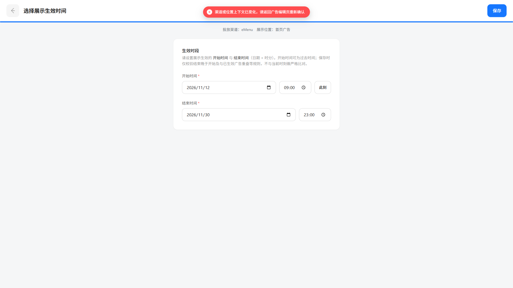

图：模拟渠道上下文不一致，保存被拦截。

## M平台：展示区域管理

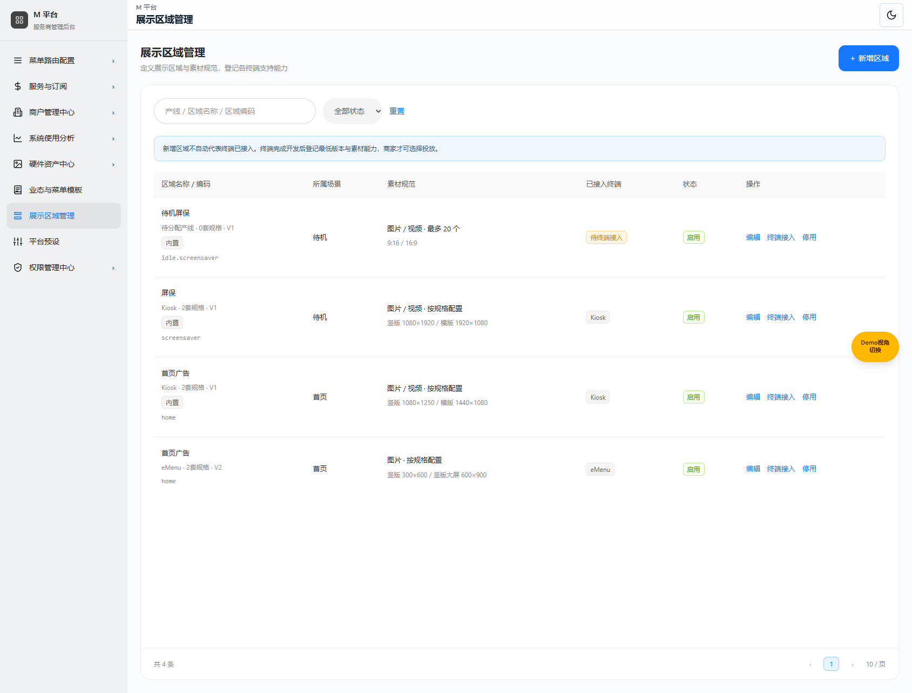

入口：M平台 → 展示区域管理。平台管理员配置，商家仅选择并配置内容；沿用现有平台管理权限。

| 字段／操作 | 逻辑说明 |
| --- | --- |
| 搜索 | 支持按产线、位置名称或编码筛选。 |
| 状态筛选、重置、分页 | 沿用原状态筛选及列表操作。 |
| 区域名称／编码 | 展示名称、编码、所属产线、规格数量和当前版本；名称可相同，身份不相同。 |
| 素材规范 | 汇总支持类型及各规格名称、像素尺寸，单套的数量和大小以编辑表单为准。 |
| 接入终端 | 新位置默认待接入；仅所属产线能登记支持。 |
| 新增区域、编辑 | 打开位置配置抽屉。保存仅配置，不代表终端已完成开发。 |
| 启用／停用 | 停用后不可用于新建、重新保存和上架；不删除原广告或素材。既有终端停止展示依赖终端刷新与接入。 |

### 新增／编辑位置

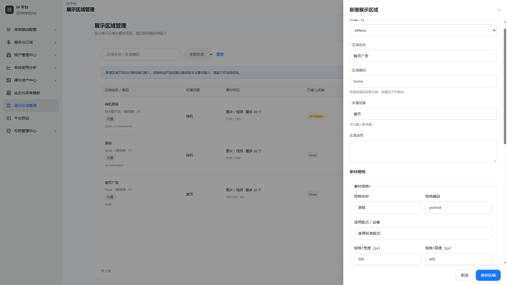

| 字段／操作 | 逻辑说明 |
| --- | --- |
| 所属产线 | 第一项，必选单选；已归属的位置不可直接换产线。 |
| 区域名称 | 必填，最多30字，商家可见；不同产线可同名。 |
| 区域编码 | 必填，同一产线内唯一，创建后不可修改；小写字母开头，可含数字、点、下划线或短横线，最多64位。 |
| 所属场景 | 必填，最多20字，可选择或输入首页、待机、购物车、完成页等；不直接决定尺寸。 |
| 区域说明 | 最多200字，用于说明具体区域和使用限制。 |
| 新增规格 | 新增一套配置；每个位置1～12套，可以有多个同方向规格。 |
| 删除此规格 | 移除本次配置中的该规格，保存后生成新版本；旧广告快照保留。 |
| 可配置参数 | 轮播间隔、无操作进入时间、切换效果，沿用原配置能力；终端需支持后执行。 |
| 保存区域 | 校验产线、同产线编码唯一性及所有规格；成功关闭并更新列表，新位置为待接入。失败保持抽屉及输入。 |
| 取消／关闭 | 有未保存修改时执行原放弃确认；取消放弃则继续编辑，不写入配置。 |

### 素材规格

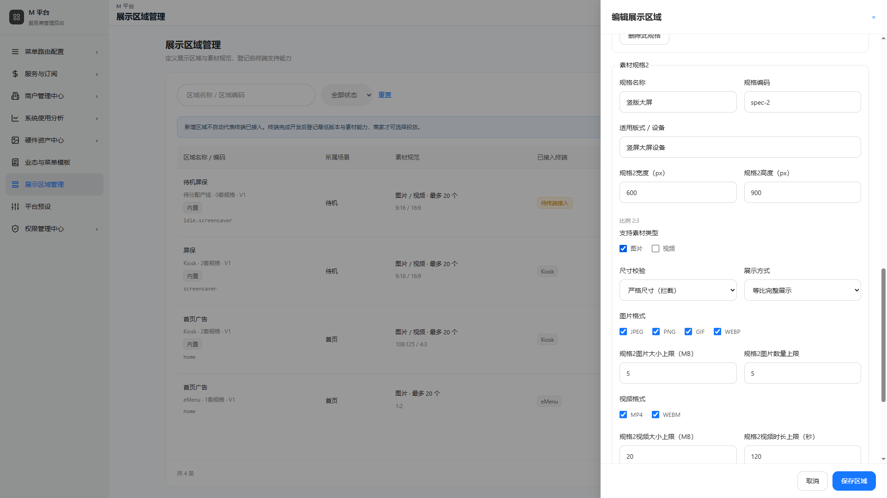

| 字段／操作 | 逻辑说明 |
| --- | --- |
| 规格名称 | 必填，最多30字，例如竖版标准屏、竖版大屏。 |
| 规格编码 | 位置内唯一，字母开头，可含小写字母、数字、下划线与短横线，最多40位；已保存规格编码只读。 |
| 适用版式／设备 | 必填，最多80字，同位置内不得重复；用于明确区分规格，终端按规格编码取素材，不依赖自由文本自动匹配。 |
| 宽度 | 必填，1～16384正整数，单位px。 |
| 高度 | 必填，1～16384正整数，单位px。 |
| 比例 | 按宽高约分自动计算，不独立输入。 |
| 支持素材类型 | 图片、视频，至少选一种；终端接入能力不得超出该位置支持类型。 |
| 尺寸校验 | 推荐模式提示并允许确认后继续；严格模式要求宽高完全一致，不自动裁切替代校验。 |
| 展示方式 | 等比完整展示或等比裁切，用于预览与终端接入约定。 |
| 图片格式 | 支持JPEG、PNG、GIF、WEBP；支持图片时至少选一种。 |
| 图片大小上限 | 1～100整数，MB，默认5。 |
| 图片数量上限 | 1～20整数，默认5，每套规格分别计数。 |
| 视频格式 | MP4、WEBM；支持视频时至少选一种。 |
| 视频大小上限 | 1～500整数，MB，默认20。 |
| 视频时长上限 | 1～3600整数，秒，默认120；实际素材读取时长后校验。 |
| 视频数量 | 每套规格最多1个。 |
| 规格版本 | 规格发生变更时递增，保存旧版本规范；名称与区域说明等非规格变更不单独升规格版本。 |

### 终端接入

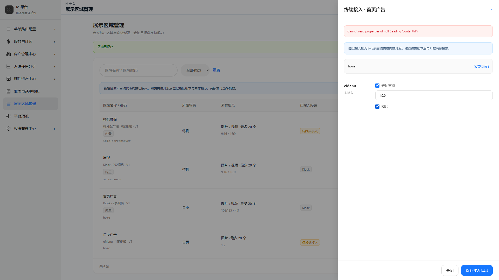

| 字段／操作 | 逻辑说明 |
| --- | --- |
| 位置编码、复制编码 | 展示稳定编码，复制供终端对接；请求时须同时携带产线和规格编码。 |
| 登记支持 | 仅所属产线可登记；未登记的位置不出现在商家可用位置列表。 |
| 最低支持版本 | 必填版本号，例如1.0.0，保留原版本格式校验。 |
| 素材能力 | 至少一种，不得超出位置素材类型；商家只展示规格与接入共同支持的类型。 |
| 保存接入信息 | 校验通过后保存；不自动完成客户端开发、设备能力发现或真实下发。 |
| 关闭／取消 | 沿用原未保存提示，不写入配置。 |

## 历史活动与交付边界

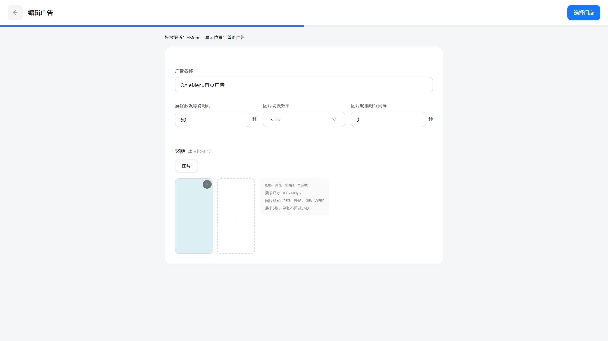

历史广告不批量迁移、不自动拆分或改变发布状态。已有广告位快照回显原版本；归属不明、仅有旧位置字段的记录需明确选择渠道与位置，再校验已有素材。M平台新版本不覆盖旧广告快照。

当前为项目原生页面与浏览器本地配置联动；真实服务端配置、按设备版本匹配规格及真实终端下发未接入。至少配置一套素材可以保存草稿；实际投放设备所需规格覆盖需在接入链路验收，不能将保存成功当作所有设备均可展示。详见[功能验证与交付边界](验证记录/V1.11渠道广告位与规格验证.md)及[页面文案校验](验证记录/V1.12等待时间字段文案校验.md)。

## 研发字段与一致性

| 字段／规则 | 定义 |
| --- | --- |
| DisplayRegion.productLine | 位置所属产线；兼容旧数据时可缺失，缺失位置不得作为商家新建目标。 |
| DisplayRegion.specs | AdSpec[]，每套规格独立编码、像素尺寸、媒体能力与限制。 |
| specVersion／specHistory | 当前规格版本与历史规格；规范化比较避免仅属性顺序变化产生新版本。 |
| theme.adSlot | 保存{id,name,code,productLine,version,specs}快照；最终保存按当前目录确认位置仍可用且版本存在。 |
| theme.adSlotAssets | 按specId保存素材数组，切换上传区不覆盖其他规格。 |
| 素材metadata | 保存kind、mime、bytes、width、height及视频duration；原始像素保留，不再将严格规格图片压缩成缩略图。 |
| distributeChannels／distributePositions | 保留string[]结构，新数据分别恰好一个渠道和位置编码；位置标签使用广告位快照名称。 |
| portraitImages／landscapeImages | 按宽高方向聚合兼容原列表及预览，素材保留adSpecId；新素材的规范依据为adSlotAssets。 |
| 本地配置存储 | 沿用menusifu:display-regions:v1，M平台与iframe同源读取；跨窗口更新继续遵守revision冲突保护。 |
| 临时投放上下文 | 当前themeId隔离位置；门店页从当前广告写入唯一渠道；时间页重新核对渠道、位置与快照，避免旧渠道缓存串用。 |
| 复制视频 | 从原视频读取Blob，副本保存新mediaRef，避免删除一条广告损坏另一条的媒体。 |
| 规范产物 | src/marketing-display/ad-slot-catalog.ts为共同规则；build-ad-slot-catalog.mjs生成原生页脚本，predev与build先生成。 |
| 冲突身份 | 原门店、时间规则叠加广告位身份；新广告用productLine＋slotId，老记录缺身份时保守沿用原范围。 |

算例：Kiosk/home与eMenu/home允许同名、同编码；eMenu/home重复创建被拦截。300×600严格规格拒绝500×600；推荐规格允许确认后保留。规格V1改为V2时，V1活动仍按历史规范校验；停用位置后新保存与重新上架被拦截。
