# 展示内容业务规格说明书（研发交付版）

版本：V1.8；日期：2026-11-10；变更编号：MARKETING-CARD-POSITIONS-20261110-01。共同业务基线：用户提供的三张门店、渠道、生效时间截图及已确认展示区域规则；代码起始 main@7f3433d9，功能分支 codex/marketing-card-positions-20261110。

职责：数据对象、校验、存储、状态流转、解析与测试算例。[产品 V1.8](展示内容产品权威需求文档.md) · [研发 V1.8](展示内容业务规格说明书（研发交付版）.md) · [个人规范 V1.8](展示内容需求文档（个人规范版）.md) · [验证与交付缺口](交付缺口与逐操作截图清单.md)。

## 广告位管理列表：投放渠道与展示位置

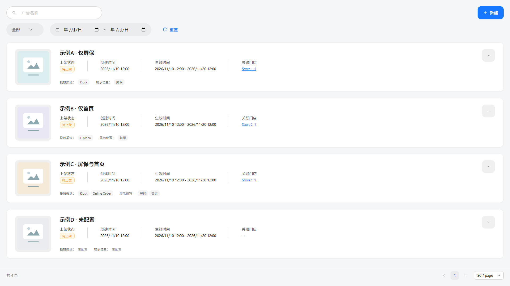

图：V1.8功能分支，1920×1080页面全图，隔离Demo数据；四张卡片分别为仅屏保、仅首页、双位置和未配置。

用途／入口：营销中心 → 营销广告 → 广告位管理。卡片底部展示活动已保存的渠道和位置，原缩略图、名称、状态、时间、门店及更多菜单保持原流程。

| 字段／操作 | 逻辑说明 |
| --- | --- |
| 投放渠道 | 独立标注“投放渠道：”，沿用原渠道标签文案；无有效渠道显示“未配置”。 |
| 展示位置 | 独立标注“展示位置：”，仅作为列表信息，不提供直接切换或保存。 |
| 屏保 | 已保存位置包含screensaver时展示；不因位置字段缺失自动推断为屏保。 |
| 首页 | 已保存位置包含home时展示。 |
| 两个位置 | 分别展示屏保、首页两个标签，固定按该顺序；不显示“全部”。 |
| 未配置 | 活动及回显偏好均无有效位置，或活动位置显式为空／无效时显示；不写回位置，不改变现有发布状态。 |
| 列表读取 | 优先活动已保存位置；活动没有该字段时读取已保存的回显偏好。显式空值不以旧偏好补齐；不读取本轮未保存的临时选择。 |
| 修改位置 | 沿用原编辑、选择渠道、生效时间和保存流程；标签本身不触发编辑或发布。 |
| 历史记录 | 缺少可信历史识别信息时按用户确认先显示未配置；“老活动默认屏保”兼容方案不在本次实现范围。 |

### 名称筛选后的标签

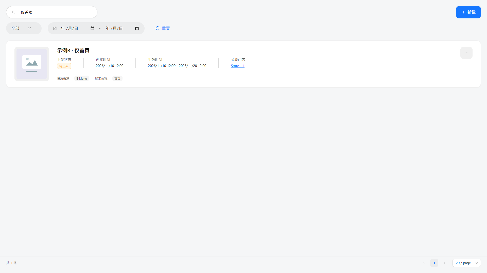

图：V1.8真实列表筛选状态；筛选不改变位置标签的数据来源。

| 字段／操作 | 逻辑说明 |
| --- | --- |
| 广告名称筛选／重置 | 沿用原筛选，结果仍显示相应活动的位置；重置恢复完整列表。 |

### 窄屏布局

图：V1.8，390px宽页面全图。卡片内容及渠道、位置分组换行；日期筛选容器随换行增高。

| 字段／操作 | 逻辑说明 |
| --- | --- |
| 卡片与标签换行 | 窄屏下缩略图与正文分行，标签按可用宽度换行，更多按钮保持卡片右上角；桌面保持原横排布局。 |

### 列表读取与验证

| 字段／规则 | 定义 |
| --- | --- |
| savedForTheme(theme) | 纯读取，不访问当前临时草稿、不写localStorage、不修改传入活动。 |
| distributePositions | 字段存在时直接按固定编码归一化，显式空数组、null或非法类型返回空，不回退偏好。 |
| lastDistributePrefs.positions | 仅活动不存在distributePositions字段时读取；无法得到有效编码返回空。 |
| 归一化 | 仅保留screensaver、home，去重并固定排序；仅未知编码返回空，列表显示未配置。 |
| 验证算例 | home→首页；home/screensaver/home→屏保、首页；缺字段→未配置；显式空且偏好home→未配置；只有合法偏好home→首页；临时草稿含首页但活动无位置→未配置。 |

## 广告位管理：页面命名

待补页面图片：V1.7导航与页面名称。下文V1.6旧图的入口名称不代表当前文案，其余页面内容沿用。

### 广告列表

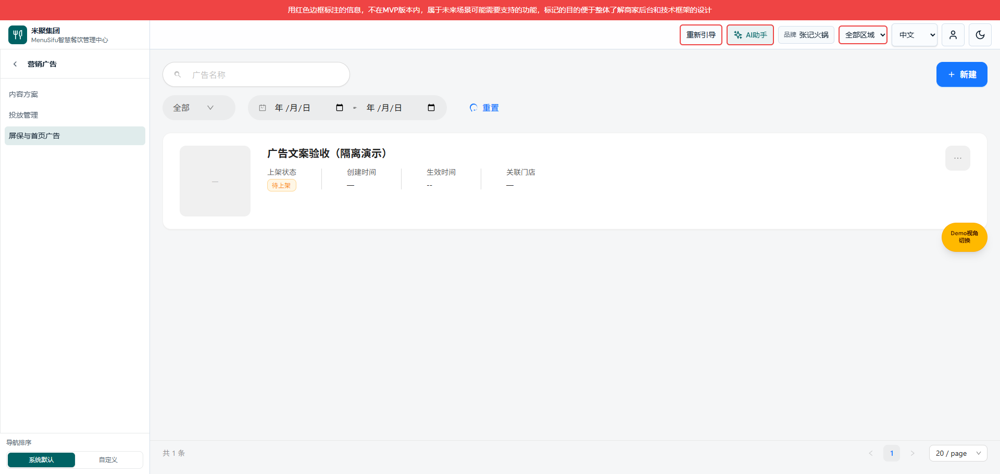

图：V1.6功能分支，1920×911，隔离演示会话；导航图含QA广告记录。

用途／入口：营销中心 → 营销广告 → 广告位管理；沿用 /marketing/screensaver。

| 字段／操作 | 逻辑说明 |
| --- | --- |
| 广告位管理 | 第三个子菜单及原页面权限名称；与内容方案、投放管理同级。中文名称统一，英文 Ad placement management。 |
| 广告名称 | 列表筛选、编辑字段及校验中的对象名称；原name字段及用户已保存名称不修改。 |
| 暂无广告 | 没有广告时的空状态；提示创建广告并投放到门店设备。 |
| 广告预览 | 预览占位、素材预览及版式切换的称呼；原横竖版、缩放功能保留。 |
| 删除广告 | 原删除确认及后果保留，删除对象统一称广告。 |

### 新建与编辑广告

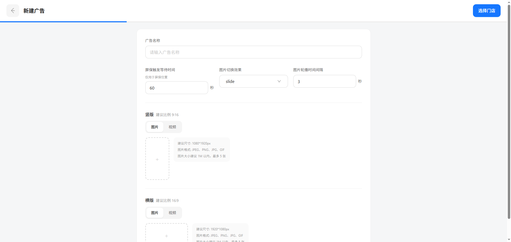

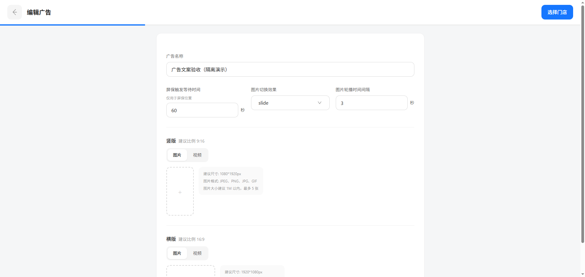

图：V1.6实际新建及编辑页；编辑对象qa-copy为隔离演示记录。

| 字段／操作 | 逻辑说明 |
| --- | --- |
| 新建广告／编辑广告 | 原新建、编辑页标题；广告名称输入、必填提示统一。 |
| 屏保触发等待时间 | 原idleTimeoutSec，秒、默认60、正整数约束沿用；显示“仅用于屏保位置”，不表示首页受空闲触发控制。 |
| 广告素材 | 上传校验、预览及新增素材自动名称使用广告称呼；素材库既有屏保素材分类保留，不迁移分类或改写用户素材名。 |

### 投放流程

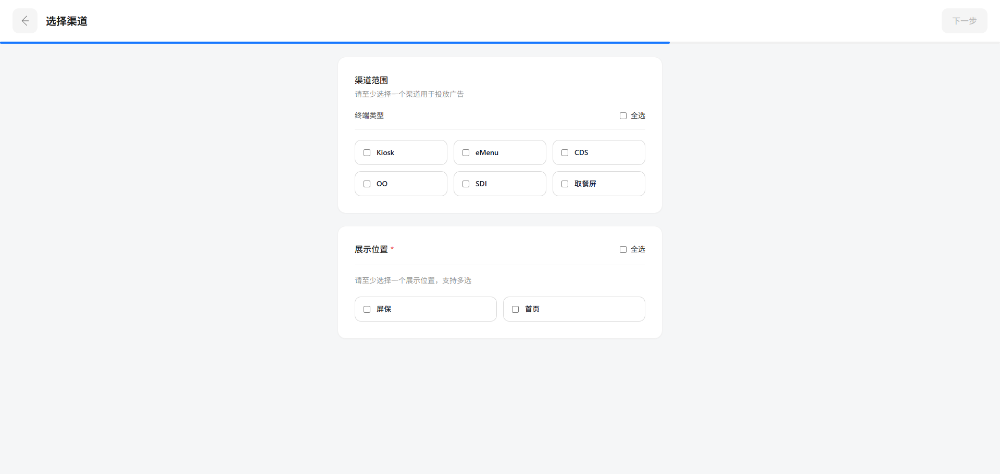

图：V1.6渠道页，保留屏保、首页位置选项。门店、时间页与弹框的本版截图待补，见交付清单。

| 字段／操作 | 逻辑说明 |
| --- | --- |
| 投放广告 | 门店、渠道、时间页文档标题及相关确认统一称投放广告；渠道说明为“请至少选择一个渠道用于投放广告”。 |
| 屏保／首页 | 展示位置选项保持原名称与稳定值；新建空选、至少一项、多选和全选沿用位置章节。 |
| 冲突与校验 | 原提示中的主题对象统一称广告；排期、重叠、保存、发布和回执逻辑不因改名改变。 |

## 展示位置

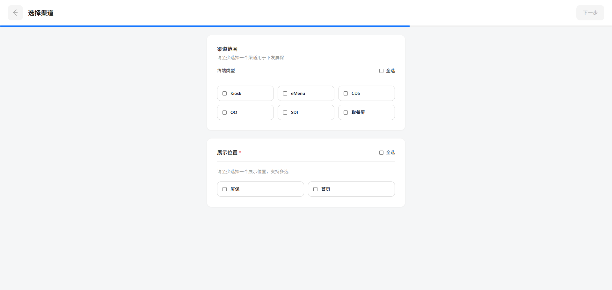

图：V1.5 功能分支，1920×911，直接加载同一检出的原渠道页；新建选择均为空。

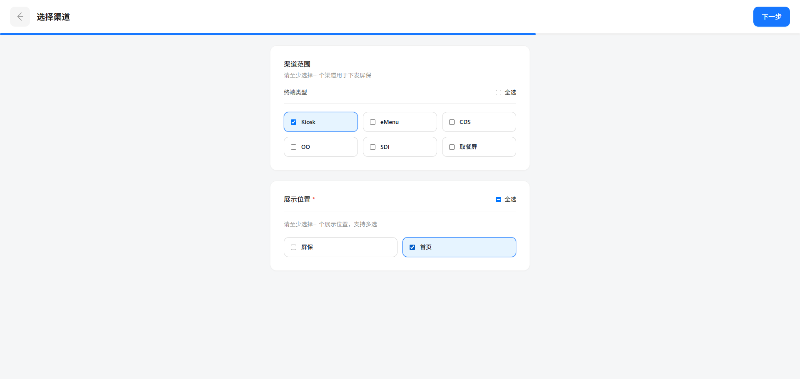

图：Kiosk、首页选中，位置全选框半选，下一步可用。

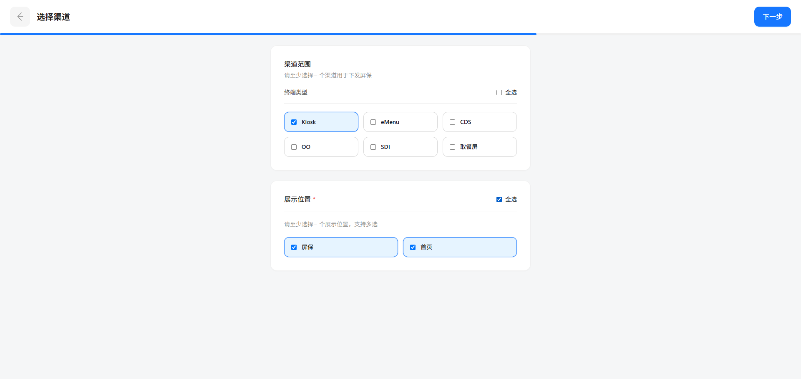

图：两个位置全选，不联动渠道全选。

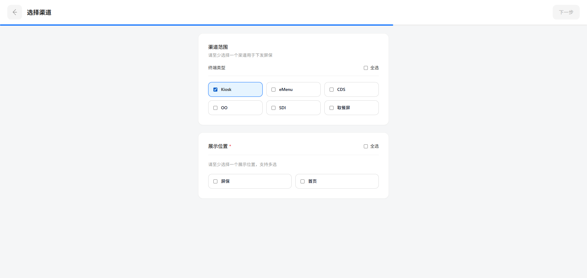

图：仅选择Kiosk、位置为空，下一步禁用。

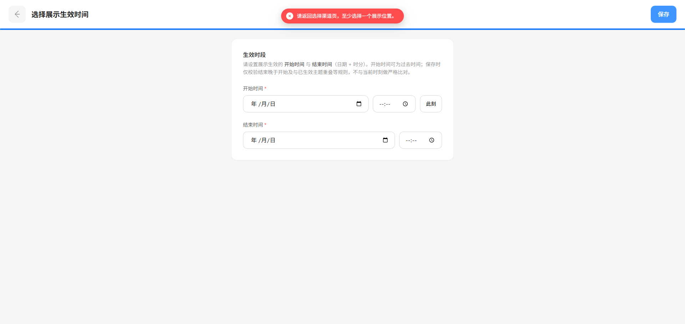

图：隔离QA模拟绕过渠道页清空位置，原时间页保存提示返回选择。

用途／入口：营销中心 → 营销广告 → 广告位管理 → 新建或编辑 → 选择门店 → 选择渠道。渠道范围卡片下方为独立展示位置卡片。

| 字段／操作 | 逻辑说明 |
| --- | --- |
| 展示位置 | 必填多选组，固定提供屏保、首页两个选项；新建时均不勾选。与终端渠道分别选择，所选位置应用于本次所选渠道。 |
| 屏保 | 稳定值 screensaver；勾选加入本次展示位置，取消移除。 |
| 首页 | 稳定值 home；可独立选择或与屏保同时选择。 |
| 全选展示位置 | 仅作用于两个位置，不改变渠道选择。未全选时点击勾选全部；已全选时点击清空。只选一项时显示半选状态。 |
| 下一步 | 渠道至少一项且展示位置至少一项才可用；任一组清空后禁用。启用后进入原展示生效时间页，保留原 embedded 与 from 上下文。 |
| 返回／刷新回显 | 同一主题本次选择保留，显式清空也保留；切换主题不会读取另一主题的未保存位置。重新投放回显该主题已保存的位置。 |
| 历史记录 | 没有展示位置字段的记录回显为空，重新保存投放前须明确选择至少一个位置；不自动将历史记录批量改为首页或屏保。 |
| 保存 | 时间页在原时间与重叠校验外再次校验位置非空，空选提示“请返回选择渠道页，至少选择一个展示位置。”并保留当前页面和数据。成功随原主题草稿保存位置，清理本次位置临时选择；取消原重叠确认不写入位置。 |
| 存储失败 | 位置选择写入失败时显示“展示位置保存失败，请检查浏览器存储后重试。”；以最后成功保存的选择回显，不伪装成功。 |

### 位置字段与存储

| 字段 | 类型与约束 |
| --- | --- |
| theme.distributePositions | string[]，本次成功保存的展示位置，仅 screensaver/home，去重并按屏保、首页排序；至少一项。 |
| theme.lastDistributePrefs.positions | string[]，与 distributePositions 同次写入相同副本，用于重新投放回显。 |
| selected_display_positions_for_distribute | localStorage JSON 对象 {themeId, positions}；themeId 为 current_theme_id_for_distribute；仅在主题匹配时读取草稿，空数组优先于已保存值。 |
| 回显优先级 | 同主题临时数组（包括空数组）→ lastDistributePrefs.positions 数组 → distributePositions → 空数组。未知值过滤，不提供默认勾选。 |
| 成功与取消 | 原生效时间保存成功后清理临时位置；新建放弃、编辑存草稿沿用原清理时机；取消重叠确认保留临时选择。 |
| 校验算例 | 渠道 Kiosk + 位置空：禁用；渠道空 + 首页：禁用；Kiosk + 首页：可下一步；任意有效渠道 + 两位置：可下一步；切换主题：不串用临时位置。 |

## 菜单名称

菜单名称为“营销广告”（英文 Marketing ads）。父项标识 mkt-screensaver、路由、权限键和三个子菜单的路由及功能保持现有定义。文档文件名沿用既有唯一入口。

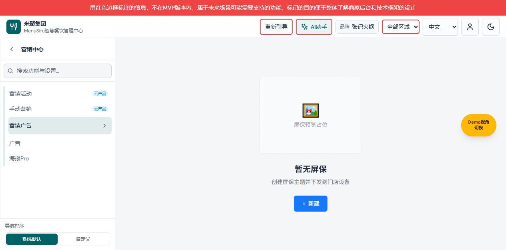

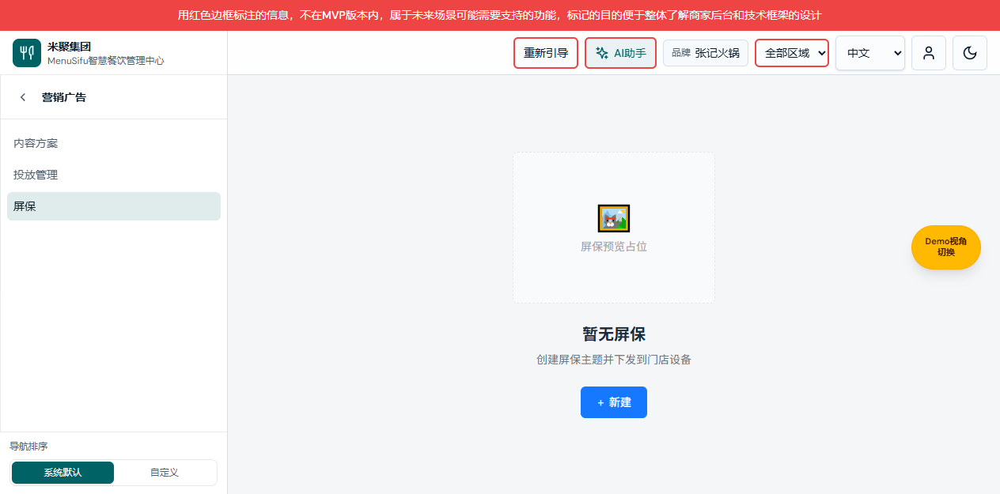

图：V1.4 功能分支，1280×625，隔离演示会话。父菜单与子导航标题均为营销广告；下文旧版截图只说明未变的页面内容。

## 广告位管理

图：V1.3 功能分支，1280×625，隔离演示源的空列表。

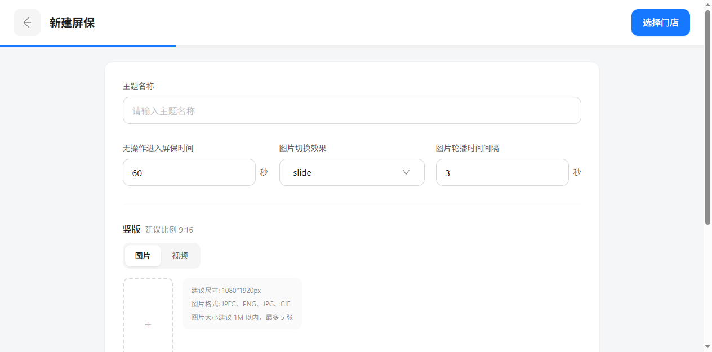

图：同一分支原 iframe 的新建页，全屏状态；该图为V1.3原新建页；V1.5渠道页与时间页依据展示位置章节扩展。其他旧流程截图缺口见交付清单。

用途／入口：营销中心 → 营销广告 → 广告位管理。内容方案、投放管理的顺序、页面及操作保持现状。

| 字段／操作 | 逻辑说明 |
| --- | --- |
| 广告位管理菜单 | 第三个同级叶子，标识 `mkt-legacy-screensaver`；进入 `/marketing/screensaver`，公共子导航保持显示并高亮广告位管理。 |
| 原页面宿主 | 直接加载 `Configuration center/kiosk-screensaver.html` 原 iframe，内部进入 `kiosk-theme-list.html`；不重写原页面。 |
| 原编辑与下发 | 沿用原新增、编辑、素材上传、横竖版预览、门店、渠道、生效时间、保存、上架与下架流程及校验；独立页面内部保持原交互。 |
| 全屏与返回 | 原新增／编辑页进入全屏，门店／渠道／时间页保持，返回原列表退出全屏；原取消及返回行为保留。 |
| 权限 | 原 `page:/marketing/screensaver` 及管理操作键保持；查看默认只读，隐藏祖先和现有预设过滤继续生效；不因新增入口自动授予编辑。 |
| 数据 | 原 `kiosk_themes` 及原媒体 IndexedDB 沿用；与内容方案／投放记录分别存储，不自动迁移或下发。浏览器不同端口属于不同源，不自动复制旧源数据。 |
| 默认入口 | `/marketing/display-content` 仍进入内容方案；`/marketing/screensaver` 不再转至内容方案。 |

## 1. 页面及职责映射

实际功能分支、1440×900；不使用内容／投放 Tab。

| 路由／对象 | 规则 |
| --- | --- |
| `/marketing/display-content/contents` | 当前品牌内容草稿；名称、区域、状态筛选取交集，10 条一页。 |
| `/marketing/display-content/placements` | 当前品牌投放；仅完整落入当前门店授权范围的记录可管理；可按顶栏选定门店再筛选。 |
| `/m-platform/display-regions` | 平台共享区域目录，权限复用 `presets` 页面与 `publish` 操作。 |
| `/marketing/screensaver` | 原屏保 iframe 页面；`kiosk-screensaver.html` 转至原列表，`embedded=1` 沿用。 |
| 菜单父节点 | 保留 `mkt-screensaver` 身份及对应 L2 预设过滤键，标题为营销广告；新叶子是独立路由。 |
| 商家页面权限 | 页级内容／管理操作分别注册；旧屏保页面保留原权限键与只读默认，新路由使用兼容继承，不隐式赋予只读角色编辑权。 |

## 2. 存储与上下文

| 字段 | 定义 |
| --- | --- |
| 平台存储键 | `menusifu:display-regions:v1`，区域与终端支持目录；不含商家内容。 |
| 品牌存储键 | `menusifu:display-content:v1:<encodeURIComponent(scope)>`；scope 为明确品牌 merchantId，不使用全部品牌或门店名称。 |
| schema | 整数常量 1；未知版本、JSON 损坏或结构错误阻止读取，不重置原值。 |
| revision | 每次成功提交 +1；提交前核对期望版本，发现已发生的其他窗口更新则阻止保存并保留草稿。 |
| scope | 当前商家快照所属品牌，与当前权限上下文必须一致。 |
| storeIds | 当前品牌 M 平台目录与账号授权候选的交集；不包含其他品牌和无归属 roster ID。 |
| canWrite | 商家在保存时重新计算；平台在区域写入时重新校验预设发布权限。页面按钮禁用不是唯一校验。 |

一次内容／投放提交写入一个品牌键，失败不更新内存成功态；平台提交写入一个目录键。浏览器本地版本检查只检测已发生的更新，服务端并发事务及设备鉴权不由该本地持久化替代。

## 3. 区域对象 DisplayRegion

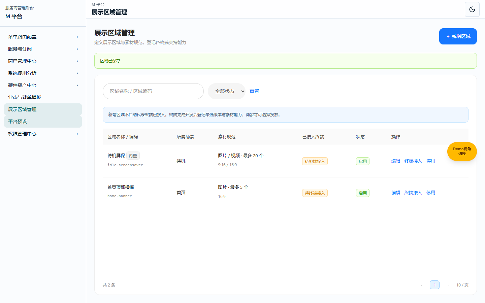

实际功能分支的区域创建结果；编码与版本均为受控验证数据。

| 字段 | 类型、默认、约束及关系 |
| --- | --- |
| id | 非空字符串，创建时生成；内置屏保为 `idle-screensaver`。 |
| name | 字符串，必填，trim 后 1～30 字。 |
| code | 字符串，必填、唯一、创建后不可改，最多 64 字；正则 `^[a-z][a-z0-9]*(?:[._-][a-z0-9]+)+$`。 |
| scene | 字符串，必填 1～20 字；自由场景分组，不作为终端程序分支枚举。 |
| description | 字符串，默认空，最多 200 字。 |
| ratio | 由一个或多个 `正整数:正整数` 组成，每边最多 4 位；多项以 `/` 分隔并去重。 |
| mediaKinds | 非空数组，枚举 `image`、`video`，去重。 |
| maxItems | 整数 1～20；新建默认 5；内置屏保上限 20。 |
| parameters | 去重数组，枚举 `interval`、`idle`、`transition`；不允许动态脚本或任意可执行代码。 |
| enabled | 布尔，新建 true；false 时禁止内容保存及发布，终端解析清空。 |
| builtin | 布尔，内置屏保 true，新建区域 false；不通过删除迁移旧引用。 |
| generation | 非负整数，新建 0；从启用变停用时 +1。已发布快照代次与当前不符，按已下架处理。重新启用不减少代次。 |
| bindings | 以终端名称为键的对象；新建为空。每端保存 minimumVersion 与 mediaKinds。 |

内置屏保比例为 `9:16 / 16:9`，类型图片／视频，参数 interval、idle 与 transition；没有经过登记的终端不推断为支持。

### 区域保存

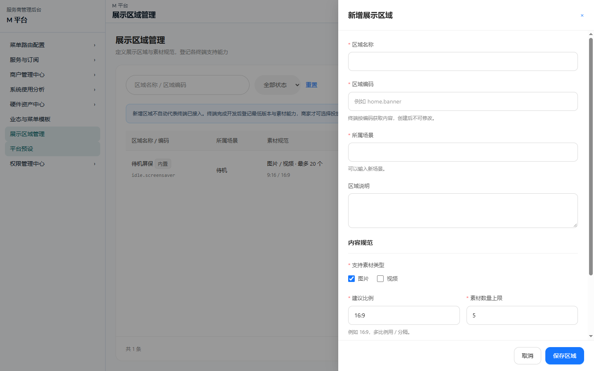

先校验名称／场景、编码格式及唯一性、比例、类型、数量、参数与终端能力；有接入信息的区域不能直接改变 ratio、maxItems、mediaKinds、parameters。成功提交目录版本；失败不写入，取消不保存。

### 终端能力

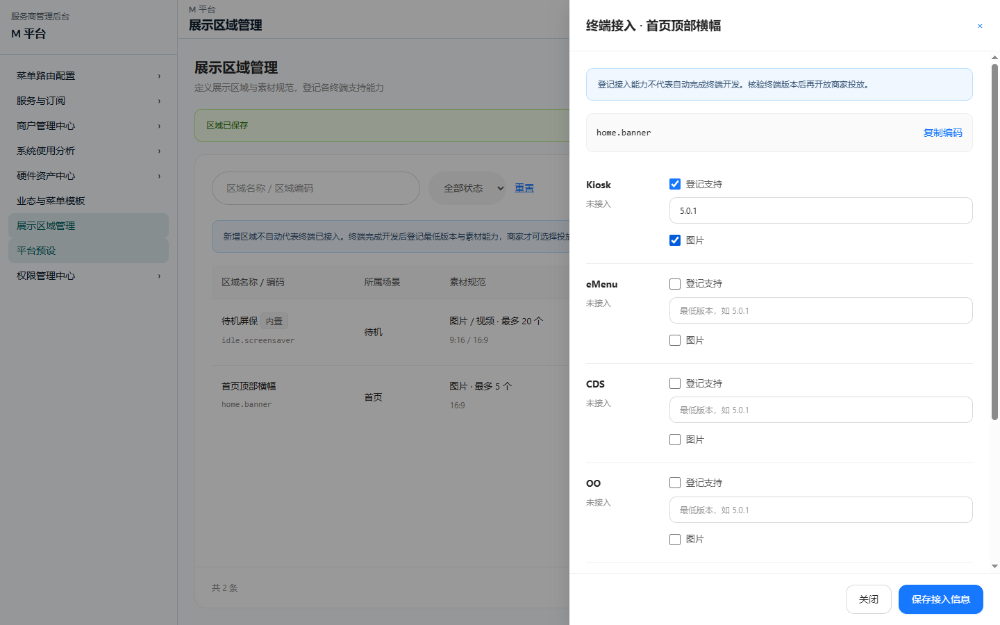

| 字段 | 规则 |
| --- | --- |
| 终端键 | Kiosk、eMenu、CDS、OO、SDI、取餐屏。 |
| minimumVersion | 三段或四段非负数字；例如 5.0.10 大于 5.0.2，不进行字符串字典排序。 |
| mediaKinds | 非空且是区域素材类型的子集；实际投放全部素材必须被每个所选终端支持。 |
| 未勾选端 | 从当前能力目录中移除，发布阻止选择，解析返回 unsupported-terminal。 |

## 4. 内容对象与编辑

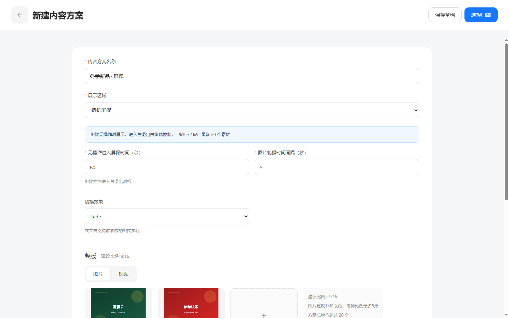

| 字段 | 类型、默认及规则 |
| --- | --- |
| id | 字符串，新增生成，编辑不改。 |
| name | 必填字符串，trim 后 1～50 字。 |
| regionId | 区域 ID，必填；保存时区域存在且启用。 |
| assets | 有序非空数组，数量不超区域上限；保存冻结当前草稿中的引用与顺序。 |
| assets[].id | 非空素材 ID；素材库选择去重；上传创建独立 ID。 |
| assets[].name | 非空名称，列表与预览使用转义文本。 |
| assets[].kind | `image` 或 `video`；不得超出区域规范。 |
| assets[].url | HTTP(S)、同源绝对路径或对应 image/video Data URL；拒绝 javascript 等非法协议。 |
| assets[].variant | `default` 或当前区域定义的比例；切区域后保存重新校验。 |
| settings.interval | 区域开放时必填整数 1～300 秒，编辑默认 5。 |
| settings.idle | 区域开放时必填整数 1～3600 秒，编辑默认 60。 |
| version | 正整数，每次成功保存 +1；不因输入、预览或保存失败增加。 |
| updatedAt | UTC epoch 毫秒，成功保存时写入；本地展示按明确时区格式化。 |
| legacyId | 选填，用于旧屏保导入幂等，不产生自动发布权限。 |

未被区域开放的参数不写入内容 settings。修改方案区域不重写旧发布快照，但该方案旧区域的草稿投放发布前会因区域关系改变而被拦截。

### 素材库与上传

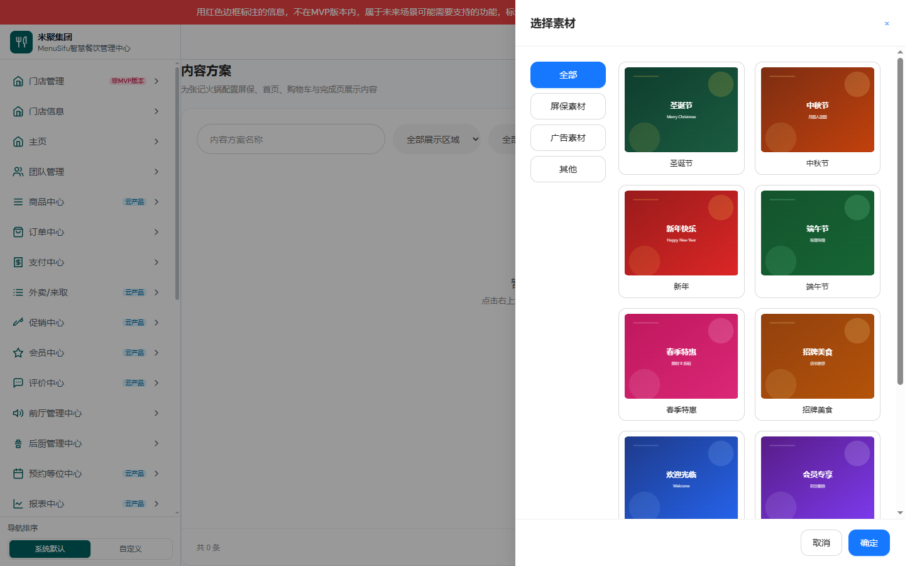

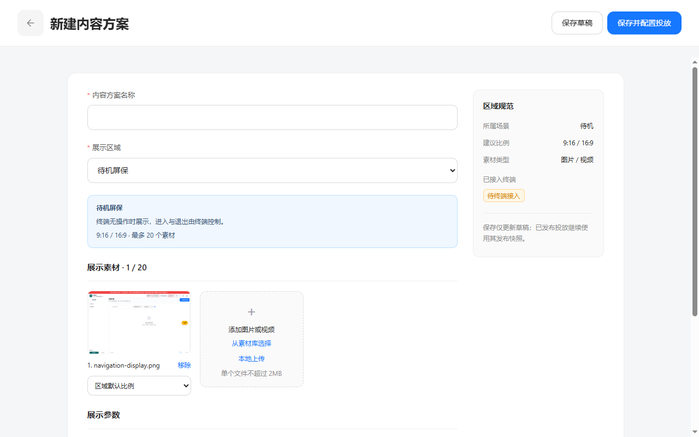

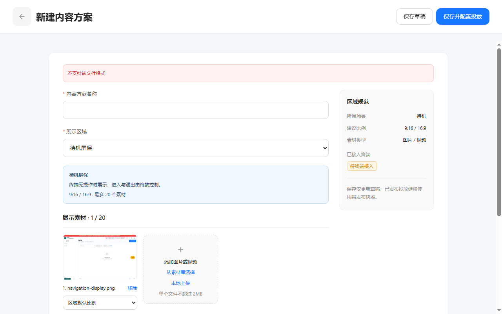

图：1280×800 功能分支隔离会话，以导航截图及受控错误文件验证；原生文件选择取消和底层读取失败尚无截图。

复用 `readMaterialImages()` 与现有素材中心数据；选择后添加引用。上传允许 PNG/JPEG/WEBP/GIF/MP4/WEBM，图片建议1MB以内；视频≤20×1024×1024字节；本期本地持久化尺寸限制不代表生产素材服务限制。读取、类型、数量及存储错误保留当前草稿，不伪造成功。

## 5. 投放对象 DisplayPlacement

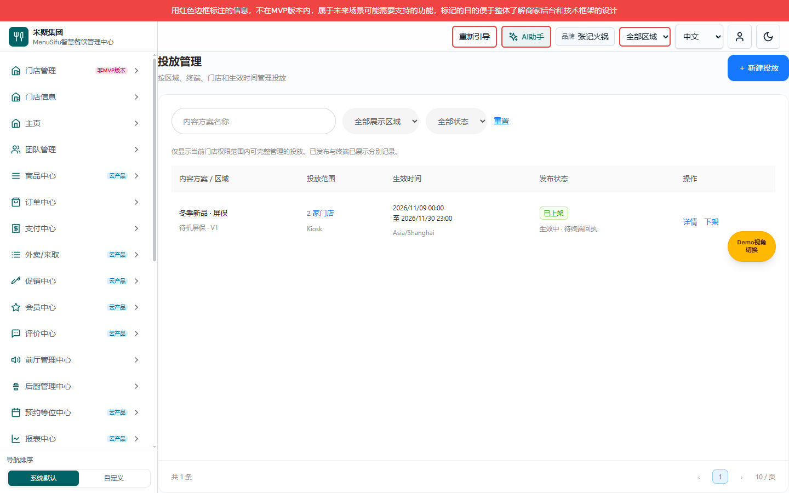

| 字段 | 类型、默认及关系 |
| --- | --- |
| id | 字符串，新增生成。 |
| contentId | 当前品牌内容 ID；保存和发布均验证存在。 |
| regionId | 保存草稿时由内容带出；发布时须与当前内容区域一致。 |
| storeIds | 去重非空数组，全部在当前品牌与账号门店范围内。 |
| terminals | 去重非空数组，全部在区域已登记支持范围内。 |
| startAt | UTC epoch 毫秒，含起点；允许早于当前时刻，结束必须晚于开始与当前时刻。 |
| endAt | UTC epoch 毫秒，不含终点；严格大于 startAt。 |
| timeZone | IANA 时区名，UI 明确选择，默认 Asia/Shanghai；起止输入按该时区转换。 |
| status | `draft`、`published`、`revoked`；区域代次变化额外使已发布记录按已下架展示。 |
| snapshot | 发布时创建，草稿为空；已发布后不可覆盖。 |
| publishedAt | 成功发布时间；取消确认、校验失败不写入。 |
| updatedAt | 保存／发布的成功时间。 |

### 向导页面与临时字段

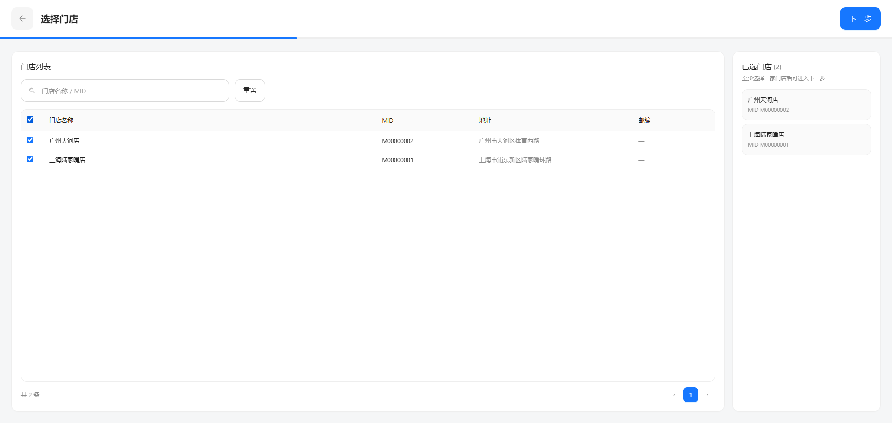

图：授权门店分页与已选集合；V1.2功能分支原生页面，隔离演示，1920×911。

| 字段／操作 | 逻辑说明 |
| --- | --- |
| 页面入口 | 内容编辑右上“选择门店”先保存内容草稿，再带入该方案；内容卡片“选择门店”直接带入。投放管理“新建投放”在此页另显示方案选择。 |
| 左上返回 | 第一步返回入口列表；有未保存投放选择时弹框确认放弃，取消保留。内容草稿已保存，不随放弃投放删除。 |
| 右上下一步 | 至少一家授权门店已选才启用；点击进入选择渠道，无底部重复按钮。 |
| 顶部进度线 | 紧贴80px页头，第一步1/3、第二步2/3、第三步全宽，不使用正文步骤条。 |
| 门店列表 | 左侧独立白色卡片，右侧320px已选门店卡片；候选限当前品牌与账号权限交集。 |
| 门店名称／MID搜索 | 仅匹配当前授权候选名称或MID，忽略大小写并去首尾空格；输入时回第一页，不清除筛选外选择。 |
| 重置 | 清空搜索并回第一页，已选门店保留。 |
| 表头复选框 | 全选／取消当前筛选结果的当前页，不影响其他页；部分选中显示indeterminate。空结果时禁用。 |
| 行复选框 | 逐店勾选／取消，即时更新右侧数量与卡片。 |
| 门店名称 | 当前授权选项的真实名称，不使用参考图的示例店名。 |
| MID | 真实storeId，独立列；按此ID持久化投放范围。 |
| 地址 | 同MID的企业门店元数据address，缺失或空白显示—，不扩大候选范围。 |
| 邮编 | 同MID元数据postalCode，缺失或空白显示—，不伪造示例。 |
| 共N条 | 当前搜索匹配的授权门店数，空结果0；不固定展示参考图88条。 |
| 页码／上一页／下一页 | 每页10条，搜索后回第一页，首尾禁用，翻页保留选择；大页数显示首尾、当前附近及省略号。 |
| 已选门店数量 | 完整已选集合数量，包括当前搜索或分页之外的选择。 |
| 已选门店卡片 | 展示真实名称及MID；移除按钮悬停或键盘聚焦时显示，移除仅作用于该店。 |

图：渠道选择；V1.2功能分支原生页面，隔离演示，1920×911。

| 字段／操作 | 逻辑说明 |
| --- | --- |
| 页面标题 | 选择渠道；左上返回上一步，右上下一步，进度2/3。 |
| 页面布局 | 约624px居中白色圆角卡片，渠道三列两行；不显示独立确认页或底部步骤操作。 |
| 渠道范围说明 | 至少选择一个渠道用于下发当前区域的展示内容；屏保区域使用屏保文案。 |
| 终端类型 | 固定显示Kiosk、eMenu、CDS、OO、SDI、取餐屏。渠道与底层terminals字段一一对应，不另建枚举。 |
| 可选条件 | 区域启用、已登记接入且支持方案全部素材类型；不因参考图示例而自动登记能力。 |
| 禁用原因 | 未接入、不兼容或停用时禁用；鼠标提示与辅助说明给出原因。全部不可用显示平台登记路径提示。 |
| 全选 | 仅选中或取消可用渠道，不包含禁用项；全部可用渠道选中时复选框勾选。 |
| 单渠道卡片 | 勾选后蓝色边框和浅蓝底，选择变更即时更新下一步可用状态。 |
| 下一步 | 至少一个可用渠道已选才启用，进入展示生效时间。 |
| 返回上一步 | 保留门店和渠道选择，返回门店页。 |

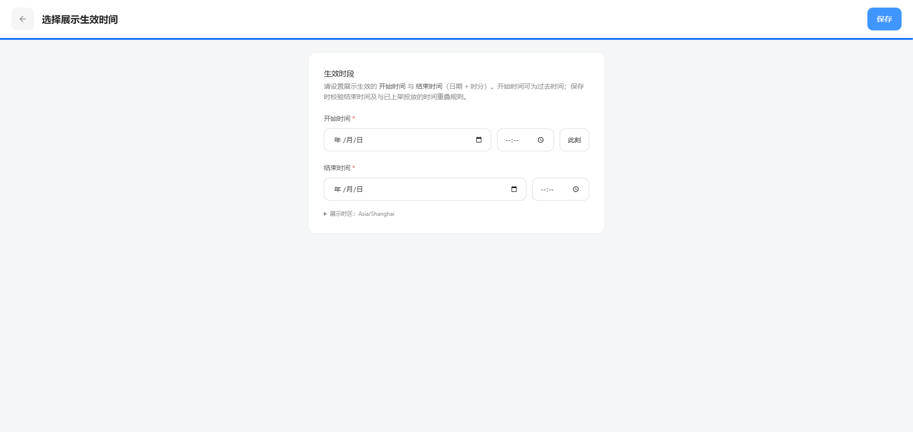

图：拆分日期时分；V1.2功能分支原生页面，隔离演示，1920×911。

| 字段／操作 | 逻辑说明 |
| --- | --- |
| 页面标题与进度 | 选择展示生效时间，进度全宽；右上唯一主要操作为保存。 |
| 页面布局 | 约624px居中白色圆角卡片，开始、结束分别由原生日期与时分输入构成。 |
| 开始日期 | 新投放默认空；保存与开始时分组合为所选时区的本地日期时间。允许过去开始时间。 |
| 开始时分 | 新投放默认空，分钟精度；缺少日期或时分时提示完整日期与时间。 |
| 此刻 | 按所选时区同时写入当前开始日期和时分；不修改结束值。 |
| 结束日期 | 新投放默认空，和结束时分组合；须满足现有业务校验。 |
| 结束时分 | 新投放默认空；结束须晚于开始和当前时刻，不自动填一天或七天。 |
| 展示时区 | 默认Asia/Shanghai；折叠入口展开后可选既有六个IANA时区。切换保留当前输入，按新时区解释。 |
| 时间异常 | 非法日期、DST缺失或重复时间、结束不晚于开始或当前时间均拒绝保存，保留输入。 |
| 左上返回 | 返回选择渠道，保留日期、时分、时区、渠道与门店。 |
| 保存 | 从四个输入及zone采集草稿，先检查权限与时间，再打开确认保存弹框；不进入第四个页面，不提供本流程“保存投放草稿”按钮。 |

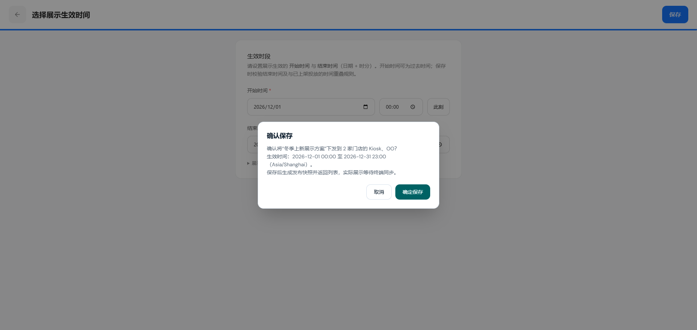

图：保存确认；V1.2功能分支原生页面，隔离演示，1920×911。

| 字段／操作 | 逻辑说明 |
| --- | --- |
| 确认摘要 | 说明方案名称、门店数、渠道、开始结束及展示时区；这是弹框而非独立第四步。 |
| 取消 | 关闭弹框，停留生效时间页，保留所有值，不写入投放。 |
| 确定保存 | 再次校验品牌与操作权限、区域接入、门店与渠道、素材、时段和同区域冲突；冻结内容版本后写入published，成功返回入口列表。 |
| 冲突／保存失败 | 弹框关闭后在时间页提示，未写入投放，当前输入保留，调整后可重新保存。 |
| 结果状态 | 管理端显示已上架／已投放与等待同步；不把保存成功当成真实设备已展示。 |

| 临时字段／对象 | 逻辑说明 |
| --- | --- |
| Flow.step | 仅1、2、3；确认弹框不增加step。入口默认1，header返回减一，第一步返回沿用草稿保护。 |
| Flow.selectContent | 从新建投放进入时true，在门店卡片内展示方案下拉；从内容方案带入或编辑已有投放时false。 |
| storePage / pageSize | 本地临时页码，pageSize=10；页数max(1,ceil(filteredCount/10))，页码钳制范围；搜索和重置回1。不持久化到投放。 |
| Flow.storeIds | 授权候选中的完整选择集合；分页和搜索不清空。selectFlowStorePage只增删当前页ID。 |
| address / postalCode | getEnterpriseMerchantSnapshotForAuthorization().stores按storeId关联，仅为已通过品牌及权限过滤的候选补充元数据；不创建新候选。缺省展示—。 |
| startDate/startTime | 原生date/time输入；readFlowWallTime两者完整时组合YYYY-MM-DDTHH:mm，否则空串并由既有wallTimeToEpoch拒绝。 |
| endDate/endTime | 同上，与开始分开；开始允许过去，end>start且end>now规则不变。 |
| Flow.start/end/zone | 返回或保存前采集四输入及zone；此刻按zone计算开始日期时分。持久化仍为startAt/endAt绝对毫秒及timeZone，不修改schema。 |
| 保存链 | 采集→当前权限→时间校验→确认→savePlacement→publishPlacement→单次saveMerchantDisplay；异常不提交半条投放。现有draft可编辑，本流程不新增保存草稿按钮。 |

### 冲突公式

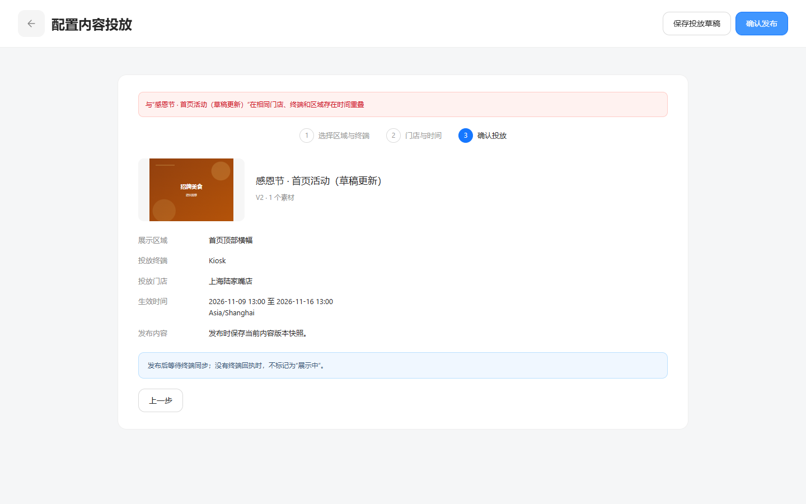

候选 C 与已发布且未撤销的 P 冲突，当且仅当：同品牌、同 regionId、存在同时启用的相同门店与产线组合（两记录disabledTargets均未排除该组合），并且 `P.startAt < C.endAt && C.startAt < P.endAt`。不比较其他品牌或其他区域，不把同一投放本身作为冲突对象；endAt≤本次操作now的过期记录不作为冲突对手，即使新投放开始时间在过去。

| 算例 | 结果 |
| --- | --- |
| 同区域同店同端，10:00～11:00 与 11:00～12:00 | 不冲突，半开区间相邻。 |
| 同区域同店同端，10:00～11:00 与 10:30～11:30 | 冲突，不写入发布。 |
| 同店同端同时间，首页 home.banner 与购物车 cart.banner | 不冲突。 |
| 时间相交但门店无交集、终端无交集或旧投放已撤销 | 不冲突。 |

## 6. 发布快照、撤销与区域停用

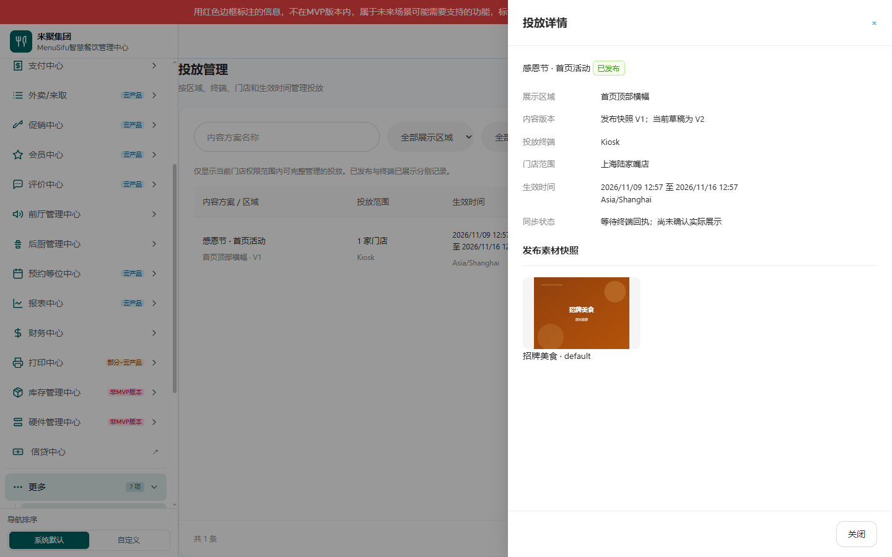

snapshot 保存 contentId、name、version、regionCode、generation、assets、settings；通过结构化深拷贝与草稿分离。冻结的是素材引用、类型和顺序，素材服务需保证引用版本稳定，不宣称已复制远端文件字节。

| 动作／状态 | 前置、写入及结果 |
| --- | --- |
| 发布草稿 | 当前权限有效、目标范围合法、区域启用、终端及素材匹配、未过期且无冲突；创建快照并进入 published。 |
| 重复发布已发布记录 | 拒绝覆盖快照；需另建投放。 |
| 撤销 | 仅 published 且当前拥有全部目标门店权限；写 revoked。 |
| 区域停用 | 目录 enabled=false、generation+1；所有品牌旧代次发布立即不再被解析，不需遍历改写每个品牌存储键。 |
| 重新启用 | enabled=true，generation 保持；旧代次仍视为撤销，不自动恢复。 |
| 已结束 | `now >= endAt`，无有效内容；发布记录保留便于追溯。 |

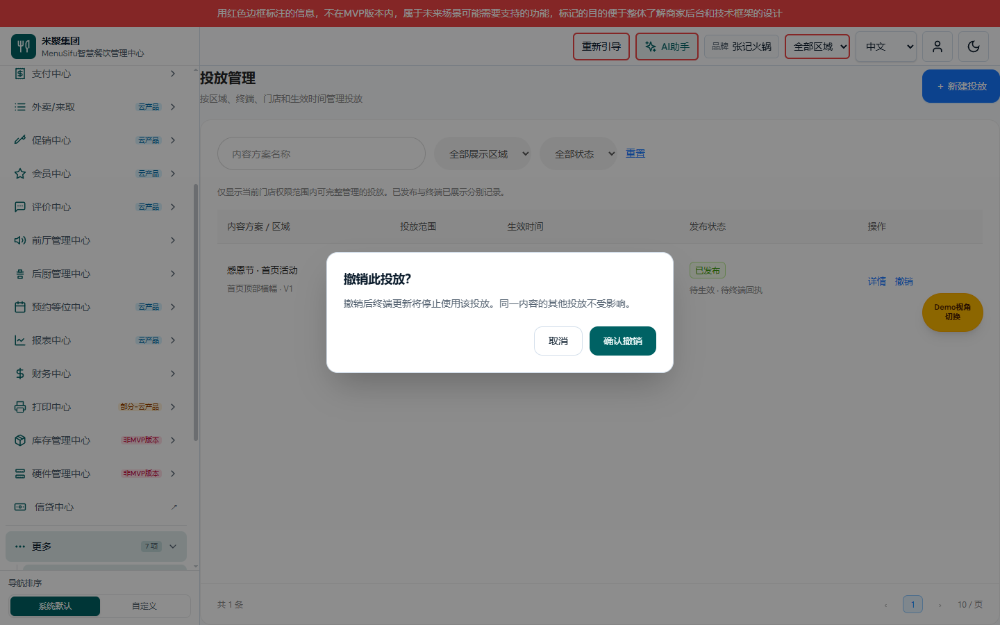

确认成功刷新列表；取消不写入。发布状态与待生效／生效中／已结束的时间状态独立，没有设备回执不标记展示中。

## 7. 终端解析合同

公开纯函数：`resolveTerminalContent(platform, merchantState, request)`。这是可移植的消费合同，不是已部署 HTTP 接口。

| 请求字段 | 含义 |
| --- | --- |
| scope | 品牌，与 merchantState.scope 一致。 |
| storeId | 本次设备所属门店。 |
| terminal | 设备产品线。 |
| regionCode | 稳定区域编码。 |
| version | 设备实际版本，三段或四段数字。 |
| now | UTC epoch 毫秒。 |
| variant | 可选，明确所需素材比例。 |

| 响应字段 | 含义 |
| --- | --- |
| regionCode | 对应请求区域。 |
| revision | 平台版本、品牌版本以及匹配发布／内容快照版本组成的缓存标识。 |
| items | 快照素材，不读取当前可变草稿；先匹配 variant，再退 default；未指定比例时取默认或首个比例的素材组。 |
| settings | 发布时冻结的参数。 |
| validUntil | 有效内容的结束时刻，空结果为 null；缓存不得越过此边界。 |
| clear | 无可用内容时 true，要求清空旧区域内容，不持续展示失效缓存。 |
| reason | active、scope-mismatch、region-disabled、unsupported-terminal、no-active-content、conflicting-publications、missing-snapshot、missing-compatible-media。 |

若损坏数据导致同时命中多个发布，拒绝随机挑选，返回清空。真实接口必须独立校验设备身份、品牌与门店绑定，不能信任请求自行声称的 scope。

## 8. 旧屏保导入与异常

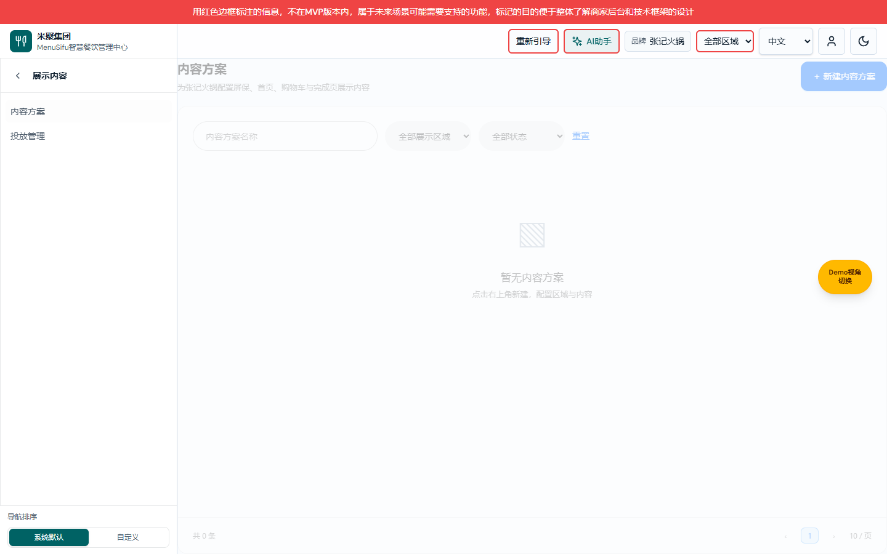

导入入口仅在本浏览器检测到旧 `kiosk_themes` 时出现。用户确认当前品牌归属后，将完整可读取、符合每比例5图或1视频及区域总数限制的方案按横竖比例转换成内置屏保内容草稿；legacyIds 防止重复导入。旧时间、渠道、无归属门店不自动形成新发布；原记录不覆盖、不删除。

| 异常 | 处理 |
| --- | --- |
| 品牌变化／权限撤销 | 保存前重新校验，拒绝写入其他品牌。 |
| 存储 JSON 损坏／schema 未知 | 保留原值并提示，不回退空状态后覆盖。 |
| 版本已变化 | 提示其他窗口已修改；当前表单保留。 |
| quota 或存储不可用 | 不更新成功状态与 revision，保留草稿供减少素材后重试。 |
| 图片／视频不可读 | 先通过原 MenuSifu_kiosk_theme_media/blobs 读取 IndexedDB 引用；缺失媒体、无可读素材或超出素材限制的方案整条跳过，不截断导入、不写入 legacyIds；没有可导入方案则报错，原数据保留。资产缺口在独立清单登记。 |

## 9. 预览与区域停用界面

预览按所选比例读取全部素材，支持翻页、25%—300%缩放与原生视频控件；布局示意不参与发布、版本或终端状态判定，关闭不持久化。

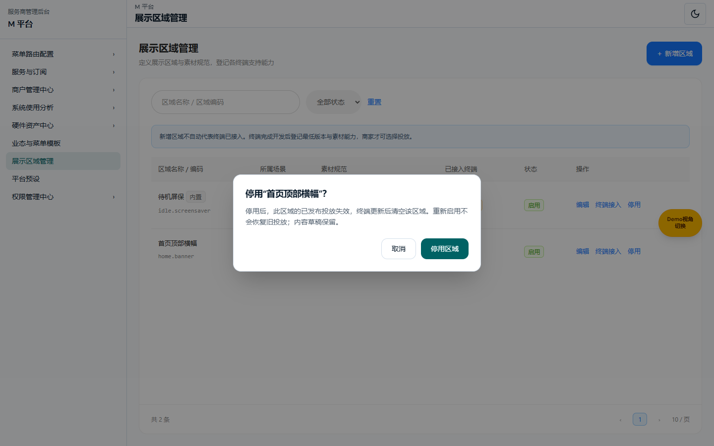

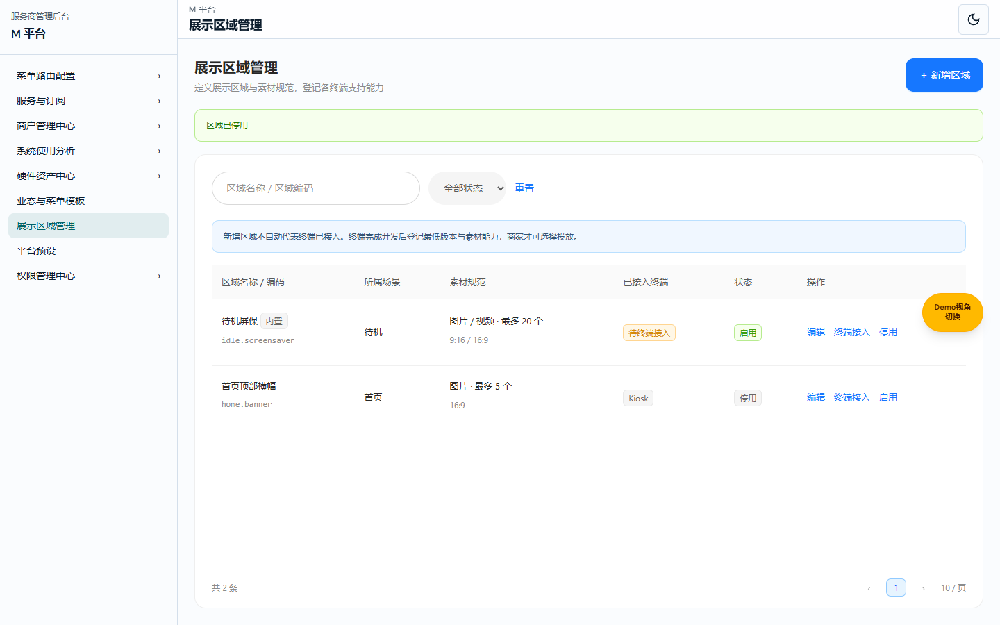

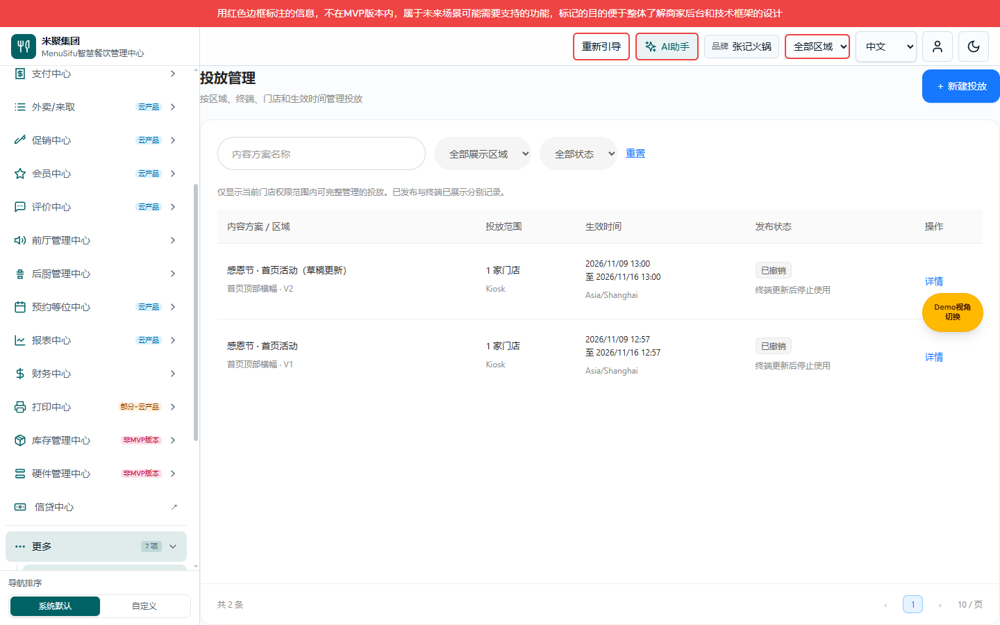

停用保存 enabled=false、generation+1；启用仅 enabled=true。placementIsRevoked按快照代次与当前区域判定，历史记录不需要批量改写。确认取消及启用界面见个人规范第十七节。

## 10. 复用对象与状态补充

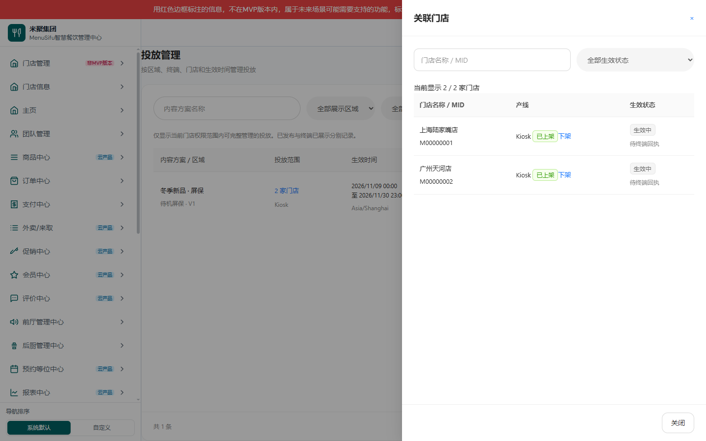

图：实际功能页面；功能分支 V1.1，隔离演示会话。

| 字段／操作 | 逻辑说明 |
| --- | --- |
| settings.transition | 选填字符串，枚举slide/fade/zoom/rotate/bounce/flip；内置屏保或开放transition的区域保存，缺省slide；冻结到snapshot.settings并由resolver返回。旧快照无值时终端使用默认效果。 |
| assets[].variant | 区域已声明比例或default；每比例不得图片视频混合，图片≤5、视频≤1，总量≤region.maxItems。 |
| 视频资源 | 本地上传Blob保存到原屏保IndexedDB的MenuSifu_kiosk_theme_media/blobs，URL表示为display-media:<id>；不将blob URL写入持久化。渲染异步读取Blob生成会话URL，关闭或重渲染释放。真实跨设备接口需将其转换为媒体服务地址，不能下发浏览器本地引用。 |
| disabledTargets | placement可选string[]，默认空；元素storeId|terminal。单目标下架加入集合，上架移除；两者均重检品牌、完整门店权限、投放有效及目标存在。 |
| 单目标重新上架 | 检查所有有效投放中相同门店、产线、区域及重叠时间的启用目标；冲突不写入。草稿和过期、撤销、区域代次失效记录不提供有效内容。 |
| resolver | 原筛选后排除disabledTargets包含当前storeId|terminal的记录；目标下架后返回明确clear；其他目标仍消费同一内容快照。 |
| 复制内容 | 复用saveContent产生新id与V1，不复制legacyId和placements；原素材引用可共用，不改原快照。 |
| 删除内容 | requireContext后拦截未撤销且endAt>now的published记录；删除contents对象及关联draft投放，不删原媒体、已下架或结束的历史记录和snapshot。 |
| 时间默认值 | 新投放start/end均空；编辑draft带入原值；开始可过去，end>start且end>now。发布时再次检查end>now。 |
| 列表文案映射 | draft待上架；有效published已上架；revoked、代次失效或到期已下架。枚举与历史数据仍为draft/published/revoked，不进行批量重写。 |

## 11. 验证入口

`npx --no-install tsx scripts/verify-display-reference-flow.ts`覆盖分页、跨页选择、转义、渠道兼容和拆分时间输入；`npm run verify:display-content` 覆盖稳定编码、权限、跨品牌／门店过滤、发布快照、版本数值比较、半开时间、同区域冲突、停用与撤销、导入幂等、存储损坏／quota／旧版本及 DST。公共递归导航与营销权限回归分别使用现有脚本，执行方式和结果见独立清单。
