# 广告位管理产品权威需求文档

版本：V1.10；日期：2026-11-12；变更编号：AD-POSITION-FIRST-20261112-01。共同业务基线：PC端广告位管理、第一步展示位置单选及按位置区分素材规格。

文档范围：仅PC端广告位管理；M平台及扩展内容方案、投放管理不纳入当前交付。

职责：产品范围、角色、业务规则与验收口径。[产品 V1.10](展示内容产品权威需求文档.md) · [研发 V1.10](展示内容业务规格说明书（研发交付版）.md) · [个人规范 V1.10](展示内容需求文档（个人规范版）.md) · [验证与交付缺口](交付缺口与逐操作截图清单.md)。

## 广告位管理列表：投放渠道与展示位置

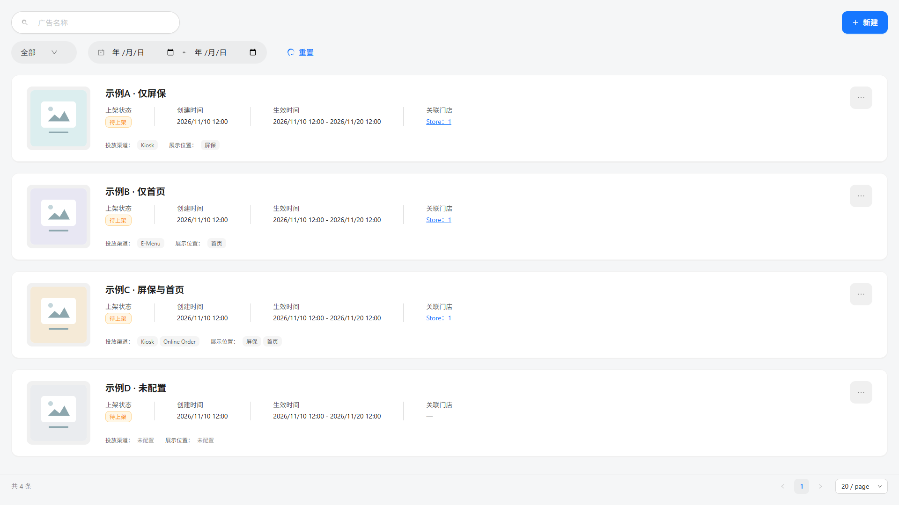

图：当前项目PC页面；隔离示例数据。

用途／入口：营销中心 → 营销广告 → 广告位管理。卡片底部展示活动已保存的渠道和位置，原缩略图、名称、状态、时间、门店及更多菜单保持原流程。

| 字段／操作 | 逻辑说明 |
| --- | --- |
| 投放渠道 | 独立标注“投放渠道：”，沿用原渠道标签文案；无有效渠道显示“未配置”。 |
| 展示位置 | 独立标注“展示位置：”，仅作为列表信息，不提供直接切换或保存。 |
| 屏保 | 已保存位置包含screensaver时展示；不因位置字段缺失自动推断为屏保。 |
| 首页 | 已保存位置包含home时展示。 |
| 历史双位置 | 分别展示屏保、首页两个标签，固定按该顺序；不显示“全部”。 |
| 未配置 | 活动及回显偏好均无有效位置，或活动位置显式为空／无效时显示；不写回位置，不改变现有发布状态。 |
| 列表读取 | 优先活动已保存位置；活动没有该字段时读取已保存的回显偏好。显式空值不以旧偏好补齐；不读取本轮未保存的临时选择。 |
| 修改位置 | 进入编辑，在内容页“修改展示位置”中单选后继续门店、渠道、生效时间和保存；标签本身不触发编辑或发布。 |
| 历史记录 | 缺少可信历史识别信息时按用户确认先显示未配置；“老活动默认屏保”兼容方案不在本次实现范围。 |

### 名称筛选后的标签

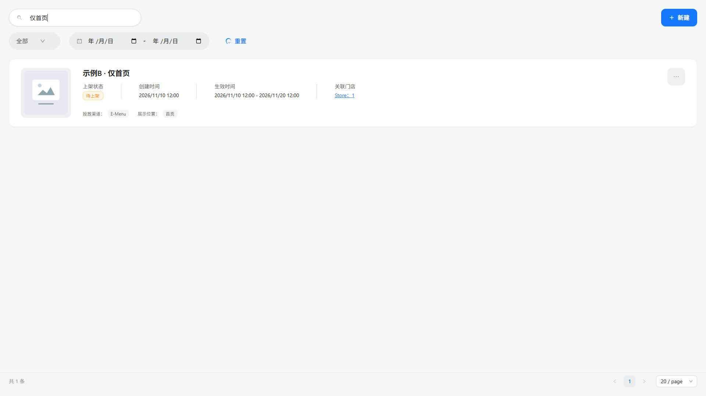

图：当前项目PC页面；隔离示例数据。

| 字段／操作 | 逻辑说明 |
| --- | --- |
| 广告名称筛选／重置 | 沿用原筛选，结果仍显示相应活动的位置；重置恢复完整列表。 |

## 广告位管理：页面命名

图片来源：当前功能分支实际PC页面，2026-11-12采集；使用隔离示例数据。

### 广告列表

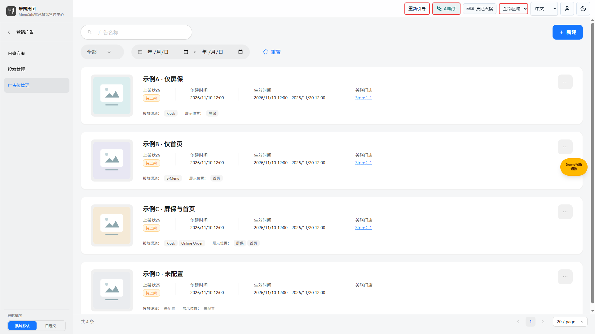

图：当前项目PC页面；隔离示例数据。

用途／入口：营销中心 → 营销广告 → 广告位管理；沿用 /marketing/screensaver。

| 字段／操作 | 逻辑说明 |
| --- | --- |
| 广告位管理 | 第三个子菜单及原页面权限名称；与内容方案、投放管理同级。中文名称统一，英文 Ad placement management。 |
| 广告名称 | 列表筛选、编辑字段及校验中的对象名称；原name字段及用户已保存名称不修改。 |
| 暂无广告 | 没有广告时的空状态；提示创建广告并投放到门店设备。 |
| 广告预览 | 预览占位、素材预览及版式切换的称呼；原横竖版、缩放功能保留。 |
| 删除广告 | 原删除确认及后果保留，删除对象统一称广告。 |

### 新建与编辑广告

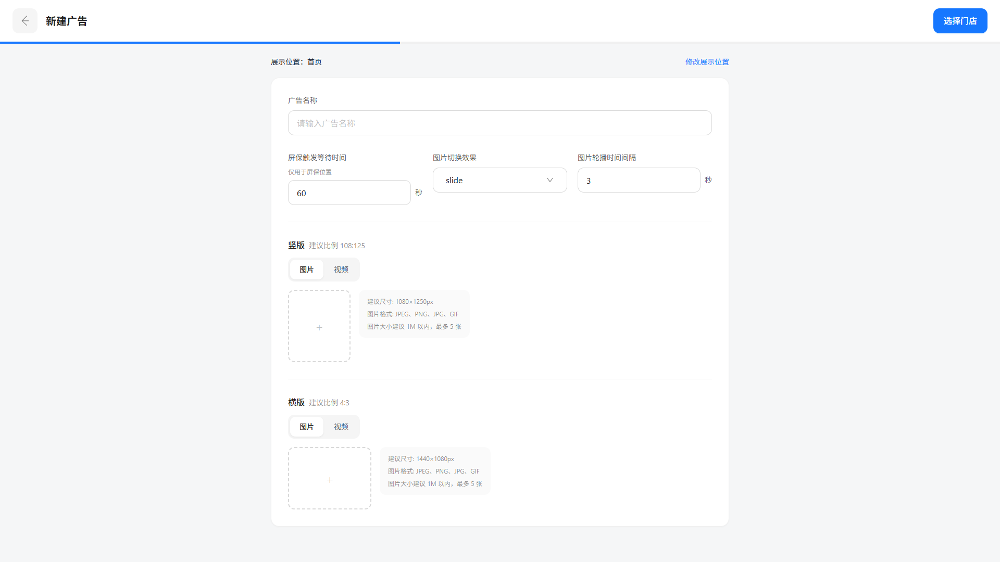

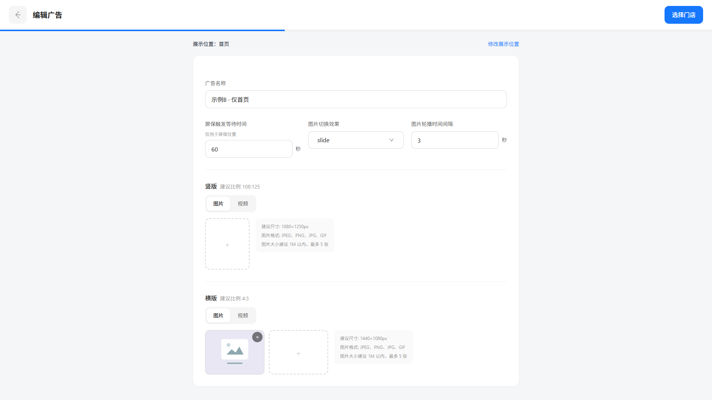

图：当前项目PC页面；隔离示例数据。

| 字段／操作 | 逻辑说明 |
| --- | --- |
| 新建广告／编辑广告 | 原新建、编辑页标题；广告名称输入、必填提示统一。 |
| 屏保触发等待时间 | 原idleTimeoutSec，秒、默认60、正整数约束沿用；显示“仅用于屏保位置”，不表示首页受空闲触发控制。 |
| 广告素材 | 上传校验、预览及新增素材自动名称使用广告称呼；素材库既有屏保素材分类保留，不迁移分类或改写用户素材名。 |

### 投放流程

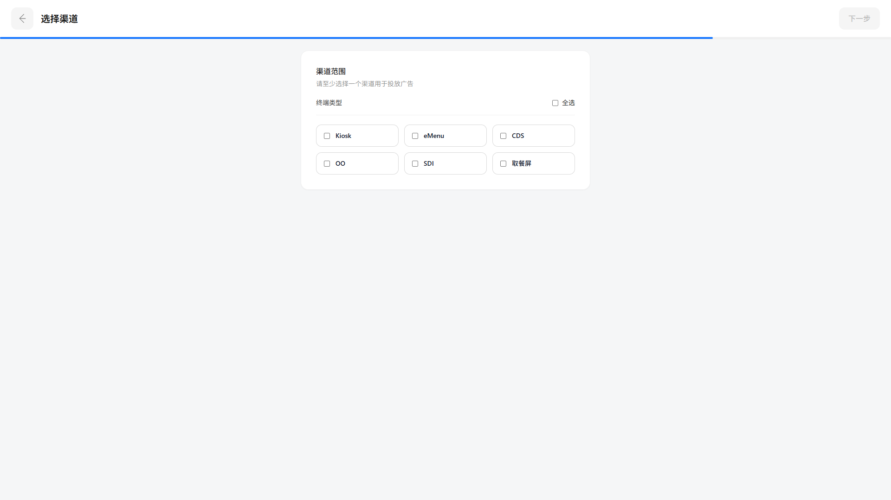

图：当前项目PC页面；隔离示例数据。

| 字段／操作 | 逻辑说明 |
| --- | --- |
| 投放广告 | 门店、渠道、时间页文档标题及相关确认统一称投放广告；渠道说明为“请至少选择一个渠道用于投放广告”。 |
| 屏保／首页 | 展示位置选项保持原名称与稳定值；新建第一步空选，必须单选一项；渠道页不再配置展示位置。 |
| 冲突与校验 | 原提示中的主题对象统一称广告；排期、重叠、保存、发布和回执逻辑不因改名改变。 |

## 展示位置：新建第一步

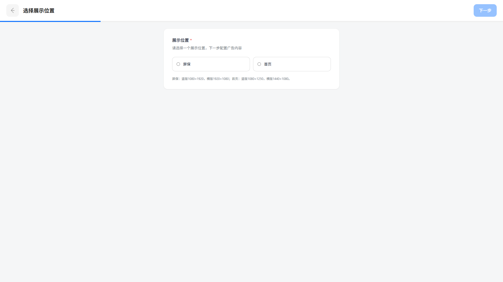

图：选择展示位置，初始未选。

入口：广告位管理 → 新建。选择一个位置后进入广告内容页，再按门店 → 渠道 → 生效时间完成配置。

| 字段／操作 | 逻辑说明 |
| --- | --- |
| 展示位置 | 必填单选，选项为屏保、首页；新建初始均不选，不提供全选。 |
| 屏保 | 值 screensaver；选择后使用屏保素材规格。 |
| 首页 | 值 home；选择后使用首页素材规格。 |
| 下一步 | 未选择时禁用；选择一项后进入广告内容配置页。此时不创建活动、不发布广告。 |
| 修改展示位置 | 内容页显示当前所选位置，点击返回位置选择；名称、素材和其他表单输入保留，确认后更新尺寸提示与上传预览比例。 |
| 返回 | 新建内容页返回位置选择；位置页返回列表，沿用原新建草稿清理。编辑返回沿用原放弃确认。 |
| 编辑与历史数据 | 已保存单位置正常回显；缺失、空值或包含两个位置时，要求重新选择一项；保存前不改已有活动，未编辑的历史双位置活动保留原标签。 |
| 保存 | 内容页保存时记录所选位置，后续页面只读取；生效时间页再次校验恰好一项，否则提示“请返回广告编辑页，选择一个展示位置。”并保留页面及输入。 |
| 渠道范围 | 仅保留终端渠道多选及全选；不再展示展示位置，至少选择一个渠道可进入生效时间页。 |
| 保存失败／取消 | 沿用原错误提示与确认流程；不跳转成功页，不自动选择或批量改写历史位置。 |

### 广告内容与素材尺寸

图：首页广告内容与素材规格。

| 字段／操作 | 逻辑说明 |
| --- | --- |
| 首页竖版 | 建议尺寸1080×1250px，比例108∶125；图片、视频提示及上传预览框一致。 |
| 首页横版 | 建议尺寸1440×1080px，比例4∶3。 |
| 屏保竖版 | 建议尺寸1080×1920px，比例9∶16。 |
| 屏保横版 | 建议尺寸1920×1080px，比例16∶9。 |
| 素材约束 | 尺寸为上传建议，不新增像素尺寸拦截；原格式、大小、数量、排序、删除、图片／视频切换规则继续生效。修改位置保留素材，由用户按新规格检查或替换。 |
| 其他配置 | 名称、屏保触发等待时间、切换效果、轮播间隔、门店、生效时间及保存／上下架沿用现有流程；等待时间仍仅用于屏保。 |

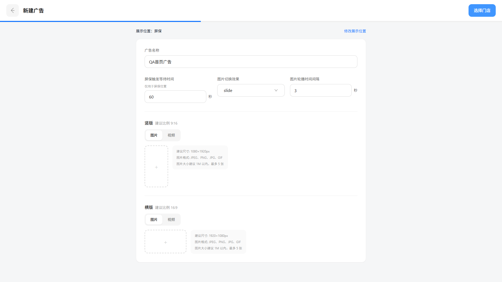

图：屏保广告内容与素材规格。

图：渠道页只保留终端渠道选择。

### 历史双位置编辑

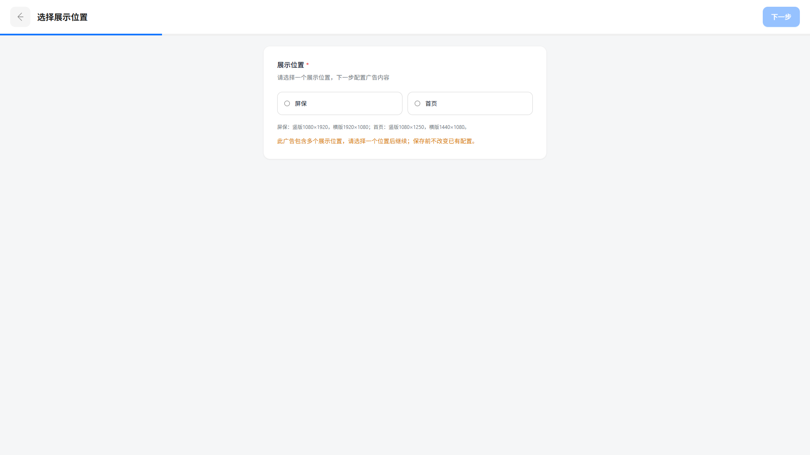

图：未保存前保留历史配置，编辑时要求重新单选。

### 生效时间页保存校验

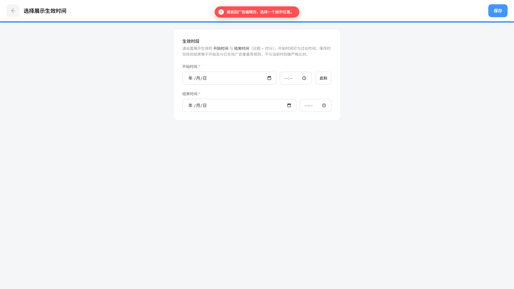

图：隔离验证清空临时位置后，实际保存操作被拦截。校验规则见本节保存项。

## 菜单名称

菜单名称为“营销广告”（英文 Marketing ads）。父项标识 mkt-screensaver、路由、权限键和三个子菜单的路由及功能保持现有定义。文档文件名沿用既有唯一入口。

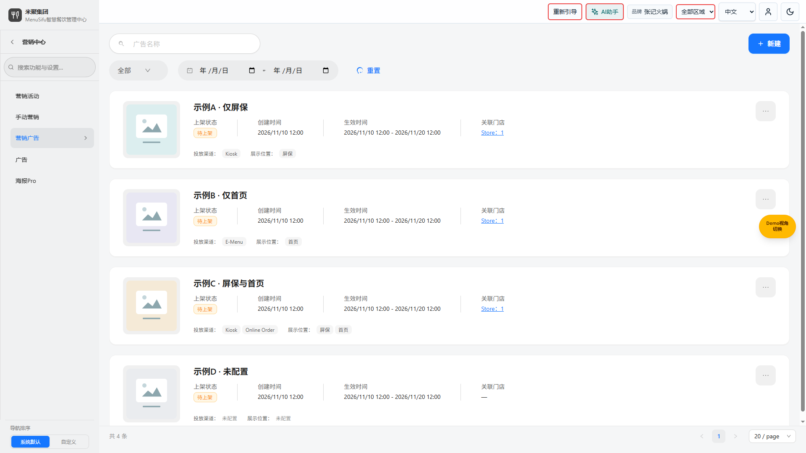

图：当前项目PC页面；隔离示例数据。

## 广告位管理

图：当前项目PC页面；隔离示例数据。

图：当前新建内容页，展示位置为首页。

用途／入口：营销中心 → 营销广告 → 广告位管理。内容方案、投放管理的顺序、页面及操作保持现状。

| 字段／操作 | 逻辑说明 |
| --- | --- |
| 广告位管理菜单 | 第三个同级叶子，标识 `mkt-legacy-screensaver`；进入 `/marketing/screensaver`，公共子导航保持显示并高亮广告位管理。 |
| 原页面宿主 | 直接加载 `Configuration center/kiosk-screensaver.html` 原 iframe，内部进入 `kiosk-theme-list.html`；不重写原页面。 |
| 原编辑与下发 | 沿用原新增、编辑、素材上传、横竖版预览、门店、渠道、生效时间、保存、上架与下架流程及校验；独立页面内部保持原交互。 |
| 全屏与返回 | 原新增／编辑页进入全屏，门店／渠道／时间页保持，返回原列表退出全屏；原取消及返回行为保留。 |
| 权限 | 原 `page:/marketing/screensaver` 及管理操作键保持；查看默认只读，隐藏祖先和现有预设过滤继续生效；不因新增入口自动授予编辑。 |
| 数据 | 原 `kiosk_themes` 及原媒体 IndexedDB 沿用；与内容方案／投放记录分别存储，不自动迁移或下发。浏览器不同端口属于不同源，不自动复制旧源数据。 |
| 默认入口 | `/marketing/display-content` 仍进入内容方案；`/marketing/screensaver` 不再转至内容方案。 |
