# 广告位管理产品权威需求文档

版本：V1.23；日期：2026-11-23；共同变更编号：AD-SELECTED-SUMMARY-20261123-06。业务基线：已确认单渠道、单位置，M平台按产线配置广告位与多套素材规格。

职责：产品范围、业务规则与验收依据。配对文档：[产品 V1.23](展示内容产品权威需求文档.md) · [研发 V1.23](展示内容业务规格说明书（研发交付版）.md) · [个人规范 V1.23](展示内容需求文档（个人规范版）.md)。

## 范围与公共规则

PC端广告位管理与M平台展示区域配置使用同一套业务定义。一条广告对应一个渠道、一个展示位置；位置身份为“所属产线＋位置编码”，同名位置及同名规格在不同产线间不共享配置。内容方案、投放管理的其他功能不在本文展开。

图片使用隔离示例数据；V1.15渠道、首页名称截图来自2026-11-16功能分支，未变更页面沿用图注版本。保留渠道为Kiosk、eMenu、CDS、取餐屏、Waitlist，均内置独立屏保位置；Kiosk另有首页。已有位置配置保留，其他位置仍由M平台配置并登记接入后开放。eMenu的300×600、600×900为验证用配置，不代表该产线统一标准。

## 商家端：广告列表

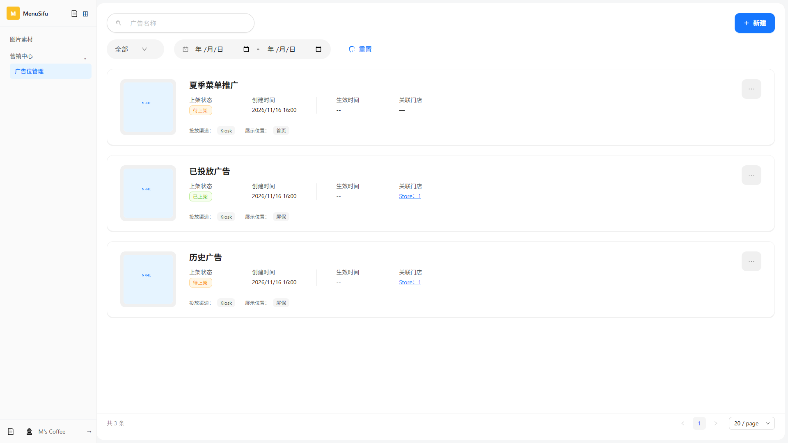

入口：营销中心 → 营销广告 → 广告位管理。

| 字段／操作 | 逻辑说明 |
| --- | --- |
| 广告名称筛选 | 按名称筛选；重置恢复完整列表，渠道与位置标签跟随结果。 |
| 上架状态、日期筛选 | 沿用现有状态与日期筛选，不因新增广告位改变原含义。 |
| 新建 | 进入“选择渠道与广告位”，不自动创建活动。 |
| 广告卡片 | 保留素材缩略图、广告名称、上架状态、创建时间、生效时间与关联门店。 |
| 投放渠道 | 新广告显示唯一渠道；历史多渠道记录保留原标签，不自动拆分。 |
| 展示位置 | 新广告显示所选位置名称；历史缺失显示未配置，历史双位置仍保留两个标签，不自动改写。 |
| 编辑 | 回显原投放配置；仅明确从未发布的草稿可更换渠道、位置。曾发布或历史不明的广告通过复制更换。 |
| 复制广告 | 进入新建流程，名称加“（副本）”，带入源素材；须重新确认位置，保存前校验目标规格。原广告、投放范围和排期不修改，不自动发布副本。 |
| 素材预览 | 打开现有预览弹框；保留横竖版切换、上一张、下一张、缩放和关闭。 |
| 上架 | 新广告再次校验广告位启用与接入、保存的规格版本及素材规则，再执行原排期和冲突校验。 |
| 下架、删除 | 保留现有确认、成功和失败流程；不因广告位配置变化自动删除活动。 |

## 商家端：选择渠道与广告位

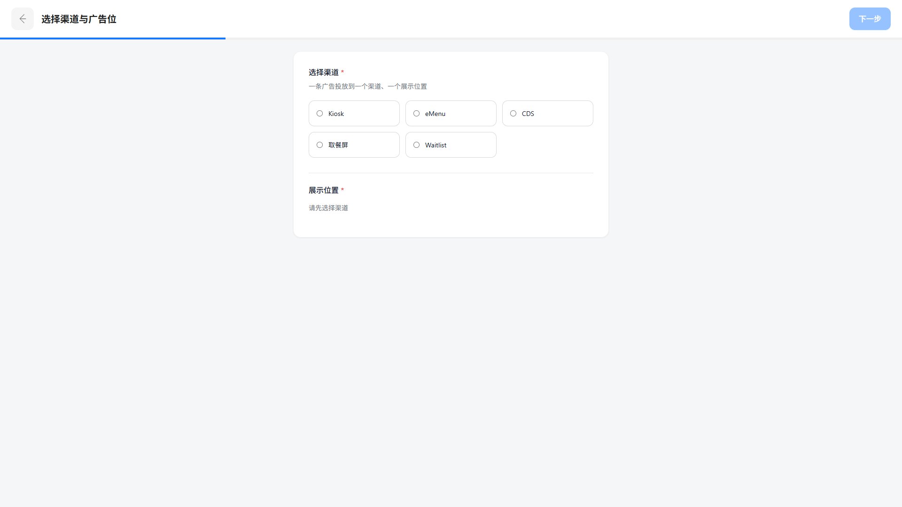

新建第一步，进入时渠道、位置均不选；复制广告可带入源渠道，但位置仍须确认。

| 字段／操作 | 逻辑说明 |
| --- | --- |
| 选择渠道 | 单选Kiosk、eMenu、CDS、取餐屏或Waitlist，必选；不提供OO、SDI。历史广告与已保存产线记录保留。 |
| 展示位置 | 仅加载所选渠道下已启用、有规格且已登记接入的位置；单选必选，无全选。主动选择渠道后默认选中可用屏保；Kiosk可切换首页。已停用或未接入的位置不自动恢复。编辑已有广告保留原位置。 |
| 无可用位置 | 显示“该渠道暂无可用广告位，请联系平台管理员配置并登记接入”，下一步禁用。 |
| 下一步 | 渠道与位置均有效才启用；进入广告内容页，读取所选广告位规格。 |
| 返回 | 新建返回列表；已有新建草稿沿用原放弃清理。编辑返回保留原放弃确认。 |

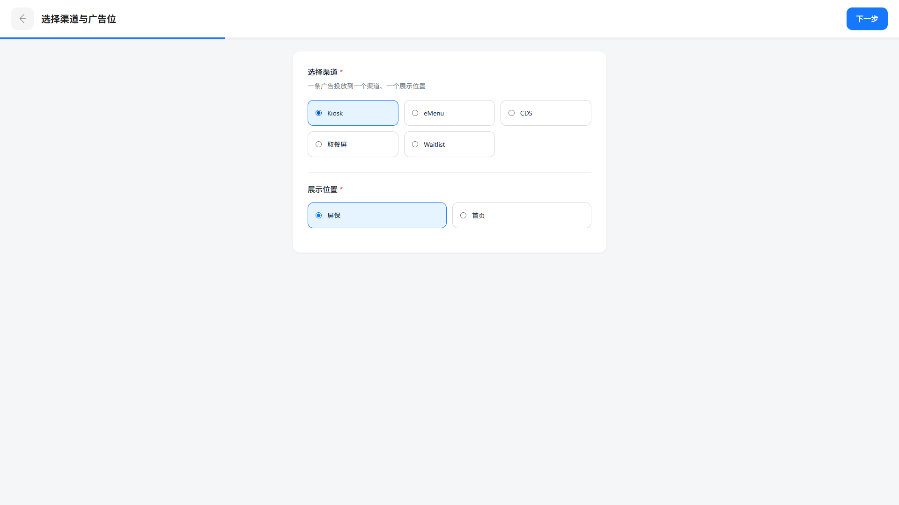

图：V1.15实际PC页面，Kiosk默认屏保，可改选首页；home编码、规格和历史快照不变。

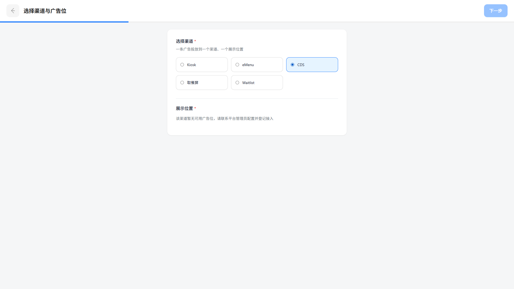

图：V1.15实际PC页面，示例中CDS屏保被管理员停用，无可用位置时拦截。

图：V1.15实际PC页面，eMenu默认选中本产线屏保；自定义位置按已有配置保留。

### Waitlist渠道

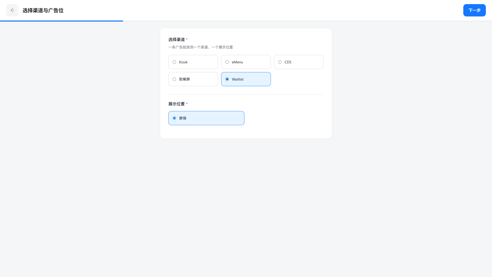

图：V1.15实际PC页面，选择Waitlist后默认选中屏保。

| 字段／操作 | 逻辑说明 |
| --- | --- |
| Waitlist | 渠道值Waitlist；新建初始不勾选，与其他渠道互斥。 |
| 屏保 | Waitlist内置位置，编码screensaver，身份ad-waitlist-screensaver；不共享Kiosk位置配置。 |
| 默认素材规格 | 竖版1080×1920、横版1920×1080，推荐尺寸；图片／视频、格式、数量与大小沿用内置屏保规则。M平台可按Waitlist独立维护。 |
| 保存 | 记录唯一渠道Waitlist、位置screensaver及本位置规格快照，后续门店与时间流程保持。 |

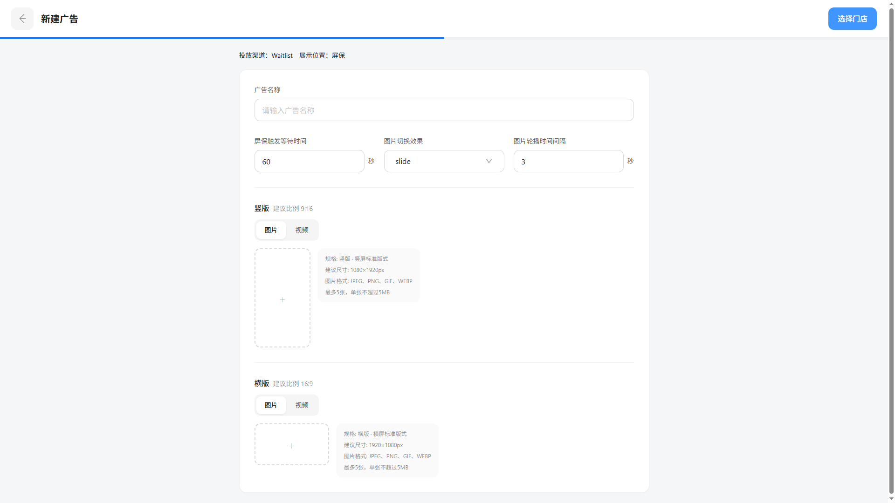

图：Waitlist屏保横竖版素材要求；仅为项目内配置，不代表真实Waitlist终端已接入。

## 商家端：广告内容与素材

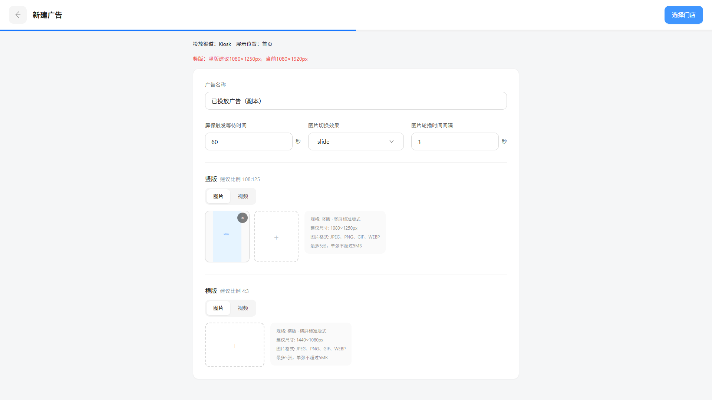

用途：填写广告内容，按所选位置的规格上传素材。

| 字段／操作 | 逻辑说明 |
| --- | --- |
| 渠道、位置摘要 | 只读显示当前渠道与位置，不展示规格版本号。内部保留规格版本及校验。 |
| 广告名称 | 必填；编辑回显，复制带入副本名称；沿用原名称保存校验。 |
| 屏保触发等待时间 | 秒，默认60，正整数；仅用于屏保，不控制首页触发。 |
| 图片切换效果 | 默认slide，保留原slide、fade、zoom、rotate、bounce、flip选择。 |
| 图片轮播时间间隔 | 秒，默认3，正整数；沿用原播放设置。 |
| 素材规格选择 | 同方向有多套规格时可切换；每套分别保留素材、类型与顺序。没有配置的方向不显示上传区。 |
| 尺寸与比例 | 来自广告位规格；Kiosk首页竖版1080×1250、横版1440×1080，屏保竖版1080×1920、横版1920×1080。其他产线独立配置。 |
| 图片／视频 | 仅展示规格与接入能力共同支持的类型。同一规格不混用图片与视频；切换类型清空当前规格素材，其他规格保留。 |
| 本地上传 | 校验格式、大小、尺寸及视频时长；严格尺寸不符合时不加入素材，提示具体规格要求。 |
| 素材库选择 | 复用现有分类、多选与确定流程；加入和保存时按同一规格规则校验，不因来自素材库而跳过。 |
| 数量 | 每套规格按M平台配置限制，图片1～20张上限、视频最多1个；不同规格分别计数。 |
| 排序、删除 | 保留原拖动排序、删除行为，仅影响当前规格。 |
| 选择门店 | 至少一套规格有素材且原表单校验通过，才保存内容草稿并进入门店页；推荐尺寸不一致时提示确认，取消留在内容页。 |
| 保存失败 | 保留页面和输入，提示素材或存储错误；不显示保存成功、不继续跳转。 |

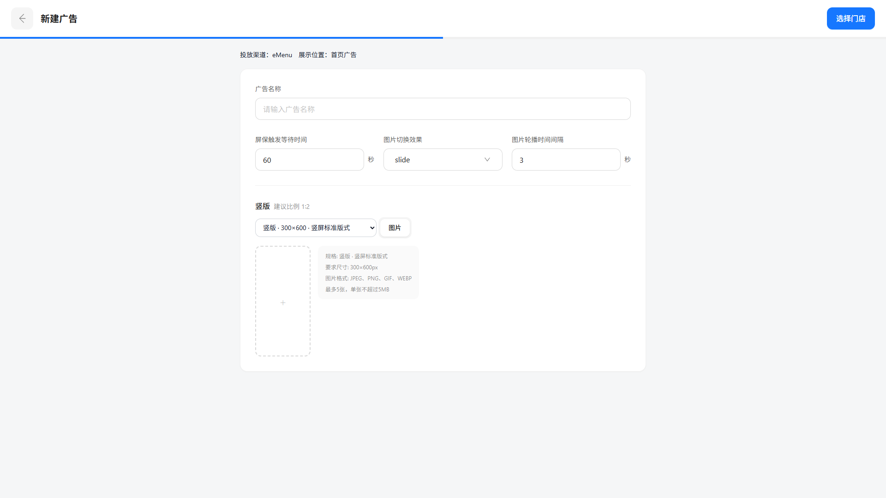

图：eMenu配置仅支持图片、300×600严格尺寸。

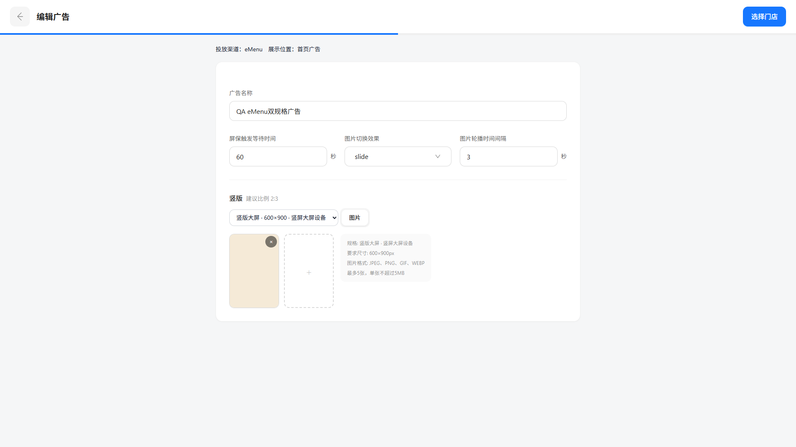

图：同一位置的竖版标准屏与竖版大屏分别配置素材。

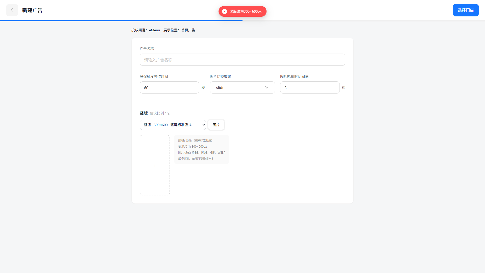

图：300×600严格规格拦截500×600图片。

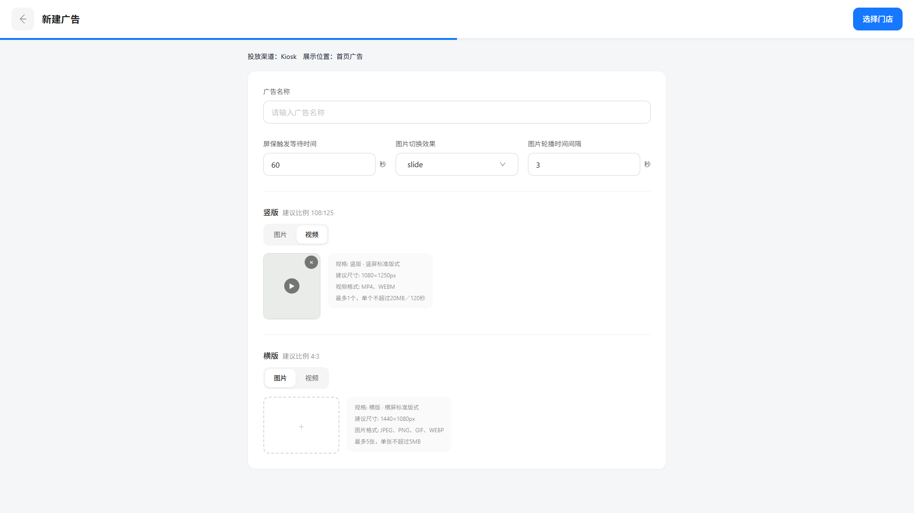

图：视频规格显示格式、大小、时长和数量要求。

### 编辑：从未发布的草稿

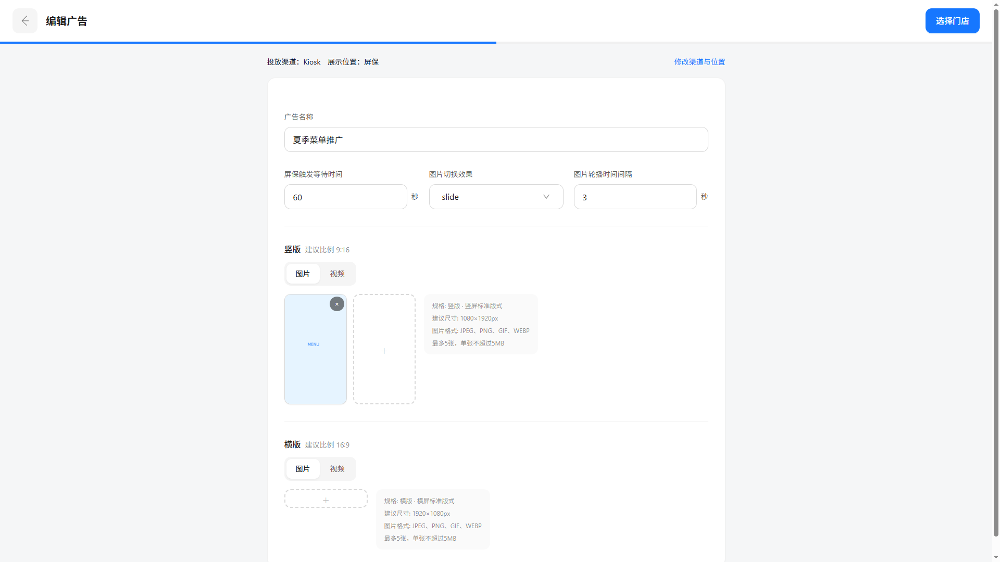

图：V1.14功能分支实际PC页面，1920×1080，隔离示例数据。

| 字段／操作 | 逻辑说明 |
| --- | --- |
| 修改渠道与位置 | 仅对明确从未发布的草稿显示；进入选择页并回显当前渠道、位置。广告名称、播放参数和素材暂存于当前页面。 |
| 发布历史 | 上架成功即视为曾发布，包括待生效广告；下架、过期、内容编辑和重新保存草稿均不恢复更换权限。历史信息不足时不根据“草稿”状态推断从未发布。 |

### 编辑：更换渠道与位置

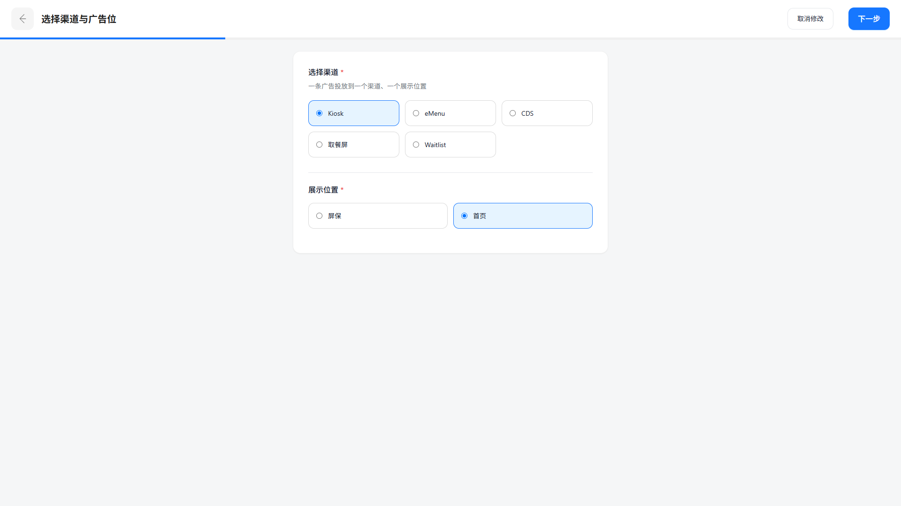

图：V1.15实际PC页面，草稿修改目标；与新建共用单渠道、单位置选择。

| 字段／操作 | 逻辑说明 |
| --- | --- |
| 渠道 | 必选单选；更换后仅展示目标渠道的可用位置，默认选择可用屏保；无可用屏保时须选择其他位置。 |
| 展示位置 | 必选单选；名称相同的位置也按所属渠道区分。 |
| 下一步 | 两项有效后进入内容页；素材按目标规格重新检查，此时不写入原广告。 |
| 取消修改／返回 | 退出本次选择，恢复进入选择页前的渠道、位置、素材与输入；不写入广告、不清空已保存门店。 |

#### 有素材时的切换确认

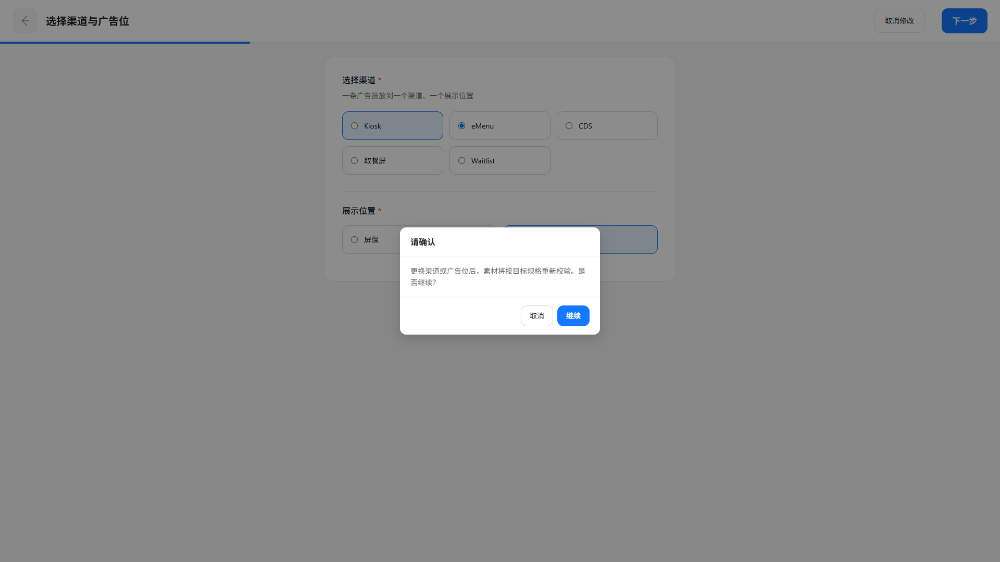

图：V1.15实际PC弹框。

| 字段／操作 | 逻辑说明 |
| --- | --- |
| 继续 | 切换当前选择，带入素材后按目标规格校验。 |
| 取消／Esc | 保持当前渠道、位置与素材。 |

### 编辑：目标规格校验

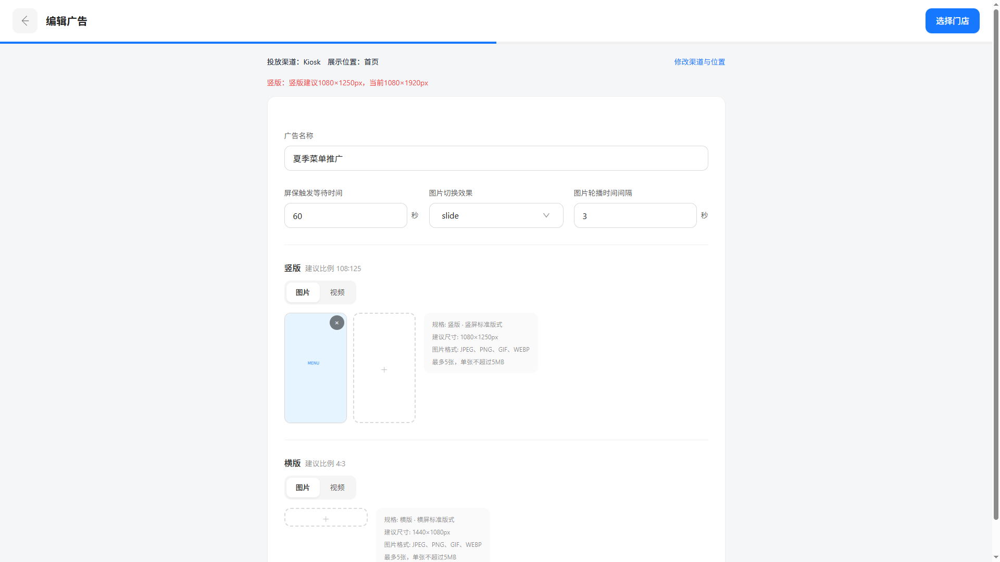

图：V1.15实际PC页面，屏保竖版素材用于首页时提示推荐尺寸差异。

| 字段／操作 | 逻辑说明 |
| --- | --- |
| 素材提示 | 按目标规格检查图片／视频、格式、尺寸、大小、时长和数量；不自动裁剪或拉伸源文件。严格限制不符合时须删除或替换；推荐尺寸不同时允许在保存确认后保留。 |
| 选择门店 | 保存前重新读取广告发布历史和广告位配置；校验不通过则保留输入并提示原因，不跳转。目标变化保存成功后清空关联门店及门店偏好，保留日期、时间输入，进入门店重选。最终保存仍执行排期冲突校验。 |
| 状态已变化 | 编辑期间广告被上架或删除时，拦截保存并提示返回列表刷新；不覆盖最新广告。 |

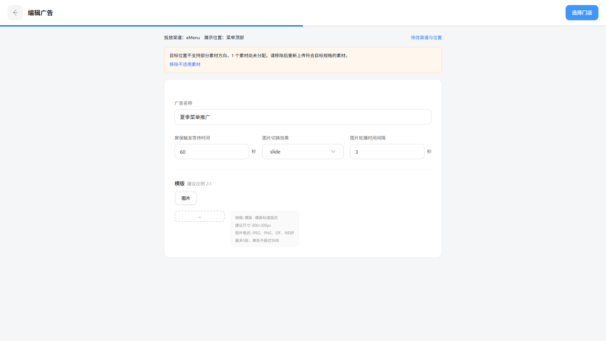

图：V1.14实际PC页面，目标仅有横版规格，源竖版素材未被静默丢弃。

| 字段／操作 | 逻辑说明 |
| --- | --- |
| 未分配素材 | 目标不支持素材方向时显示数量；未处理前不能保存。 |
| 移除不适用素材 | 确认后从当前编辑内容移除，原广告保存前保持不变；取消保留。随后按目标规格补充至少一套素材。 |

#### 移除未分配素材确认

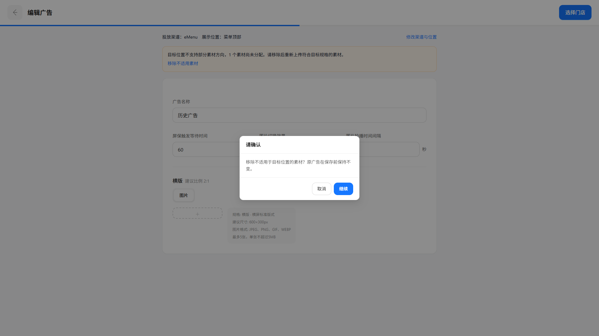

图：V1.14实际PC弹框。

| 字段／操作 | 逻辑说明 |
| --- | --- |
| 继续 | 移除当前编辑的未分配项，不立即改写已保存广告。 |
| 取消／Esc | 保留未分配项及当前输入。 |

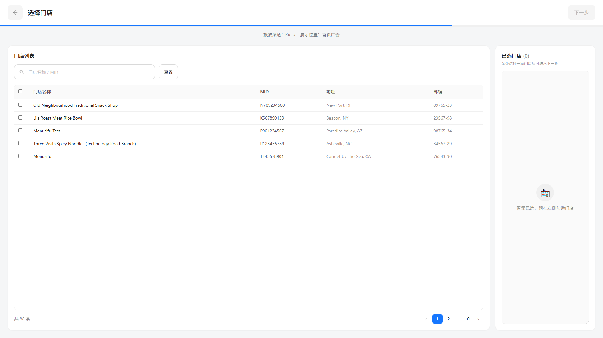

图：V1.14实际PC页面，更换位置保存后已选门店为0。

#### 保存时状态已变化

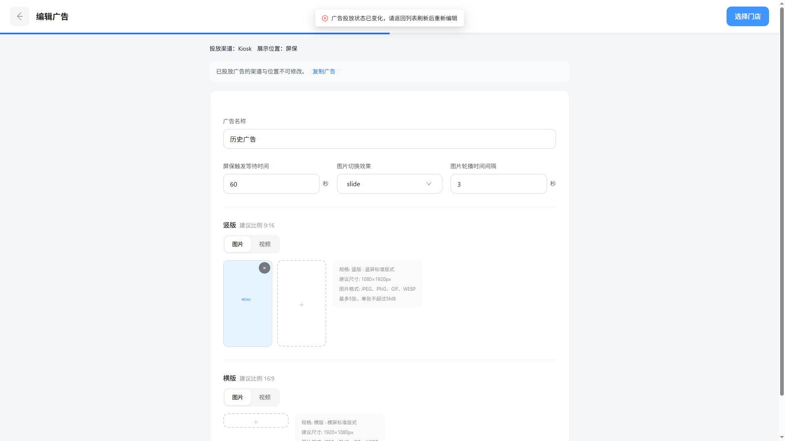

图：V1.14实际PC页面，另一标签页更新发布状态后拦截当前编辑保存。提示返回列表刷新，当前输入不丢弃。

### 编辑：已投放与历史状态不明

图：V1.14实际PC页面，已投放广告的渠道与位置只读。

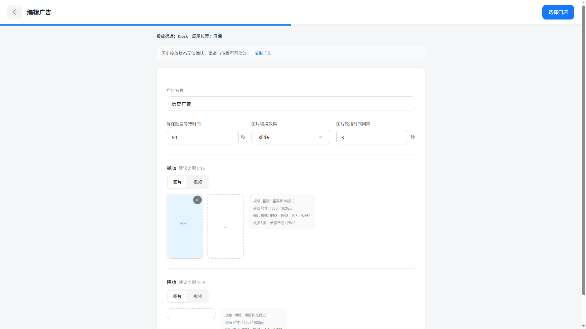

图：V1.14实际PC页面，历史状态不明的广告不自动解锁。

| 字段／操作 | 逻辑说明 |
| --- | --- |
| 渠道与位置 | 保留保存时的快照，不显示修改入口；缺少有效配置的历史广告须复制重新配置。 |
| 复制广告 | 创建独立且从未发布的草稿，带入名称和素材；重新选择目标渠道、位置、门店及排期。源广告不修改、不下架，副本不自动上架。 |
| 其他内容编辑 | 有有效快照时保留现有编辑流程；保存仍保留曾发布／历史不明状态，不借草稿状态解锁目标。 |

### 素材预览

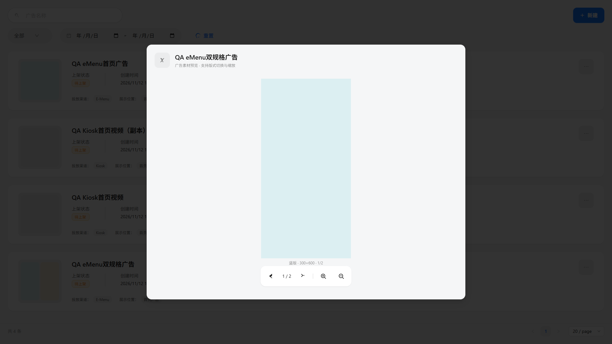

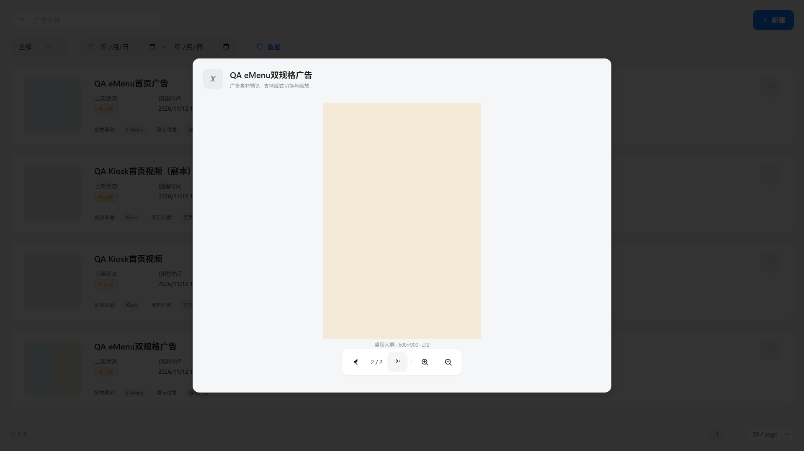

| 字段／操作 | 逻辑说明 |
| --- | --- |
| 预览区域 | 按当前素材所属规格宽高建立画框，采用配置的等比完整展示或等比裁切；不强行拉伸。 |
| 规格说明 | 显示规格名称、尺寸及当前序号，区分同方向的不同规格。 |
| 上一张／下一张 | 在当前横／竖版素材中切换，对应画框和说明同时更新。 |
| 横／竖版切换 | 同时有两个方向素材时显示，沿用原分组；同方向多规格通过上一张／下一张查看。 |
| 放大／缩小、关闭 | 保留原缩放、拖动及关闭行为，不改写素材和位置。 |

## 商家端：素材点击行为

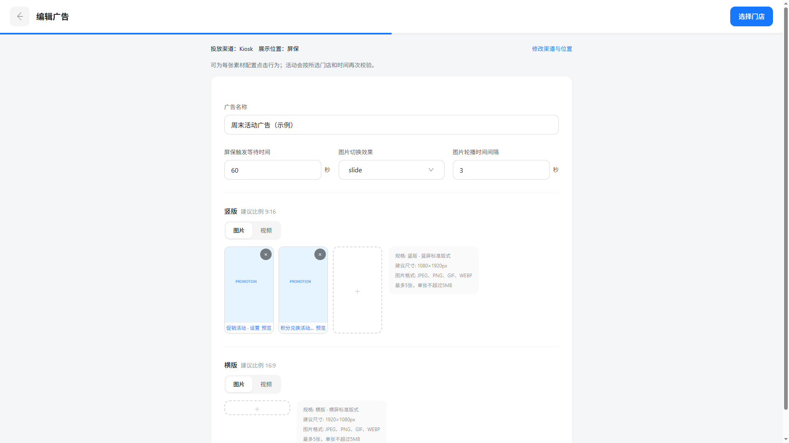

V1.22功能分支PC实拍，使用隔离示例数据。新建与编辑均在内容页按素材配置；原有渠道、规格、门店和排期流程保留。

| 字段／操作 | 逻辑说明 |
| --- | --- |
| 配置点击行为 | 每张图片、每段视频独立配置，默认不跳转；旧素材缺少配置时同样不跳转，不批量改写旧广告。 |
| 素材标识 | 排序、重新打开、复制与视频存储保留动作及素材标识；删除素材同时删除对应动作。切换规格保留已有配置，保存前复核目标能力。 |
| 查看入口 | 项目内活动隐藏预览入口；外部活动显示“查看跳转信息”，只查看配置，不打开第三方页面。 |

### 项目内活动配置

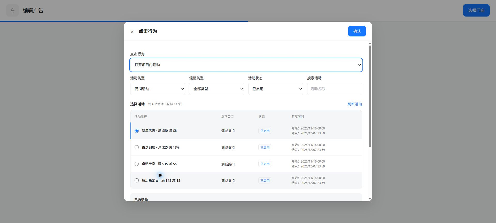

入口：素材的配置点击行为 → 项目内活动。活动来源见下文“活动与能力来源”；早期V1.19截图使用隔离测试目录。

| 字段／操作 | 逻辑说明 |
| --- | --- |
| 点击行为 | 单选不跳转、项目内活动或外部活动；不支持交互的位置只能保存不跳转。 |
| 活动类型 | 单选促销、积分兑换或优惠券活动；切换类型重新加载该类型目录。 |
| 搜索、活动选择 | 按名称检索当前品牌目录，单选活动；保存原活动ID，不复制优惠规则。不属于当前品牌的活动不可关联。 |
| 活动状态及门店 | 展示目录返回的状态和门店信息；停用、删除、过期活动不能保存。周期性促销须由原业务复核时段，不能仅凭已启用视为当前可参与。 |
| 刷新 | 重新读取目录；加载失败允许重试，空目录不自动生成活动。 |
| 应用到全部素材 | 确认时覆盖当前广告各规格已有素材的动作；后续新上传素材仍默认不跳转。 |
| 确认 | 校验当前品牌、编辑权限、广告位能力与活动可用性，成功后写回表单；失败保留输入。 |
| 关闭、Esc | 未配置、只筛选或与原设置一致时直接关闭；实际修改关联、外链或应用范围时提示放弃，取消放弃继续编辑，确认放弃不改素材。 |

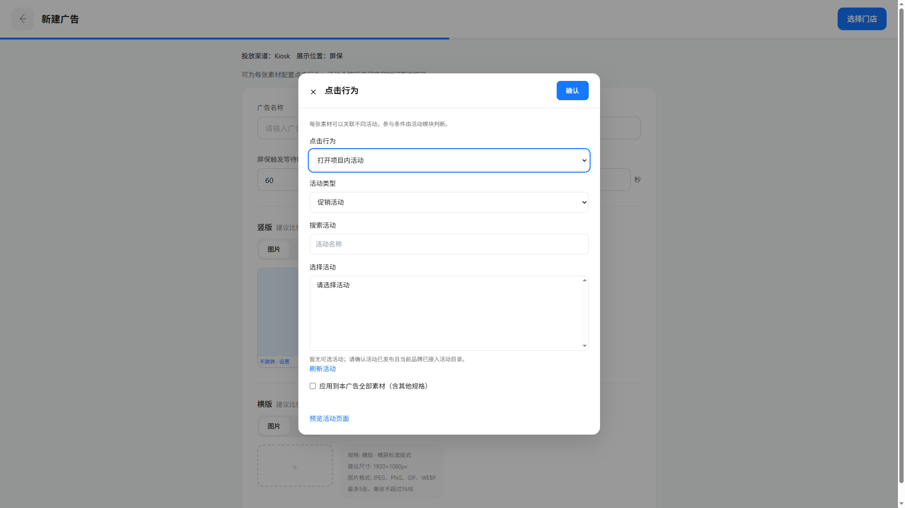

活动源没有记录时显示空目录，不自动生成实际商家活动；演示账号目录来源见下文。

未保存修改的关闭确认；放弃只撤销本次弹框修改。

### 外部活动配置

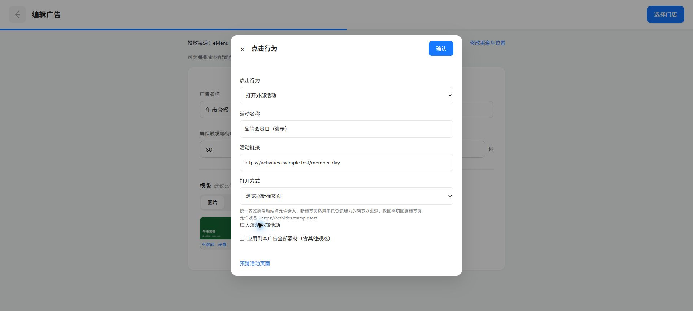

| 字段／操作 | 逻辑说明 |
| --- | --- |
| 活动标题 | 必填，最多80字符，用于统一容器标题。 |
| 活动链接 | 必填HTTPS地址，不允许URL用户名或密码；必须匹配平台登记的完整来源，包含端口，不自动信任子域名。 |
| 允许域名提示 | 来自可信接入配置；未登记来源时不能保存外部活动，不增加M平台运营勾选项。 |
| 查看跳转信息 | 只展示校验后的标题、链接与打开方式，不加载外部页面。 |
| 确认与取消 | 确认执行上述校验并按应用范围写回；取消沿用项目内活动的放弃规则。 |

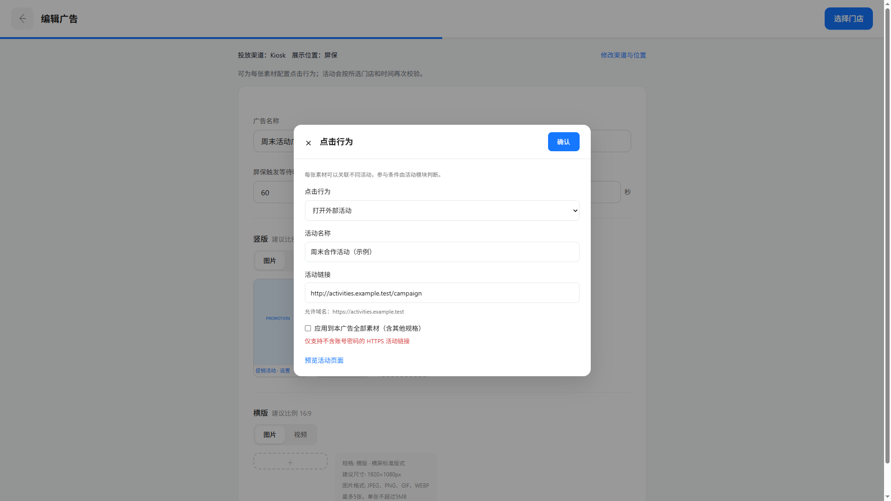

非法链接保存失败，保留输入供修改。

### 能力与归属变化

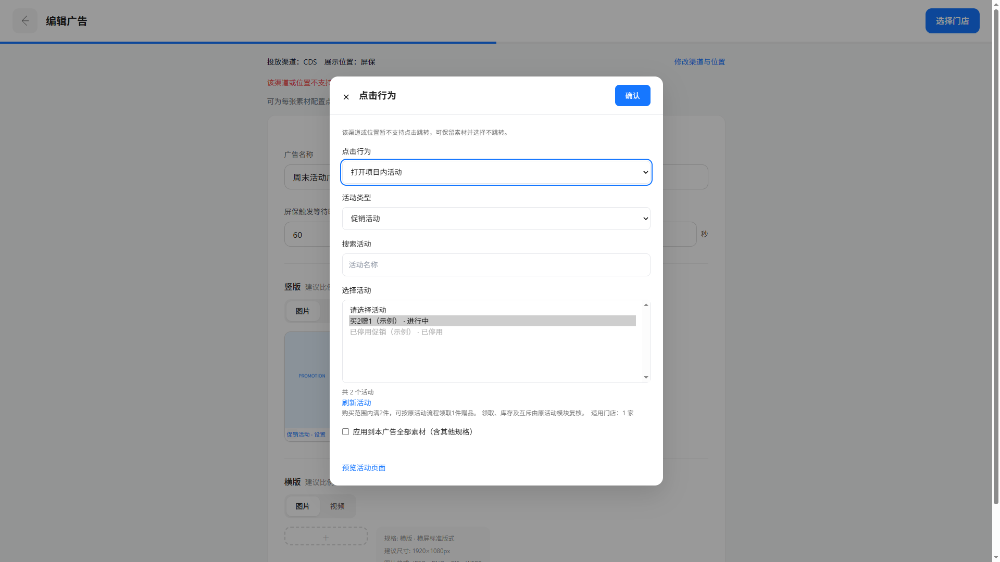

切换到不支持交互的目标时不静默清除原动作；用户须改为不跳转或更换目标后保存。默认本地接入策略支持Kiosk、eMenu的屏保与首页；演示账号另登记四个演示位置，其他实际位置须可信终端登记。该策略不代表已验证实机版本。

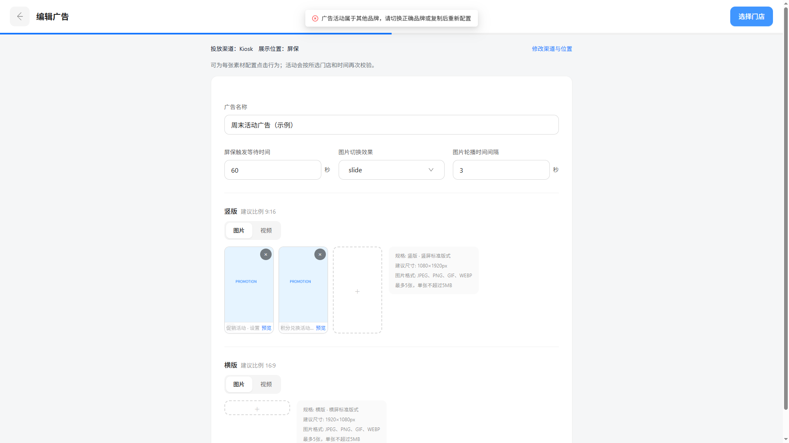

品牌切换后不可覆盖原品牌广告，即使移除全部动作也不能绕过归属检查。只读权限不能配置或保存动作；复制需在当前品牌重新校验关联，不能跨品牌沿用活动引用。

## 统一活动容器与发布检查

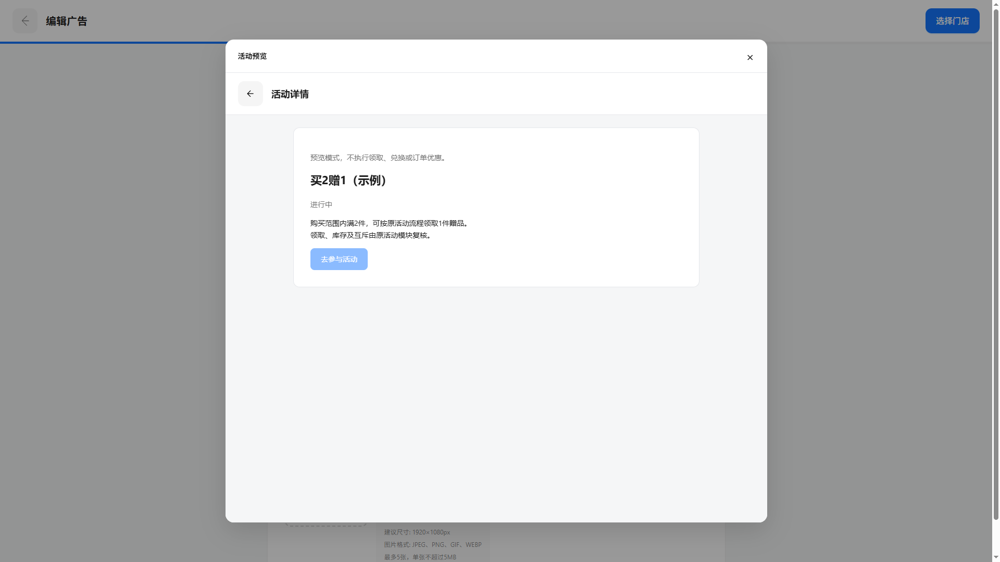

历史V1.19内部容器预览截图，当前后台入口已隐藏；此图不代表现有后台可打开内部预览。真实终端点击接入后使用同一活动契约；本次未修改终端仓库。

| 字段／操作 | 逻辑说明 |
| --- | --- |
| 活动标题与说明 | 重新读取当前品牌原活动；展示目录返回的内容，促销门槛、商品范围和优惠由原业务定义。 |
| 参与 | 预览禁用；真实场景交给原业务模块，再检查订单、会员、库存及优惠冲突。打开原模块不视为参与成功，只有原模块明确返回完成才记录成功。 |
| 返回与超时 | 返回关闭容器并恢复原广告上下文；连续120秒无交互退出，不清空原业务购物车。实际终端唤醒、返回栈和会话保持仍须接线验证。 |
| 外部活动 | 真实场景在受限H5容器打开，加载失败可重试或返回；实际合作方嵌入策略、登录态须单独验收。 |
| 无效活动 | 删除、停用、过期或归属变化时阻止参与，允许刷新或返回；无可用广告素材时交由原广告链路清屏或回退。 |

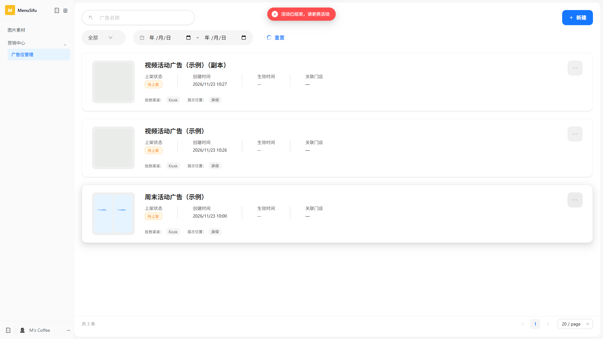

保存门店及排期、上架时重新读取活动：所选门店必须在活动范围内，广告区间不能超出活动有效期；周期时段交由原业务检查。校验失败保留表单或原上架状态，不自动换活动。

活动状态的广告可展示资格与当前订单的可优惠资格分开处理：广告不提前执行优惠，实际参与以原业务结果为准。预览不统计；本次SDK仅提供品牌隔离、最多500条的本地曝光／点击／参与事件缓存，未接通服务端统计。

## 商家端：门店与生效时间

### 选择门店

| 字段／操作 | 逻辑说明 |
| --- | --- |
| 上下文摘要 | 只读显示已选渠道与位置，不展示规格版本号，不提供第二次渠道选择。 |
| 搜索、重置、分页 | 保留原门店名称／MID搜索、重置及分页。 |
| 门店勾选、全选 | 保留原门店列表和已选门店联动，至少选择一家。 |
| 下一步 | 保存所选门店后直接进入生效时间页，不再经过渠道页。 |
| 返回 | 回到对应新建／编辑内容页，保留本活动上下文。 |

### 设置生效时间

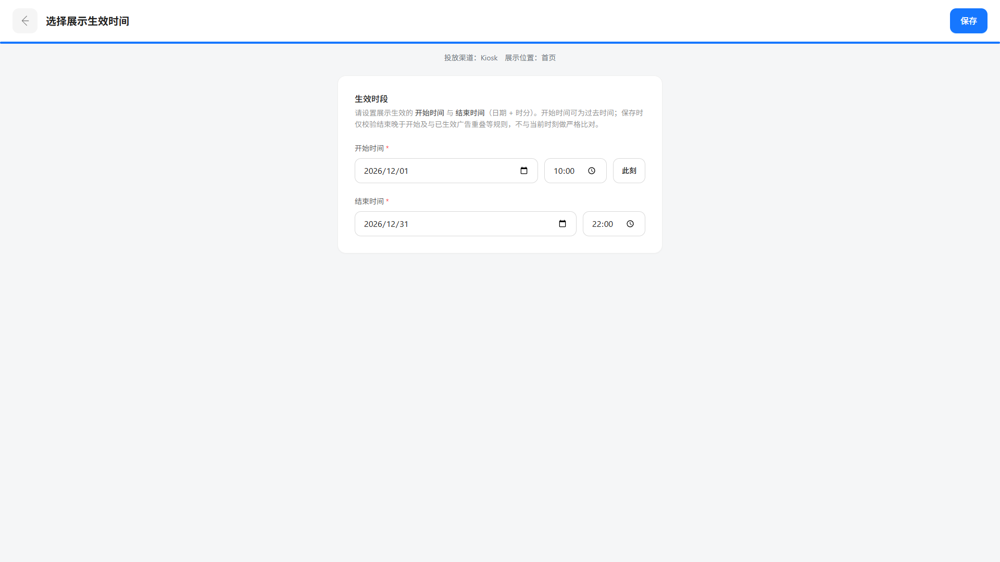

| 字段／操作 | 逻辑说明 |
| --- | --- |
| 开始日期 | 必填，使用原日期选择；允许过去的开始日期。 |
| 开始时分 | 必填，与开始日期共同确定开始时间。 |
| 此刻 | 将开始日期与时分设置为当前时间。 |
| 结束日期 | 必填，与结束时分共同确定结束时间。 |
| 结束时分 | 必填，结束时间须晚于开始时间，沿用原时间校验。 |
| 返回 | 回到门店页，保留对应广告、来源页、门店和时间上下文。 |
| 保存 | 重新校验单渠道、单位置、广告位启用与接入、规格版本、素材及原时间规则；成功保存投放偏好并清理临时选择，返回列表，沿用原草稿／上架流程。 |
| 冲突 | 同一门店、同一产线、同一位置且时间重叠时执行原提示；不同产线或位置互不因相同时间冲突。历史归属不明仍保守沿用原校验。 |
| 保存失败／取消确认 | 保留页面及数据，不清理草稿，不自动发布。 |

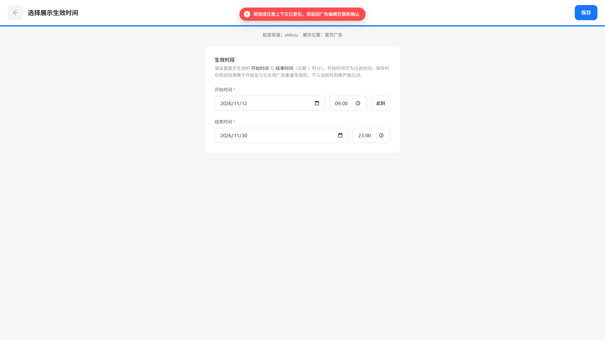

图：模拟渠道上下文不一致，保存被拦截。

## M平台：广告位管理

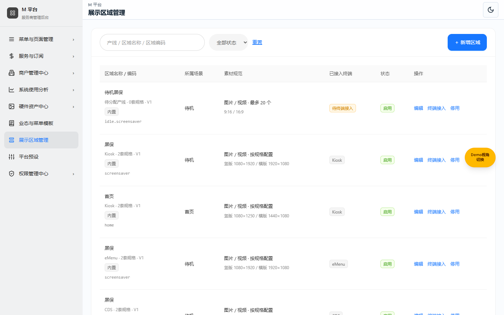

图：列表工具栏左侧为搜索、状态筛选和重置，右侧为「新增区域」。页面标题仅由外层页头显示。 列表随页面在窗口右侧纵向滚动，表格不单独纵向滚动。

入口：M平台 → 展示区域管理。平台管理员配置，商家仅选择并配置内容；沿用现有平台管理权限。

| 字段／操作 | 逻辑说明 |
| --- | --- |
| 搜索 | 支持按产线、位置名称或编码筛选。 |
| 状态筛选、重置、分页 | 沿用原状态筛选及列表操作。 |
| 区域名称／编码 | 展示名称、编码、所属产线、规格数量和当前版本；名称可相同，身份不相同。 |
| 素材规范 | 汇总支持类型及各规格名称、像素尺寸，单套的数量和大小以编辑表单为准。 |
| 接入终端 | 新位置默认待接入；仅所属产线能登记支持。 |
| 新增广告位、编辑 | 「新增广告位」从工具栏打开全屏三步向导；编辑从区域行打开同样的全屏三步向导，依次展示基础信息、位置说明和素材规格，最后一步右上角保存。保存不代表终端已完成接入。 |
| 启用／停用 | 停用后不可用于新建、重新保存和上架；不删除原广告或素材。既有终端停止展示依赖终端刷新与接入。 |

### 新增／编辑位置

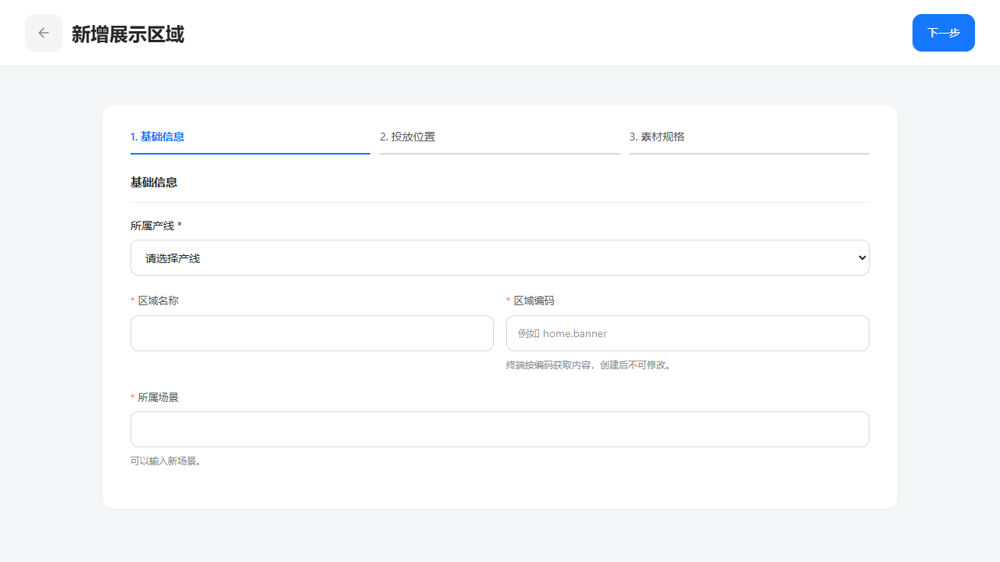

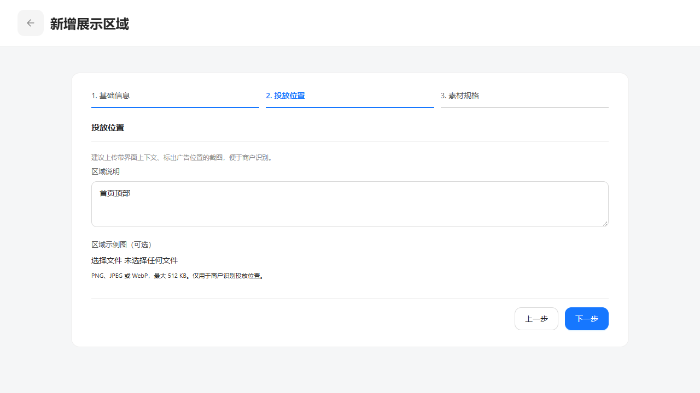

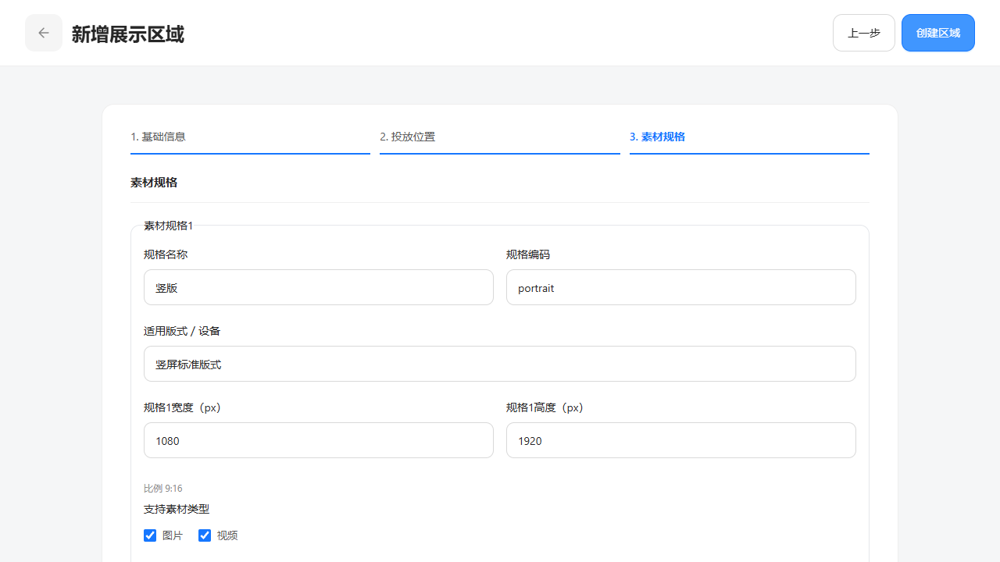

图：V1.18 功能分支的全屏三步向导。编辑独立页截图待补。

新增页采用公共页头和步骤条，每次仅显示当前步骤。基础信息验证必填项、编码格式及同产线唯一性；区域说明可选，新增时必须上传区域示例图才能进入素材规格步骤；编辑已有区域不补传；最后配置素材规格。步骤操作统一放在页头右侧：第一步「下一步」，第二步「上一步／下一步」，第三步「上一步／创建区域」。往返保留已填内容，不写入数据。

| 字段／操作 | 逻辑说明 |
| --- | --- |
| 所属产线 | 第一项，必选单选；已归属的位置不可直接换产线。 |
| 区域名称 | 必填，最多30字，商家可见；不同产线可同名。 |
| 区域编码 | 必填，同一产线内唯一，创建后不可修改；输入框下方展示格式和示例：1–64 个字符，以小写英文字母开头；其余可用小写英文字母、数字、点、下划线或短横线，例如 home.banner。 |
| 展示场景 | 新增广告位不显示此字段，编辑时选填，最多20字。已有值保留；广告位描述用于说明展示时机和位置。 |
| 区域说明 | 最多200字，用于说明具体区域和使用限制。 |
| 区域示例图 | 新增时必传一张 PNG、JPEG 或 WebP，最大 512 KB。选图指引位于字段标题下、按钮上方；点击「选择示例图」打开文件选择器；选图成功后显示预览，并提供「更换示例图」和「移除示例图」；移除后须重新上传才能继续新增；保存区域后生效，取消不写入。仅供商户识别位置，不下发终端。 |
| 新增规格 | 新增一套配置；每个位置1～12套，可以有多个同方向规格。 |
| 删除此规格 | 移除本次配置中的该规格，保存后生成新版本；旧广告快照保留。 |
| 历史参数 | 新增与编辑均不显示参数配置。新区域不预设参数；编辑已有区域保留原参数。 |
| 演示数据 | Demo 登录后生成跨产线的展示区域与位置示意图；已示例接入的区域在商家广告位管理中提供素材草稿，未接入场景不可选择。仅浏览器本地演示，不下发终端。 |
| 创建区域／保存区域 | 新增仅在第三步右上显示「创建区域」，校验规格后提交；成功返回列表并提示「区域已创建，待终端接入」；失败留在当前步骤并保留输入。编辑仍使用「保存区域」。 |
| 返回列表 | 新增页左上返回。无修改直接返回；有草稿先确认放弃，取消确认则留在原页且不写入。 |
| 取消／关闭（仅编辑） | 有未保存修改时确认是否放弃；取消确认则继续编辑，不写入配置。 |

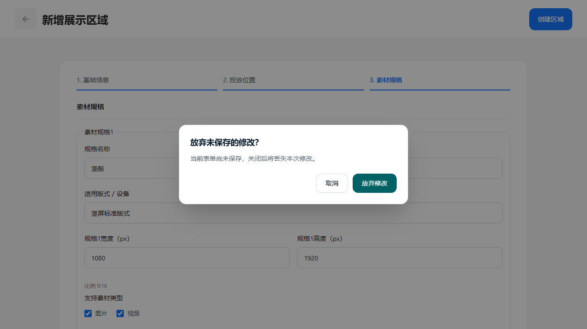

图：V1.18 新增页点击返回，有未保存修改。

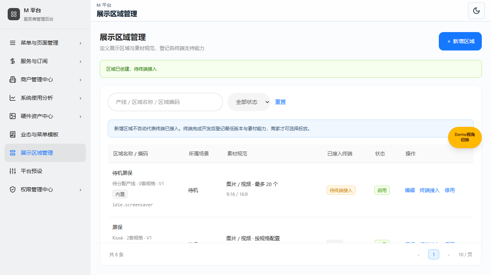

图：V1.18 保存成功返回列表，记录为待接入；使用隔离演示数据。

待补页面图片：区域示例图上传、替换、移除及保存失败。

### 商户端：选择展示位置时查看区域示例图

待补页面图片：展示位置列表、选中预览和查看大图。

| 字段／操作 | 逻辑说明 |
| --- | --- |
| 查看示例图 | 位置列表和示例图分开展示。同渠道有6个或以上可用位置时，可按位置名称或场景搜索。预览只显示当前选中位置；无图时不影响选择。窄屏默认收起预览。查看大图不裁切、不改变选中位置。 |

### 素材规格

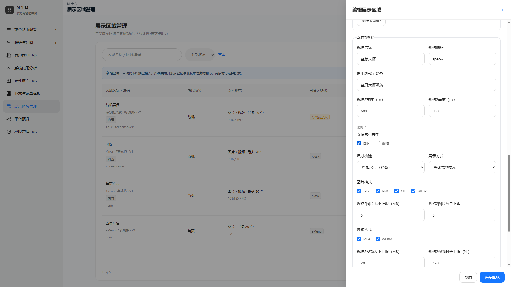

| 字段／操作 | 逻辑说明 |
| --- | --- |
| 规格名称 | 新规格由设备和版式自动生成，例如「自助终端 · 横版」；不在表单手填，已有名称保留。 |
| 规格编码 | 新规格由系统生成位置内唯一编码；不在表单展示或手填，已有编码保留。 |
| 适用版式／设备 | 必填，先选预设设备再选横版或竖版，同位置内不得重复；用于明确区分规格，终端按规格编码取素材，不依赖自由文本自动匹配。 |
| 宽度 | 必填，1～16384正整数，单位px。 |
| 高度 | 必填，1～16384正整数，单位px。 |
| 比例 | 按宽高约分自动计算，不独立输入。 |
| 支持素材类型 | 图片、视频，至少选一种；终端接入能力不得超出该位置支持类型。 |
| 尺寸处理 | M 平台仅维护推荐宽高。商家本地上传时，比例一致但像素不同则提示并允许继续；比例不同时须确认继续或更换素材；历史严格尺寸仍拦截。不裁切原件。 |
| 展示方式 | 由终端按实际容器处理，商家预览注明实际展示以终端为准。 |
| 通用上传规则 | 商家后台本地上传统一执行：JPEG、PNG、GIF、WebP 单张最多 5 MB；MP4、WebM 单个最多 20 MB、时长最多 120 秒。M 平台不配置这些规则。生产上传服务须执行同一规则；当前本地 Demo 不包含该服务。 |
| 投放能力 | M 平台不在素材规格表单配置素材类型或数量。新规格默认支持图片和视频，每套最多5张图片或1个视频；已有规格保留原设置。 |
| 规格版本 | 规格发生变更时递增，保存旧版本规范；名称与区域说明等非规格变更不单独升规格版本。 |

### 终端接入

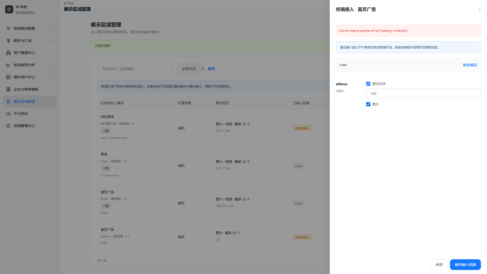

| 字段／操作 | 逻辑说明 |
| --- | --- |
| 位置编码、复制编码 | 展示稳定编码，复制供终端对接；请求时须同时携带产线和规格编码。 |
| 登记支持 | 仅所属产线可登记；未登记的位置不出现在商家可用位置列表。 |
| 版本兼容 | 接入页不显示或填写版本号。已登记的版本门槛保留，首次登记不新增最低版本限制。 |
| 素材能力 | 不提供图片或视频选择；已有接入沿用已登记能力，新接入沿用广告位的素材能力。 |
| 登记接入 | 技术验证完成后直接登记并保存，状态为已接入；未接入的广告位不向商家开放。 |
| 素材能力 | 不提供图片或视频选择；已有接入沿用已登记能力，新接入沿用广告位的素材能力。 |
| 保存接入信息 | 校验通过后保存；不自动完成客户端开发、设备能力发现或真实下发。 |
| 关闭／取消 | 沿用原未保存提示，不写入配置。 |

## 历史活动与交付边界

历史广告不批量迁移、不自动拆分或改变发布状态。已有广告位快照回显原版本；归属或发布历史不明的记录不能直接更换渠道与位置，需复制广告重新配置并校验素材。M平台新版本不覆盖旧广告快照。

当前为项目原生页面与浏览器本地配置联动；真实服务端配置、按设备版本匹配规格及真实终端下发未接入。至少配置一套素材可以保存草稿；实际投放设备所需规格覆盖需在接入链路验收，不能将保存成功当作所有设备均可展示。详见[功能验证与交付边界](验证记录/V1.11渠道广告位与规格验证.md)及[页面文案校验](验证记录/V1.12等待时间字段文案校验.md)。

验收重点：渠道位置隔离、空选禁用、同方向多规格不覆盖、严格尺寸与媒体限制、完整保存、复制独立媒体、规格版本保留及保存前重新校验。

## 广告点击行为：活动与能力来源

V1.22功能分支PC实拍，演示账号。入口：编辑广告 → 素材下方设置 → 打开项目内活动。促销目录复用当前促销中心的数据范围、保存记录与默认演示配置；不另建促销规则。

| 字段／操作 | 逻辑说明 |
| --- | --- |
| 点击行为 | 已登记能力的位置可选择不跳转、项目内活动、外部活动；未知实际位置继续限制为不跳转。演示账号对现有购物车、菜单首页、取餐屏和等位屏四个演示位置单独登记，不扩大实际账号权限。 |
| 促销活动 | 按当前促销中心的品牌／门店视角读取配置；保留原ID、名称、类型、启用状态、日期、星期与时段。当前启用类型以外的活动及已结束活动禁选，未来有效活动可关联。原模块变更后刷新或保存时重新读取。 |
| 促销权限 | 无促销页面访问权限时不返回活动；广告编辑权限仍单独校验。 |
| 确认与继续 | 确认写回当前素材或全部已有素材；继续到门店步骤时保存广告配置，返回编辑正确回显。日期与门店选择仍须符合活动范围，实际优惠由原业务判断。 |
| 图片回显 | 支持既有dataUrl及演示素材src字段，新建复制与编辑采用同一读取规则，不因字段差异误报解码失败。 |

### 积分兑换演示

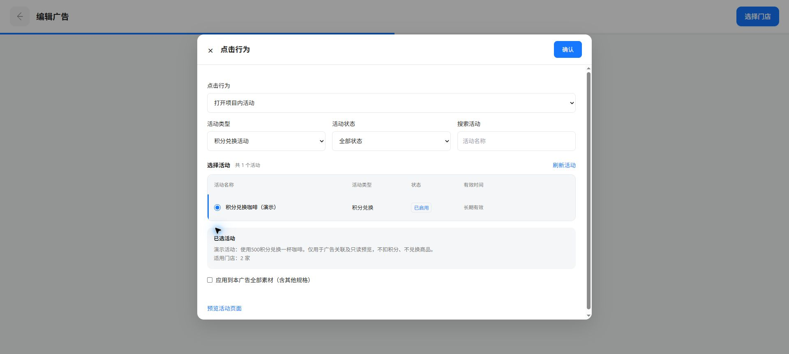

| 字段／操作 | 逻辑说明 |
| --- | --- |
| 积分兑换活动 | 演示账号显示“积分兑换咖啡（演示）”，可关联及预览；实际账号不生成示例活动，需接入原积分服务。 |
| 演示提示 | 标明仅供配置及预览，不扣积分、不兑换商品；不提供伪造成功的参与回调。 |

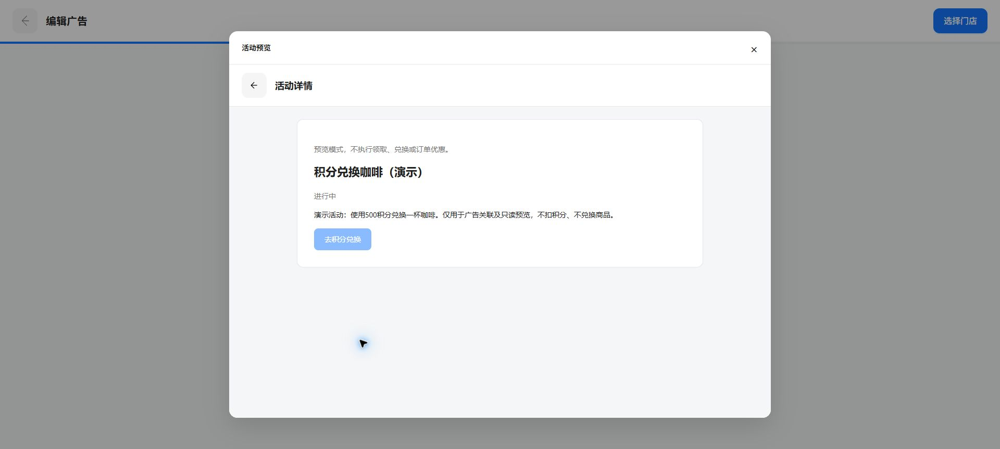

此为历史积分容器预览截图；当前后台仅在活动列表下查看规则详情，预览入口已隐藏。

### 外部活动信息

| 字段／操作 | 逻辑说明 |
| --- | --- |
| 允许来源 | 演示账号登记https://activities.example.test；实际账号沿用平台可信注册，不自动信任演示来源。该域名是示例，不代表可访问的合作方活动站点。 |
| 填入演示外部活动 | 仅演示账号显示；点击填入“品牌会员日（演示）”及示例HTTPS链接，用户可修改，确认仍校验来源。 |
| 查看跳转信息 | 只读展示标题、校验后链接和打开方式，不访问第三方网站、不触发外部业务；真实合作方H5仍需完成嵌入及登录态联调。 |

## 项目内活动：促销筛选与优惠券

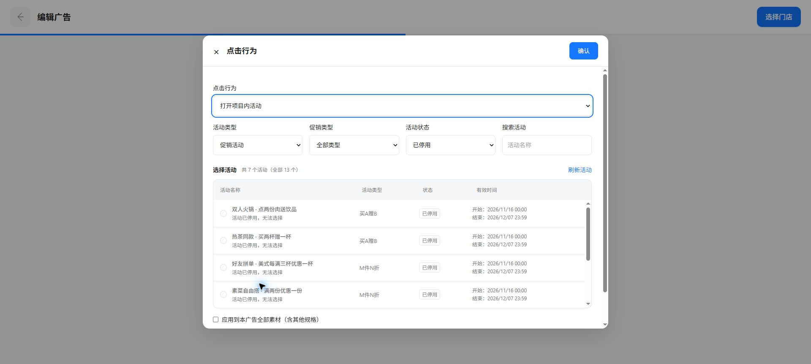

V1.22功能分支PC实拍，演示账号；入口：素材点击行为 → 项目内活动 → 促销活动。

| 字段／操作 | 逻辑说明 |
| --- | --- |
| 活动类型 | 单选促销活动、积分兑换活动或优惠券活动；切换类型清空名称搜索、促销筛选与未确认选择，重新加载对应目录。 |
| 促销类型 | 仅促销活动显示；默认全部类型，可选买A赠B、M件N折、满减折扣、加价换购。依据原活动类型编码筛选，不按名称推断。未提供类型的历史记录只在全部类型中展示。 |
| 名称搜索 | 与促销类型按同时满足的条件筛选；无结果提示调整筛选。筛选不改变活动启用状态或品牌归属。 |
| 已选活动 | 筛选后仍在结果内则保留；被筛除则清空当前弹框选择及详情，须重新选择后确认，不自动切换为另一活动。未确认前不改素材原关联。筛选操作本身不触发关闭确认。 |
| 结果数量 | 展示当前结果数量；结果少于目录总数时同时显示全部数量。停用、结束活动仍显示其状态并禁选，不因筛选解除限制。 |

### 优惠券活动配置

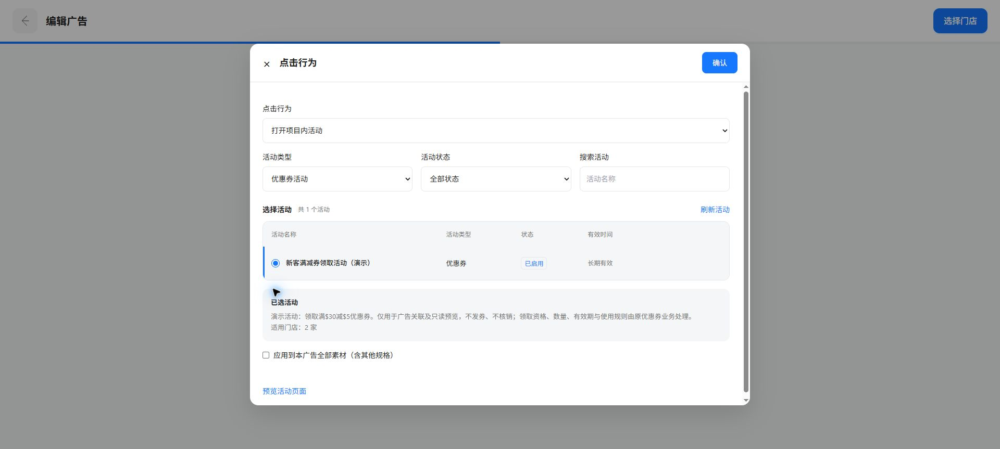

| 字段／操作 | 逻辑说明 |
| --- | --- |
| 优惠券活动目录 | 使用当前品牌的原领券活动ID；演示账号提供“新客满减券领取活动（演示）”，实际账号不生成示例，真实目录通过统一provider接入。无优惠券页面访问权限时不返回目录。 |
| 搜索、选择与确认 | 沿用名称搜索、单选、状态、门店及排期校验；确认保存activityType=coupon及原活动ID。与其他活动一样支持应用到全部已有素材。 |
| 领取规则 | 领取资格、数量、有效期、库存、使用门槛、发券及核销由原优惠券模块负责；广告不创建另一套券规则。 |

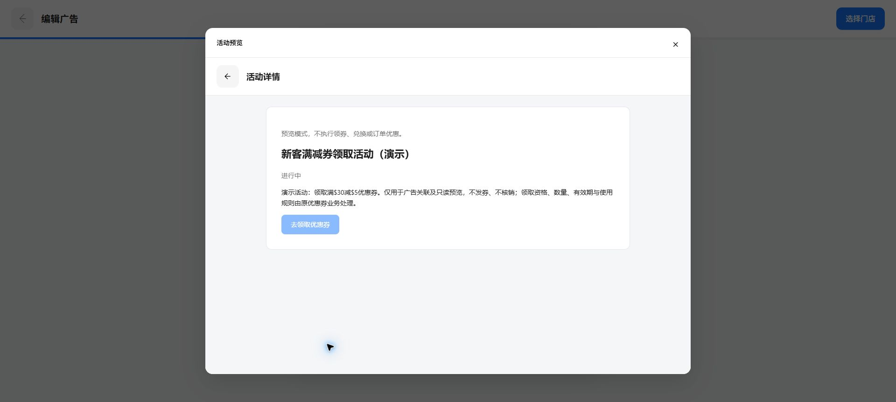

此为历史优惠券容器预览截图；当前后台预览入口已隐藏，不发券、不核销。真实领券服务及终端参与回调仍属接入缺口。

## 项目内活动：单选列表与状态筛选

V1.22功能分支PC实拍，演示账号。促销、积分、优惠券使用同一列表，在点击行为弹框中选择，不新开一层选择弹框。

| 字段／操作 | 逻辑说明 |
| --- | --- |
| 顶部说明 | 不显示逐素材规则说明及演示模式说明；未登记交互能力时保留不可用原因。真实服务接入边界在配套验证记录中维护。 |
| 活动类型 | 选择促销、积分兑换或优惠券。切换后清空未确认的活动选择、促销类型、活动状态和名称搜索，并加载对应目录。 |
| 促销类型 | 仅促销显示，默认全部；保留四种原活动类型筛选，与状态和名称同时匹配。 |
| 活动名称搜索 | 按名称包含匹配；输入即时更新当前结果及数量，不修改活动本身。无结果显示空态。 |
| 活动名称列 | 显示名称和单选框；整行点击选择，键盘方向键可切换可选项。选中行浅灰底、蓝色单选及左侧标记，筛选后不在结果中的暂存选择清空。 |
| 活动类型列 | 显示买A赠B、M件N折、满减折扣、加价换购，或积分兑换、优惠券；未提供促销子类型时显示促销活动。 |
| 状态列 | 显示已启用、未开始、已结束、已停用或未发布；已启用表示发布且进入有效日期，周期活动的实际时段仍由原模块复核。 |
| 有效时间列 | 显示开始与结束时间至分钟；单侧缺失显示不限，两侧均缺失显示长期有效。 |
| 不可选原因 | 停用、未发布、结束记录置灰且禁选，在名称下说明原因；不能通过筛选或键盘绕过。 |
| 刷新活动、结果数 | 重新读取当前品牌目录并保留筛选；等待时禁选，失败提示重试，成功后再次核对原选择。显示当前结果数及必要的目录总数。 |
| 当前选择摘要 | 选择后显示名称、状态、类型、日期及门店数量；规则默认收起，由查看活动规则原位展开。无选择隐藏，确认前不改素材。 |
| 确认 | 沿用最新权限、归属、能力、活动状态校验，成功写回素材；项目内活动不提供后台预览入口。 |
| 关闭、Esc | 未配置关联、空外链、只搜索或筛选、与原设置一致时直接关闭；确实修改关联、外链内容或对已有行为勾选应用全部时才提示放弃。取消放弃继续编辑，放弃后保留素材原设置。部分外链输入仍作为草稿保护，不等同空配置。 |

### 活动状态筛选

| 字段／操作 | 逻辑说明 |
| --- | --- |
| 活动状态 | 三类项目内活动均提供，默认全部状态；可选已启用、未开始、已结束、已停用、未发布。与促销类型和名称按交集筛选，不改变可选资格。 |
| 已启用 | 对应目录已发布、已进入有效日期且未结束的记录；周期星期与时段以原活动复核结果为准，不代表当前订单已满足优惠门槛。 |
| 空结果 | 没有匹配记录时提示调整条件；未选择活动仍可关闭，不弹放弃提示。 |

### 浏览器与设备的外部打开方式

| 字段／操作 | 逻辑说明 |
| --- | --- |
| 打开方式 | 外部活动必选，默认统一H5容器（iframe）；旧配置缺失时按iframe读取。另一选项为浏览器新标签页。 |
| 渠道能力 | 平台可信接入按渠道、广告位及终端登记，M平台无自由勾选表。未登记新标签页能力时该项禁用并解释原因；当前仅eMenu演示渠道登记新标签页，不代表实机已支持。 |
| iframe | 真实点击进入统一容器；活动站点须允许嵌入，原有返回、失败重试及120秒无交互退出规则保留。 |
| 浏览器新标签页 | 真实点击按已登记HTTPS来源打开新标签，原广告页保留；使用noopener、noreferrer，不携带登录凭据。返回由用户切回原标签，不承诺控制第三方标签关闭或恢复。受浏览器弹窗策略约束，实际渠道须联调。 |
| 查看跳转信息 | 两种方式均只读展示标题、链接和配置方式，不打开第三方页面或新标签，不记真实点击。 |
| 保存与更换目标 | 保存及真实打开均复核当前允许来源和打开能力；新目标不支持原方式时提示改为统一容器，不静默改写。 |

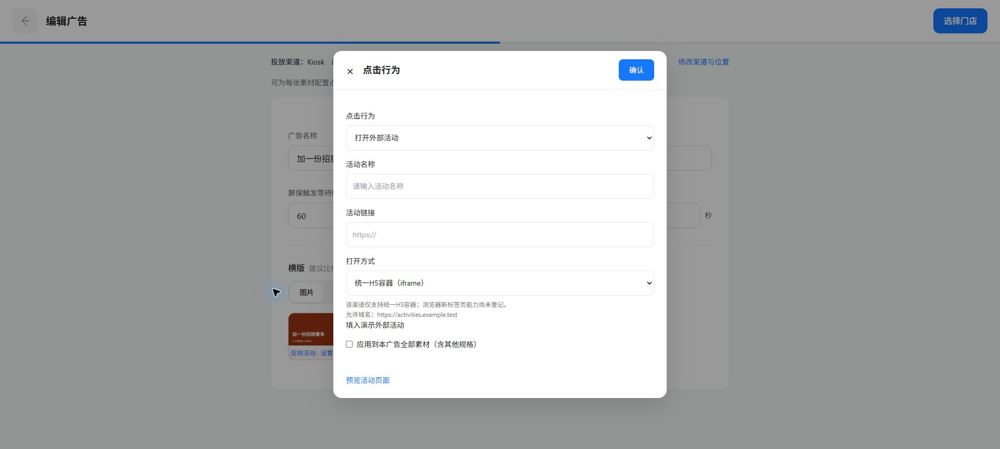

Kiosk等未登记浏览器新标签页能力的渠道保留iframe，禁用新标签页，避免离开设备业务环境。

## V1.22交付边界

已实现本仓库配置、校验、只读预览及接入契约；真实活动服务、终端接线、外部H5及服务端统计尚未联调。详细证据及共同缺口见[验证记录](验证记录/V1.22活动列表及打开方式验证.md)。

## 广告内容页：说明精简

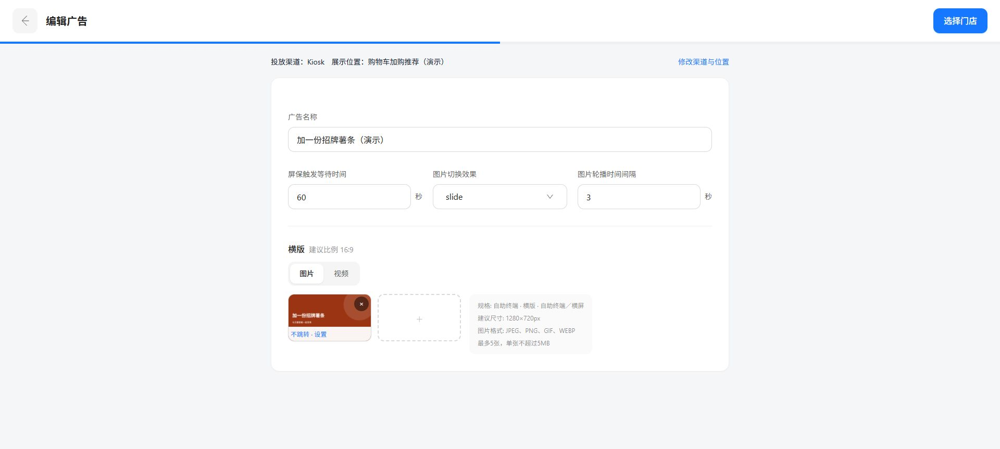

V1.22.1功能分支PC实拍，独立会话完成视觉复核，原有用户草稿未刷新。

| 字段／操作 | 逻辑说明 |
| --- | --- |
| 推荐尺寸提示 | 内容页不重复展示“建议尺寸、当前尺寸”预提示；各规格下原有建议尺寸字段保留。严格尺寸不符仍拦截，推荐尺寸不符在保存时确认，不绕过格式、大小、数量和视频时长校验。 |
| 点击行为说明 | 内容页不显示“可为每张素材配置点击行为；活动会按所选门店和时间再次校验”及品牌上下文引导段落；素材下设置入口、权限禁用与保存校验保留。 |

本次检查及页面验收缺口见[文案精简验证](验证记录/V1.22.1内容页文案精简验证.md)。

## 素材活动的查看入口

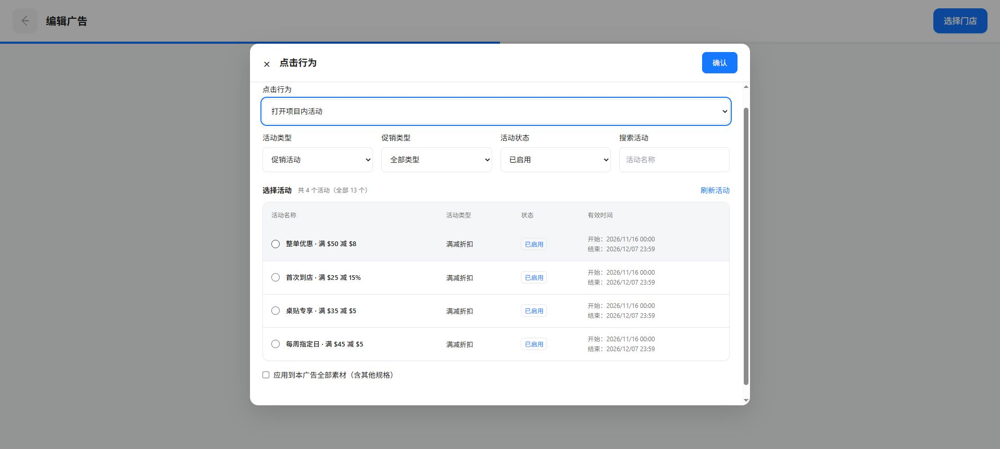

V1.22.1功能分支PC实拍。入口：广告内容页 → 素材设置 → 项目内活动。

| 字段／操作 | 逻辑说明 |
| --- | --- |
| 项目内活动 | 促销、积分兑换、优惠券共用活动列表及下方规则详情；素材下方与配置弹框均隐藏活动预览按钮。确认与保存不要求先预览。 |
| 规则详情 | 保留名称、规则、状态和门店说明，供选择时核对；真实顾客活动页与参与流程由原模块接入。 |

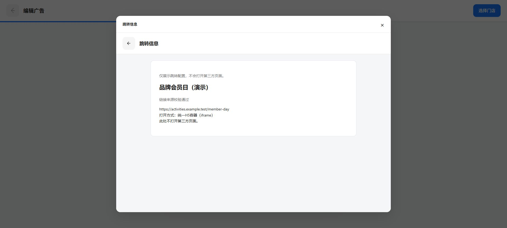

| 字段／操作 | 逻辑说明 |
| --- | --- |
| 查看跳转信息 | 仅外部活动显示，素材行与设置弹框均使用此名称；设置弹框点击时先校验标题、HTTPS来源与打开方式。失败保留输入，成功打开“跳转信息”。 |
| 跳转信息 | 展示标题、链接和打开方式；“链接来源校验通过”仅表示符合登记来源，不代表第三方页面可访问或允许嵌入。不会加载第三方页面或打开外部标签，不执行业务、不记真实统计。 |
| 返回／关闭 | 关闭信息层并回到原编辑上下文，不自动确认或保存当前设置。 |

## 当前选择与活动规则

V1.23功能分支PC实拍，演示账号；入口：素材点击行为 → 项目内活动 → 选择活动。促销、积分与优惠券共用此结构。

| 字段／操作 | 逻辑说明 |
| --- | --- |
| 当前选择 | 有选中活动时显示白底细边框摘要卡；未选择或被筛选排除时隐藏。卡片突出活动名称及状态，次行展示类型、日期范围、适用门店数量；日期缺失按原活动范围展示不限或长期有效。 |
| 查看活动规则 | 卡片右上角的次要按钮，默认折叠；点击在卡片内展开，不叠加弹框、不跳转页面。按钮同步改为收起活动规则，并提供键盘焦点及展开状态。 |
| 更换或清空选择 | 切换活动后更新摘要并默认折叠；切换类型、刷新清空或筛选排除原选择时同步隐藏／重置。筛选后保留同一选择时保持当前展开状态。 |
| 确认与关闭 | 选中活动仅暂存，仍需弹框右上角确认才写回素材；仅展开或收起规则不构成待保存修改。取消及保存前的权限、品牌、状态、门店和排期校验保留。 |

### 原位展开活动规则

| 字段／操作 | 逻辑说明 |
| --- | --- |
| 优惠内容 | 展示原活动配置的优惠说明，不重新计算顾客订单优惠。促销依据原类型与金额／数量字段生成展示文本；积分与优惠券使用各自目录提供的规则。 |
| 参与条件 | 展示已知首单、促销码及指定商品限制；其他资格由原活动模块判断，不把缺失条件写为无限制。 |
| 有效时间 | 显示原活动起止时间与明确提供的星期、时段；仅明确无星期及时间限制时合并为有效期内全天。日期范围仍保留，不将其解释为永久全天。 |
| 适用门店 | 展示原目录门店数量，空范围沿用品牌全部门店含义；本次不新增门店明细入口。 |
| 缺少结构化规则 | 保留原活动说明，日期及门店仍单独列出；不按活动名称或说明文字猜测限制、全天范围。 |

### 积分与优惠券复用

两类活动沿用同一摘要与折叠规则。截图为演示信息，不扣积分、不发券；真实参与、库存、核销及终端接入边界保留。

验收记录：[V1.23当前选择摘要验证](验证记录/V1.23当前选择摘要验证.md)。
