# 展示内容产品权威需求文档

版本：V1.7；日期：2026-11-09；变更编号：MARKETING-AD-SLOT-LABEL-20261109-08。共同业务基线：用户提供的三张门店、渠道、生效时间截图及已确认展示区域规则；代码起始 main@0aa320f0，功能分支 codex/marketing-ad-slot-label-20261109。

职责：产品范围、角色、业务规则与验收口径。[产品 V1.7](展示内容产品权威需求文档.md) · [研发 V1.7](展示内容业务规格说明书（研发交付版）.md) · [个人规范 V1.7](展示内容需求文档（个人规范版）.md) · [验证与交付缺口](交付缺口与逐操作截图清单.md)。

## 广告位管理：页面命名

待补页面图片：V1.7导航与页面名称。下文V1.6旧图的入口名称不代表当前文案，其余页面内容沿用。

### 广告列表

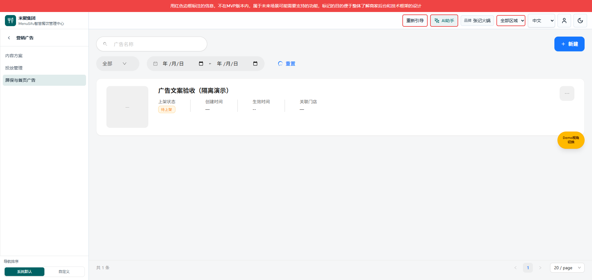

图：V1.6功能分支，1920×911，隔离演示会话；导航图含QA广告记录。

用途／入口：营销中心 → 营销广告 → 广告位管理；沿用 /marketing/screensaver。

| 字段／操作 | 逻辑说明 |
| --- | --- |
| 广告位管理 | 第三个子菜单及原页面权限名称；与内容方案、投放管理同级。中文名称统一，英文 Ad placement management。 |
| 广告名称 | 列表筛选、编辑字段及校验中的对象名称；原name字段及用户已保存名称不修改。 |
| 暂无广告 | 没有广告时的空状态；提示创建广告并投放到门店设备。 |
| 广告预览 | 预览占位、素材预览及版式切换的称呼；原横竖版、缩放功能保留。 |
| 删除广告 | 原删除确认及后果保留，删除对象统一称广告。 |

### 新建与编辑广告

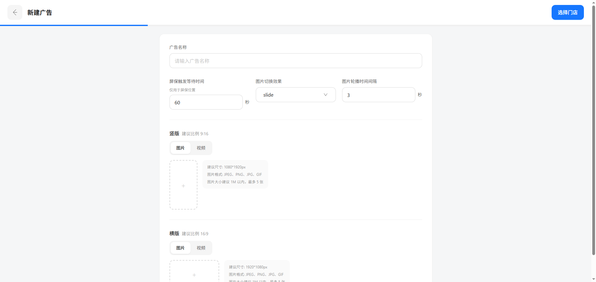

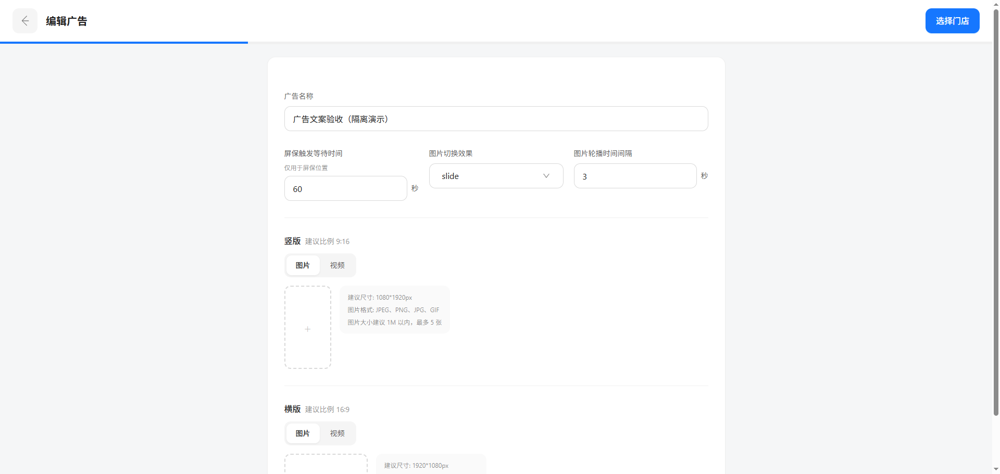

图：V1.6实际新建及编辑页；编辑对象qa-copy为隔离演示记录。

| 字段／操作 | 逻辑说明 |
| --- | --- |
| 新建广告／编辑广告 | 原新建、编辑页标题；广告名称输入、必填提示统一。 |
| 屏保触发等待时间 | 原idleTimeoutSec，秒、默认60、正整数约束沿用；显示“仅用于屏保位置”，不表示首页受空闲触发控制。 |
| 广告素材 | 上传校验、预览及新增素材自动名称使用广告称呼；素材库既有屏保素材分类保留，不迁移分类或改写用户素材名。 |

### 投放流程

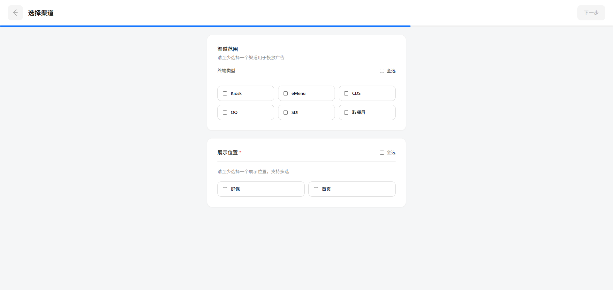

图：V1.6渠道页，保留屏保、首页位置选项。门店、时间页与弹框的本版截图待补，见交付清单。

| 字段／操作 | 逻辑说明 |
| --- | --- |
| 投放广告 | 门店、渠道、时间页文档标题及相关确认统一称投放广告；渠道说明为“请至少选择一个渠道用于投放广告”。 |
| 屏保／首页 | 展示位置选项保持原名称与稳定值；新建空选、至少一项、多选和全选沿用位置章节。 |
| 冲突与校验 | 原提示中的主题对象统一称广告；排期、重叠、保存、发布和回执逻辑不因改名改变。 |

## 展示位置

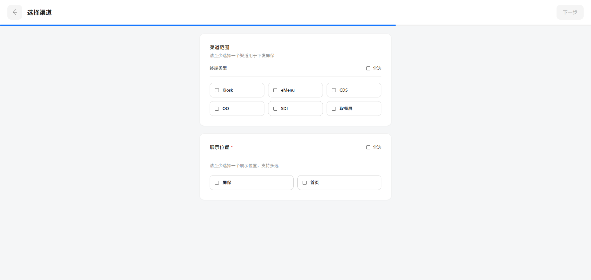

图：V1.5 功能分支，1920×911，直接加载同一检出的原渠道页；新建选择均为空。

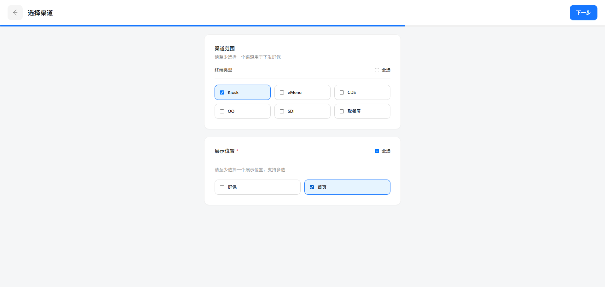

图：Kiosk、首页选中，位置全选框半选，下一步可用。

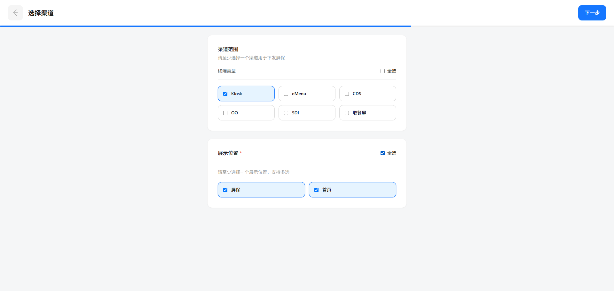

图：两个位置全选，不联动渠道全选。

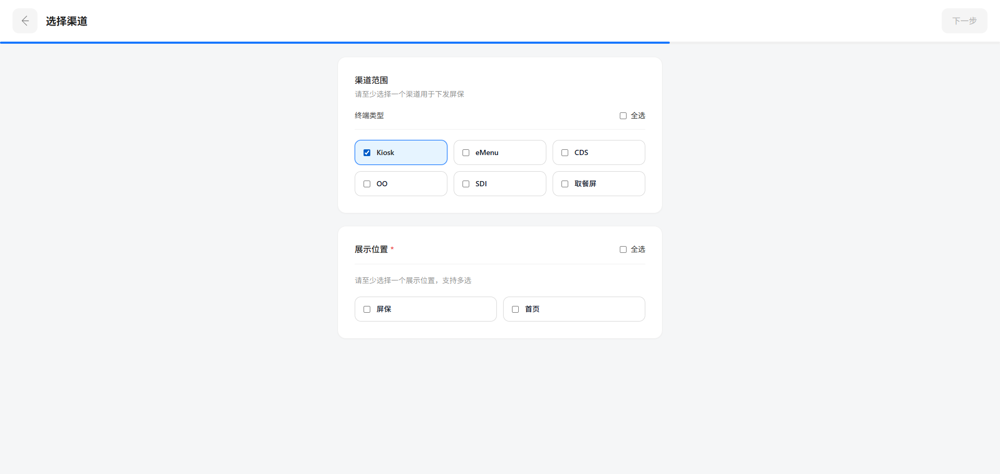

图：仅选择Kiosk、位置为空，下一步禁用。

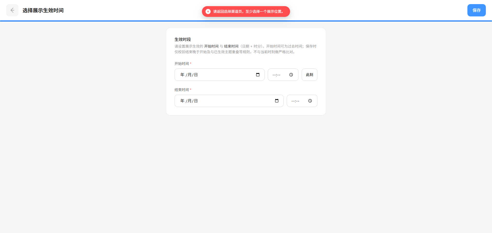

图：隔离QA模拟绕过渠道页清空位置，原时间页保存提示返回选择。

用途／入口：营销中心 → 营销广告 → 广告位管理 → 新建或编辑 → 选择门店 → 选择渠道。渠道范围卡片下方为独立展示位置卡片。

| 字段／操作 | 逻辑说明 |
| --- | --- |
| 展示位置 | 必填多选组，固定提供屏保、首页两个选项；新建时均不勾选。与终端渠道分别选择，所选位置应用于本次所选渠道。 |
| 屏保 | 稳定值 screensaver；勾选加入本次展示位置，取消移除。 |
| 首页 | 稳定值 home；可独立选择或与屏保同时选择。 |
| 全选展示位置 | 仅作用于两个位置，不改变渠道选择。未全选时点击勾选全部；已全选时点击清空。只选一项时显示半选状态。 |
| 下一步 | 渠道至少一项且展示位置至少一项才可用；任一组清空后禁用。启用后进入原展示生效时间页，保留原 embedded 与 from 上下文。 |
| 返回／刷新回显 | 同一主题本次选择保留，显式清空也保留；切换主题不会读取另一主题的未保存位置。重新投放回显该主题已保存的位置。 |
| 历史记录 | 没有展示位置字段的记录回显为空，重新保存投放前须明确选择至少一个位置；不自动将历史记录批量改为首页或屏保。 |
| 保存 | 时间页在原时间与重叠校验外再次校验位置非空，空选提示“请返回选择渠道页，至少选择一个展示位置。”并保留当前页面和数据。成功随原主题草稿保存位置，清理本次位置临时选择；取消原重叠确认不写入位置。 |
| 存储失败 | 位置选择写入失败时显示“展示位置保存失败，请检查浏览器存储后重试。”；以最后成功保存的选择回显，不伪装成功。 |

## 菜单名称

菜单名称为“营销广告”（英文 Marketing ads）。父项标识 mkt-screensaver、路由、权限键和三个子菜单的路由及功能保持现有定义。文档文件名沿用既有唯一入口。

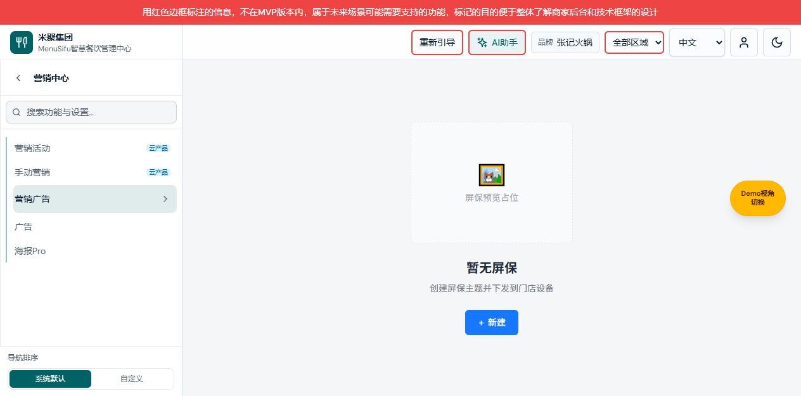

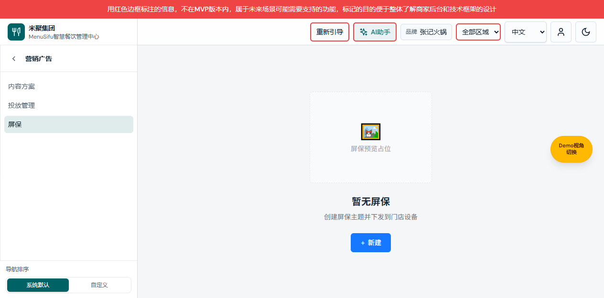

图：V1.4 功能分支，1280×625，隔离演示会话。父菜单与子导航标题均为营销广告；下文旧版截图只说明未变的页面内容。

## 广告位管理

图：V1.3 功能分支，1280×625，隔离演示源的空列表。

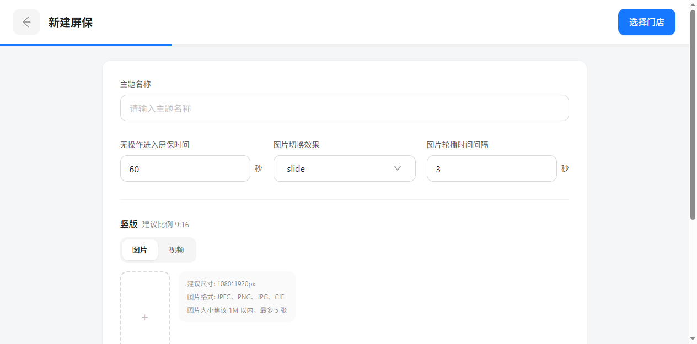

图：同一分支原 iframe 的新建页，全屏状态；该图为V1.3原新建页；V1.5渠道页与时间页依据展示位置章节扩展。其他旧流程截图缺口见交付清单。

用途／入口：营销中心 → 营销广告 → 广告位管理。内容方案、投放管理的顺序、页面及操作保持现状。

| 字段／操作 | 逻辑说明 |
| --- | --- |
| 广告位管理菜单 | 第三个同级叶子，标识 `mkt-legacy-screensaver`；进入 `/marketing/screensaver`，公共子导航保持显示并高亮广告位管理。 |
| 原页面宿主 | 直接加载 `Configuration center/kiosk-screensaver.html` 原 iframe，内部进入 `kiosk-theme-list.html`；不重写原页面。 |
| 原编辑与下发 | 沿用原新增、编辑、素材上传、横竖版预览、门店、渠道、生效时间、保存、上架与下架流程及校验；独立页面内部保持原交互。 |
| 全屏与返回 | 原新增／编辑页进入全屏，门店／渠道／时间页保持，返回原列表退出全屏；原取消及返回行为保留。 |
| 权限 | 原 `page:/marketing/screensaver` 及管理操作键保持；查看默认只读，隐藏祖先和现有预设过滤继续生效；不因新增入口自动授予编辑。 |
| 数据 | 原 `kiosk_themes` 及原媒体 IndexedDB 沿用；与内容方案／投放记录分别存储，不自动迁移或下发。浏览器不同端口属于不同源，不自动复制旧源数据。 |
| 默认入口 | `/marketing/display-content` 仍进入内容方案；`/marketing/screensaver` 不再转至内容方案。 |

## 目标与角色

平台定义可扩展的展示区域，各终端按稳定编码接入；商家在区域中维护内容、配置独立投放。同一内容区域可以服务不同终端，新区域不要求中台新增专属页面。

| 对象／角色 | 规则 |
| --- | --- |
| 平台管理员 | 在 M 平台管理区域、素材规范和终端支持信息；查看权限、管理权限沿用平台预设的查看与发布权限。 |
| 商家 | 在当前明确品牌范围内配置内容与投放；仅可选择本品牌且在当前账号门店权限内的门店。 |
| 终端 | 使用区域编码获取内容，负责真实位置、布局、触发、播放及默认回退；登记支持不代表终端已开发或升级。 |
| 区域 | 独立展示单元，如首页顶部横幅；同一页面多个独立位置分别建区域。 |
| 内容方案 | 一个区域中的素材集合、顺序、尺寸版本和展示参数；保存更新草稿版本。 |
| 投放 | 内容与门店、终端、时区、时间的关联；一个方案可以有多条独立投放。 |

## 导航与页面入口

图：实际功能分支，1440×900，隔离演示会话。营销中心内下钻至营销广告，正文无内容／投放 Tab。

| 字段／操作 | 逻辑说明 |
| --- | --- |
| 营销广告 | 营销中心中的父菜单，整行进入覆盖父层的子导航；覆盖营销中心标题、搜索及菜单区域。 |
| 内容方案 | 独立页面 `/marketing/display-content/contents`；进入内容列表，当前子导航保持显示并高亮。 |
| 投放管理 | 独立页面 `/marketing/display-content/placements`；进入投放列表，当前子导航保持显示并高亮。 |
| 返回上一级 | 从营销广告退回营销中心，仅退一层，不更改当前业务页面。 |
| 广告位管理 | 营销广告的第三个同级叶子，`/marketing/screensaver` 直接进入原屏保页面；内容方案和投放管理保持独立。 |
| 展示区域管理 | M 平台独立入口 `/m-platform/display-regions`；商家营销广告子导航不出现区域管理，也没有演示角色切换。 |

## 区域管理

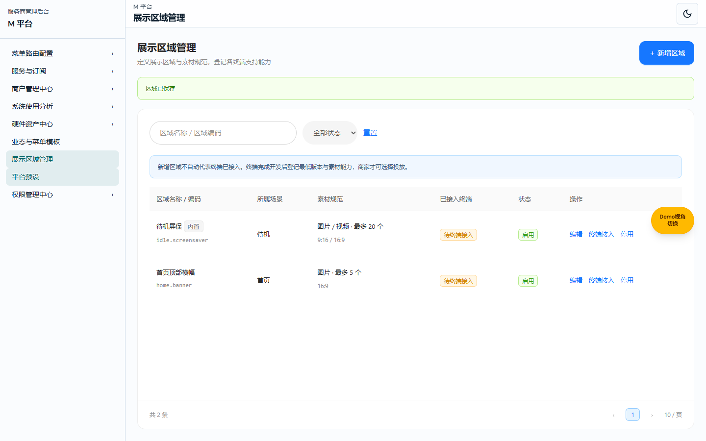

图：实际功能分支，区域创建结果；门店、区域及版本数据均为受控验证数据。

| 字段／操作 | 逻辑说明 |
| --- | --- |
| 区域名称 | 商家可识别的名称，1～30 字，去除首尾空格后保存。 |
| 区域编码 | 全平台唯一，最多 64 字；小写英文字母开头，使用字母、数字及 `. _ -` 分隔，如 `home.banner`。创建后不可修改。 |
| 所属场景 | 1～20 字，可直接输入新场景，不由中台固定枚举；首页、购物车、完成页、待机为输入建议。 |
| 区域说明 | 最多 200 字，说明位置与用途，允许为空。 |
| 素材类型 | 图片、视频至少选择一种；投放还需满足各终端登记的格式能力。 |
| 建议比例 | 如 `16:9`；多比例使用 `/` 分隔。每边是 1～4 位正整数；素材可标记区域默认或明确比例。 |
| 素材数量上限 | 必填整数 1～20，默认 5。 |
| 轮播间隔 | 可开放给商家配置，单位秒；允许 1～300 的整数。 |
| 无操作进入时间 | 可开放给需要空闲触发的区域，单位秒；允许 1～3600 的整数。其他区域不强制填写此参数。 |
| 新增区域 | 初始启用、无终端支持；不自动开放任何终端投放。 |
| 已接入区域编辑 | 可修改名称、场景及说明；素材类型、比例、数量、参数的兼容性变更受保护，不直接改变已接入协议。 |
| 停用 | 二次确认；已发布投放失效，内容草稿保留；终端下次获取得到清空结果。 |
| 重新启用 | 开放新配置，但停用前的发布不会恢复，须重新创建投放。 |

### 区域新增与校验

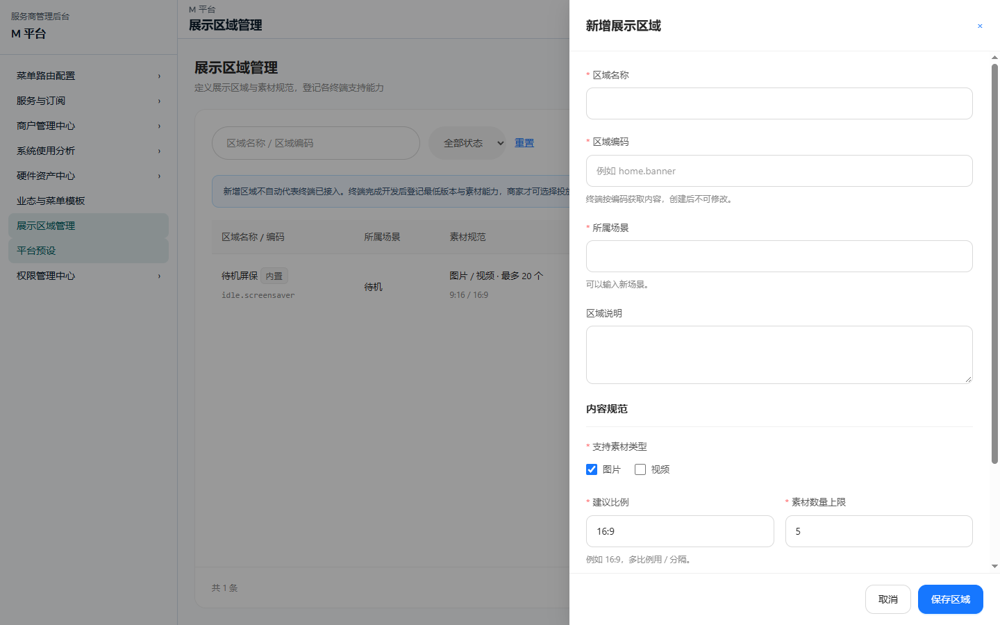

图：实际功能分支的新增抽屉。

新增、编辑使用独立抽屉；保存前校验字段、唯一编码和兼容性；失败保留输入，不覆盖已有数据。取消或关闭未修改表单不写入；有修改时先确认是否放弃。

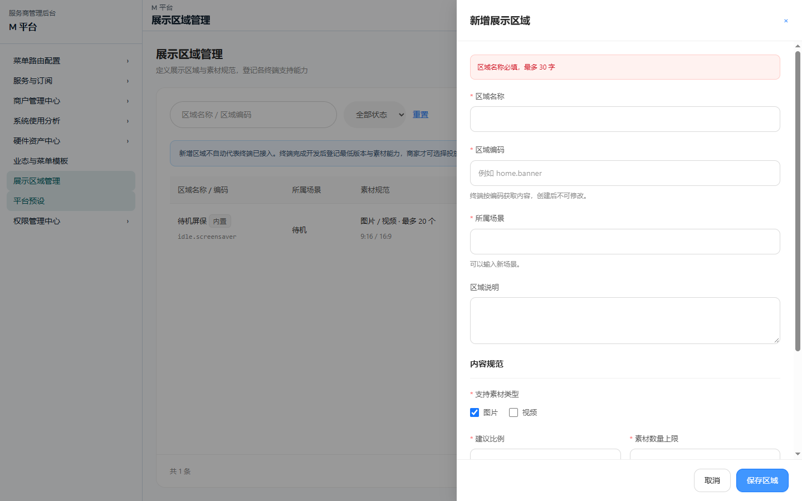

图：受控空表单提交后的真实错误状态。

## 终端接入登记

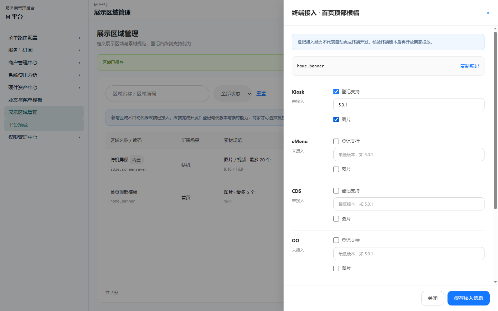

图：实际功能分支，Kiosk 支持信息编辑；版本号为验收数据，不是已发布终端版本证明。

| 字段／操作 | 逻辑说明 |
| --- | --- |
| 区域编码／复制 | 提供稳定对接标识；复制不修改配置。 |
| 终端 | Kiosk、eMenu、CDS、OO、SDI、取餐屏逐项登记，互相独立。 |
| 登记支持 | 选中后需填写最低版本及至少一种素材类型；未选中的终端不开放投放。 |
| 最低支持版本 | 三段或四段数字，如 `5.0.1`；终端实际版本须不低于该版本，按每段数字比较。 |
| 支持素材类型 | 不得超出区域规范；终端不支持所选素材类型时阻止发布。 |
| 保存接入信息 | 成功后商家可选择对应终端；保存失败保留输入。登记不代表真实开发或部署完成。 |

## 内容方案列表

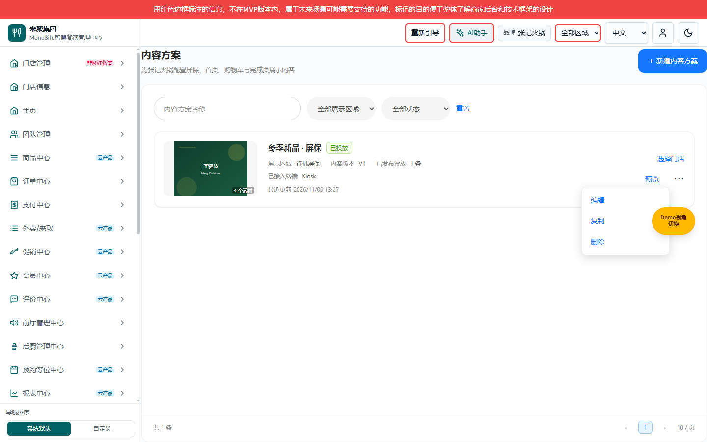

图：内容卡片与更多操作；功能分支 V1.1，隔离演示会话。

| 字段／操作 | 逻辑说明 |
| --- | --- |
| 内容列表 | 复用原屏保卡片、缩略图、圆角筛选、分页和更多菜单；每页10条。 |
| 内容筛选 | 名称、展示区域、未投放／已投放／有未发布修改；重置回全部。 |
| 预览 | 实际素材预览，支持比例切换、翻页、缩放、视频与键盘；不增加版本。 |
| 更多→编辑 | 进入已有内容草稿；保存不污染历史发布。 |
| 更多→复制 | 复制内容与素材引用为独立V1草稿，不复制投放、旧标识或门店范围；名称追加副本并限制总长度。 |
| 更多→删除 | 需确认；存在有效投放则拦截。成功删除内容及关联未上架投放草稿，素材原件和历史快照保留。取消不写入。 |
| 选择门店 | 复用门店→渠道→生效时间三步，支持同一内容独立配置多次投放。 |

## 内容编辑

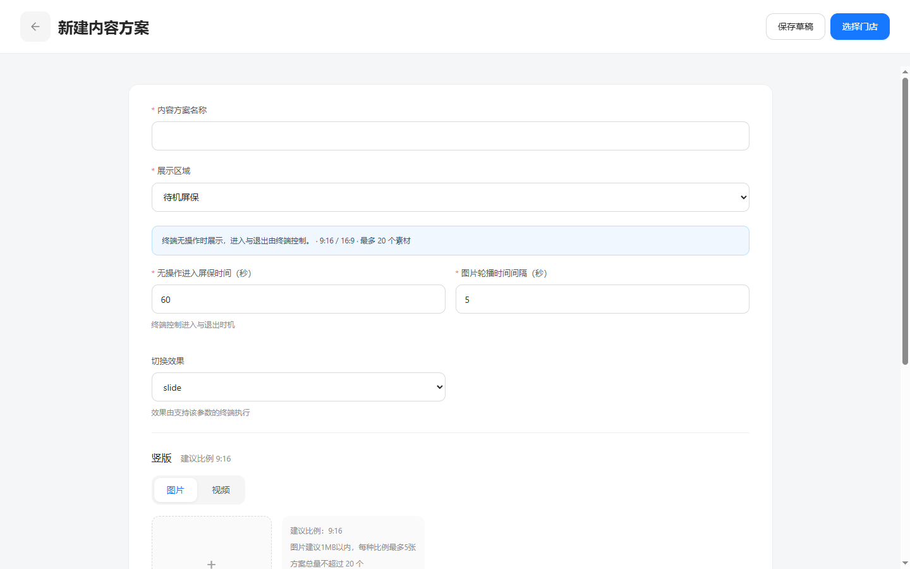

图：独立内容编辑与横竖分区；功能分支 V1.1，隔离演示会话。

| 字段／操作 | 逻辑说明 |
| --- | --- |
| 内容方案名称 | 必填1—50字，去首尾空格；列表搜索按名称匹配。 |
| 展示区域 | 单选启用区域，决定比例、类型、总量及参数。切换区域时不删除素材，不再匹配的比例转入通用分组，保存时重检。停用区域不可保存新内容。 |
| 无操作进入屏保时间 | 区域开放idle时显示；默认60秒，1—3600整数，终端执行进入退出。 |
| 图片轮播时间间隔 | 区域开放interval时显示；默认5秒，1—300整数。 |
| 切换效果 | 内置屏保或区域开放transition时显示；默认slide，可选slide/fade/zoom/rotate/bounce/flip，发布冻结参数，由支持的产线执行。 |
| 比例分区 | 按区域比例分别编辑；9:16显示竖版，16:9显示横版，其他显示比例名。已有default素材另显示通用分组。 |
| 图片／视频 | 每个比例只能一种类型；最多5张图片或1个视频，同时受区域总数上限约束。切换类型且存在其他类型素材时确认，确认只移除当前草稿该比例素材；取消保留。 |
| 素材删除 | 移除当前草稿引用，不删除素材库、媒体原件或历史快照；无素材不能保存。 |
| 前移／后移 | 仅调整同一比例的素材相对顺序，首尾越界无变化，保存后进入下一内容版本。 |
| 保存草稿 | 重检内容、品牌、权限和revision；成功version+1，不修改已上架快照，失败保留编辑内容。 |
| 选择门店 | 先保存当前内容；成功进入门店步骤并带入此方案，失败停留编辑页。 |
| 返回 | 有修改先确认放弃；取消留在原表单，确认关闭不保存。 |

### 上传与素材库

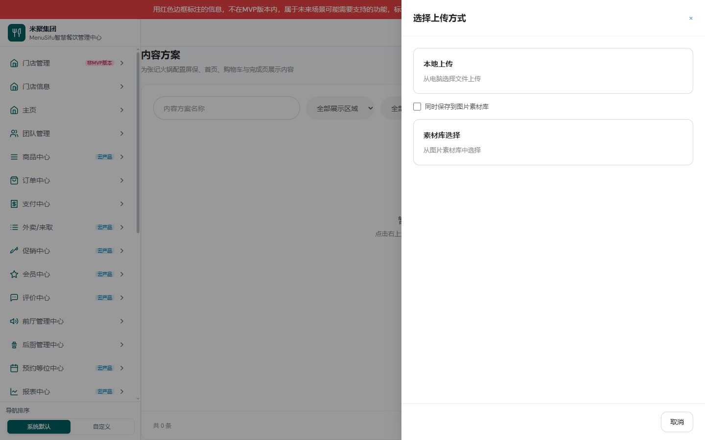

图：上传来源；功能分支 V1.1，隔离演示会话。

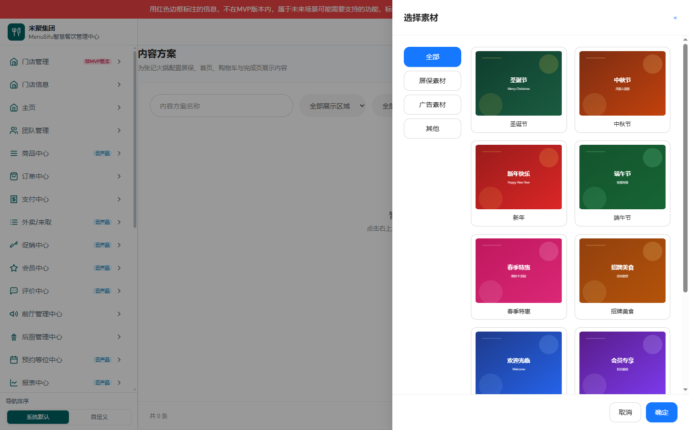

图：分类素材选择；功能分支 V1.1，隔离演示会话。

| 字段／操作 | 逻辑说明 |
| --- | --- |
| 本地上传 | 图片支持PNG/JPEG/WebP/GIF，可多选；建议1MB以内，不设置2MB硬限制。视频支持MP4/WebM，每个不超过20×1024×1024字节；在IndexedDB保存Blob引用。 |
| 数量校验 | 先检查本次全部文件的格式、大小及数量；不符合不将这一批部分加入草稿。每比例5图或1视频，且不超过区域总量。 |
| 同时保存到图片素材库 | 默认不勾选，仅图片可用；图片按屏保素材或广告素材分类写入既有material_images。写入失败提示，草稿不添加这批素材，可取消同步后重试。 |
| 素材库选择 | 仅图片可用；复用现有素材数据和分类。支持分类切换、多选、取消选中、已选数量、确定及取消；同一比例相同素材不重复添加。 |
| 取消 | 返回原编辑内容，未确定素材不加入；取消系统文件选择不改变草稿。 |
| 异步读取与失败 | 表单已关闭或切换不重新打开旧编辑器；格式、大小、数量、读取或存储错误保留现有内容并提示。 |

### 素材类型切换确认

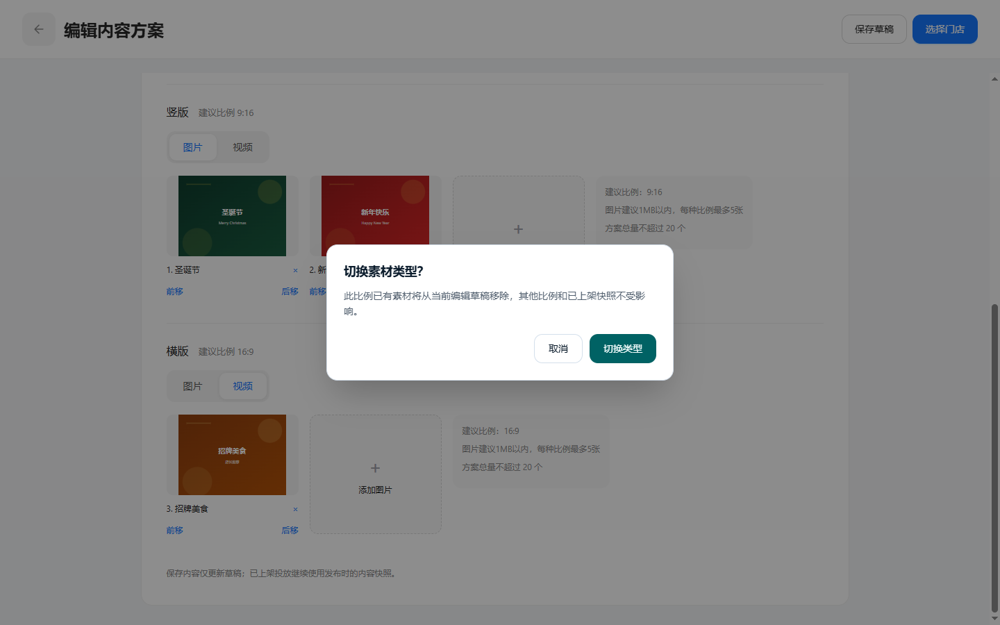

图：切换类型确认；功能分支 V1.1，隔离演示会话。

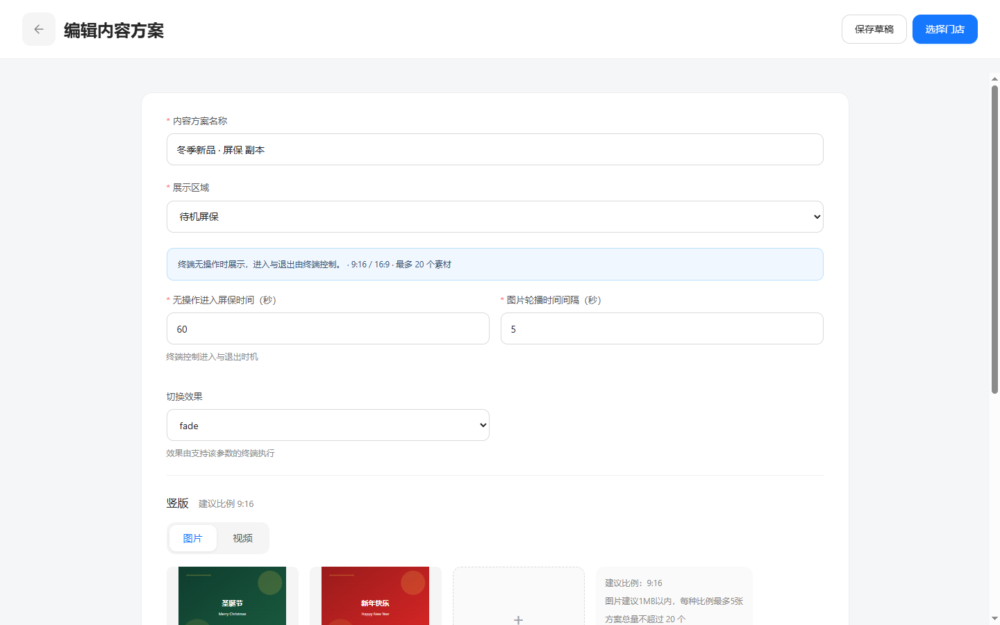

图：取消切换保留素材；功能分支 V1.1，隔离演示会话。

## 投放流程：选择门店

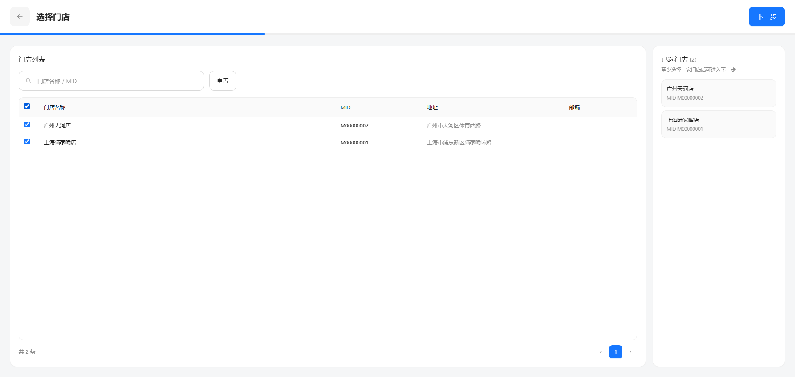

图：全宽门店表格及已选门店卡片；V1.2功能分支原生页面，隔离演示，1920×911。

| 字段／操作 | 逻辑说明 |
| --- | --- |
| 页面入口 | 内容编辑右上“选择门店”先保存内容草稿，再带入该方案；内容卡片“选择门店”直接带入。投放管理“新建投放”在此页另显示方案选择。 |
| 左上返回 | 第一步返回入口列表；有未保存投放选择时弹框确认放弃，取消保留。内容草稿已保存，不随放弃投放删除。 |
| 右上下一步 | 至少一家授权门店已选才启用；点击进入选择渠道，无底部重复按钮。 |
| 顶部进度线 | 紧贴80px页头，第一步1/3、第二步2/3、第三步全宽，不使用正文步骤条。 |
| 门店列表 | 左侧独立白色卡片，右侧320px已选门店卡片；候选限当前品牌与账号权限交集。 |
| 门店名称／MID搜索 | 仅匹配当前授权候选名称或MID，忽略大小写并去首尾空格；输入时回第一页，不清除筛选外选择。 |
| 重置 | 清空搜索并回第一页，已选门店保留。 |
| 表头复选框 | 全选／取消当前筛选结果的当前页，不影响其他页；部分选中显示indeterminate。空结果时禁用。 |
| 行复选框 | 逐店勾选／取消，即时更新右侧数量与卡片。 |
| 门店名称 | 当前授权选项的真实名称，不使用参考图的示例店名。 |
| MID | 真实storeId，独立列；按此ID持久化投放范围。 |
| 地址 | 同MID的企业门店元数据address，缺失或空白显示—，不扩大候选范围。 |
| 邮编 | 同MID元数据postalCode，缺失或空白显示—，不伪造示例。 |
| 共N条 | 当前搜索匹配的授权门店数，空结果0；不固定展示参考图88条。 |
| 页码／上一页／下一页 | 每页10条，搜索后回第一页，首尾禁用，翻页保留选择；大页数显示首尾、当前附近及省略号。 |
| 已选门店数量 | 完整已选集合数量，包括当前搜索或分页之外的选择。 |
| 已选门店卡片 | 展示真实名称及MID；移除按钮悬停或键盘聚焦时显示，移除仅作用于该店。 |

## 投放流程：选择渠道

图：居中渠道卡片；V1.2功能分支原生页面，隔离演示，1920×911。

| 字段／操作 | 逻辑说明 |
| --- | --- |
| 页面标题 | 选择渠道；左上返回上一步，右上下一步，进度2/3。 |
| 页面布局 | 约624px居中白色圆角卡片，渠道三列两行；不显示独立确认页或底部步骤操作。 |
| 渠道范围说明 | 至少选择一个渠道用于下发当前区域的展示内容；屏保区域使用屏保文案。 |
| 终端类型 | 固定显示Kiosk、eMenu、CDS、OO、SDI、取餐屏。渠道与底层terminals字段一一对应，不另建枚举。 |
| 可选条件 | 区域启用、已登记接入且支持方案全部素材类型；不因参考图示例而自动登记能力。 |
| 禁用原因 | 未接入、不兼容或停用时禁用；鼠标提示与辅助说明给出原因。全部不可用显示平台登记路径提示。 |
| 全选 | 仅选中或取消可用渠道，不包含禁用项；全部可用渠道选中时复选框勾选。 |
| 单渠道卡片 | 勾选后蓝色边框和浅蓝底，选择变更即时更新下一步可用状态。 |
| 下一步 | 至少一个可用渠道已选才启用，进入展示生效时间。 |
| 返回上一步 | 保留门店和渠道选择，返回门店页。 |

## 投放流程：展示生效时间

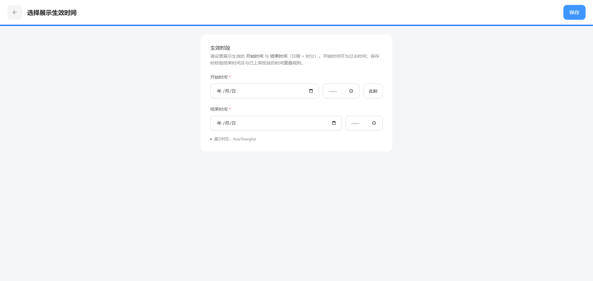

图：日期与时分分开输入；V1.2功能分支原生页面，隔离演示，1920×911。

| 字段／操作 | 逻辑说明 |
| --- | --- |
| 页面标题与进度 | 选择展示生效时间，进度全宽；右上唯一主要操作为保存。 |
| 页面布局 | 约624px居中白色圆角卡片，开始、结束分别由原生日期与时分输入构成。 |
| 开始日期 | 新投放默认空；保存与开始时分组合为所选时区的本地日期时间。允许过去开始时间。 |
| 开始时分 | 新投放默认空，分钟精度；缺少日期或时分时提示完整日期与时间。 |
| 此刻 | 按所选时区同时写入当前开始日期和时分；不修改结束值。 |
| 结束日期 | 新投放默认空，和结束时分组合；须满足现有业务校验。 |
| 结束时分 | 新投放默认空；结束须晚于开始和当前时刻，不自动填一天或七天。 |
| 展示时区 | 默认Asia/Shanghai；折叠入口展开后可选既有六个IANA时区。切换保留当前输入，按新时区解释。 |
| 时间异常 | 非法日期、DST缺失或重复时间、结束不晚于开始或当前时间均拒绝保存，保留输入。 |
| 左上返回 | 返回选择渠道，保留日期、时分、时区、渠道与门店。 |
| 保存 | 从四个输入及zone采集草稿，先检查权限与时间，再打开确认保存弹框；不进入第四个页面，不提供本流程“保存投放草稿”按钮。 |

### 保存确认、取消与结果

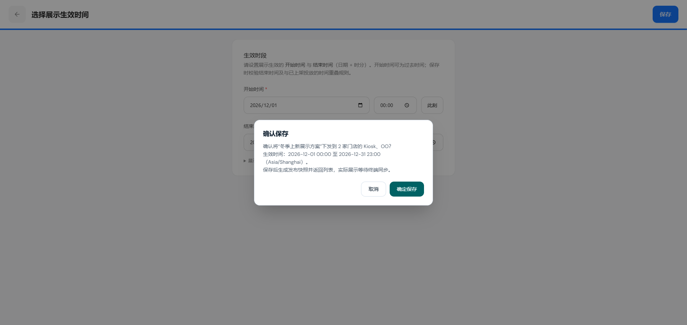

图：保存确认弹框；V1.2功能分支原生页面，隔离演示，1920×911。

| 字段／操作 | 逻辑说明 |
| --- | --- |
| 确认摘要 | 说明方案名称、门店数、渠道、开始结束及展示时区；这是弹框而非独立第四步。 |
| 取消 | 关闭弹框，停留生效时间页，保留所有值，不写入投放。 |
| 确定保存 | 再次校验品牌与操作权限、区域接入、门店与渠道、素材、时段和同区域冲突；冻结内容版本后写入published，成功返回入口列表。 |
| 冲突／保存失败 | 弹框关闭后在时间页提示，未写入投放，当前输入保留，调整后可重新保存。 |
| 结果状态 | 管理端显示已上架／已投放与等待同步；不把保存成功当成真实设备已展示。 |

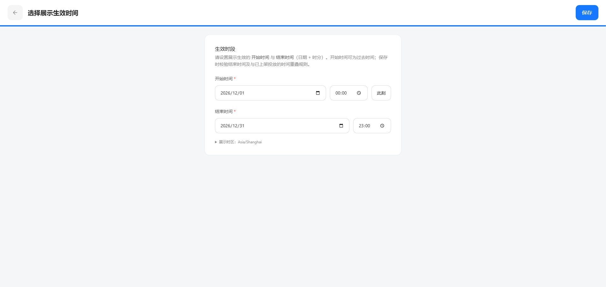

图：取消后保留时间输入；V1.2功能分支原生页面，隔离演示，1920×911。

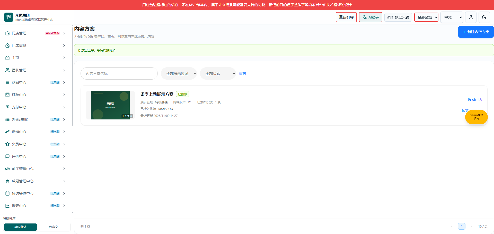

图：保存成功返回入口列表；V1.2功能分支原生页面，隔离演示，1920×911。

## 投放管理

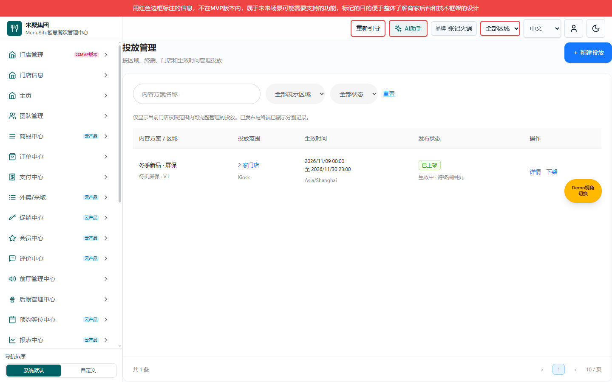

图：实际功能页面；功能分支 V1.1，隔离演示会话。

| 字段／操作 | 逻辑说明 |
| --- | --- |
| 记录对象 | 每条是一次独立投放；按名称、区域、待上架／已上架／已下架筛选，每页10条。 |
| 关联门店 | 数量链接打开关联门店抽屉，不能用内容当前草稿覆盖投放自己的目标。 |
| 上下架状态 | draft→待上架；published且未失效、未到期→已上架；revoked、区域代次失效或已到期→已下架。状态为配置结果，不是设备回执。 |
| 生效状态 | 按起止分待生效／生效中／已结束；与上架状态分开。到期在关联门店中仍能识别已结束。 |
| 编辑 | 仅待上架记录可原位修改；再次投放从历史范围创建新记录并重新选时间，不覆盖旧快照。原内容已删除则提示从新建选择其他内容。 |
| 上架 | 待上架行确认后按当前草稿生成快照；冲突则保留原记录并提示。 |
| 下架 | 已上架行确认后变为revoked；取消保持原状态，其他投放不受影响，终端更新后清空。 |
| 详情 | 显示投放快照版本、素材、区域、门店、产线、时区、范围与同步提示；与当前草稿版本不同则同时提示。 |

## 关联门店

图：实际功能页面；功能分支 V1.1，隔离演示会话。

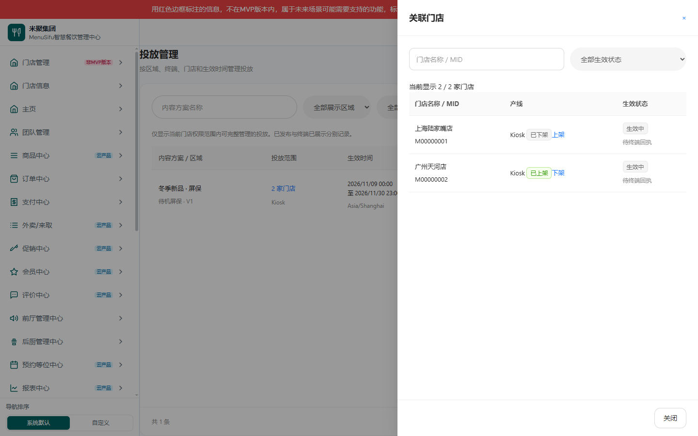

图：上海Kiosk下架、广州保持上架；功能分支 V1.1，隔离演示会话。

| 字段／操作 | 逻辑说明 |
| --- | --- |
| 名称／MID搜索 | 在该条投放目标内匹配，不显示越权门店。 |
| 门店生效状态 | 筛选待生效／生效中／已结束／已下架，按投放排期与整体上下架判定。 |
| 产线状态 | 逐店逐产线显示上架／下架；单产线下架不修改整条投放的排期或其他目标。 |
| 产线上下架 | 仅未到期且区域仍有效的published记录可管理；需确认。下架将门店产线记入disabledTargets；重新上架移除该项并重检同区域冲突。 |
| 回执提示 | 当前无真实设备回执，显示待终端回执，不把配置上架当成已展示。 |
| 关闭 | 关闭抽屉不写入；查询和筛选不触发未保存确认。 |

## 内容预览

图：实际功能页面；功能分支 V1.1，隔离演示会话。

| 字段／操作 | 逻辑说明 |
| --- | --- |
| 比例切换 | 仅显示方案已有素材比例；切换后回该比例第1个素材及100%缩放。 |
| 上一张／下一张 | 同一比例内依素材顺序翻页，首尾禁用；左右方向键等效。 |
| 缩小／放大／重置 | 每次25%，范围25%—300%，重置100%；+、−键等效，视频控件内不接管键盘。 |
| 图片展示 | 默认contain完整展示，不裁切；放大可滚动查看。 |
| 视频播放 | 原生播放控件与声音控制，IndexedDB引用读取为当前会话blob URL；关闭或重渲染释放URL，持久化不写blob URL。 |
| 返回 | 关闭预览回列表，不保存、不增加版本。 |

## 验收依据

营销广告包含内容方案、投放管理、广告位管理三个独立叶子；编辑、素材、预览和门店下发沿用原屏保交互。每次投放冻结内容；草稿版本、上下架、排期及设备回执分别判定。服务端、设备接入和未采集状态不作为已完成能力，见独立交付清单。
