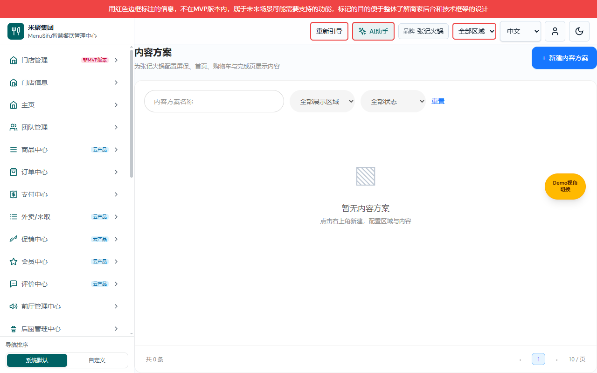
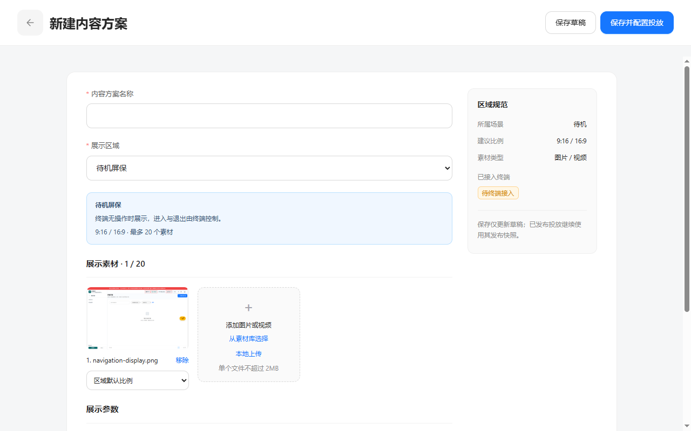
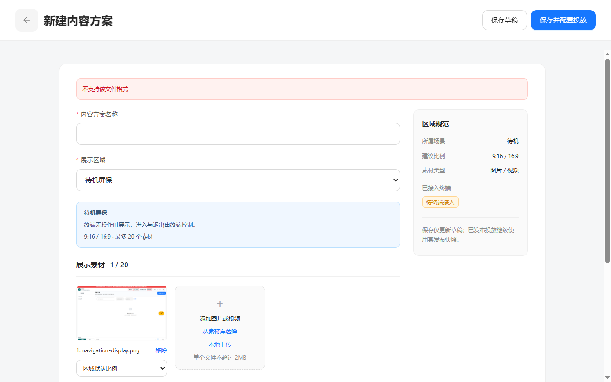

# 展示内容交付缺口与逐操作截图清单

版本：V1.0；日期：2026-11-09；变更编号：DISPLAY-20261109-01。配套：[产品 V1.0](../展示内容产品权威需求文档.md) · [研发 V1.0](../展示内容业务规格说明书（研发交付版）.md) · [个人规范 V1.0](../展示内容需求文档（个人规范版）.md)。

## 实现与验证范围

代码位于独立功能分支 codex/marketing-display-regions-20261109，起始 main@e16c7f90；本机隔离演示品牌 merchant-zhangji、M00000001/M00000002 为验收数据，不代表真实生产操作。图片均来自实际原生功能页；新增 region home.banner 的 Kiosk 5.0.1 支持登记是受控测试信息，不代表真实设备已完成此能力。

外部浏览器已验证：营销中心 → 展示内容 → 内容方案/投放管理；平台新增区域与终端登记；商家素材库编辑、草稿保存、向导保存/发布；同区域冲突；已发布V1与草稿V2分离；取消与确认发布/撤销；未保存草稿保护；停用后启用不恢复旧发布。

自动检查：display domain、TypeScript、公共递归导航、营销权限目录、生产构建通过。构建存在现有大包/混合导入告警，并提示本检出没有 kiosklite/.embed-build，未构建或改动设备嵌入包。本任务管理端构建成功不等于设备包或真实设备验收。构建生成的无关 dist 和自动生成文件恢复至本任务起始提交，保留源码交付与原基线静态资源。

## 仍需闭合的接入与验收

| 编号 | 缺口 | 当前状态／下一步 |
| --- | --- | --- |
| G1 | 真实服务端存储与权限 | 当前项目使用 localStorage 分品牌桶；需要API、服务端授权与审计、媒体存储/不可变资源版本，不能把浏览器按钮鉴权当后端授权。 |
| G2 | 并发与冲突事务 | 当前 revision 重检可发现已落盘变化，跨窗口不是原子CAS；线上需服务端事务处理区域编码唯一性、投放冲突与版本条件写入。 |
| G3 | 终端真实接入 | resolveTerminalContent 为可测试的纯解析合同；未暴露网络API，未实现各终端位置/播放/触发/缓存/默认回退。需终端按区域编码对接、版本核验、断网/到期清空。 |
| G4 | 设备回执与监控 | 界面仅“待终端回执”，不显示虚假的已展示。需设备身份校验、下发/接收/展示/失败回执及重试与监控。 |
| G5 | 旧屏保媒体迁移 | 可完整读取且1—20素材才转草稿；IndexedDB引用未迁移、不可读或超量方案整条保留待人工处理；原数据不删、不自动沿用旧排期。 |
| G6 | 截图与浏览器覆盖 | 逐操作清单下列待补项没有宣称完整。首次上传自动化曾出现CDP超时；新隔离会话已验证上传成功、格式及2MB容量错误。原生取消、底层读取失败、只读账号、跨品牌切换、quota界面仍需补验。 |
| G7 | Git与桌面登记 | 未提交、未合并、未推送。期间其他工作使main推进至7f47e8a7；本功能保留起始e16c7f90，尚未与新main整合。Git worktree有效；桌面create_worktree任务登记未完成，attach返回无法确认归属。不会因此修改原脏检出。 |

预览服务：端口5298，127.0.0.1，功能分支源码；HEAD e16c7f90，包含本次未提交修改。实际目录为 `C:/Users/27273/.codex/worktrees/marketing-display-regions-20261109/new-bp/admin-web`。任务开始已fetch核验main；期间main由其他工作推进，上述功能预览不代表当前main。

## 显示与上传复验

图：1280×800 新隔离会话，均为本期原生页面，受控上传测试文件保存在任务D盘临时目录；失败后原素材仍保留。上传与两种错误检查后的浏览器 errors 无输出。随后追加保存上传内容的自动化遇到CDP连接失联，未作为通过项；原素材库内容保存及发布流程已在前一会话完成。

## 逐操作覆盖

清单索引不能替代正文就近配图；“待补”保留为交付缺口。“失败截图待补”不表示正常路径未实现，域测试也不代替真实UI图片。正文位置为个人规范相应节，公共规则同时在产品与研发说明。

| 页面 | 操作名称 | 触发入口 | 操作后界面 | 确认／取消／结果 | 对应图片 | 验证与缺口 | 正文位置 |
| --- | --- | --- | --- | --- | --- | --- | --- |
| 导航 | 营销中心下钻 | 侧栏营销中心 | 营销子层 | 不适用 | [图片](../assets/navigation-marketing.png) | 已验证 | 个人§一 |
| 导航 | 展示内容下钻 | 营销子层展示内容 | 展示内容子层 | 不适用 | [图片](../assets/navigation-display.png) | 已验证；整层覆盖 | 个人§一 |
| 导航 | 内容方案菜单 | 展示内容子层 | 内容列表 | 不适用 | [图片](../assets/contents-final.png) | 已验证；独立路由 | 个人§一、五 |
| 导航 | 投放管理菜单 | 展示内容子层 | 投放列表 | 不适用 | [图片](../assets/placements-list.png) | 已验证；独立路由 | 个人§一、八 |
| 导航 | 返回上层 | 展示内容子层返回 | 营销中心子层 | 不适用 | [图片](../assets/navigation-marketing.png) | 通用实现回归通过；点击后独立截图待补 | 个人§一 |
| 导航 | 旧屏保URL兼容 | /marketing/screensaver | 内容方案 | 不适用 | 待补页面图片 | 路由已实现；独立刷新截图待补 | 产品导航 |
| 区域 | 搜索 | 区域列表搜索框 | 名称／编码匹配 | 空结果与重置 | 待补页面图片 | 已实现；过滤前后截图待补 | 个人§二 |
| 区域 | 状态筛选 | 区域列表状态 | 启用／停用过滤 | 全部状态 | 待补页面图片 | 已实现；筛选结果截图待补 | 个人§二 |
| 区域 | 重置 | 区域筛选重置 | 恢复全部 | 不适用 | [图片](../assets/regions-final.png) | 初始画面已采；操作前后待补 | 个人§二 |
| 区域 | 新增区域 | 区域列表新增 | 新增抽屉 | 取消不保存 | [图片](../assets/region-create.png) | 已验证 | 个人§三 |
| 区域 | 保存必填失败 | 新增抽屉保存 | 字段错误 | 草稿保留 | [图片](../assets/region-required-error.png) | 已验证；重复编码见域测试 | 个人§三 |
| 区域 | 保存成功 | 新增抽屉保存 | 区域列表新增行 | 不适用 | [图片](../assets/region-create-success.png) | 已验证；最新列表见 regions-final.png | 个人§三 |
| 区域 | 编辑 | 区域行编辑 | 编辑抽屉、编码不可改 | 取消不保存 | 待补页面图片 | 已实现；独立编辑画面和取消截图待补 | 个人§三 |
| 区域 | 终端接入 | 区域行终端接入 | 接入抽屉 | 关闭不保存 | [图片](../assets/bindings-before.png) | 已验证 | 个人§四 |
| 区域 | 登记终端与版本 | 接入抽屉 | 勾选Kiosk/版本/类型 | 未接入保持禁用 | [图片](../assets/bindings-edit.png) | 已验证 | 个人§四 |
| 区域 | 保存接入 | 接入抽屉保存 | 列表Kiosk标签 | 失败保留草稿 | [图片](../assets/bindings-success.png) | 成功已验证；无效版本错误截图待补，域测试覆盖 | 个人§四 |
| 区域 | 复制编码 | 接入抽屉复制 | 按钮已复制 | 剪贴板失败提示 | 待补页面图片 | 已实现；成功与失败截图待补 | 个人§四 |
| 区域 | 停用确认 | 启用区域行停用 | 停用确认框 | 取消维持启用 | [图片](../assets/region-disable-confirm.png) | 已验证 | 个人§十七 |
| 区域 | 取消停用 | 停用框取消 | 区域仍启用 | 不写入 | [图片](../assets/region-disable-cancel.png) | 已验证 | 个人§十七 |
| 区域 | 确认停用 | 停用框确认 | 区域停用、旧代次失效 | 失败不提交 | [图片](../assets/region-disabled.png) | 成功已验证；存储失败截图待补 | 个人§十七 |
| 区域 | 启用 | 停用区域行启用 | 区域启用 | 不恢复旧投放 | [图片](../assets/region-enabled.png) | 已验证 | 个人§十七 |
| 区域 | 旧投放不复活 | 启用后商家列表 | 历史投放已撤销 | 需新建 | [图片](../assets/region-reenabled-no-revival.png) | 已验证并有域测试 | 个人§十七 |
| 内容 | 无数据 | 内容菜单 | 空列表 | 新建入口 | [图片](../assets/contents-empty.png) | 已验证 | 个人§五 |
| 内容 | 搜索 | 内容列表搜索 | 匹配名称 | 无结果 | 待补页面图片 | 已实现；内容专属前后截图待补，不复用投放搜索 | 个人§五 |
| 内容 | 区域筛选 | 内容列表区域 | 按区域过滤 | 重置 | 待补页面图片 | 已实现；对应结果截图待补 | 个人§五 |
| 内容 | 状态筛选 | 内容列表状态 | 草稿/发布/修改 | 重置 | 待补页面图片 | 已实现；对应结果截图待补 | 个人§五 |
| 内容 | 重置 | 内容列表重置 | 全部内容 | 不适用 | 待补页面图片 | 已实现；操作前后截图待补 | 个人§五 |
| 内容 | 新建 | 内容列表新建 | 内容编辑页 | 返回确认 | [图片](../assets/content-editor-empty.png) | 已验证 | 个人§六 |
| 内容 | 编辑 | 内容卡编辑 | 已有内容编辑 | 保存不改变旧快照 | [图片](../assets/content-editor-filled.png) | 已验证 | 个人§六 |
| 内容 | 切换展示区域 | 编辑区域下拉 | 规范与参数联动 | 旧素材仍需校验 | 待补页面图片 | 已验证向导使用新区域；独立切换前后图待补 | 个人§六 |
| 内容 | 必填错误 | 编辑保存 | 校验错误 | 不写入 | [图片](../assets/content-required-error.png) | 已验证 | 个人§六 |
| 内容 | 保存草稿 | 编辑页保存 | 内容版本增加 | 存储失败保留 | [图片](../assets/content-draft-updated.png) | 成功已验证；quota错误截图待补，域测试覆盖 | 个人§六 |
| 内容 | 保存并配置投放 | 编辑页右上 | 投放向导第一步 | 内容草稿先保存 | [图片](../assets/flow-terminals.png) | 已验证 | 个人§六、九 |
| 内容 | 返回未保存确认 | 编辑页返回 | 公共确认框 | 取消保留 | [图片](../assets/discard-confirm.png) | 已验证 | 个人§六 |
| 内容 | 取消放弃 | 确认框取消 | 原编辑输入保留 | 不写入 | [图片](../assets/discard-cancel.png) | 已验证 | 个人§六 |
| 内容 | 确认放弃 | 确认框放弃 | 原列表 | 未保存内容丢弃 | [图片](../assets/flow-discard-success.png) | 向导放弃结果已采；编辑页自身结果图待补 | 个人§六、十五 |
| 素材 | 打开素材库 | 编辑素材区 | 素材库 | 返回编辑 | [图片](../assets/material-library.png) | 已验证 | 个人§七 |
| 素材 | 选中／取消选中 | 素材缩略图 | 选择边框/计数 | 不保存原件 | [图片](../assets/material-library.png) | 选择已验证；取消选择单独图待补 | 个人§七 |
| 素材 | 添加选中素材 | 素材库添加 | 编辑页新增素材 | 超限/类型校验 | [图片](../assets/content-editor-filled.png) | 成功已验证；超限截图待补 | 个人§七 |
| 素材 | 素材库返回 | 素材库返回 | 编辑页输入保留 | 不新增 | 待补页面图片 | 已实现；独立返回结果图待补 | 个人§七 |
| 素材 | 移除 | 编辑素材卡移除 | 素材数量减少 | 不删库原件 | [图片](../assets/media-removed.png) | 已验证 | 个人§十八 |
| 素材 | 本地上传／取消 | 编辑本地上传 | 原生文件选择/编辑 | 取消不变 | [成功图片](../assets/local-upload.png) | 加入编辑草稿成功已复验；保存上传内容复验遇CDP失联未完成，原生取消截图待补 | 个人§十九 |
| 素材 | 上传失败 | 格式/2MB/读取/数量错误 | 提示并保留草稿 | 不写入 | [格式错误](../assets/upload-format-error.png) / [容量错误](../assets/upload-size-error.png) | 格式与容量已验证；读取失败/超数量截图待补 | 个人§十九 |
| 预览 | 打开与关闭 | 卡片预览 | 位置预览抽屉 | 关闭回列表 | [图片](../assets/content-preview.png) | 已验证；只示意首个素材 | 个人§十六 |
| 投放 | 无数据 | 投放菜单 | 空列表 | 新建入口 | [图片](../assets/placements-empty.png) | 已验证 | 个人§八 |
| 投放 | 搜索无结果 | 列表搜索 | 无结果 | 输入保留 | [图片](../assets/filter-empty.png) | 已验证 | 个人§八 |
| 投放 | 重置搜索 | 列表重置 | 全部记录 | 不写入 | [图片](../assets/filter-reset.png) | 已验证 | 个人§八 |
| 投放 | 区域筛选 | 列表区域 | 目标区域记录 | 全部区域 | 待补页面图片 | 已实现；独立筛选结果图待补 | 个人§八 |
| 投放 | 状态筛选 | 列表状态 | 草稿/已发布/已撤销 | 全部状态 | 待补页面图片 | 已实现；独立筛选结果图待补 | 个人§八 |
| 投放 | 新建／配置投放 | 新建或内容卡配置 | 第一步 | 未接入端不可选 | [图片](../assets/flow-terminals.png) | 两入口已验证 | 个人§九 |
| 投放 | 切换内容方案 | 向导方案下拉 | 更新区域、清空终端 | 重检支持 | 待补页面图片 | 已实现；多方案切换前后图待补 | 个人§九 |
| 投放 | 选择终端并下一步 | 第一步终端 | 第二步 | 零终端错误 | [图片](../assets/flow-terminal-error.png) | 错误与成功已验证；第二步见flow-stores.png | 个人§九、十 |
| 投放 | 选择门店和时间 | 第二步 | 门店/时区/起止 | 越权与DST校验 | [图片](../assets/flow-stores.png) | 成功已验证；越权/DST错误截图待补，域测试覆盖 | 个人§十 |
| 投放 | 第二步下一步 | 第二步下一步 | 第三步摘要 | 错误保留 | [图片](../assets/flow-confirm.png) | 成功已验证；非法时间界面待补 | 个人§十一 |
| 投放 | 上一步 | 第二或第三步上一步 | 前一步保留输入 | 不写入 | 待补页面图片 | 已实现；逐步返回图待补 | 个人§九—十一 |
| 投放 | 保存投放草稿 | 第三步保存草稿 | 投放列表草稿 | 失败保留 | [图片](../assets/placement-draft-success.png) | 已验证 | 个人§十一 |
| 投放 | 编辑草稿投放 | 草稿行编辑 | 带入向导 | 已发布不可编辑 | 待补页面图片 | 已实现；编辑独立截图待补 | 个人§八 |
| 投放 | 确认并发布 | 向导第三步 | 发布成功 | 冲突保留输入 | [图片](../assets/publication-success.png) | 成功已验证；与列表发布分别定义 | 个人§十一 |
| 投放 | 重复排期冲突 | 相同区域目标时间 | 冲突错误 | 输入保留 | [图片](../assets/placement-conflict.png) | 已验证；相邻/不同区域域测试通过 | 个人§十一 |
| 投放 | 查看详情 | 记录行详情 | 详情抽屉 | 关闭不写入 | [图片](../assets/publication-detail.png) | 已验证；独立关闭结果图待补 | 个人§十二 |
| 投放 | 快照版本不随草稿变 | 编辑V2后查看V1投放 | V1快照与V2提示 | 不替换发布 | [图片](../assets/publication-snapshot-preserved.png) | 已验证 | 个人§十二 |
| 投放 | 列表发布确认 | 草稿行发布 | 确认框 | 取消仍草稿 | [图片](../assets/publish-confirm.png) | 已验证 | 个人§十三 |
| 投放 | 取消发布 | 发布框取消 | 原草稿 | 不写入 | [图片](../assets/publish-cancel.png) | 已验证 | 个人§十三 |
| 投放 | 确认发布成功 | 发布框确认 | 已发布等待回执 | 失败不提交 | [图片](../assets/placement-publish-success.png) | 成功已验证；存储失败界面待补 | 个人§十三 |
| 投放 | 撤销确认 | 已发布行撤销 | 确认框 | 取消保持发布 | [图片](../assets/revoke-confirm.png) | 已验证 | 个人§十四 |
| 投放 | 取消撤销 | 撤销框取消 | 已发布仍在 | 不写入 | [图片](../assets/revoke-cancel.png) | 已验证 | 个人§十四 |
| 投放 | 确认撤销 | 撤销框确认 | 已撤销 | 终端更新后清空 | [图片](../assets/revoke-success.png) | 已验证；真实设备停止尚待接入 | 个人§十四 |
| 投放 | 向导返回退出 | 向导返回列表 | 放弃确认 | 取消保留向导 | [图片](../assets/flow-discard-confirm.png) | 确认放弃已验证；取消自身结果图待补 | 个人§十五 |
| 投放 | 向导确认放弃 | 退出确认 | 返回列表 | 内容草稿保留 | [图片](../assets/flow-discard-success.png) | 已验证 | 个人§十五 |
| 公共 | 分页上/下页 | 各列表底部 | 每页10条 | 首尾禁用 | [图片](../assets/placements-list.png) | 首尾按钮已采；超过10条的翻页结果图待补 | 个人§二、五、八 |
| 公共 | 只读角色 | 受限账号页面 | 写入禁用 | 保存再次鉴权 | 待补页面图片 | 域拒绝写入及权限目录回归通过；实际只读账号图待补 | 覆盖清单 |
| 公共 | 品牌切换/草稿保护 | 全局品牌上下文 | 新桶/阻止旧写入 | 不可跨品牌 | 待补页面图片 | 域隔离与门店过滤通过；实际跨品牌切换结果图待补 | 研发§2 |
| 公共 | 存储损坏/容量/旧版本 | 读写持久化 | 错误与草稿保留 | 不覆盖旧记录 | 待补页面图片 | 纯存储测试通过；受控界面异常图待补 | 研发§8 |
| 公共 | 刷新/关页未保存 | 浏览器导航 | 原生离开提示 | 确认/取消由浏览器 | 待补页面图片 | 未采集原生提示；不以网页确认框代替 | 个人§六 |
| 迁移 | 旧屏保导入入口 | 检测到旧数据 | 归属确认框 | 取消不变 | 待补页面图片 | 已实现；入口/确认/取消截图待补 | 个人§十九 |
| 迁移 | 确认导入／不可读 | 归属确认按钮 | 实际导入数或错误 | 完整可读才标记导入 | 待补页面图片 | 域幂等、不可读整条跳过通过；实际结果截图待补 | 个人§十九 |

## 产线不可选排查（2026-11-09）

区域未登记终端支持时，产线按既定规则禁用，不自动虚构终端能力。投放向导入口已增加重新读取最新平台能力，避免沿用过时状态；无接入时显示平台管理员的完整配置路径。属于既定行为修复与提示补充，三份V1.0业务规则不变。新增提示截图待补，尚未实际浏览器验收。
