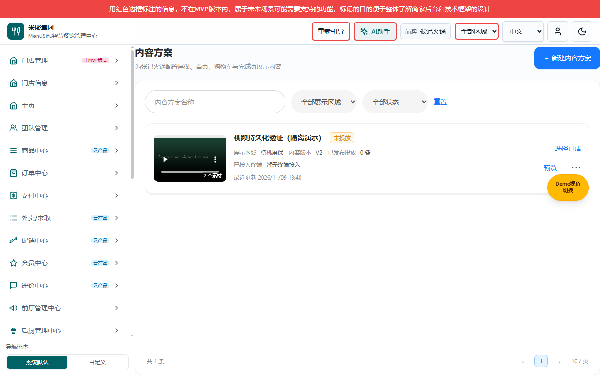
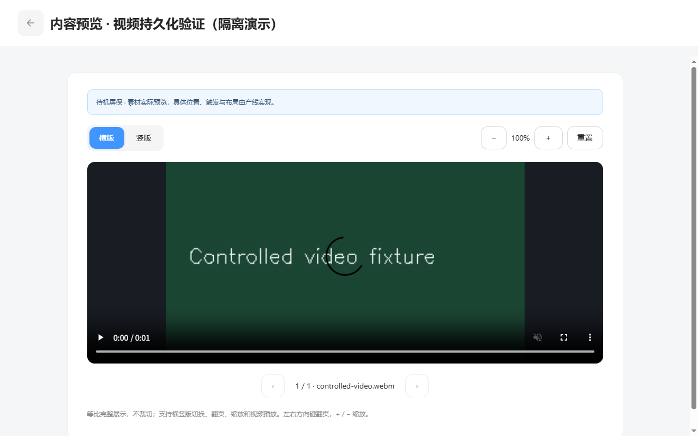

# 展示内容交付缺口与逐操作截图清单

版本V1.1；变更编号 DISPLAY-LEGACY-20261109-02；日期2026-11-09。配套：[产品V1.1](../展示内容产品权威需求文档.md) · [研发V1.1](../展示内容业务规格说明书（研发交付版）.md) · [个人规范V1.1](../展示内容需求文档（个人规范版）.md)。

## 验证范围

功能分支 codex/marketing-display-regions-20261109，起始e16c7f90，未提交。功能端口5298，实际目录 `C:/Users/27273/.codex/worktrees/marketing-display-regions-20261109/new-bp/admin-web`。期间main已推进，本功能不代表当前main，未自动合并或rebase。

主要截图来自1440×900的隔离浏览器演示会话；视频加入编辑截图为1264×625，窄屏复验为1280×800。merchant-zhangji、M00000001/M00000002和Kiosk 5.0.1接入登记均为受控数据，不代表真实商家操作或设备支持。原屏保样式和行为的来源为本分支基线的Configuration center/screensaver-create.html、kiosk-theme-list.html、store-select.html、channel-select.html、effective-time.html，提取为原生组件，未修改旧嵌入包。

原生日期输入的自动化填入使用DOM value与input事件，返回步骤后保留值及最终保存均走实际UI；不修改投放记录来伪造成功。视频复验使用OpenCV生成的受控VP8/WebM文件，通过实际本地上传、保存、页面刷新与播放：duration=1.5秒、readyState=4，src为IndexedDB读取出的会话blob URL。

## 逐操作清单

表中图片是索引，不能代替个人规范正文的就近图片。未覆盖操作、确认、取消和异常状态明确登记，未宣称截图完整。

| 页面 | 操作 | 图片 | 验证及缺口 |
| --- | --- | --- | --- |
| 内容列表 | 更多菜单/编辑/选择门店 | [图片](../assets/v11-content-menu.png) | 已验证；更多菜单复用原屏保样式 |
| 内容列表 | 复制 | [图片](../assets/v11-duplicate-success.png) | 已验证新V1草稿，不复制投放 |
| 内容列表 | 删除确认/取消/成功/有效投放拦截 | [确认](../assets/v11-delete-confirm.png) / [取消](../assets/v11-delete-cancel.png) / [成功](../assets/v11-delete-success.png) | 确认、取消和无投放内容删除成功已验证；有效投放拦截域测试通过，UI拦截图待补 |
| 内容列表 | 名称、区域、状态筛选与重置 | 待补页面图片 | 实现沿用；新版本逐筛选前后图待补 |
| 内容编辑 | 新建与横竖分区 | [图片](../assets/v11-content-create.png) | 已验证 |
| 内容编辑 | 填写参数并保存 | [图片](../assets/v11-editor-filled.png) | 素材库内容成功保存并投放；fade保存值需独立终端展示验证 |
| 内容编辑 | 切换区域 | 待补页面图片 | 实现；不兼容比例转通用分组，前后图待补 |
| 内容编辑 | 切换图片视频确认 | [图片](../assets/v11-media-type-confirm.png) | 已验证 |
| 内容编辑 | 取消类型切换 | [图片](../assets/v11-media-type-cancel.png) | 已验证保留原素材 |
| 内容编辑 | 类型确认后清除当前比例素材 | [图片](../assets/v11-video-source.png) | 已验证进入视频上传 |
| 内容编辑 | 移除/前移/后移 | 待补页面图片 | 实现；素材移除已操作，逐步前后截图待补 |
| 内容编辑 | 返回未保存确认与取消 | 待补页面图片 | 公共既定保护，V1.0已验证；新布局截图待补 |
| 上传 | 来源弹框 | [图片](../assets/v11-upload-source.png) | 已验证 |
| 上传 | 素材库分类/多选/取消选择 | [图片](../assets/v11-material-library.png) | 分类数据已显示，多选已操作；分类筛选及取消选择单独图待补 |
| 上传 | 确定素材 | [图片](../assets/v11-material-selected.png) | 已验证两竖一横，返回编辑并成功保存 |
| 上传 | 取消素材选择 | 待补页面图片 | 实现；独立结果图待补 |
| 上传 | 本地图片/同步素材库/原生取消 | [同步选择](../assets/v11-upload-copy-library.png) / [图片加入](../assets/v11-local-image-upload.png) | 实际本地图片上传、保存及同步屏保素材分类已验证；原生取消/失败截图待补 |
| 上传 | 视频来源/禁用素材库 | [图片](../assets/v11-video-source.png) | 已验证 |
| 上传 | 视频超过20MB | [图片](../assets/v11-video-size-error.png) | 受控21MB文件已拦截 |
| 上传 | 视频上传保存与刷新播放 | [图片](../assets/v11-video-upload.png) | 实际视频上传、保存、刷新与播放通过，播放见v11-video-preview.png |
| 预览 | 打开/比例切换 | [图片](../assets/v11-preview-portrait.png) | 已验证 |
| 预览 | 横版完整适配 | [图片](../assets/v11-preview-landscape.png) | 已验证100% contain完整显示 |
| 预览 | 翻页与放大 | [图片](../assets/v11-preview-zoom.png) | 已验证 |
| 预览 | 缩小/重置/键盘/关闭 | 待补页面图片 | 关闭已操作，键盘/缩小重置逐操作图待补 |
| 预览 | 视频播放 | [图片](../assets/v11-video-preview.png) | 有效VP8文件刷新后play成功，duration1.5秒、readyState4 |
| 投放门店 | 方案带入/门店表格/侧栏 | [图片](../assets/v11-flow-stores.png) | 已验证 |
| 投放门店 | 零门店下一步 | [图片](../assets/v11-store-required.png) | 已验证错误保留 |
| 投放门店 | 搜索/全选搜索结果 | [图片](../assets/v11-store-search-selected.png) | 已验证 |
| 投放门店 | 清空搜索/全选全部/逐店移除 | 待补页面图片 | 全选全部已验证；移除结果图待补 |
| 投放产线 | 卡片与禁用原因 | [图片](../assets/v11-flow-lines.png) | 已验证Kiosk可选、其他未接入禁用 |
| 投放产线 | 零产线下一步 | [图片](../assets/v11-line-required.png) | 已验证 |
| 投放产线 | 全选可用/上一步保留 | [图片](../assets/v11-line-back-preserved.png) | 已验证 |
| 投放时间 | 新建空时间 | [图片](../assets/v11-flow-time.png) | 已验证，无默认七天 |
| 投放时间 | 此刻 | [图片](../assets/v11-time-now.png) | 已验证按所选时区填值 |
| 投放时间 | 前一步后时间保留 | [图片](../assets/v11-time-preserved.png) | 已验证；自动化用DOM赋值填写原生datetime输入，未改业务状态 |
| 投放时间 | 过去开始/未来结束 | [图片](../assets/v11-flow-review.png) | 已验证，业务域另有测试 |
| 投放时间 | 非法日期/DST/结束不晚于开始 | 待补页面图片 | 域测试通过；新UI异常图待补 |
| 确认投放 | 摘要 | [图片](../assets/v11-flow-review.png) | 已验证 |
| 确认投放 | 确认弹框 | [图片](../assets/v11-publish-confirm.png) | 已验证 |
| 确认投放 | 取消 | [图片](../assets/v11-publish-cancel.png) | 已验证保留确认页 |
| 确认投放 | 确认成功 | [图片](../assets/v11-publication-success.png) | 已验证 |
| 确认投放 | 保存草稿/冲突/存储失败 | 待补页面图片 | 既有能力与域回归通过；新四步流程结果图待补 |
| 投放列表 | 投放记录与状态 | [图片](../assets/v11-placements.png) | 已验证 |
| 投放列表 | 整体上下架确认/取消/结果 | 待补页面图片 | 既有发布撤销机制及域测试；新文案界面图待补 |
| 投放列表 | 编辑草稿/再次投放 | 待补页面图片 | 实现；新截图待补 |
| 投放列表 | 详情快照 | 待补页面图片 | 域快照回归通过；新布局图待补 |
| 关联门店 | 打开/关闭 | [图片](../assets/v11-associated-stores.png) | 已验证 |
| 关联门店 | 名称MID搜索 | [图片](../assets/v11-associated-search.png) | 已验证 |
| 关联门店 | 生效状态筛选 | 待补页面图片 | 实现；新结果图待补 |
| 关联门店 | 单目标下架确认 | [图片](../assets/v11-store-line-confirm.png) | 已验证 |
| 关联门店 | 单目标下架成功 | [图片](../assets/v11-store-line-disabled.png) | 已验证上海Kiosk下架，广州不受影响 |
| 关联门店 | 单目标取消/重新上架/冲突 | 待补页面图片 | 域测试含重叠替代投放后重新上架拒绝；新界面图待补 |
| 公共 | 门店/品牌权限、只读、并发与存储损坏 | 待补页面图片 | 域与营销权限回归；实际只读账号/并发错误图待补 |
| 公共 | 分页上/下页 | 待补页面图片 | 首尾禁用沿用；多页切换图待补 |
| 平台区域 | 区域/接入/停用启用 | [图片](../assets/regions-final.png) | V1.0实际证据仍适用于未改字段；新增transition勾选新图待补 |
| 旧数据 | 完整素材/IndexedDB解析/幂等 | 待补页面图片 | 实现与域测试；当前实际导入界面图待补 |

## 接入与交付边界

| 编号 | 项目 | 当前边界 |
| --- | --- | --- |
| G1 | 服务端 | 当前localStorage/IndexedDB管理端，无真实API、服务端授权、审计、媒体服务。大视频引用为浏览器本地资源，真实下发需转换为媒体服务URL。 |
| G2 | 并发 | revision是本地重检，非跨窗口原子CAS；线上编码唯一性、目标状态和冲突须服务端事务。 |
| G3 | 终端 | resolver是纯解析合同；未接通真实设备的布局、触发、播放、缓存、断网回退与到期清空。 |
| G4 | 回执 | 未实现设备身份、接收/展示/失败回执及重试监控；界面仅待终端回执。 |
| G5 | 本地媒体 | IndexedDB可用且媒体存在时可迁移；丢失引用、超量或混合类型旧方案保留待处理。不自动沿用旧门店排期；孤立未引用视频尚无清理工具。 |
| G6 | 截图 | 上表待补项、只读/存储异常及多页需分别验收；1280×800内容列表与预览已实际检查；已采图不等于全操作覆盖。 |
| G7 | Git与桌面登记 | 未提交、合并、推送。Git worktree有效，桌面任务归属attach异常沿用原记录；不改原工作区。 |

[V1.0独立验证记录](V1.0操作覆盖记录.md)仅追溯旧版本，不能证明V1.1四步流程。

## 已完成自动检查

域测试（含素材限制、复制删除、过去开始时间、单目标下架与重叠重新上架）、TypeScript、公共递归导航和营销权限回归通过。npm run build成功（717模块），保留既有大包与混合导入告警，并提示本检出缺Kiosk嵌入构建目录；本任务未改设备源码。构建产生的无关tracked dist及自动生成文件恢复基线；后端/设备部署不在本期完成范围。

## 1280×800显示复验

图：本期原生页面，隔离演示会话。图片与视频预览、顶部返回及比例/缩放操作可用；内容列表保留菜单与筛选。
