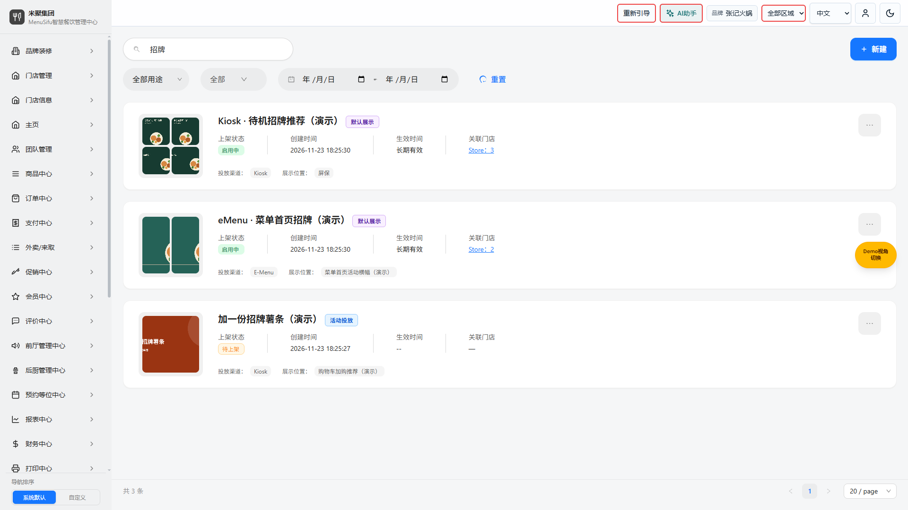
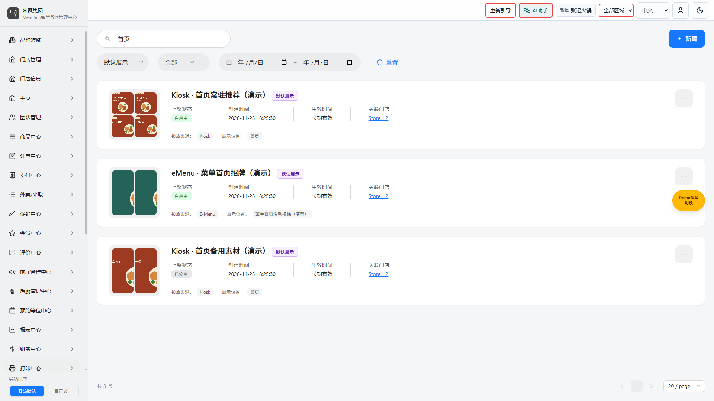
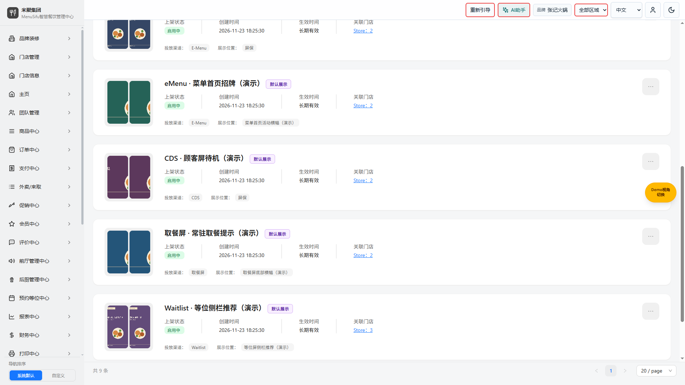
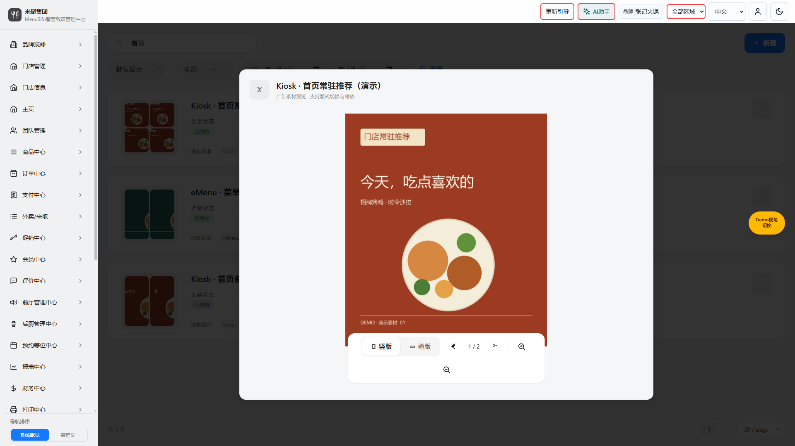
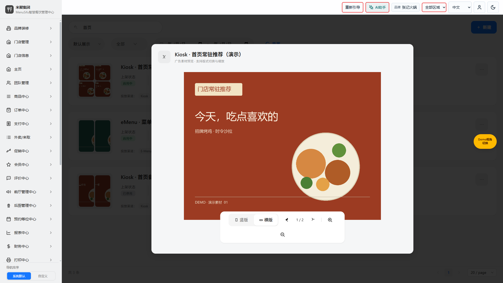
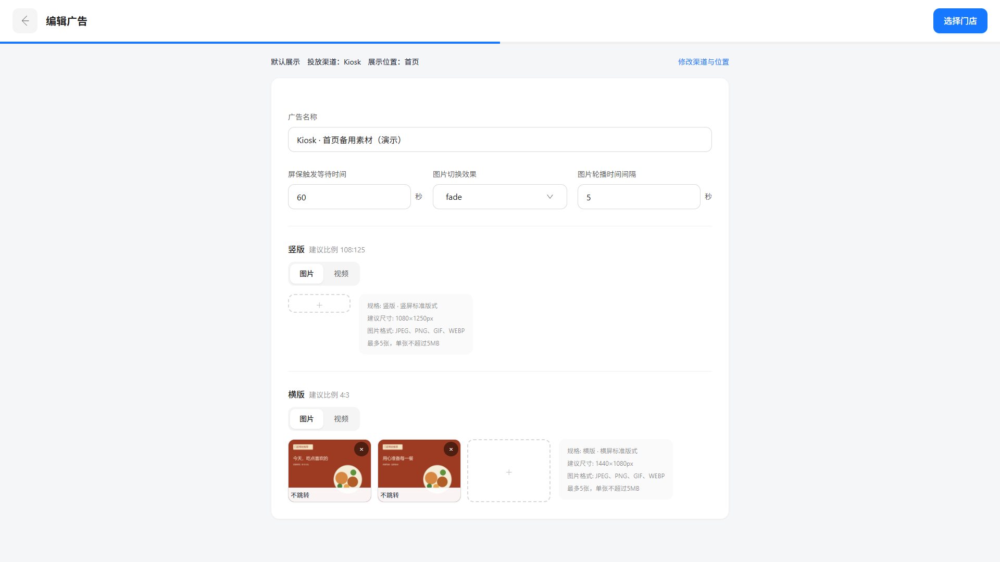

# V1.25 默认广告演示数据与用途标签验证

日期：2026-11-23；共同变更编号：AD-DEFAULT-DEMO-20261123-01。

## 环境与范围

基线：main@2f65a452；功能分支：`codex/ad-default-demo-20261123`。

实际目录：`C:/Users/27273/.codex/worktrees/ad-default-demo-20261123/permission-main-merge-20261014/admin-web`；功能预览：`http://127.0.0.1:5351/#/marketing/screensaver`。此处记录功能分支验收环境；后续提交、合并与主线预览更新以Git记录为准。

这是写入演示环境、可筛选和操作的有效测试记录，素材为本地生成并实际加载的PNG，不是客户生产数据。仅演示账号、明确品牌及有编辑权限时初始化，不扩展权限；生产后端与真实终端接线缺口保持V1.24口径。

## 演示数据清单

所有素材不跳转，轮播间隔5秒；默认广告没有排期。全新演示数据下共9条，其中8条启用、1条停用。存在同范围默认广告时跳过已占用门店；位置停用、未接入或规格被修改而不匹配时跳过该案例，不覆盖已有数据。

| 产线 | 位置／场景 | 状态 | 门店数 | 素材 |
| --- | --- | --- | --- | --- |
| Kiosk | 屏保／待机招牌 | 启用中 | 3 | 1080×1920、1920×1080各2张 |
| Kiosk | 首页常驻推荐 | 启用中 | 2 | 1080×1250、1440×1080各2张 |
| Kiosk | 购物车搭配推荐 | 启用中 | 1 | 1280×720共2张 |
| eMenu | 屏保／待机欢迎 | 启用中 | 2 | 1080×1920共2张 |
| eMenu | 菜单首页招牌 | 启用中 | 2 | 1280×720共2张 |
| CDS | 顾客屏待机 | 启用中 | 2 | 1920×1080共2张 |
| 取餐屏 | 取餐屏底部横幅 | 启用中 | 2 | 1280×720共2张 |
| Waitlist | 等位屏侧栏推荐 | 启用中 | 3 | 720×1280共2张 |
| Kiosk | 首页备用素材 | 已停用 | 2 | 1440×1080共2张，重新启用时走门店替换确认 |

门店复用原生选择器中的MID示例。每个启用案例都有独立渠道＋位置范围，未引入同门店同位置同时启用多个默认广告的例外。

## 真实页面检查

### 用途标签与混合列表

实际名称搜索“招牌”，同时显示蓝色活动投放与紫色默认展示；底色、边框、加粗文字独立于上架／启停状态。冷启动时共13条记录，包含原有4条活动广告；13张卡片均无损坏缩略图。

### 默认展示与停用备选

实际用途选择“默认展示”、名称搜索“首页”，返回Kiosk首页、eMenu菜单首页及已停用备用。名称、用途、状态、关联门店均正常。

### 其他产线

实际列表滚动至CDS、取餐屏及Waitlist案例；图片均从项目本地静态资源加载。

### 首页横竖版预览

原生预览读取到图片固有尺寸1080×1250；2张素材可切换。

切换横版后固有尺寸为1440×1080，继续使用原生预览与缩放。

### 备用广告编辑

原生编辑回显2张1440×1080素材、不跳转、轮播5秒、fade；未发布备用保留草稿目标编辑规则。验证仅打开和返回，不保存修改。

## 初始化与验证证据

- `default-ad-demo.ts`使用独立、按品牌区分的版本标记；与已有活动演示数据标记互不影响。由广告iframe既有品牌上下文注入入口调用，不新增品牌权限依赖循环。
- 数据持久化在演示环境的`kiosk_themes`，20个本地PNG被多个方向及备用记录复用。元数据的字节数、PNG宽高与文件逐个校验；不把图片重复编码到localStorage。
- 已有默认范围占用时仅使用未占用门店；不改写既有广告内容、状态或范围。已编辑／删除的示例不重复创建；无品牌、只读、非演示账号不初始化。
- 原生列表兼容`dataUrl`、`src`和`url`，原有4条活动演示图片也能显示；没有批量迁移原记录。
- 浏览器实际冷启动及刷新后均13条、9条默认、13个唯一ID；缩略图失败数为0。用途文字色实际为活动蓝`rgb(9,88,217)`、默认紫`rgb(83,29,171)`，有对应浅底色与边框。

通过：`verify-default-ad-demo.mjs`、`verify-default-ads.mjs`、`verify-default-ad-transaction.mjs`、`verify-native-ad-slots.mjs`、`verify-ad-target-policy.mjs`、`verify-ad-position-first.mjs`及TypeScript无输出检查。

Vite构建输出到任务隔离目录`D:/Dev/Temp/Codex/ad-default-demo-20261123/host-build`，未覆盖仓库宿主dist。保留项目已有动态／静态导入及大chunk警告。截图均为1920×1080实际PC页面，不包含实机播放或窄屏验收。
