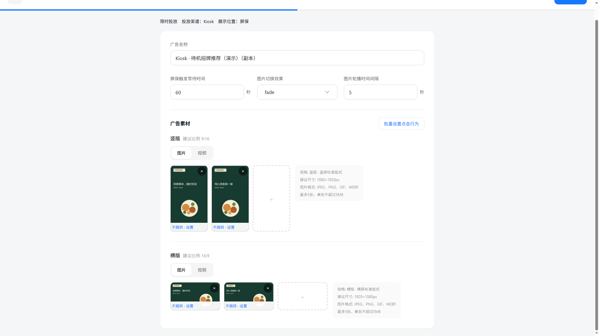
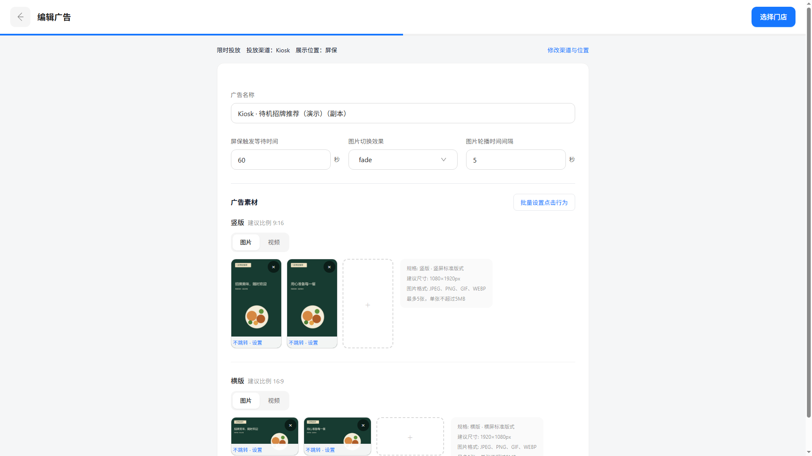
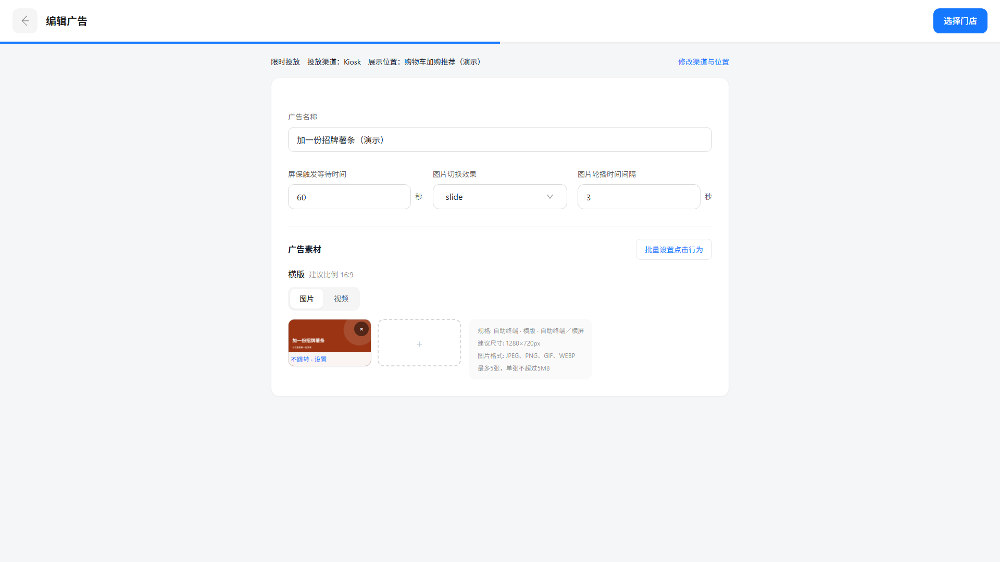
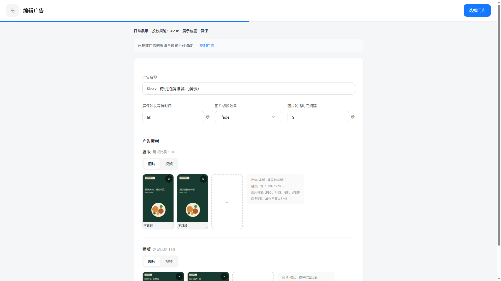
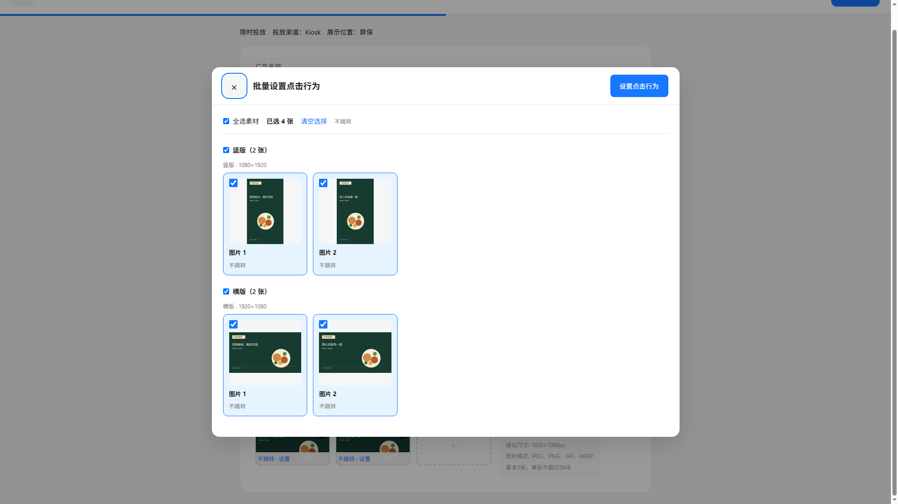

# V1.27 批量按钮位置验证

日期：2026-11-27；共同变更编号：AD-BATCH-ENTRY-20261127-01。

基线：已获取远端状态后选择包含已合入批量功能的本地main@215b5423。远端与本地分叉保留，未自动合并。分支：`codex/ad-batch-button-placement-20261127`；目录：`C:/Users/27273/.codex/worktrees/ad-batch-button-placement-20261127/new-bp/admin-web`。

功能预览：`http://127.0.0.1:5363/#/marketing/screensaver`，同检出运行源码、原生页面和静态脚本；原5361功能预览及5346主线预览保持不变。以下为功能分支验收时的演示账号配置验证；后续提交和合并以Git记录为准。

## 当前布局与实际页面

### 新建／复制

“广告素材”位于播放设置下方，批量按钮为公共标题右侧的次级操作。页头“选择门店”仍为主操作。没有将按钮放到某个方向标题，范围继续覆盖全部规格。

### 编辑双方向广告

实际DOM确认：按钮位于公共标题容器内、在标题右侧，两者垂直中心差小于2px；竖版2张、横版2张均正常回显。复制素材保存为本地草稿后，重新进入编辑页验证；未发布或下发。

### 仅横版

首个可见方向为横版，标题后不再有重复分隔线；实际border-top和padding-top均为0，标题至方向间距为16px。仅竖版的Waitlist位置同样核对通过。

### 日常展示

公共标题保留，批量按钮隐藏；仍只允许不跳转，没有增加配置入口。

### 批量范围

从新入口打开后，全选为4张，分区为竖版2张和横版2张。复用原批量弹框及处理器，没有变更素材枚举、选择、动作校验或保存逻辑。

## 检查结果与边界

- `node scripts/verify-native-ad-slots.mjs`通过：当前HTML与共享脚本语法、原广告位流程相关检查。
- `node scripts/verify-ad-material-batch.mjs`通过：全部／部分规格、原子更新、目标变化及未选素材保持规则。
- `git diff --check`通过；三份V1.27文档的共同编号、入口说明与当前图片已核对。
- 截图为同版本实际PC页面，1920×1080。未修改活动规则、终端播放、外链打开方式、业务授权或嵌入包；未进行实机及生产下发验证。
- 既有批量弹框未改版，文档沿用V1.26弹框图；入口位置以本轮V1.27内容页图为准。
