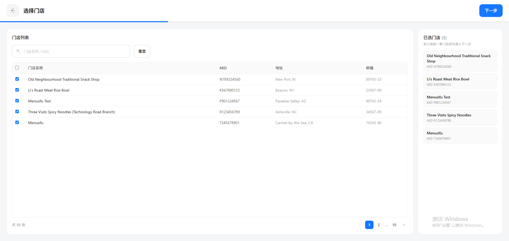
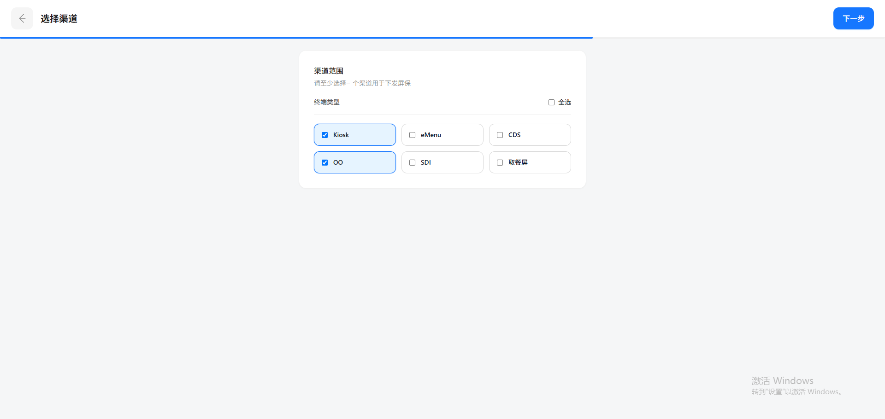
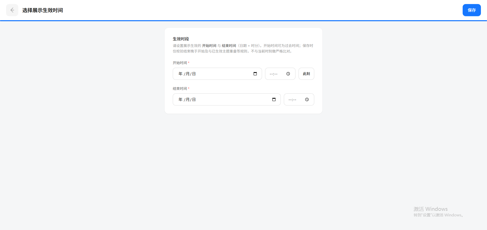

# V1.2参考与验收记录

变更DISPLAY-REFERENCE-20261109-03。以下前三张是用户提供的视觉参考，包含示例门店和系统水印，不是实现证据，也不代表真实数据或产品元素。

实现证据为主文档引用的v12-stores.png、v12-channels.png、v12-time-empty.png及各操作结果图。实际数据为隔离演示品牌的两家授权门店，地址来自项目数据，邮编缺失显示—，未复刻88条示例。Kiosk/OO接入登记为本次浏览器QA配置，不代表真实设备已接入。

配置为三步，确认保留为最后保存后的弹框；现有时区及结束时间晚于当前时刻校验保持，不从参考截图文案推断额外业务放宽。

最终回归会话仅预置本地平台接入能力fixture，未修改业务默认接入权限；内容新建与下发保存通过真实界面完成。新会话采集覆盖1920×911和1280×800主页面，页面脚本错误为空。
