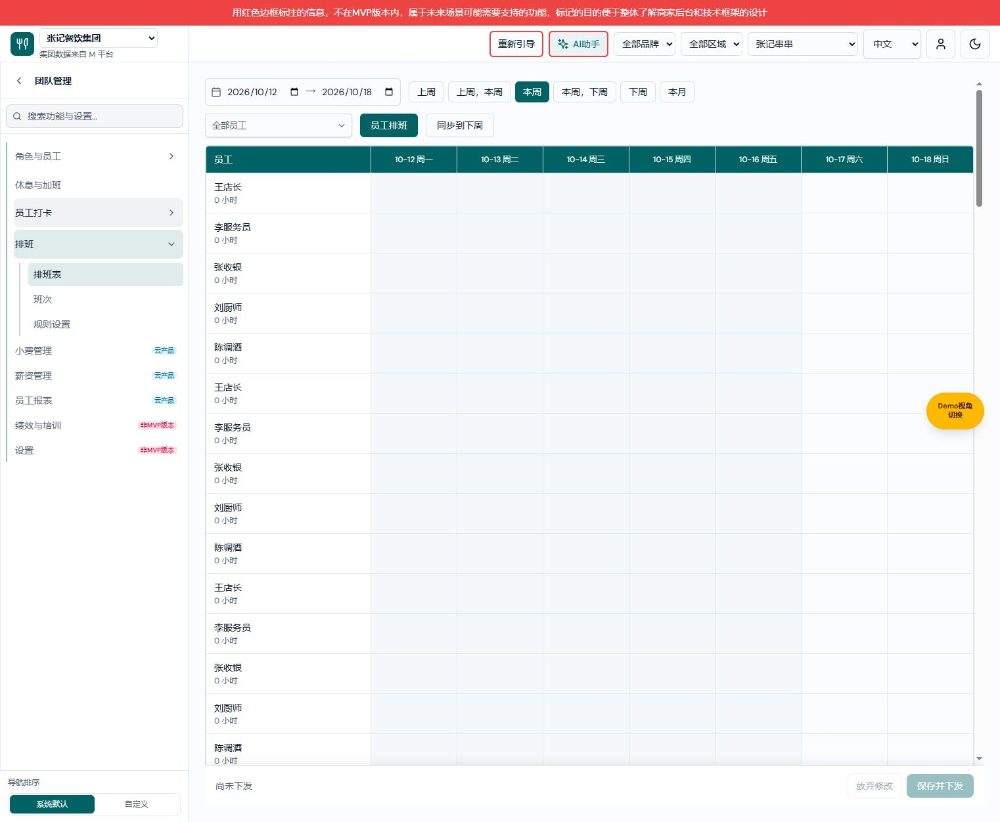
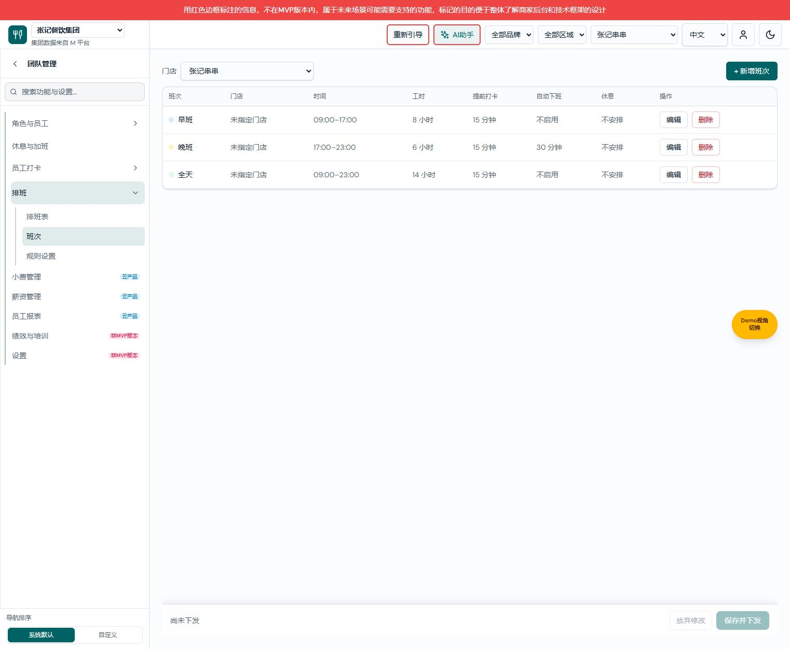
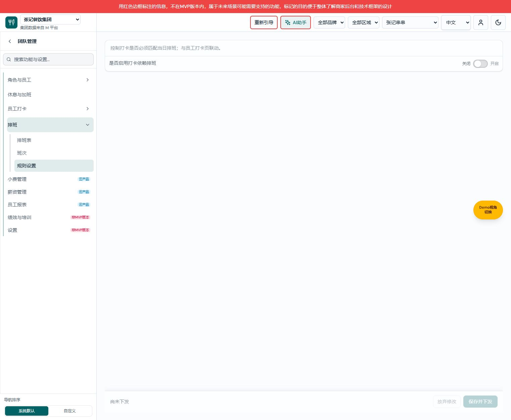

# 排班需求文档（个人规范版）

> 状态：导航实现已验证；仅覆盖 SCHEDULE-20261014-01 导航变更，不宣称已补齐历史全部排班规格。
> 版本：V1.0；日期：2026-10-14；共同基线／变更编号：SCHEDULE-20261014-01。
> 文档对：[产品权威 V1.1](排班-双Tab排班表与班次设计方案.md) · [研发 V1.0](排班业务规格说明书（研发交付版）.md) · [个人规范 V1.0](排班需求文档（个人规范版）.md)。

## 版本记录

| 版本 | 日期 | 变化 |
|---|---|---|
| V1.0 | 2026-10-14 | 补齐本次导航变更范围内的独立文档；关联产品 V1.1 |

## 排班表页面

图注：排班表，默认演示数据状态；来源为本地原生项目 2026-10-14 导航变更后页面（SCHEDULE-20261014-01）。

用途／入口：团队管理 → 排班 → 排班表；展示员工 × 日期排班表，默认入口为旧排班根地址。 本文逐项覆盖本次变更的导航元素，页面内部业务沿用产品文档有效定义，历史全量元素规范尚未迁移。

### 左侧导航区域

| 字段 | 逻辑说明 |
|---|---|
| 排班 | 父菜单，展示展开箭头；点击整行展开或收起三个子项，不保存、不下发、不切换业务数据。当前地址属于排班时可定位该组。 |
| 排班表 | 固定名称；点击整行进入 `/team/shift-scheduling/schedule`，展示日期表并选中该子项；旧根地址默认进入此页。 |
| 班次 | 固定名称；点击整行进入 `/team/shift-scheduling/shifts`，展示已创建班次并选中该子项；刷新保留此地址及页面。 |
| 规则设置 | 固定名称；点击整行进入 `/team/shift-scheduling/rules`，展示原有规则开关并选中该子项；与员工打卡的同名入口由父菜单区分。 |

### 页面切换结果

导航来源为统一菜单配置。子项无需额外输入校验，点击更换地址和面板，移除重复顶部页签；切换不会自动保存或下发。跨模块离开沿用既有草稿保护。页面内未提交班次弹框在切换时关闭，无业务写入；失败提示与保存取消逻辑沿用原功能，本次无新增规则。

## 班次页面

图注：班次，默认演示数据状态；来源为本地原生项目 2026-10-14 导航变更后页面（SCHEDULE-20261014-01）。

用途／入口：团队管理 → 排班 → 班次；展示已创建班次列表，提供原有新增、编辑和删除入口。 本文逐项覆盖本次变更的导航元素，页面内部业务沿用产品文档有效定义，历史全量元素规范尚未迁移。

### 左侧导航区域

| 字段 | 逻辑说明 |
|---|---|
| 排班 | 父菜单，展示展开箭头；点击整行展开或收起三个子项，不保存、不下发、不切换业务数据。当前地址属于排班时可定位该组。 |
| 排班表 | 固定名称；点击整行进入 `/team/shift-scheduling/schedule`，展示日期表并选中该子项；旧根地址默认进入此页。 |
| 班次 | 固定名称；点击整行进入 `/team/shift-scheduling/shifts`，展示已创建班次并选中该子项；刷新保留此地址及页面。 |
| 规则设置 | 固定名称；点击整行进入 `/team/shift-scheduling/rules`，展示原有规则开关并选中该子项；与员工打卡的同名入口由父菜单区分。 |

### 页面切换结果

导航来源为统一菜单配置。子项无需额外输入校验，点击更换地址和面板，移除重复顶部页签；切换不会自动保存或下发。跨模块离开沿用既有草稿保护。页面内未提交班次弹框在切换时关闭，无业务写入；失败提示与保存取消逻辑沿用原功能，本次无新增规则。

## 规则设置页面

图注：规则设置，默认演示数据状态；来源为本地原生项目 2026-10-14 导航变更后页面（SCHEDULE-20261014-01）。

用途／入口：团队管理 → 排班 → 规则设置；展示原有“是否启用打卡依赖排班”规则。 本文逐项覆盖本次变更的导航元素，页面内部业务沿用产品文档有效定义，历史全量元素规范尚未迁移。

### 左侧导航区域

| 字段 | 逻辑说明 |
|---|---|
| 排班 | 父菜单，展示展开箭头；点击整行展开或收起三个子项，不保存、不下发、不切换业务数据。当前地址属于排班时可定位该组。 |
| 排班表 | 固定名称；点击整行进入 `/team/shift-scheduling/schedule`，展示日期表并选中该子项；旧根地址默认进入此页。 |
| 班次 | 固定名称；点击整行进入 `/team/shift-scheduling/shifts`，展示已创建班次并选中该子项；刷新保留此地址及页面。 |
| 规则设置 | 固定名称；点击整行进入 `/team/shift-scheduling/rules`，展示原有规则开关并选中该子项；与员工打卡的同名入口由父菜单区分。 |

### 页面切换结果

导航来源为统一菜单配置。子项无需额外输入校验，点击更换地址和面板，移除重复顶部页签；切换不会自动保存或下发。跨模块离开沿用既有草稿保护。页面内未提交班次弹框在切换时关闭，无业务写入；失败提示与保存取消逻辑沿用原功能，本次无新增规则。

## 验证及交付边界

三份文档互链、导航名称、路径与截图对应。真实浏览器已验证三个子项切换、旧地址默认定位、班次和规则刷新定位及顶部页签移除；类型检查通过。历史全部排班页面内部字段和弹框图片未在本次补齐，后续全量个人版交付仍有该范围缺口。
