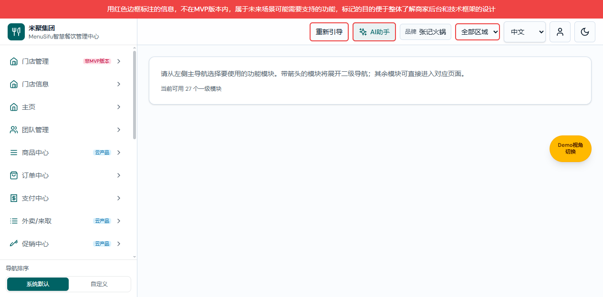

# 演示登录产品权威需求文档

版本 v1.1 · LOGIN-BRAND-DEFAULT-20261023-01 · 2026-10-23 · 功能分支实现验证，未提交或合并。
共同业务基线：main@82d0d9cb（保留本地已合并未推送成果）。
配对：[研发规格 v1.1](./演示登录业务规格说明书（研发交付版）.md)、[个人规范 v1.1](./演示登录需求文档（个人规范版）.md)。

## 默认演示入口：品牌视角

图：65131隔离功能预览，基线82d0d9cb＋本次修改；复用已完成首次引导的演示配置，非真实登录历史。

默认演示账号登录成功，或已认证演示账号新打开项目根地址时，默认使用品牌多门店视角，不再因M管理员演示身份自动落到M平台。根地址包含空hash、#、#/、#/home、#/home/，只在文档首次加载时处理，不在每次页面重绘时强制切换。

真实员工账号、品牌专属账号、代登录的身份／权限和原有落地不改变。未认证仍显示登录页，必须点击登录；未完成首次引导仍进入原引导页，不自动填业务数据或标记完成。明确打开M路径或业务深链保留原路径和访问校验；M平台入口仍可手动进入。

图：同一隔离会话，显式打开M平台后再打开项目根地址，回到品牌首页；未保存业务数据。

验收：默认登录进入品牌首页；M直链正常打开；重新打开根地址回到品牌；业务直链不改写。真实账号及代登录不触发演示默认策略，不能以本次变更扩大访问权。

登录页每次渲染默认填入演示账号 `demo.menusifu.cn` 和现有演示密码 `Menusifu666`，密码掩码显示。用户可以直接点击登录，也可以编辑两个字段后登录。不得自动提交或自动登录。退出后重新进入登录页再次显示默认演示值，不记忆其他账号输入的密码。

指定演示账号允许不含 @；原有 Menusifu 企业邮箱和受维护员工账号校验继续生效，停用账号仍拒绝，错误密码仍拒绝。会话及日志沿用实际提交账号记录，大小写和首尾空格沿用既有归一化流程。

验收：打开、刷新、重新进入登录页均有默认值；不手工输入可点击登录进入系统；错误密码提示并留在登录页；企业邮箱登录不受影响。未改变会话有效期、权限或自动下发规则。

## 变更记录

| 版本 | 变更 |
|---|---|
| v1.1 | LOGIN-BRAND-DEFAULT-20261023-01：默认演示登录和根地址进入品牌视角，保留真实账号、明确链接及首次引导边界。 |
| v1.0 | LOGIN-20261019-01：默认演示凭据填充及指定账号兼容。 |
