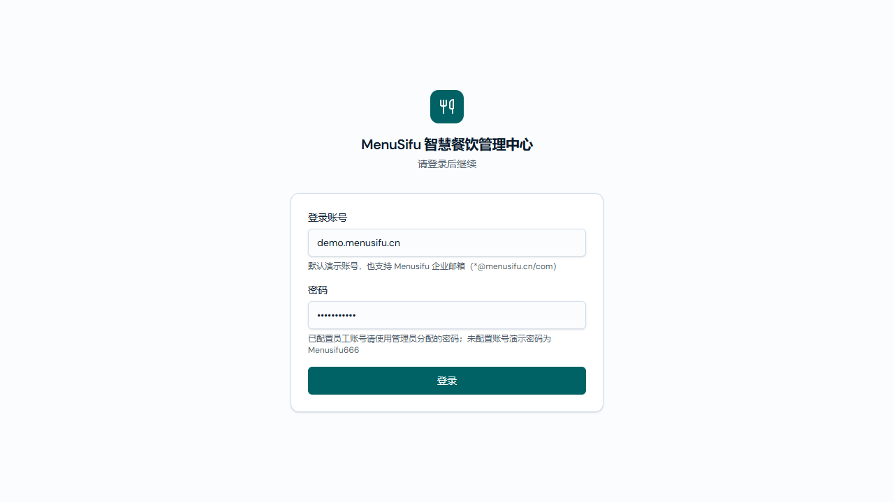

# 演示登录需求文档（个人规范版）

版本 v1.0 · LOGIN-20261019-01 · 2026-10-19 · 基线 main@0d922a6a。
[产品权威 v1.0](./演示登录产品权威需求文档.md)、[研发规格 v1.0](./演示登录业务规格说明书（研发交付版）.md)。

## 登录页 / 默认凭据状态

图：功能分支 codex/demo-login-defaults-20261019，基于 main@0d922a6a，默认填充状态。
入口：未登录时访问商家后台，或退出后进入登录页。

| 字段或操作 | 逻辑说明 |
|---|---|
| 登录账号 | 默认 demo.menusifu.cn，可修改；清空后点击登录提示必填。还支持既有企业邮箱。 |
| 账号说明 | 说明当前为演示账号，并列明支持的企业邮箱格式。 |
| 密码 | 默认现有演示密码，掩码显示，可修改；错误或空密码均不能登录。 |
| 登录 | 用户点击才提交，按研发规格执行校验；成功进入既有引导或主页，失败留在当前页面并展示原因。 |
| 刷新或重新进入 | 恢复默认演示账号和密码，无需再次手工输入；不保存其他手工输入密码。 |

## 变更记录

v1.0：LOGIN-20261019-01 默认凭据及操作后果，与产品、研发 v1.0 配对。
