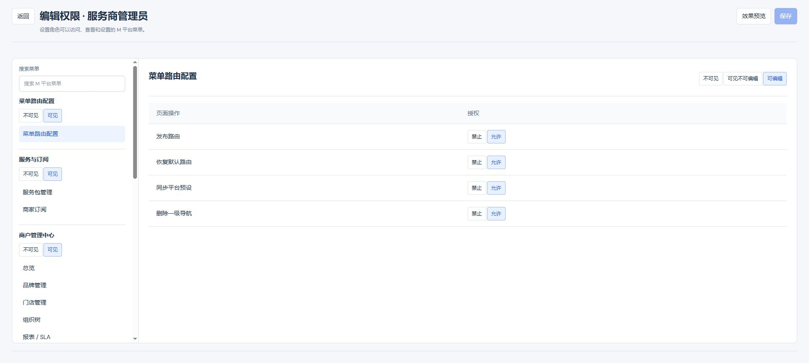

# 独立页面头部布局需求文档（个人规范版）

版本：V1.0；日期：2026-11-03；共同变更编号：STANDALONE-HEADER-20261103-01。
共同业务基线：全项目原生独立页面公共页头；起始 main@d0404494。
配套：[产品权威 V1.0](独立页面头部布局产品权威需求文档.md) · [研发交付 V1.0](独立页面头部布局业务规格说明书（研发交付版）.md) · [个人规范 V1.0](独立页面头部布局需求文档（个人规范版）.md)。
状态：本地原型；不改变各业务原有权限、保存、发布和草稿规则。

## 独立页面公共页头

图：2026-11-03 外部 Chrome；功能分支以 main@d0404494 为基线，本地未提交。展示公共布局，其他业务对象信息沿用所属模块，不以本图替代各业务弹框或子应用截图。

用途/入口：进入独立详情、编辑或预览路由时展示；主返回保持原页面上下文。

| 字段/操作 | 逻辑说明 |
| --- | --- |
| 返回按钮 | 标题左侧；显示原有返回名称，仅一个主返回入口；点击沿用原目标与草稿保护；取消离开继续编辑，确认离开按原业务处理 |
| 页面标题 | 返回右侧；展示当前业务动作和对象；对象来自对应业务，动态名称转义，允许换行 |
| 副标题 | 标题下方；展示原对象编码、邮箱等已有信息，没有内容则不生成区域 |
| 状态 | 使用对应业务状态标签，不将停用或不存在状态改成可操作状态 |
| 保存 | 标题右侧；原权限、无变更禁用、确认、校验和写入成功/失败规则不变；表单外按钮仍关联原表单 |
| 取消 | 标题右侧；保持原取消后果和未保存提示；不静默丢弃草稿 |
| 预览/返回编辑 | 标题右侧；只切换工作模式，左侧主返回保持独立；预览仍按原业务快照/草稿定义 |
| 发布/导出/重试 | 标题右侧，按对应页面已有业务条件展示；不因展示位置赋予授权，不自动执行 |
| 底部状态 | 仅保留原有保存或草稿状态，不重复页面级按钮 |
| 步骤操作 | 向导上一步/下一步留在步骤区域，最终保存/发布属于页头操作 |
| 内容操作 | 员工工作台当前配置维度保存位于页头右侧，各维分别保存，生效权限不显示保存；添加授权和行内按钮保持内容区域 |
| 窄屏布局 | 右侧操作组换行右对齐；标题、返回、按钮不互相遮挡 |

公共布局只定义位置与行为保持契约，具体授权、字段校验、成功/失败和异常由对应业务文档定义。界面清单、验证结果和子应用边界见[验证记录](../验证记录/独立页面头部布局验证记录.md)。
