# 餐位管理需求文档（个人规范版）

> 版本：V1.0；日期：2026-10-15；变更编号：FOH-20261015-01。状态：本次交互已实现并完成隔离浏览器验收；真实 KPOS 成功写入未执行。
> 职责：逐页面、区域、字段和操作后果；主要页面定位与验收阅读入口。共同业务基线：用户在本次会话确认“按照建议进行优化修改”；只确认本次交互调整，未重新确认历史 KPOS 同步设计中的全部业务规则。

[产品权威 V1.0](餐位管理产品权威需求文档.md) · [研发交付 V1.0](餐位管理业务规格说明书（研发交付版）.md) · [个人规范 V1.0](餐位管理需求文档（个人规范版）.md)

| 版本 | 日期 | 变更与配对 |
|---|---|---|
| V1.0 | 2026-10-15 | FOH-20261015-01：餐位管理与布局分工、属性侧栏、草稿保护、画布工具及确认后提交；三份均 V1.0 |

## 范围与公共规则

本次增加餐位管理二级菜单并优化平面图，其他前厅入口沿用。列表/画布共享数据、保存、权限及门店范围；公共业务规则以[产品权威文档](餐位管理产品权威需求文档.md#公共业务规则)为准，公式和异常算例见[研发版](餐位管理业务规格说明书（研发交付版）.md)。下面逐项定义实际页面元素，不新增独立区域菜单，不改变开台或计价业务。

## 餐位管理页面

图注：餐位管理页面／默认全部区域／四个餐位；2026-10-15，本地原生 Vite 页面，本次变更版本；数据为隔离测试样例，不是线上门店数据。

用途／入口：前厅管理中心 → 餐位管理；对象为当前有访问权限门店的全部区域与餐位。初次进入名称为空、区域筛选为全部；会话内返回保留筛选。

### 顶部区域与操作

| 字段／操作 | 逻辑说明 |
|---|---|
| 当前区域 | 单选当前门店已存在区域，默认沿用上次活动区域，无记录取首个；无区域显示尚无区域。决定新增默认归属及区域编辑对象，不等于列表区域筛选。切换前校验有效属性加入草稿，错误则保持原区域；清空画布选择。 |
| 新增区域 | 打开新增区域弹框，携带当前门店。读取中或读取失败且无可用数据时不可操作；取消不新增。 |
| 管理当前区域 | 有活动区域时显示，打开对应区域编辑弹框；无活动区域不显示。 |
| 新增餐位 | 有活动区域时显示，打开新增抽屉并生成默认预览；无区域先创建区域。 |
| 门店与当前区域数量 | 显示归属门店名及当前区域tables.length，单位个；与筛选结果数量不同，失败不据此声称实际为0。 |
| 撤销 | 有已应用历史时可点；有效属性先加入草稿，撤销最近一步业务变更；非法值先修正或取消。 |
| 重做 | 有future历史时可点，恢复最近撤销的一步；新业务修改后失效。保存成功、放弃与连接切换清空两栈。 |

### 筛选区域

| 字段／操作 | 逻辑说明 |
|---|---|
| 餐位名称 | 文本搜索，默认空，去首尾空格、忽略大小写的包含匹配；每次输入即时筛选当前门店数据，不写配置。 |
| 区域筛选 | 默认全部区域；候选来自当前门店区域，单选；与名称条件取交集。不改变顶部当前区域和已有表单输入。 |
| 重置 | 清空名称、恢复全部区域，立即更新列表；保留业务修改。 |
| 共N个餐位 | 筛选结果长度；0为有效空结果，配合没有符合条件的餐位提示；读取失败单独显示错误。 |

### 列表区域

| 字段／操作 | 逻辑说明 |
|---|---|
| 餐位名称列 | 显示保存数据/已应用草稿的name，文本转义；未应用输入不会提前覆盖该行。 |
| 所属区域列 | 显示餐位归属area.name；不允许通过改显示字符串改变归属。 |
| 容纳人数列 | 显示配置容量seats，单位人，不是当前就餐人数。 |
| 形状列 | 显示rectangle矩形、circle圆形、oval铁板桌/长桌、bar吧台、ktv卡拉OK对应名称。 |
| 编辑 | 每行独立按钮，整块按钮命中区可点；切到该餐位所属区域，在右侧打开属性。当前有效输入先归并，无效则阻止切换。 |
| 平面图定位 | 每行独立链接，携带门店上下文、编码后的area和table ID进入布局；选中目标并显示属性，画布内部滚动使其可见，保留其他草稿。 |
| 空结果 | 显示没有符合条件的餐位，可调整筛选或新增；无区域时提示先新增区域。不伪造默认餐位。 |

## 餐位平面图页面

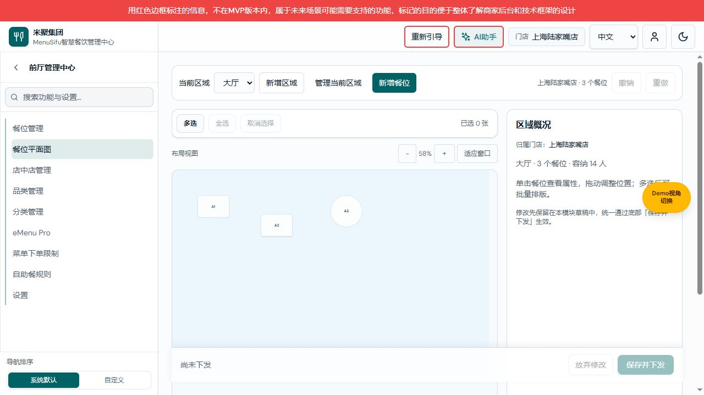

图注：餐位平面图／未选中／自动适应窗口；2026-10-15，本地原生 Vite 页面，本次变更版本；数据为隔离测试样例，不是线上门店数据。

用途／入口：前厅管理中心 → 餐位平面图，或餐位列表定位链接。当前区域与管理页共用；顶部区域及增删改/历史按钮沿用上节定义。

### 画布和选择

| 字段／操作 | 逻辑说明 |
|---|---|
| 餐位图形 | 位置、宽高、形状来自对应餐位草稿，名称显示在图形内；单击选中而不弹居中框。选中高亮，同时右侧显示属性。键盘Enter/Space也可选择。 |
| 运行人数标记 | 沿用连接数据的只读运行标记，区别于配置容纳人数；本次不新增状态判断。 |
| 拖动 | 左键按下并超过5逻辑单位门槛开始移动；按实际缩放换算增量，鼠标松开提交一步草稿历史；pointercancel不提交。 |
| 吸附参考线 | 移动边缘/中心距其他餐位目标线小于6屏幕像素时显示，松开/取消隐藏；不写入配置。 |
| 边界提示 | 未旋转矩形到达1000×650逻辑画布边界时提示已到达画布边界，坐标限幅。 |
| 点击空白 | 无表单时取消选择；有有效属性先应用草稿，有非法值保留输入并阻止取消；新增抽屉需先创建/取消。 |
| 区域概况 | 无属性面板时显示当前区域名、餐位数及容量合计=sum(seats)，不计算营业数据；无区域显示创建提示。 |

### 画布视图工具

| 字段／操作 | 逻辑说明 |
|---|---|
| 布局视图 | 明确该工具组只改变观看方式，不用于修改餐位大小。 |
| 缩小画布 | 每次减少10个百分点，最小50%；不生成业务变更和历史。 |
| 缩放百分比 | 展示当前视图比例四舍五入为整数，业务坐标仍以1000×650保存。 |
| 放大画布 | 每次增加10个百分点，最大150%；不改变餐位宽高。 |
| 适应窗口 | 取容器宽/1000与高/650的较小值，并限制到50%至150%；第一次布局绑定时自动执行。 |
| 画布滚动 | 比例较大时允许在容器内横纵滚动；定位只调整画布容器滚动，不自动把整页工具栏移出视野。 |

### 多选状态

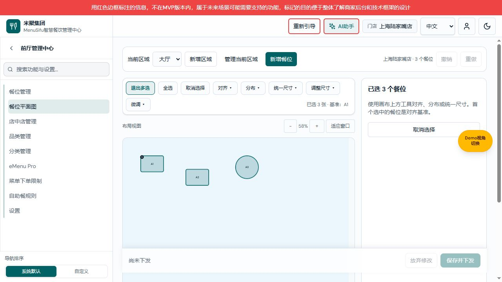

图注：餐位平面图／三项多选／排版工具显示；2026-10-15，本地原生 Vite 页面，本次变更版本；数据为隔离测试样例，不是线上门店数据。

| 字段／操作 | 逻辑说明 |
|---|---|
| 多选 | 显式进入；正常模式Ctrl/Command点图形也进入；选择只作用当前区域。 |
| 退出多选 | 保留第一项并回到属性编辑；不撤销业务修改。 |
| 全选 | 仅多选模式可用，选中当前区域全部餐位，不包括其他区域。 |
| 取消选择 | 清空全部当前选择；工具条与右侧按钮效果相同，不回滚布局。 |
| 已选N张 | 当前有效ID数量；两项以上额外显示基准餐位名称。 |
| 基准1标记 | 第一项为对齐/统一尺寸基准，画布标记1；取消基准后下一项成为基准。 |
| 对齐 | 至少2项显示；左/右/上/下/水平中心/垂直中心与第一项对应边线一致；超出边界拒绝整次操作。 |
| 分布 | 至少3项显示；按左右或上下位置排序，保留两端范围，平均分配剩余间距；空间不足拒绝。 |
| 统一尺寸 | 至少2项显示；宽或高等于基准，其他维度保持。 |
| 调整尺寸 | 有选择才显示；每次增宽/减宽/增高/减高5逻辑单位，减宽下限60、减高下限40；超界拒绝。 |
| 微调 | 有选择才显示；向左/右/上/下每次5逻辑单位；所有选中餐位作为同一次历史提交。 |
| 多选侧栏 | 显示选择数量和基准说明，不展示单餐位表单。 |

### 当前区域无餐位

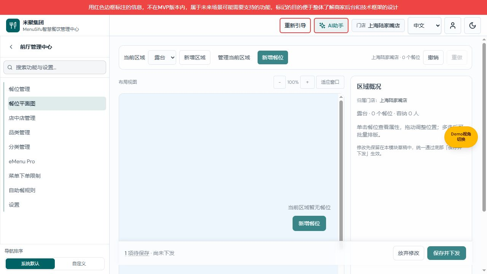

图注：平面图／空区域创建引导；2026-10-15，本地原生 Vite 页面，本次变更版本；数据为隔离测试样例，不是线上门店数据。

仅突出新增餐位，隐藏批量排版工具；无区域则突出新增区域。此图采于本次早期实现，最终版本首次进入会自动适应窗口，空态提示在可见画布内居中。无区域独立截图尚未采集，不以空区域图冒充无区域图。

## 餐位属性面板（管理页和平面图共用）

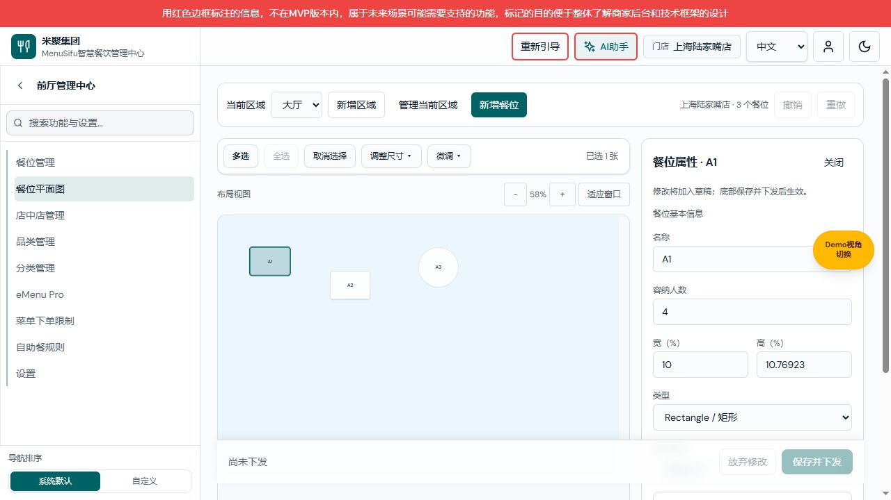

图注：属性面板／单选餐位／基本字段；2026-10-15，本地原生 Vite 页面，本次变更版本；数据为隔离测试样例，不是线上门店数据。

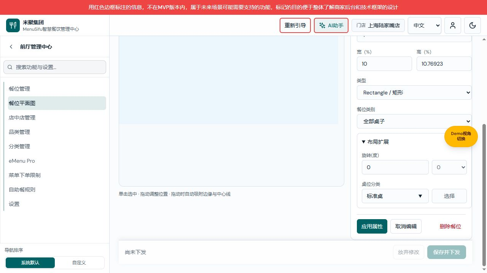

图注：属性面板／展开扩展／下部操作；2026-10-15，本地原生 Vite 页面，本次变更版本；数据为隔离测试样例，不是线上门店数据。

用途／入口：列表编辑、画布单击或定位后展示；对象为一个餐位；打开时复制其当前业务草稿，不改变业务值。

### 基本信息

| 字段／操作 | 逻辑说明 |
|---|---|
| 名称 | 必填字符串，新增默认T+当前区域数量加1；应用时trim并大写，当前门店跨区域唯一，排除当前ID；为空或重名提示并保留输入。 |
| 容纳人数 | 必填正整数，新增4，编辑原值；0、负数、小数、空值均不通过。 |
| 宽（%） | 当前宽/1000×100，显示最多5位小数；输入有限数>0且<=100；新增另沿用宽至少60逻辑单位即6%。不编辑时保留精确原宽。 |
| 高（%） | 当前高/650×100，显示最多5位小数；输入有限数>0且<=100；新增另沿用高至少40逻辑单位，即约6.15385%。不编辑时保留精确原高。 |
| 类型 | 必选rectangle/circle/oval/bar/ktv；切换更新新增预览形状及条件字段，映射真实桌型沿用研发版。 |
| 餐位类别 | 候选来自既有连接类别，默认全部桌子(ID1)；已有未知值显示未知值并保留ID；这是源系统类别，与下面本地桌位分类不同。 |

### 布局扩展

| 字段／操作 | 逻辑说明 |
|---|---|
| 布局扩展折叠 | 默认收起，仅展示已有本地扩展，不承诺写入KPOS。 |
| 旋转(度) | 默认0，整数步进，快捷0/45/90/135/180/270；选择快捷值与直接输入均更新表单草稿。 |
| 桌位分类 | 沿用standard/booth/bar/private/ktv及对应中文标签，默认标准桌；命中已定义类别才改变枚举，未知输入沿用原值。 |
| 应用属性 | 校验成功后把表单归并到本模块草稿，保留面板；不直接外部写入。失败显示内联提示并聚焦字段。 |
| 取消编辑 | 丢弃此面板尚未应用的输入并关闭，不撤销此前拖动、其他餐位编辑或已应用的值。 |
| 关闭 | 与取消编辑相同，清空选择并关闭；保存确认框存在时Escape只关闭确认框，不连带取消属性。 |
| 删除餐位 | 针对当前餐位确认删除；本地进入删除草稿，真实模式使用中或运行人数>0拒绝；真正外部删除只在确认下发后执行。 |

### 校验提示状态

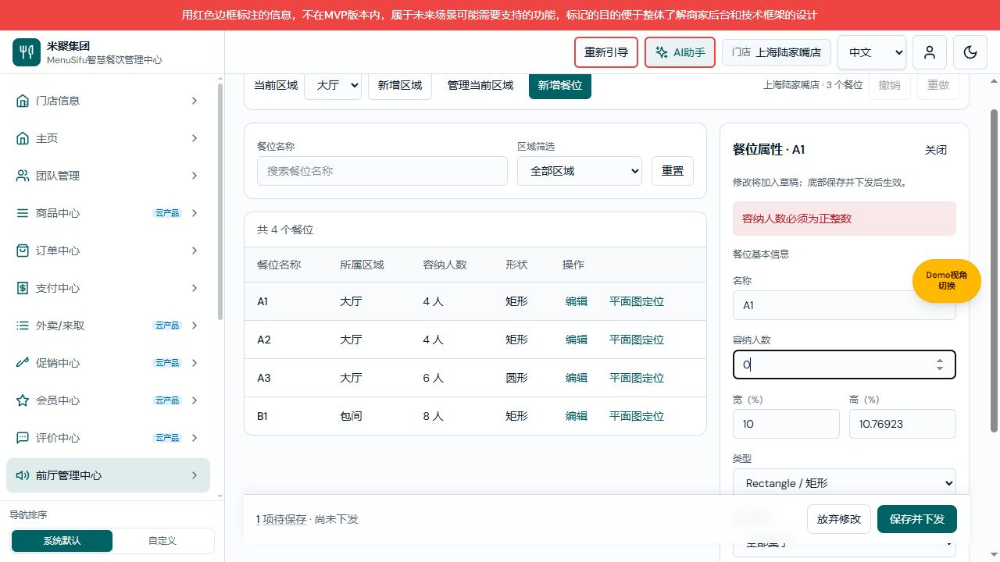

图注：属性面板／容纳人数错误／原区域保留；2026-10-15，本地原生 Vite 页面，本次变更版本；数据为隔离测试样例，不是线上门店数据。

如输入0并切换区域，提示“容纳人数必须为正整数”，保留原区域和输入，焦点回到人数；修正后可继续，取消编辑恢复原配置容量。其他字段同样在应用/切换/保存前校验。

## 新增餐位抽屉

图注：新增餐位／非模态抽屉／预览；2026-10-15，本地原生 Vite 页面，本次变更版本；数据为隔离测试样例，不是线上门店数据。

用途／入口：当前区域“新增餐位”按钮；对象为未创建的餐位草稿。基本字段与属性面板共用，新增默认矩形、4人、宽80/高60逻辑单位。

| 字段／操作 | 逻辑说明 |
|---|---|
| 目标区域 | 必选当前门店区域，默认顶部当前区域；切换后保留已填属性，按目标区域重新寻找空位并更新预览。 |
| 预览图形 | 虚线与预览标记区别于已创建餐位；名称/形状/宽高/旋转随输入变化，可在画布拖动落点；取消不创建餐位。 |
| 空间不足警示 | 无合法空位时提示可能重叠，创建时再次确认；取消重叠确认保留抽屉，确认后仅进入草稿。 |
| 创建餐位 | 按本节及基本字段规则校验；新餐位必须在逻辑画布内，名称门店唯一。成功加入目标区域，关闭抽屉并选中新餐位；外部生效仍需保存下发。 |
| 取消/关闭 | 删除本次新增预览和输入，不影响已存在餐位及其他草稿。 |
| 其他操作阻断 | 未创建时切区域、选其他餐位、批量排版、保存前提示先创建或取消；可继续操作画布上的新增预览。 |

### 铁板桌条件

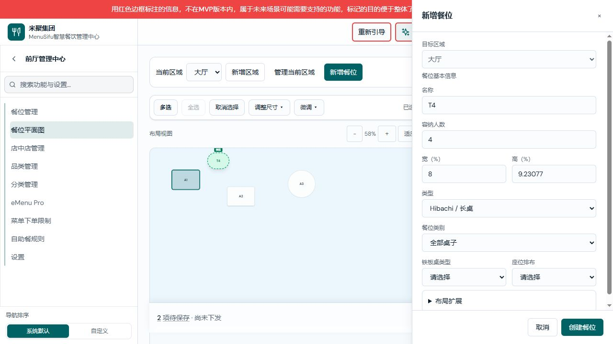

图注：新增餐位／铁板桌条件字段；2026-10-15，本地原生 Vite 页面，本次变更版本；数据为隔离测试样例，不是线上门店数据。

| 字段／操作 | 逻辑说明 |
|---|---|
| 铁板桌类型 | 类型为Hibachi时显示且必选；Default (3-4-3)、2-4-2、4-4-4对应0/1/2。 |
| 座位排布 | 类型为Hibachi时显示且必选；Left/Right对应0/1；缺值阻止创建或应用。 |

### 卡拉 OK 条件

图注：新增餐位／卡拉OK房间候选为空；2026-10-15，本地原生 Vite 页面，本次变更版本；数据为隔离测试样例，不是线上门店数据。

| 字段／操作 | 逻辑说明 |
|---|---|
| 卡拉 OK 房间 | 类型KTV时显示且必选；来自现有KTV商品源；无候选保持请选择并阻止保存，不生成虚假房间。切换非KTV清空该关联。 |

## 新增区域弹框

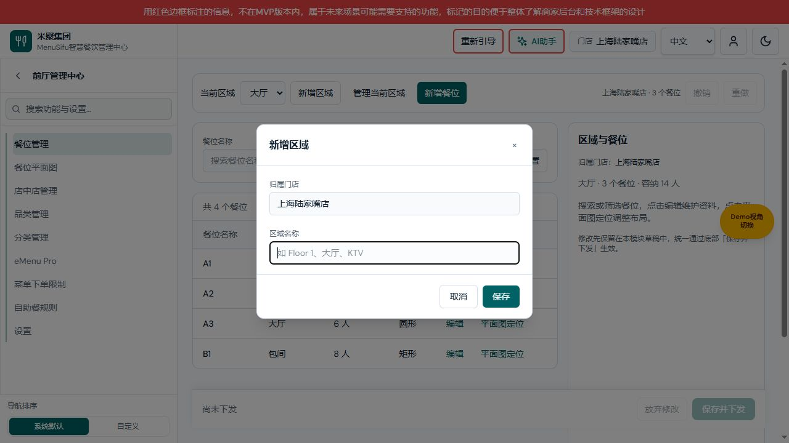

图注：新增区域／名称空／门店只读；2026-10-15，本地原生 Vite 页面，本次变更版本；数据为隔离测试样例，不是线上门店数据。

用途／入口：顶部新增区域或无区域引导。对象为当前门店的新区域。

| 字段／操作 | 逻辑说明 |
|---|---|
| 归属门店 | 当前门店只读，不能在弹框内跨店创建。 |
| 区域名称 | 必填字符串，默认空，trim；例大厅、包间、露台。本次不新增未确认的长度或唯一规则。 |
| 保存 | 非空后生成区域ID及空餐位数组，进入模块草稿，当前区域切换到新区域；失败保留弹框，不外部写入。 |
| 取消/关闭/遮罩/Escape | 关闭弹框不新增区域，保持已有业务草稿。 |

## 编辑区域弹框

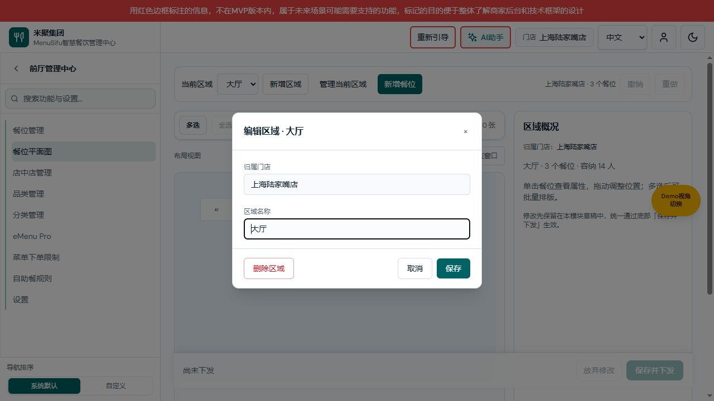

图注：编辑当前区域／大厅；2026-10-15，本地原生 Vite 页面，本次变更版本；数据为隔离测试样例，不是线上门店数据。

用途／入口：管理当前区域，携带活动区域ID。

| 字段／操作 | 逻辑说明 |
|---|---|
| 归属门店 | 沿用当前门店只读。 |
| 区域名称 | 回填原名，必填trim；保存替换该区域name，餐位ID和归属不变。 |
| 保存 | 应用区域名称到草稿；不直接下发。 |
| 删除区域 | 本地模式确认删除区域及其全部餐位；取消确认保留；撤销可恢复完整区域。真实KPOS模式保留不允许删除限制。 |
| 取消/关闭/遮罩/Escape | 不应用本次区域名称输入，不影响此前已应用的修改。 |

## 统一保存确认

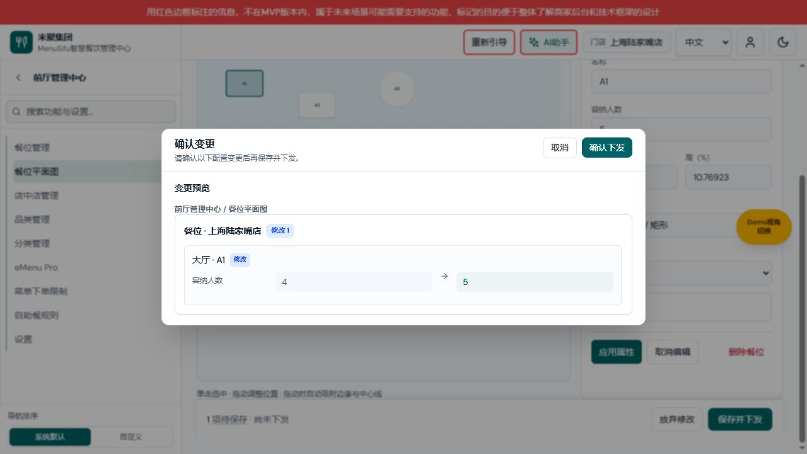

图注：统一保存确认／字段前后值；2026-10-15，本地原生 Vite 页面，本次变更版本；数据为隔离测试样例，不是线上门店数据。

用途／入口：两个业务页共用底部保存栏和同一业务草稿。

| 字段／操作 | 逻辑说明 |
|---|---|
| 待保存项数 | 由真实集合diff和表单投影产生，不含选择、视图比例、筛选和无关设置初始化；点击只查看预览，不发外部写请求。 |
| 下发状态 | 沿用既有状态，不把已创建下发批次描述为全部终端已经成功。 |
| 放弃修改 | 二次确认后恢复本模块业务基线、清除表单及历史；取消保留。 |
| 保存并下发 | 有真实变更才启用；校验并归并表单后展示确认框，同页重复点击不生成并发保存。 |
| 确认变更标题/说明 | 说明本次配置前后值；目标为当前门店既有下发范围，不在此新增授权。 |
| 变更分组/对象/字段/原值/新值 | 按区域和餐位对象显示；类别ID按名称展示，不把字符串1展示成开启。 |
| 取消/关闭/遮罩/Escape | 关闭确认框，不发送Save/Delete，不丢弃业务草稿。 |
| 确认下发 | 先执行确认后提交钩子；成功沿用下发流程并更新基线、清空历史；失败不清除待保存项，不能显示成功。 |

### 保存失败状态

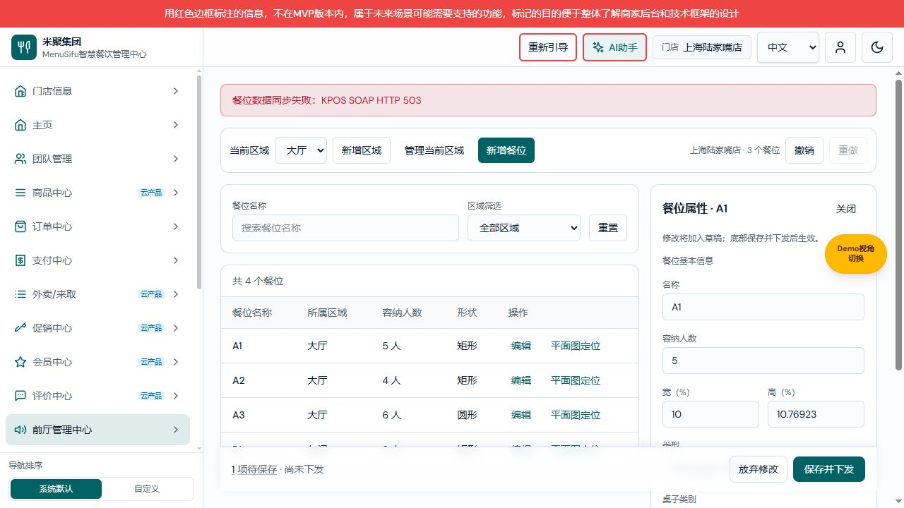

图注：模拟外部保存503失败／修改值及待保存项保留；2026-10-15，本地原生 Vite 页面，本次变更版本；数据为隔离测试样例，不是线上门店数据。

显示同步失败原因，保留修改值、历史和待保存项，可修正或重试。真实外部多步写入存在部分成功可能，不自动承诺回滚，不撤销操作账本。此图使用完全隔离模拟服务。

## 离开模块确认

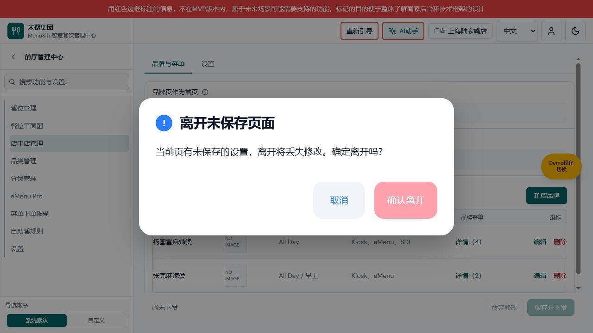

图注：2026-10-15，本次原生项目隔离测试；尝试进入店中店管理时提示餐位草稿未保存。

| 字段／操作 | 逻辑说明 |
|---|---|
| 离开未保存页面标题 | 仅离开餐位共享保存键且有真实草稿时触发；管理页与平面图互跳不触发。 |
| 提示正文 | 明确离开将丢失未保存修改；目标页可先挂载，但确认前保留原页面键及业务草稿。 |
| 取消／Escape／遮罩 | 返回原地址，保留表单输入与业务草稿；浏览器已验证A1容量5仍保留。 |
| 确认离开 | 清除页面变更并通知业务恢复baseline；浏览器验证返回餐位管理后A1容量为4、保存按钮禁用。 |

## 验证记录与未闭合项

已完成：TypeScript、专项脚本、页面初始化回归；浏览器搜索/区域交集、列表定位、单选侧栏、多选对齐、文字与菜单留白实际点击、内联校验保留、取消、撤销、约58%缩放真实指针拖动、区域与餐位新增、本地统一保存。模拟请求日志验证确认前和取消无写入、确认后一次失败写请求且草稿保留。

未执行真实KPOS成功写入、真实终端下发完成、部分成功人工恢复；不代表已上线。缺图：无区域初始状态、真实删除拦截状态及真实终端下发结果（没有对线上数据做验证）；已有空区域、字段错误和模拟保存失败图不得冒充这些状态。历史新增尺寸与编辑尺寸下限不同，已在字段和研发版登记，本次不扩大为业务规则统一。

## 保存中交互保护

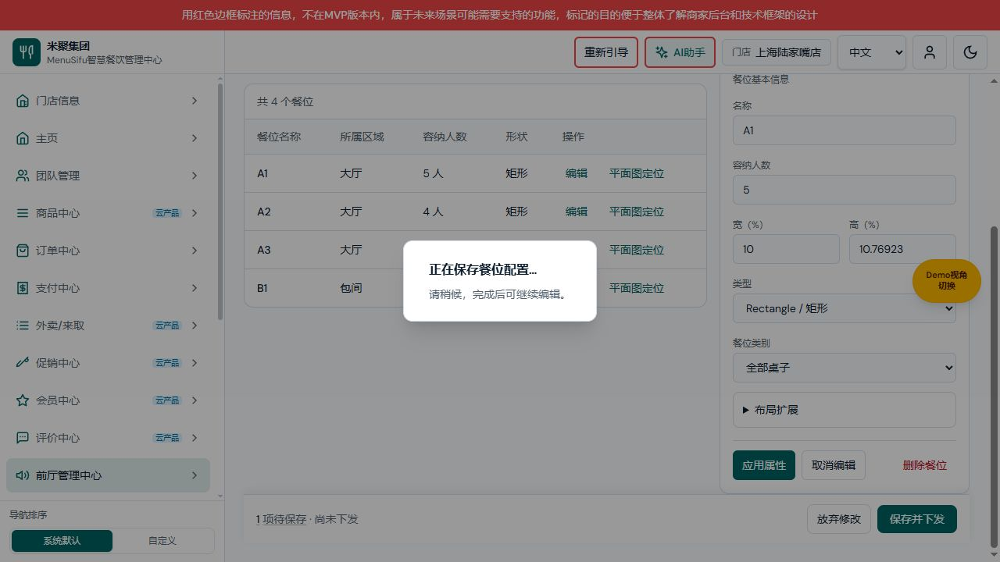

图：隔离模拟接口延迟响应期间的保存状态，FOH-20261015-01；失败后保留容量5与待保存草稿。

确认下发后至本次同步成功或失败期间，显示“正在保存餐位配置…请稍候，完成后可继续编辑”。整个应用内容临时设为inert，阻止属性、画布、撤销/重做、放弃、导航、门店及连接切换操作；成功和失败均恢复此前可交互状态，避免请求期间的新输入被回读快照覆盖。浏览器关闭/刷新仍按既有操作账本恢复边界处理，不承诺远端事务回滚。
