# 权限管理中心 Demo 数据与验证记录

范围：权限总览、M 平台角色、商家后台访问角色、员工与账号、集中变更记录。变更编号 PERMISSION-DEMO-SCENARIOS-20261103-01；基线 main@0cd32dea；分支 codex/permission-center-demo-20261103；功能端口 5319。用户已授权提交、合并、推送，实际 Git 结果以交付核验为准。

本文件是测试资料，不定义产品授权规则。业务文档配对版本保持 V1.14：[产品权威](../项目文档/M平台内部权限产品权威需求文档.md)、[研发规格](../项目文档/M平台内部权限业务规格说明书（研发交付版）.md)、[个人规范](../项目文档/M平台内部权限需求文档（个人规范版）.md)。

## 样例及保护边界

默认目录有 7 个 M 角色、5 个商户角色、6 位员工；M 已绑定员工 5 位（含停用样例），M 合成日志 13 条，商户合成日志 9 条。统计为绑定数量，不代表停用员工可访问。

两类授权仅在对应存储键不存在时初始化；已有合法空/非空快照不补写、不覆盖、不复活已删除样例。空字符串或损坏 JSON 报错，不静默重置。已有账号沿用既有种子合并，只添加保留 ID/邮箱的演示账号；账号启停、密码等现有值不覆盖。保留身份不匹配时不生成额外绑定，缺品牌或门店时跳过对应范围。不增加品牌或门店已开通菜单，不变更系统兼容管理员身份。故已有保存浏览器可能看不到完整默认样例，不应清空用户数据来演示。

合成记录 actor 为演示数据（非真实操作人）、action 以演示：开头，固定样例时间为 2026-11-03；记录不含密码或账号凭据，不代表真实操作历史。M 记录包含新建、复制、编辑、删除历史样例和员工绑定；前后值按对象范围记录。后续用户保存仍产生原有本地实际操作记录。

## 员工场景

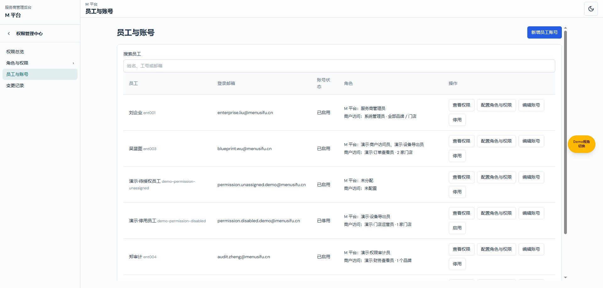

截图来源：2026-11-03、当前功能分支、外部 Chrome、5319 隔离演示目录。

| 员工 | M 角色 | 商户授权 / 用途 |
| --- | --- | --- |
| 刘企业 ent001 | 系统管理员 | 系统兼容范围，只读商户配置；唯一可管理角色与授权的启用管理员 |
| 周预设 ent002 | 预设配置员、商户访问员 | 张记火锅品牌概览＋上海陆家嘴店运营；两类角色和范围编辑、保存、预览 |
| 吴蓝图 ent003 | 商户访问员、设备导出员 | 两家指定门店订单查看；多角色并集、只读页独立导出动作 |
| 郑审计 ent004 | 权限审计员 | 茶语一家品牌财务查看；M 权限中心只读、禁止写操作 |
| 演示·待授权员工 demo-permission-unassigned | 无 | 无商户绑定；添加授权、首次分配和未授权空态 |
| 演示·停用员工 demo-permission-disabled | 设备导出员 | 上海陆家嘴店运营绑定保留，账号停用，两个维度均不生效 |

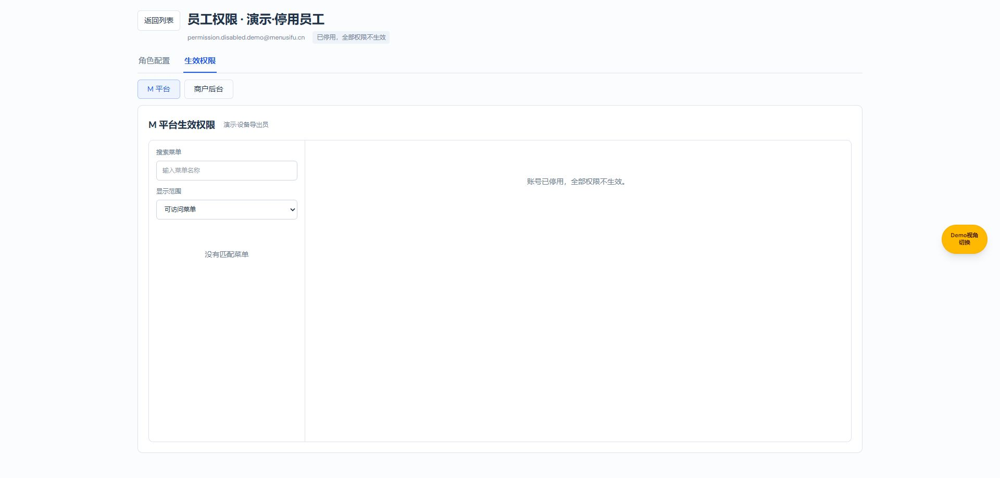
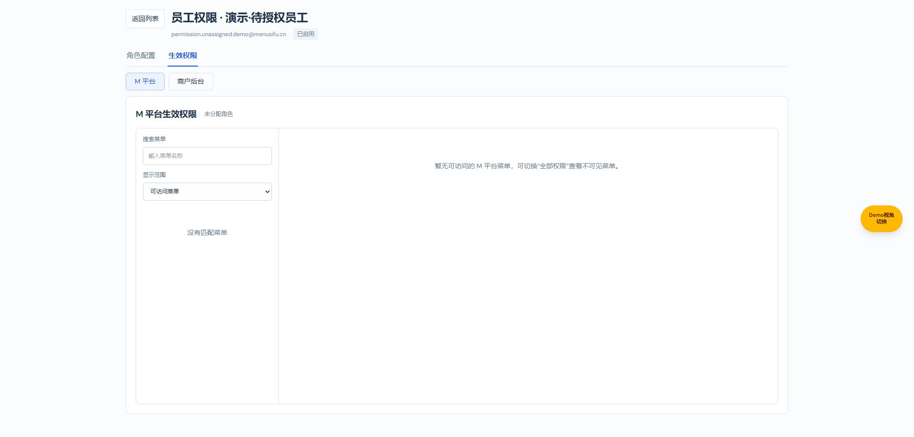
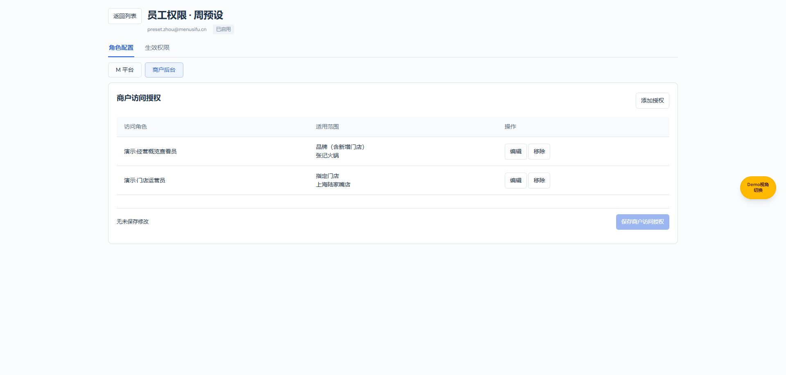

## 角色、成员与操作准备

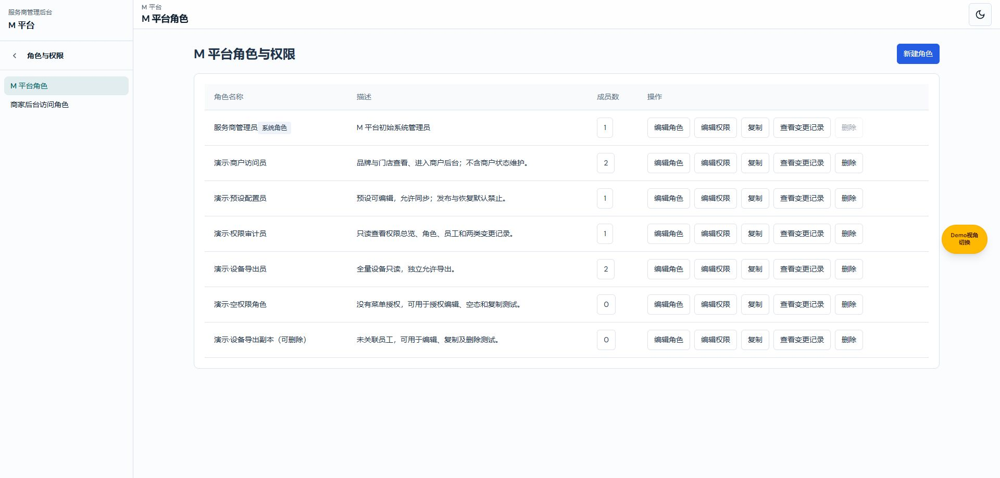
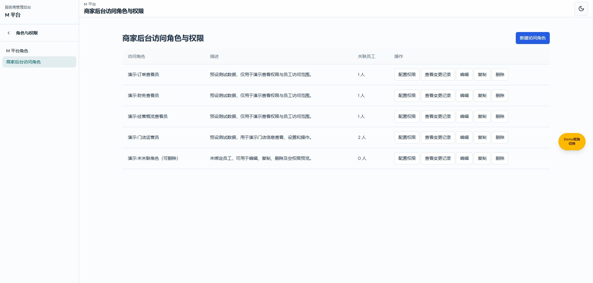

| 操作 | 可用样例 | 验证结果 |
| --- | --- | --- |
| M 新建角色 | 系统管理员入口；空权限角色作为配置参考 | 已打开表单、验证空名称失败、取消；未新建额外角色 |
| M 编辑角色 | 演示·权限审计员 | 已验证名称/描述回填并取消，未修改样例 |
| M 复制角色 | 演示·设备导出副本（可删除）及其他普通角色 | 已打开复制表单并取消，工厂中副本与源授权相同 |
| M 编辑权限 / 效果预览 | 预设配置员：页面可编辑、允许同步、禁止发布恢复；设备导出员：页面只读、允许导出 | 领域测试通过；该轮浏览器独立权限编辑/保存未完整执行 |
| M 成员查看 | 设备导出员关联吴蓝图与停用员工；空权限角色 0 人 | 已查看 2 人成员弹框并取消 |
| M 删除保护 | 系统角色、已关联商户访问员 | 系统删除禁用、已关联角色删除被拒绝 |
| M 可删除样例 | 设备导出副本、空权限角色，均未关联 | 已触发原生确认；未确认删除。原生层关闭未核实；后续未再执行该确认 |
| 商户角色新建 / 编辑 / 复制 / 权限配置 | 订单、财务、概览查看员、门店运营员 | 5 行及入口已核实；逐个表单/保存未全部重跑 |
| 商户删除 / 保护 | 未关联角色可用于删除；运营员有 2 人绑定用于保护 | 工厂数据与成员数已核实；未执行删除 |
| 员工新增 / 编辑账号 | 待授权与停用账号 | 记录已存在、状态正确；未输入或修改任何密码，表单/保存未重跑 |
| 员工启用 / 停用 | 默认停用员工与普通启用员工 | 启用/停用入口及状态已核实；未执行状态切换 |
| 分配 M 角色 | 两位多角色、只读审计、待授权员工 | 绑定/并集及禁写测试通过；该轮新增分配保存未重跑 |
| 商户添加 / 编辑 / 移除 / 保存 | 周预设两条绑定、待授权员工无绑定 | 页面绑定已核实；数据与范围测试通过，新增保存等实际写入未重跑 |
| 双维生效 / 目标切换 | 多角色、停用、未授权及品牌/门店范围 | 停用和未授权页面实测；范围、菜单上限及只读独立动作回归通过 |
| 角色搜索 | 7 个 M 角色，超过 5 个触发搜索条件 | 数据就绪；搜索交互未在该轮重跑 |

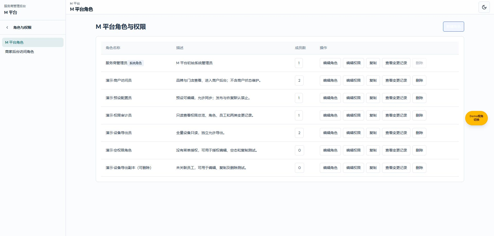
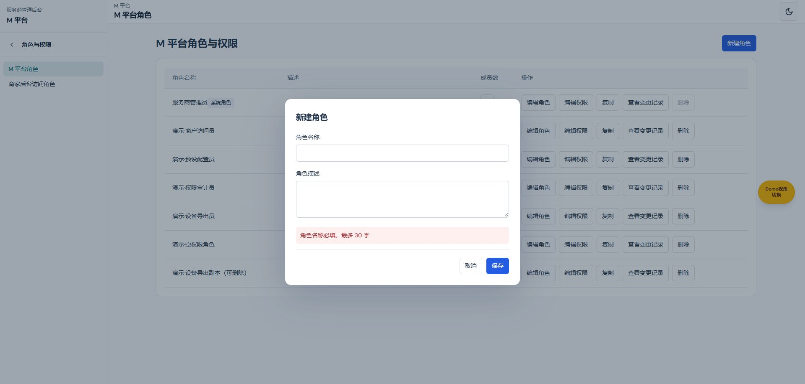
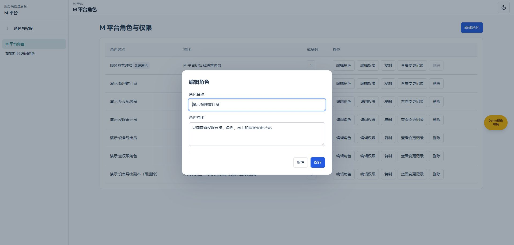
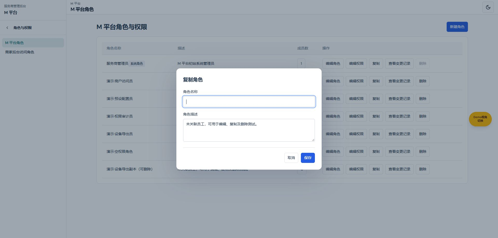
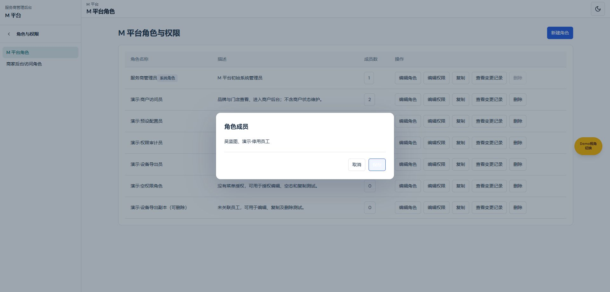
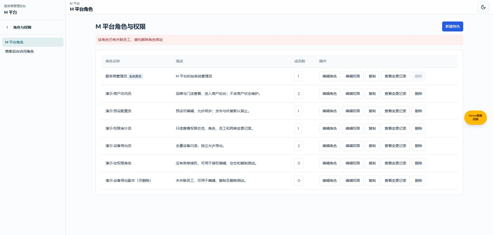

## 总览与记录

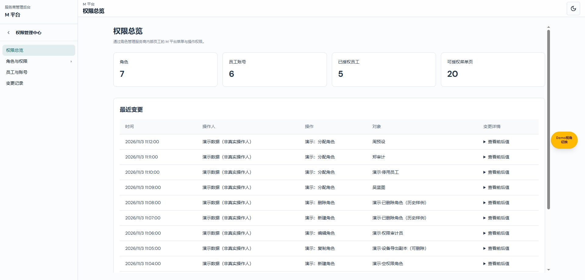
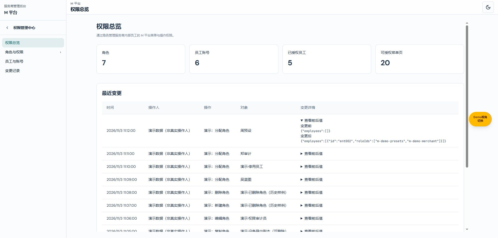
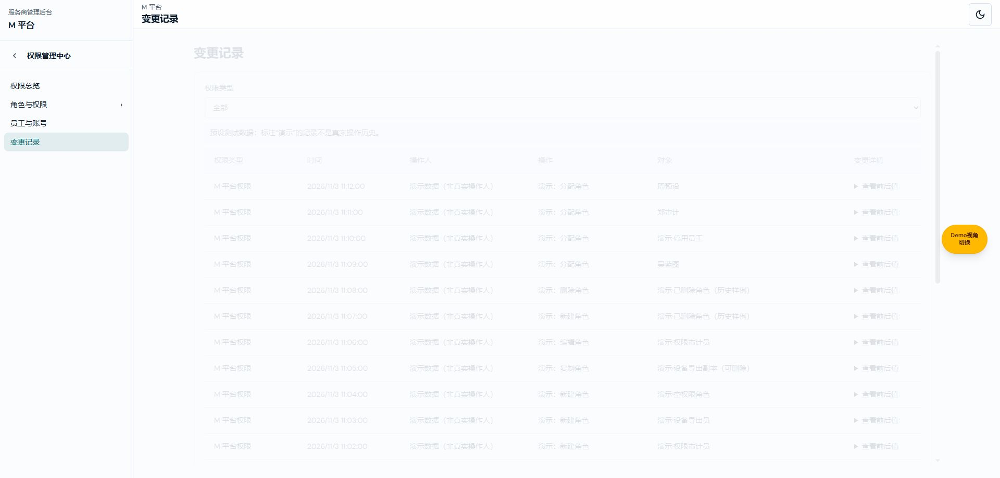

总览实测为角色 7、员工 6、绑定员工 5、菜单页 20；展开前后值不包含密码。集中记录实测 22 条（表头另 1 行）。M 与商户合成记录沿用明确演示标识；按来源/角色筛选、角色变化识别和隔离回归通过，集中页筛选/清除与展开的逐操作截图未补齐。

## 验证与缺口

TypeScript、verify-permission-center-demo、verify-provider-demo、verify-employee-access、verify-m-platform-permissions、verify-provider-access（16 项）、verify-permission-audit 均通过，git diff --check 通过。覆盖默认数量、唯一管理员、多角色、只读独立输出、禁写、停用、未授权、精确身份、冲突账号、品牌/门店范围、缺目录跳过、既有授权快照与坏 JSON、日志角色匹配及凭据排除。

先前浏览器原生删除确认导致自动化无法可靠识别窗口 URL，浏览器验证中断；没有确认删除。恢复后的浏览器验证只读地核实员工、商户角色、22 条记录、双绑定与两个空态。未做全量操作成功/失败/取消截图，不声称每个操作已实际验收。生产鉴权、真实账号服务、CI 和部署不属于本地演示验证。
