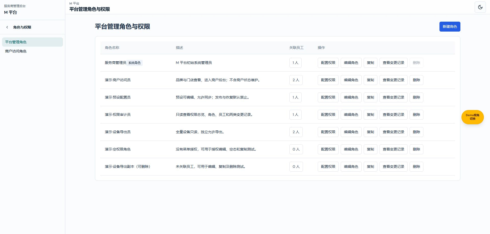
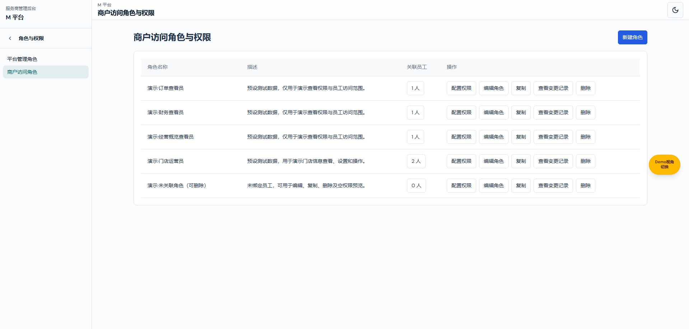

# 权限角色命名验证记录

ROLE-NAMES-20261103-01；2026-11-03。起始main@44cb0cf7，任务开始已成功获取远端并同步管理main；分支codex/permission-role-names-20261103，未提交。
实际目录：C:/Users/27273/.codex/worktrees/permission-role-names-20261103/new-bp/admin-web；功能预览端口5323，外部Chrome，不是main预览。

- TypeScript检查通过；`git diff --check`通过。
- `verify-m-platform-permissions.ts`、`verify-provider-access.ts`、`verify-employee-access.ts`、`verify-permission-center-demo.ts`通过。
- 内联目录断言：两个短导航名、完整列表页头及原编辑路由归属正确，稳定id仍为roles/provider-roles。
- 外部Chrome：两类导航及双列表应用页头/正文标题一致；员工两个配置维度、保存按钮、空角色提示及两个生效权限标题采用新称谓。商户维度仍保留角色与范围，并单独保存。
- 记录类型显示平台管理权限／商户访问权限，筛选商户类型后URL仍为type=provider且原记录可见；记录内容不改写。
- 验证仅查看与切换；未保存业务角色或授权、未新增删除角色。确认弹框/离开提示文字作源码核对，未为文案验证额外制造权限变更。
- 当前命名涉及的页面新图位于images/permission-role-names。既有历史记录及历史截图未批量改写/重拍，不作为当前命名证据；其他业务模块名称（如商家订阅）不在本次角色命名范围。
- 未单独覆盖全部受限账号组合与生产鉴权，不将局部回归视为全项目端到端验收。

