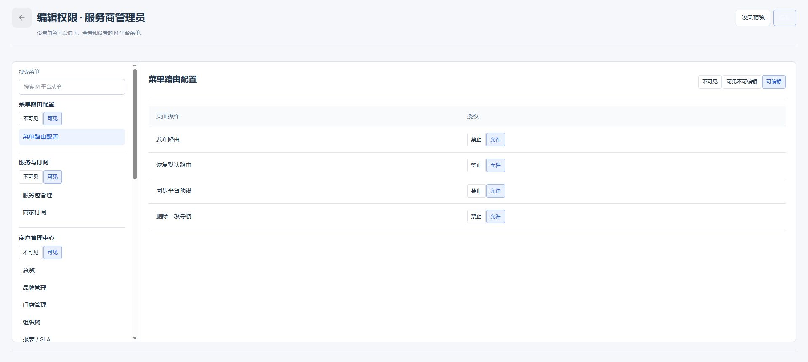
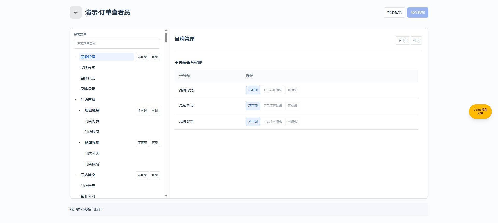
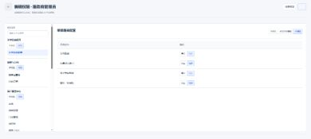

# 独立页面返回按钮样式验证记录

日期：2026-11-03；编号STANDALONE-BACK-20261103-01。
基线：成功获取origin/main并核对主线为c3dee8cb（上一项ecc251e8及后续CI构建提交）；独立功能分支codex/standalone-back-style-20261103，当前未提交。
目录：`C:/Users/27273/.codex/worktrees/standalone-back-style-20261103/new-bp/admin-web`。
预览：外部Chrome，端口5321，`http://127.0.0.1:5321/#/m-platform/permissions/roles/edit/m-system-admin`，服务工作目录为本功能目录。

## 参考与覆盖

参考用户提供截图及`dist/Configuration center/assets/order-limit-flow.css`的`.olf-icon-button`、`order-limit-flow.js`的头部`icon("back",20)`：48×48、12px圆角、20px SVG、stroke-width1.8，背景rgba(0,0,0,.04)、前景rgba(0,0,0,.45)，hover背景rgba(0,0,0,.08)。未修改参考页面。

共享入口`src/ui/standalone-page-header.ts`仅处理明确的返回槽；所有已接入的原生独立页沿用同一输出，页面族范围见[页头覆盖记录](独立页面头部布局验证记录.md)。不全局扫描按钮、不改变原a/button语义、链接、data-*和事件；只改可见展示并补可访问名称。异常/多控件返回槽原样输出。普通列表、内容和步骤返回、弹框/抽屉、嵌入子应用内部不扩展处理。

## 浏览器实际结果

| 场景 | 结果 |
| --- | --- |
| M角色权限编辑button返回 | DOM尺寸48×48，radius12px，SVG20×20；背景rgba(0,0,0,.04)、颜色rgba(0,0,0,.45)；textContent为空，aria-label/title均为返回，data-mp-do=back保留 |
| 原按钮返回行为 | 实际点击后回到/m-platform/permissions/roles，未修改角色权限 |
| 商户访问角色a返回 | 原a标签与href=#/m-platform/permissions/provider-roles保留，尺寸48×48，textContent为空，aria-label为返回列表 |
| 原链接返回行为 | 实际点击回到/m-platform/permissions/provider-roles |
| 键盘 | 从效果预览Shift+Tab到返回，focus-visible=true，outline为solid，焦点可见 |
| 暗色 | 通过主题按钮临时切换，测得背景rgba(255,255,255,.08)、前景rgba(255,255,255,.65)；随后已恢复浅色 |
| 窄屏390px | 返回仍48×48，位于标题左，页头无横向溢出，右操作在视口内；视口已恢复 |
| 悬停/禁用/异常槽 | hover定义对照参考CSS；禁用、属性和异常槽由纯渲染测试覆盖；未逐一模拟所有页面的原有禁用场景 |

## 代码检查

- verify-standalone-back-control.ts：链接/按钮标签、href/target/rel、data-*、原disabled、可访问名称、SVG装饰、其他操作不受影响、异常槽以及data-class/data-title属性边界。
- verify-m-platform-permissions.ts、verify-provider-access.ts、verify-employee-access.ts通过。
- TypeScript与git diff --check均通过；不以登录或启动服务代替页面验收。
- 三份公共文档均V1.1、同一编号与基线，互链并引用本记录；AGENTS同步公共规则。

## 边界

本次实际浏览器覆盖按钮式和链接式代表页面及窄屏/主题/焦点，不宣称每个业务分支逐页复测；未提交业务数据、未变更权限/存储。未执行额外的服务包发布、硬件保存或草稿丢弃测试；这些行为仍由原处理器与既定业务规则负责。
