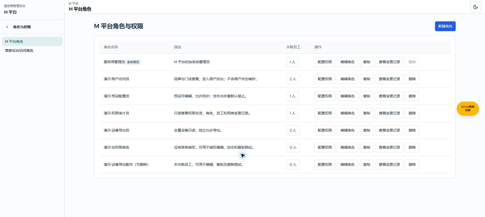
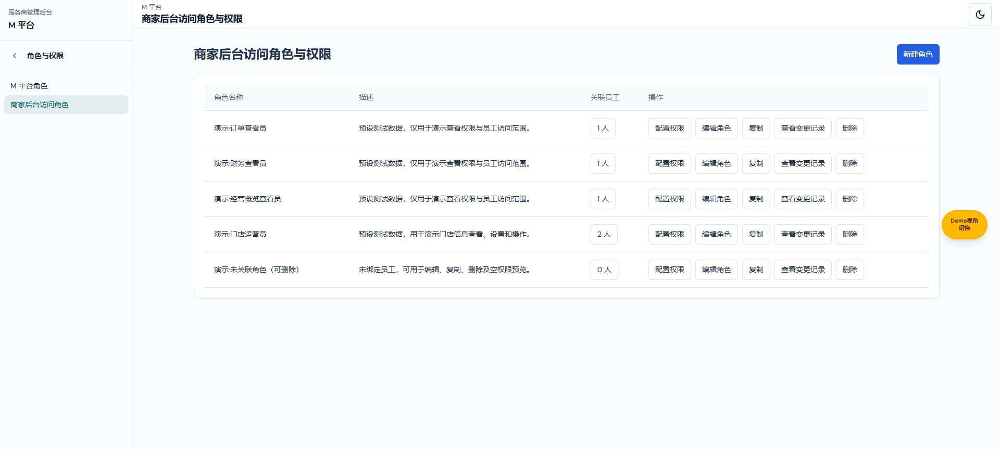
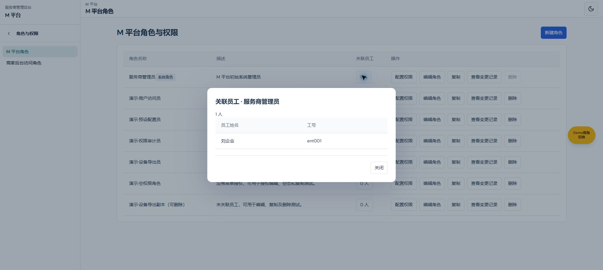
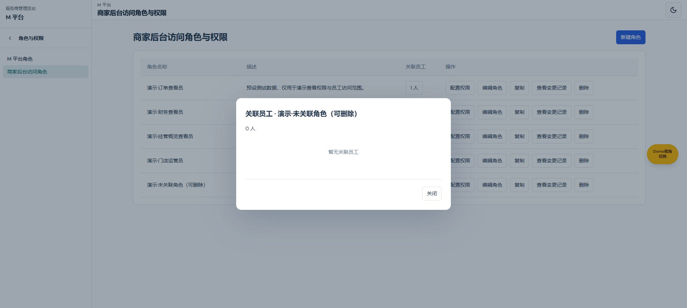

# 角色列表统一验证记录

变更ROLE-LIST-20261103-01；2026-11-03；起始main@2f7f6506；codex/role-list-consistency-20261103，未提交。
实际目录：C:/Users/27273/.codex/worktrees/role-list-consistency-20261103/new-bp/admin-web。服务端口5322，功能分支预览，非main。
远端main于任务开始成功获取，管理main已安全快进至2f7f6506；本任务未提交、合并、推送。

## 检查结果

- TypeScript `tsc --noEmit`通过。
- 内联Node断言通过：员工去重、空数组、表头与操作顺序、原disabled/href保留、HTML转义、目录缺失工号回退、零人空态、名单无form/submit/保存。
- `verify-m-platform-permissions.ts`、`verify-provider-access.ts`、`verify-permission-center-demo.ts`及`verify-permission-standalone-pages.ts`通过；原M权限门控、商户授权规则和演示数据有效。
- 外部Chrome真实页面：两列表标题区left372/top84/width1432，卡片left372/top142/width1432；四列278/444.8/111.2/556.0px一致，按钮顺序一致，系统角色删除仍禁用。截图见同目录images/role-list-consistency。
- 两类列表均验证非空及0 人名单：M为1 人／0 人，商户为2 人／0 人；两页关闭与Esc后焦点均返回原人数按钮。商户名单包含原已停用账号的配置关联，未静默减少人数。
- 商户新建／编辑／复制弹框标题、回填和取消已验证；未执行角色／授权保存或删除，测试未新增业务授权。
- 未单独覆盖窄屏实机、全权限组合及生产后端；本任务为展示统一，不声称完成全项目端到端回归或生产鉴权接入。

## 截图

最终 `git diff --check`通过。受影响的旧列表标题章节已收敛至当前“两类角色列表”定义；其他历史模块章节未批量治理，旧图不作为本变更验收依据。
